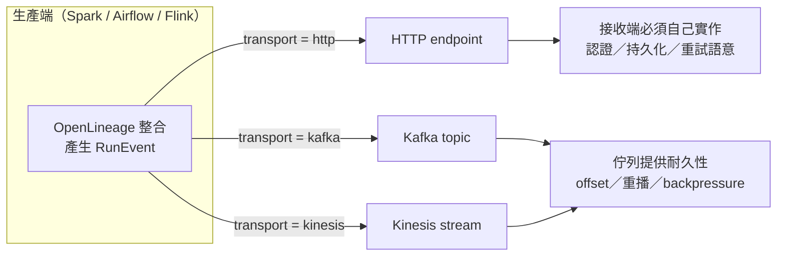
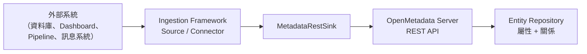
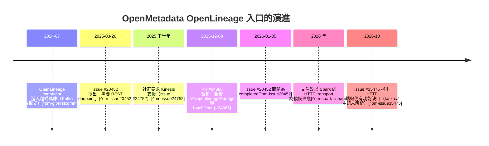

# 為什麼 OpenMetadata 的 OpenLineage Connector 要透過 Kafka / Kinesis，而不是直接開一個 HTTP endpoint 收事件？

## 摘要

OpenLineage 本身是一個「事件（event）」標準：像 Spark、Airflow、Flink 這類產生血緣的工具，會在 job 執行過程中把 `RunEvent`（START、RUNNING、COMPLETE、FAIL 等）送到某個傳輸層（transport），而 transport 可以是 HTTP、Kafka、Kinesis、file、console 等多種選擇[^ol-java-config][^ol-transports]。因此一個常見的疑問是：既然 OpenLineage 有標準的 HTTP transport，OpenMetadata 為什麼不一開始就開一個 HTTP endpoint 直接接收事件，而要求使用者先架 Kafka broker 或 AWS Kinesis Data Stream，再由 OpenMetadata 的 connector 去「拉」事件[^om-ol-docs]？

本文的結論是：**「必須用 Kafka / Kinesis」是 OpenMetadata 在 1.12.1 之前的設計事實，而不是不可改變的技術定律。** 其根源有三個層次：

1. **架構層次**：OpenMetadata 的 Ingestion Framework 是一套「拉取式（pull-based）」、可在任意平台外部執行的排程 workflow[^om-external][^collate-blog]。既有的每個 connector 都是「跑起來 → 主動向來源要資料 → 經 Sink 寫回 server 的 REST API」，也就是「來源必須是一個可以被主動輪詢（poll）的對象」；Kafka / Kinesis 這種「有 offset、可重播、可輪詢」的訊息佇列，天然符合這個模型，而 HTTP endpoint 則相反，屬於 push 模型。
2. **事件語意層次**：OpenLineage 事件是 job 執行期產生的非同步串流事件，帶有「累積式（additive）」與「可能延遲抵達」的性質[^ol-spec]。用佇列接收，可以得到耐久緩衝、重播（replay）、消費者進度（offset）控制等保證；相對地，OpenLineage 的 HTTP API 規格**並未定義任何認證機制**，503/錯誤時的重試責任落在生產端（producer）[^ol-openapi][^ol-java-config]。
3. **歷史層次**：OpenMetadata 直到 **2025 年 12 月 8 日 PR #24686** 才實作出原生的 HTTP 接收端點 `POST /api/v1/openlineage/lineage`（及批次端點）[^om-issue20452][^om-pr24686]。在那之前，Kafka（以及後來加入的 Kinesis）是唯一路徑；使用者的 feature request 就是在抱怨這件事[^om-issue20452]。

也就是說，正確的描述應該是：**在 1.12.1 之前，OpenMetadata 沒有 push 型入口，所以只能用佇列；1.12.1 之後，HTTP 已成為官方支援的一條路，而且新文件甚至把它當作 Spark 血緣的預設建議做法**[^om-spark-lineage]。

---

## 背景：兩個系統對「事件怎麼流動」的假設不同

要理解這個問題，必須先分清楚兩套系統各自的設計前提。

### OpenLineage 的角色：定義事件，不定義接收端

OpenLineage 是一個「規格（specification）」加上「一組整合（integrations）」：規格定義事件的資料結構（`RunEvent`、`Job`、`Dataset`、`Facet` 等），整合則負責從各系統收集事件[^om-ol-docs][^ol-spec]。它刻意把「事件長什麼樣」與「事件怎麼被送出去」分開，於是有了多種 transport。以 Java client 為例，官方文件列出的 transport 至少包含[^ol-java-config][^ol-transports]：

- `http`：以 HTTP POST 送出，預設 endpoint 為 `/api/v1/lineage`。
- `kafka`：送到 Kafka topic。
- `console`、`file`、`noop`、`composite`、`transform`。
- `kinesis`（Kinesis transport，另有 MSK IAM、DataZone、GCP Lineage、Datadog 等雲端專用 transport）。

值得注意的是，OpenLineage 官方**並沒有**把 HTTP transport 標記為「只能測試用」；被明確標為「主要供整合測試」的是 file transport，HTTP 反而提供 proxy、壓縮、`api_key`／`jwt`／`oauth2` 認證、Unix Domain Socket 等接近生產等級的設定[^ol-java-config]。所以「HTTP 只是玩具」的說法並不成立。

而 OpenLineage 的官方 OpenAPI 規格本身非常精簡，只定義兩個路徑[^ol-openapi]：

| 路徑 | 方法 | 說明 |
| --- | --- | --- |
| `/lineage` | POST | 送單一事件（RunEvent / DatasetEvent / JobEvent） |
| `/lineage/batch` | POST | 送一批事件 |

該規格**沒有任何 `security` 或 `securitySchemes` 區段**[^ol-openapi]。這代表：認證、授權、事件是否保證送達、伺服器不可用時怎麼辦，全都不在 OpenLineage HTTP 規格的管轄範圍內，而是「實作端自己要處理的事」。這正是為什麼「直接開一個 HTTP endpoint」對 OpenMetadata 而言不是零成本：它必須自己補齊規格沒給的東西。



### OpenMetadata 的角色：拉取式、可在外部執行的排程 workflow

OpenMetadata 的 Ingestion Framework 是「一個獨立元件，可以從——字面上的——任何地方執行」[^om-external]。它的設定檔以 `source` → `sink` 描述：source 負責抽取，sink 負責把資料寫回 server 的 REST API[^om-external]。



官方與 Collate（OpenMetadata 的商業公司）都明確將此定位為**拉取式**設計。Collate 的技術部落格直白地寫道[^collate-blog]：

> "As a result, OpenMetadata is designed to have pull-based ingestion."

同一篇文章甚至**反對**在 metadata 管線中額外插入 Kafka，理由是這樣會把「來源 → metadata 儲存」的兩跳（two hops）變成四跳（four hops），並舉自身 benchmark 為例[^collate-blog]：

> "The API-based approach completed ingestion in 10 minutes. The Kafka-based approach took 3 to 6 hours."

（此為廠商自己的 benchmark，見後文批判性反思。）

在這種「connector 是排程 workflow、要主動輪詢來源」的世界觀裡，「事件型來源」若不是一個可被輪詢的佇列，就會格格不入：**排程 workflow 沒有一個「被動等待別人 push」的常駐入口。** 這正是 OpenLineage connector 選擇佇列的架構理由。

---

## 直接原因：Kafka / Kinesis 才符合「可輪詢的事件來源」模型

### 官方文件的說法

OpenMetadata 官方 OpenLineage connector 文件的第一句話就把設計講白了[^om-ol-docs]：

> "OpenLineage connector consumes OpenLineage events from either a Kafka broker or AWS Kinesis Data Streams and translates them to OpenMetadata Lineage information."

對應的原始碼註解也重申同一件事。connector 的 `OpenlineageSource` 類別 docstring 寫著[^om-src-metadata]：

> "Works under the assumption that OpenLineage integrations produce events to Kafka topic or Kinesis stream, which is a source of events for this connector."

「source of events for this connector」是關鍵：在拉取式框架中，connector 需要一個「可以被當作來源輪詢」的東西，而 Kafka topic / Kinesis stream 就是那個東西。

### 佇列提供了 HTTP 規格沒提供的保證

實際閱讀 connector 的輪詢實作，可以看見佇列被用到的具體能力。Kafka 版本用 `while session_active` 迴圈持續 `consumer.poll()`，直到閒置超過 session timeout 才結束，這正好對應「一次排程執行」的生命週期[^om-src-metadata]：

```python
while session_active:
    message = consumer.poll(timeout=pool_timeout)
    ...
    yield result          # 交由 topology 處理，處理完才回來拿下一則
    consumer.store_offsets(message=message)
```

更有意思的是 offset 的處理方式。連線設定中關閉了自動 offset 儲存，並附上理由[^om-src-connection]：

```python
# The source stores each offset after its event is processed. The default
# stores it as soon as poll() returns the message, which commits an event
# before its lineage is written and loses it if the run stops mid-event.
"enable.auto.offset.store": False,
```

以及 `_poll_kafka` 的 docstring[^om-src-metadata]：

> "A message's offset is stored only when the topology resumes this generator, that is once the event it carries has been processed. ... a run that stops mid-event reads that event again next time instead of losing it."

這段程式碼把「為什麼是佇列」說得非常具體：**佇列提供的是 offset 語意，讓 OpenMetadata 能實作「處理完成後才提交進度」的 at-least-once 行為。** 若改用一個只有 POST 的 HTTP endpoint，這種「讀到 → 處理 → 才推進進度；中途掛掉就重讀」的機制必須由接收端自己從零打造（例如自己落地事件、自己管理游標），而 OpenLineage 的 HTTP 規格並沒有約定這些[^ol-openapi]。

下表整理兩種路徑在此框架下的差異：

| 能力 | Kafka / Kinesis（pull） | 純 HTTP endpoint（push） |
| --- | --- | --- |
| 與拉取式 workflow 的契合度 | 高，connector 主動 poll[^om-ol-docs] | 低，需 server 常駐入口 |
| 持久化 / 重播 | 佇列原生提供（offset、shard iterator）[^om-src-metadata] | 規格未定義，需自行實作[^ol-openapi] |
| 處理語意控制 | 處理後才 `store_offsets`[^om-src-connection] | 規格未定義重試語意[^ol-openapi] |
| 生產端與 OpenMetadata 解耦 | 是（server 離線時事件留在佇列） | 否（server 離線則事件遺失或需生產端重送） |
| 多消費者 | 同一 topic 可同時餵給多個系統 | 需自行轉發 |
| 認證 | 佇列層（SSL / SASL / IAM）[^om-ol-docs] | 規格無定義，實作端自訂[^ol-openapi] |
| 額外基礎設施成本 | 需架 Kafka 或 Kinesis[^om-ol-docs] | 無（複用既有 server） |

### Kinesis 的加入：同一個模型的延伸

Kinesis 不是另一個模型，而是同一個「可輪詢佇列」模型的雲端版本。對應的社群需求是 issue #24752，明確要求「在既有 Kafka 之外，也能把 Spark 血緣事件發佈到 Kinesis」，並「擴充 ingestion service 去拉取與解析 Kinesis 事件」[^om-issue24752]。實作 PR #26050 在 connector 中新增 `KinesisBrokerConfig`，並以多型的 `brokerConfig` 欄位與 Kafka 並列，實作 shard 列舉與 shard iterator（`TRIM_HORIZON` / `LATEST`）管理[^om-pr26050]。目前的 JSON Schema 也把這件事寫死成二選一[^om-ol-connection-schema]：

```json
"brokerConfig": {
  "description": "Event broker configuration. Choose between Kafka and Kinesis.",
  "oneOf": [
    { "$ref": "openlineage/kafkaBrokerConfig.json" },
    { "$ref": "openlineage/kinesisBrokerConfig.json" }
  ]
}
```

`required` 只列了 `brokerConfig`，換言之在 1.12.1 之前的連線模型裡，**「一定要有一個 broker」是 schema 層級的硬性要求**[^om-ol-connection-schema]。

---

## 歷史原因：HTTP 入口其實是後來的功能（PR #24686）

上述都是「為什麼當初選佇列」。但要回答「為什麼必須透過 Kafka / Kinesis」，最直接的事實是：**在此之前，OpenMetadata 根本沒有 OpenLineage 的 HTTP 接收端點。**

社群 issue #20452「Openlineage REST Endpoint Support」把問題描述得毫不含糊[^om-issue20452]：

> "Currently, the OpenLineage connector seems to only support Lineage events from Kafka."
> "Many products, for example Trino, enable sending Lineage data directly to a REST endpoint. It would be great if this can be supported in OpenMetadata."
> "Datahub supports REST endpoint for openlineage."

後續留言也點出需求面[^om-issue20452]：

> "Currently, OpenMetadata supports OpenLineage via Kafka-based event ingestion, which is great for specific use cases. However, adding a REST API endpoint for OpenLineage events (similar to DataHub's implementation) would offer many benefits."

該 issue 於 2026-01-05 被關閉為 completed，對應的實作是 **PR #24686「OpenLineage compatible APIs」**，於 **2025-12-08 合併**[^om-issue20452][^om-pr24686]。PR 新增了兩個端點[^om-pr24686]：

| 端點 | 用途 |
| --- | --- |
| `POST /v1/openlineage/lineage` | 接收單一 OpenLineage `RunEvent`（來自 Spark、Airflow、Flink、dbt 等） |
| `POST /v1/openlineage/lineage/batch` | 接收批次事件 |

以及一組伺服器端元件[^om-pr24686]：

- `OpenLineageResource`：處理單筆與批次事件與授權。
- `OpenLineageEntityResolver`：以「namespace → service 對應」與 FQN 查詢（含快取）把 OpenLineage dataset 解析成 OpenMetadata 的 Table；可依設定自動建立缺少的實體。
- `OpenLineageMapper`：把 `RunEvent` 轉成 `AddLineage` 請求，含欄位級血緣與 SQL 擷取。
- `OpenLineageSettings`：事件型別過濾、自動建立開關、namespace 對應、預設 pipeline service。

對應的 JSON Schema 目前存在於程式碼庫中，並自我描述為「OpenLineage HTTP API 整合的設定」[^om-ol-settings]：

```json
"description": "Settings for OpenLineage HTTP API integration.
 Configure how OpenMetadata receives and processes lineage events from external systems like Spark, Airflow, and Flink."
```

而有意思的是，**最新版的 Spark 血緣文件已經把 HTTP 當作預設建議路徑**，並宣告舊的自製 Spark agent 已被淘汰[^om-spark-lineage]：

> "The openmetadata-spark-agent.jar is superseded by the OpenLineage Spark listener — use the listener directly. ... OpenMetadata now consumes OpenLineage events natively over HTTP at POST /api/v1/openlineage/lineage, so you can point the upstream io.openlineage:openlineage-spark listener straight at OpenMetadata."

設定方式就是很標準的 OpenLineage HTTP transport[^om-spark-lineage]：

```python
.config("spark.openlineage.transport.type", "http")
.config("spark.openlineage.transport.url", "https://<your-openmetadata-host>")
.config("spark.openlineage.transport.endpoint", "/api/v1/openlineage/lineage")
.config("spark.openlineage.transport.auth.type", "api_key")
.config("spark.openlineage.transport.auth.apiKey", "<your-openmetadata-bot-jwt>")
```

---

## 時序整理



（2024-07 的時間點來自 `metadata.py` 於 2024-07-30 之前的提交紀錄[^om-git-firstcommit]；此為檔案層級的間接證據，非官方 release note。）

---

## 現況：HTTP 入口已存在，但有已知缺口

既然 HTTP 端點已經實作，就不能再簡單說「必須用 Kafka」。目前的實務狀況是**兩條路並存**，各有適用場景：

- **Kafka / Kinesis（拉取）**：適合已具備訊息基礎設施、需要耐久重播、或同一批事件要同時餵給多個系統（例如同時給 Marquez 與 OpenMetadata）的組織。
- **HTTP（推送）**：適合沒有 Kafka、且生產工具原生支援 HTTP transport 的環境（例如 Trino、以及新文件所建議的 Spark listener）[^om-spark-lineage]。

不過 HTTP 路徑仍不完整。issue #35475 明確指出：POST 到 `/api/v1/openlineage/lineage` 的事件**只會把 input/output dataset 解析成 table 實體**，不會把 `kafka://<host>:<port>` 的 dataset 解析成 topic 實體[^om-issue35475]：

> "The pull-based OpenLineage connector does match kafka://host:port to a Kafka service by bootstrapServers (#19482), but it reads events from a Kafka topic, not from this HTTP endpoint — so deployments using the HTTP transport get no Kafka lineage."

換句話說，**拉取式 connector 累積多年的解析邏輯（topic 對應、service 對應、快取等）並沒有自動平移到 HTTP 端點**，兩條路徑的行為至今存在落差[^om-issue35475][^om-issue19482]。這也從側面說明：為什麼當初選擇佇列是「順著框架」，而新增 HTTP 是「另外補一條 push 管線」——後者要追上前者需要時間。

---

## 批判性反思：這些來源可信嗎？

- **廠商文件與官方部落格的立場偏誤**：Collate 的〈APIs vs Kafka〉一文雖提供了 pull-based 的設計動機與 benchmark，但它是**廠商自己的行銷內容**，目的在論證「不需要 Kafka」，並以自家產品的架構為預設正確答案[^collate-blog]。其「10 分鐘 vs 3–6 小時」的比較未提供可重現的方法學，宜視為方向性指標而非嚴謹結論。
- **與本文主題的張力**：同一篇部落格實際上**反對**在 metadata 管線插入 Kafka，卻又是 OpenLineage connector 使用 Kafka 的廠商。合理化解讀是：一般 metadata 來源（資料庫、Dashboard）沒有事件串流，故不需要佇列；而 OpenLineage 是**第三方生產者主動產生的事件標準**，OpenMetadata 在其中扮演「消費者」而非「生產者」，因此例外地採用了消費者模型。此解讀與 connector 的 source 定位一致[^om-src-metadata]，但官方並未明文如此表述，屬本文的綜合推論。
- **一手 vs 二手證據**：本文多數關鍵結論來自**一手來源**（官方文件、OpenLineage 規格檔、OpenMetadata 原始碼與 JSON Schema），可信度較高。GitHub issue 內容為使用者與維護者的實際對話，屬於高價值的需求與缺口證據，但其中部分效能或因果敘述未經驗證。
- **時效性**：相關功能仍在快速變動（HTTP 端點 2025 年底才合併、2026 年仍有缺口 issue），任何「必須用 Kafka」的敘述都應標註查證日期。
- **規格層的空白**：OpenLineage 的 OpenAPI 規格缺乏認證與重試語意，是本文推論「HTTP 路徑成本較高」的核心依據；這是對規格檔的直接觀察，非臆測[^ol-openapi]。

---

## 結論

- **直接答案**：「必須透過 Kafka / Kinesis」反映的是 **OpenMetadata 1.12.1 之前的設計**。原因是它的 ingestion 框架是拉取式、外部執行的排程 workflow，需要一個**可輪詢、耐久、可重播**的事件來源，而 Kafka / Kinesis 正好符合；相對地，OpenLineage 的 HTTP API 規格不提供認證與重試語意，且當時 OpenMetadata 並沒有 push 型接收端點[^om-external][^collate-blog][^ol-openapi][^om-issue20452]。
- **佇列的具體價值**可從 connector 原始碼看見：以 `consumer.poll()` 迴圈取得事件、並以「處理完成後才 `store_offsets`」實作 at-least-once 語意[^om-src-metadata][^om-src-connection]。
- **這個限制已被部分解除**：PR #24686（2025-12-08 合併）新增 `POST /api/v1/openlineage/lineage`（及 batch），OpenLineage 的 HTTP transport 可直接指向 OpenMetadata；最新 Spark 文件甚至以此為建議做法[^om-pr24686][^om-spark-lineage]。
- **但仍非完全等價**：HTTP 路徑尚有已知缺口，例如 `kafka://` dataset 不會被解析成 topic 實體，而拉取式 connector 已支援[^om-issue35475]。

---

## 參考文獻

[^om-ol-docs]: OpenMetadata. (n.d.). *OpenLineage | OpenMetadata Data Lineage Pipeline*. Retrieved 2026-10-18, from https://docs.open-metadata.org/latest/connectors/pipeline/openlineage

[^om-ol-settings]: OpenMetadata. (n.d.). *openLineageSettings.json*. Retrieved 2026-10-18, from https://raw.githubusercontent.com/open-metadata/OpenMetadata/main/openmetadata-spec/src/main/resources/json/schema/configuration/openLineageSettings.json

[^om-ol-connection-schema]: OpenMetadata. (n.d.). *openLineageConnection.json*. Retrieved 2026-10-18, from https://raw.githubusercontent.com/open-metadata/OpenMetadata/main/openmetadata-spec/src/main/resources/json/schema/entity/services/connections/pipeline/openLineageConnection.json

[^om-external]: OpenMetadata. (n.d.). *Run the Ingestion Framework Externally*. Retrieved 2026-10-18, from https://docs.open-metadata.org/v2.0.x/deployment/ingestion/external

[^om-spark-lineage]: OpenMetadata. (n.d.). *Spark Lineage Ingestion*. Retrieved 2026-10-18, from https://docs.open-metadata.org/latest/connectors/ingestion/lineage/spark-lineage

[^om-src-metadata]: OpenMetadata. (n.d.). *metadata.py (openlineage source)*. Retrieved 2026-10-18, from https://github.com/open-metadata/OpenMetadata/blob/main/ingestion/src/metadata/ingestion/source/pipeline/openlineage/metadata.py

[^om-src-connection]: OpenMetadata. (n.d.). *connection.py (openlineage source)*. Retrieved 2026-10-18, from https://github.com/open-metadata/OpenMetadata/blob/main/ingestion/src/metadata/ingestion/source/pipeline/openlineage/connection.py

[^om-issue20452]: metalshanked. (2025, March 26). *Openlineage REST Endpoint Support* [Issue #20452]. GitHub. Retrieved 2026-10-18, from https://github.com/open-metadata/OpenMetadata/issues/20452

[^om-pr24686]: harshach. (2025, December 8). *OpenLineage compatible APIs* [Pull request #24686]. GitHub. Retrieved 2026-10-18, from https://github.com/open-metadata/OpenMetadata/pull/24686

[^om-issue24752]: open-metadata. (n.d.). *Add Support for Publishing OpenLineage Events to Kinesis for Spark* [Issue #24752]. GitHub. Retrieved 2026-10-18, from https://github.com/open-metadata/OpenMetadata/issues/24752

[^om-pr26050]: open-metadata. (n.d.). *Openlineage: Added Kinesis Support* [Pull request #26050]. GitHub. Retrieved 2026-10-18, from https://github.com/open-metadata/OpenMetadata/pull/26050

[^om-issue19482]: LuVlk. (n.d.). *Feature: Extend OpenLineage Connector to support Kafka topics as Pipeline inputs/outputs* [Issue #19482]. GitHub. Retrieved 2026-10-18, from https://github.com/open-metadata/OpenMetadata/issues/19482

[^om-issue35475]: peakki. (2026, October 14). *OpenLineage HTTP endpoint (/api/v1/openlineage/lineage) does not resolve Kafka topics (kafka:// datasets)* [Issue #35475]. GitHub. Retrieved 2026-10-18, from https://github.com/open-metadata/OpenMetadata/issues/35475

[^om-git-firstcommit]: Ayush Shah. (2024, July 30). *Commits touching openlineage/metadata.py* [Commit history]. GitHub. Retrieved 2026-10-18, from https://github.com/open-metadata/OpenMetadata/commits/main/ingestion/src/metadata/ingestion/source/pipeline/openlineage/metadata.py

[^collate-blog]: Chintalapani, S. (2026, January 12). *Real-time Metadata Ingestion: APIs vs Kafka Explained*. Collate. Retrieved 2026-10-18, from https://www.getcollate.io/blog/real-time-metadata-ingestion-apis-and-kafka-explained

[^ol-java-config]: OpenLineage. (n.d.). *Configuration (Java client)*. Retrieved 2026-10-18, from https://openlineage.io/docs/client/java/configuration

[^ol-transports]: OpenLineage. (n.d.). *Python client — transport registry (source)*. Retrieved 2026-10-18, from https://github.com/OpenLineage/OpenLineage/blob/main/client/python/src/openlineage/client/transport/__init__.py

[^ol-openapi]: OpenLineage. (n.d.). *OpenLineage.yml (OpenAPI specification)*. Retrieved 2026-10-18, from https://raw.githubusercontent.com/OpenLineage/OpenLineage/main/spec/OpenLineage.yml

[^ol-spec]: OpenLineage. (n.d.). *OpenLineage.md (specification)*. Retrieved 2026-10-18, from https://raw.githubusercontent.com/OpenLineage/OpenLineage/main/spec/OpenLineage.md
