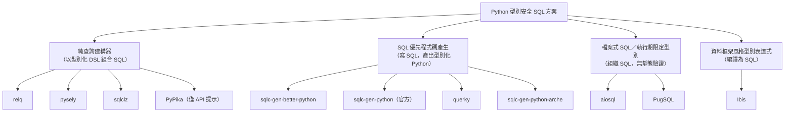

# Python 型別安全 SQL 查詢建構方案調查（排除 ORM）

## 摘要

本報告調查 Python 生態系中「型別安全（type-safe）的 SQL 查詢建構方案」，並刻意排除以 ORM（Object-Relational Mapping，物件關聯映射）為核心的解決方案。調查涵蓋查詢建構器（query builder）、由 SQL 產生程式碼（code generation）、以及檔案式 SQL 工具等不同取向，並記錄各專案的 GitHub 星數、維護狀態與其實現型別安全的技術手段。

核心結論如下：

- **真正以「查詢建構器」形式、且能在靜態檢查階段驗證欄位名稱與型別的方案仍非常稀少**。目前最貼近此定義者為 `relq`[^relq] 與 `pysely`[^pysely]，但兩者皆為極早期專案。
- **最成熟、可投入生產的路線是「SQL 優先的程式碼產生」**，代表為 `sqlc` 生態系的 Python 外掛，其中 `sqlc-gen-better-python`[^better] 功能最完整、維護最活躍。
- **傳統查詢建構器（如 `PyPika`）本身並非型別安全**，它僅提供 API 層級的型別提示，且官方明確表示「驗證 SQL 正確性不是專案目標」[^pypika]。
- **SQLAlchemy Core 是「可當純建構器使用的工具組」**，但其 2.x 的型別安全主要來自 ORM 映射（`Mapped[]`），核心層級的 `Table` 欄位存取型別資訊有限[^sa_repo][^sa_mypy]。

---

## 背景與名詞界定

### 什麼是「型別安全 SQL 查詢建構」

在本報告中，「型別安全」的判定標準為：程式在**執行前的靜態檢查階段**（例如 mypy、pyright）即可得知

1. 資料表與欄位名稱是否存在；
2. 篩選條件（WHERE）中的值型別是否符合欄位定義；
3. 查詢結果列的欄位與型別。

「查詢建構器」指以程式化 API 組合出 SQL 的工具，而非以類別實例代表資料列並提供延遲載入、身分映射（identity map）、關聯追蹤等 ORM 特性的框架。

### 為何要排除 ORM

ORM（如 SQLModel、Django ORM、SQLAlchemy ORM、Tortoise ORM、Piccolo、ormar）雖然普遍提供良好的型別提示，但其本質是將資料表映射為 Python 物件，並以 Model 類別承載查詢與結果。使用者的需求為「僅取用查詢建構能力，不引入 ORM 的物件映射與生命週期」，因此本報告將 ORM 列為對照組而非推薦對象。

---

## 方案分類

---

## 一、純查詢建構器（Type-safe Query Builder）

### 1.1 relq

- **定位**：宣告式的型別化 SQL 查詢建構器，訴求 Python 3.13 以上[^relq]。
- **GitHub 星數**：0[^relq_repo]。
- **建立時間**：2026-08-10；最後推送 2026-10-16，屬活躍但極新專案[^relq_repo]。
- **型別安全手段**：資料表以類別宣告，欄位使用 `Column[int]`、`Column[str]`、`Column[bool]` 等泛型標註；查詢完全由型別化表達式組成，宣稱「沒有任何原始 SQL 片段」，且「型別檢查器或編譯器會在查詢送達資料庫前拒絕無效查詢」[^relq]。查詢結果列的靜態型別為 `list[tuple[int, str]]` 這類精確型別[^relq]。
- **支援引擎**：SQLite（`sqlite3`）與 PostgreSQL（`asyncpg`）[^relq]。
- **配套工具**：`relq-codegen` 可由既有資料庫產生資料表宣告；`relq-migrate` 提供單向 SQL 遷移[^relq]。
- **限制**：0 星、2026 年新生專案，尚無社群驗證；使用門檻綁定 Python 3.13+。

### 1.2 pysely

- **定位**：非同步優先、受 TypeScript 的 Kysely 啟發的型別化 SQL 查詢建構器[^pysely]。
- **GitHub 星數**：1[^pysely_repo]。
- **建立時間**：2026-09-09；最後推送 2026-09-13[^pysely_repo]。
- **型別安全手段**：使用者以 Python 撰寫 `dbschema.py`（內含 `DatabaseSchema(SchemaDefinition)`），再執行 `pysely typgen dbschema.py` 產生相鄰的型別存根 `dbschema.pyi`。mypy 與 pyright 讀取該存根進行靜態驗證；**Python 執行時從不匯入該存根，且不需要型別檢查器外掛**[^pysely]。官方文件訴求為「以編輯器檢查欄位名稱、篩選值與選取結果型別」[^pysely_repo]。
- **支援引擎**：PostgreSQL、MySQL、SQLite、SQL Server、PGlite 的離線 SQL 編譯；SQLite 另支援透過 `aiosqlite` 的非同步執行與交易[^pysely]。
- **限制**：README 明言「Pysely 尚未達生產可用；核心查詢介面完成前 API 可能變動」，專案分類為 Pre-Alpha[^pysely_repo]。

### 1.3 sqlclz

- **定位**：以 `NamedTuple` 定義資料庫綱要的型別安全 SQL 查詢建構器[^sqlclz]。
- **GitHub 星數**：0[^sqlclz_repo]。
- **最後推送**：2026-01-11[^sqlclz_repo]。
- **型別安全手段**：以 `@named_tuple_table_class` 裝飾 `NamedTuple` 子類，欄位以 `Annotated[str, PRIMARY()]` 標註；查詢語法如 `sqlclz.select_from(Person).where(Person.age > 25)`，藉由 `NamedTuple` 欄位存取讓 mypy／pyright 驗證欄位參考[^sqlclz]。
- **功能**：支援 SELECT、INSERT、UPDATE、DELETE、JOIN、聚合、視窗函式、CTE、外鍵[^sqlclz]。
- **限制**：0 星、測試需手動下載 Chinook 範例資料庫，成熟度低[^sqlclz]。

### 1.4 PyPika（僅 API 提示，非綱要型別安全）

- **定位**：老牌且穩定的 SQL 查詢建構器，擅長資料分析情境[^pypika_repo]。
- **GitHub 星數**：2,923[^pypika_repo]。
- **最後推送**：2026-02-04；最新版本 v0.51.1[^pypika]。
- **型別安全程度**：**不具綱要層級型別安全**。PyPika 具備 `py.typed` 標記（PEP 561）並持續修正 mypy 相容性，但其 README 明確寫道「驗證 SQL 正確性不是明確目標」，且資料表與欄位名稱皆為字串，型別檢查器無法得知欄位是否存在[^pypika]。
- **結論**：若需求是「編譯期攔截欄位名稱拼錯或 WHERE 型別不符」，PyPika 無法滿足。

---

## 二、SQL 優先程式碼產生（Code Generation）

此類方案的核心是：開發者維持撰寫原生 SQL，工具在靜態分析 SQL 與資料庫綱要後，產生具備完整型別註解的 Python 程式碼。

### 2.1 sqlc-gen-better-python（本報告推薦首選）

- **定位**：`sqlc` 的社群外掛，將 SQL 綱要與查詢轉為現代化、完整型別的 Python 資料庫程式碼（模型、型別化查詢函式、列舉）[^better]。
- **GitHub 星數**：42；分支 5；最後推送 2026-10-16，維護活躍[^better_repo]。
- **最新版本**：v0.9.0（2026-08-16），屬 beta（1.0 前版本間選項與輸出仍可能變動）[^better_release]。
- **型別安全手段**：
  - 產生之程式碼以 Python 3.12+ 為目標，並宣稱通過 pyright（strict）與 ruff[^better]。
  - 每個查詢產生專屬函式，例如 `async def get_user(conn: ConnectionLike, *, id_: int) -> models.User | None`[^better]。
  - 支援四種模型型別：`dataclass`、`attrs`、`msgspec`、`pydantic`[^better]。
  - 支援 PostgreSQL 與 MySQL 的列舉型別（產生 `enum.StrEnum`）、型別覆寫與轉換器、透過 msgspec struct 的 JSON 欄位型別化[^better]。
- **支援驅動**：`asyncpg`、`psycopg_async`、`psycopg_sync`（PostgreSQL）、`aiosqlite`、`sqlite3`（SQLite）、`asyncmy`、`pymysql`（MySQL），以及實驗性的 `turso_async`、`turso_sync`[^better]。
- **與官方外掛差異**：相較官方版僅支援 PostgreSQL 與兩種模型型別，本外掛支援多引擎、四種模型型別、型別覆寫與轉換器[^better][^official]。
- **注意**：本方案並非「執行期查詢建構器」，而是「以 SQL 為真實來源」（SQL-first）的產生器；查詢能力來自撰寫 SQL，而非組合 API。

### 2.2 sqlc-gen-python（官方外掛）

- **定位**：`sqlc` 官方維護的 Python 外掛[^official]。
- **GitHub 星數**：341；最後推送 2025-02-24；最新版本 v1.3.0（2025-01-22）[^official_repo][^official_release]。
- **型別安全手段**：由 `sqlc` 編譯器靜態分析 SQL，產生 `dataclass` 或 Pydantic 模型與型別化查詢函式；可選擇以 `emit_str_enum` 產生 `enum.StrEnum`[^official]。
- **限制**：僅支援 PostgreSQL；相較社群外掛功能精簡，且自 2025 年初後未見新提交[^official_repo]。

### 2.3 querky

- **定位**：以單一裝飾器將原始 SQL 查詢轉為完整型別註解的 Python 函式[^querky]。
- **GitHub 星數**：22；最後推送 2024-09-22，接近停滯[^querky_repo]。
- **型別安全手段**：在 `@qrk.query` 裝飾的函式中以 f-string 撰寫 SQL，參數以 `{+arg}` 語法插入（使用參數化查詢，官方宣稱不可能發生 SQL 注入）[^querky]。程式產生腳本會連線**實際資料庫**（透過 asyncpg），從綱要推斷型別，於程式產生階段以 `PREPARE` 對 DBMS 驗證查詢語法，並輸出型別化函式與 `@dataclass` 資料列型別[^querky]。
- **限制**：僅支援 PostgreSQL + asyncpg；僅 5 次提交、單一維護者，2024 年後幾無更新，較適合作為概念驗證[^querky_repo]。

### 2.4 sqlc-gen-python-arche

- **定位**：`sqlc-gen-better-python` 的分支，新增 SQLAlchemy-async + Pydantic 產生路徑，以及針對 `jsonb` 欄位的「失敗即報錯」執行期驗證[^arche]。
- **GitHub 星數**：0，專案極新[^arche]。
- **特性**：支援將型別覆寫標記 `validate: true`，產生的讀取路徑會以 Pydantic `TypeAdapter` 驗證儲存值，不符合宣告形狀時於讀取時拋出 `ValidationError`；並支援 SQLAlchemy `AsyncConnection` 的 `AsyncQuerier` 產生[^arche]。
- **適用情境**：需要「SQLAlchemy 非同步 + Pydantic + jsonb 型別驗證」組合的專案；否則成熟度不足。

---

## 三、檔案式 SQL（執行期限定型別，無靜態驗證）

### 3.1 aiosql

- **定位**：「Python 中的簡易 SQL」，將 `.sql` 檔中的具名查詢載入為可呼叫方法（YeSQL 風格）[^aiosql_repo]。
- **GitHub 星數**：1,413；最後推送 2026-08-15，維護活躍[^aiosql_repo]。
- **型別安全程度**：**不提供對綱要的靜態型別檢查**；型別安全僅限於載入時驗證宣告的參數與函式簽章一致，無綱要推斷、無型別化模型產生[^aiosql_repo]。

### 3.2 PugSQL

- **定位**：受 HugSQL 啟發的檔案式 SQL 工具[^pugsql_repo]。
- **GitHub 星數**：777；最後推送 2025-12-04[^pugsql_repo]。
- **型別安全程度**：**無靜態型別**，查詢函式回傳無綱要感知的 dict 類物件[^pugsql_repo]。

---

## 四、資料框架風格（編譯為 SQL）

### 4.1 Ibis

- **定位**：可攜式 Python 資料框架（portable Python dataframe library），將表達式編譯為多種後端的 SQL[^ibis_repo]。
- **GitHub 星數**：6,676；最後推送 2026-10-18，維護極為活躍[^ibis_repo]。
- **與需求關係**：Ibis 具備表達式型別系統，但定位為資料框架而非純 SQL 查詢建構器，其結果以資料框架形式呈現；若需求是「以型別化 API 組合出關聯式查詢並取回資料列」，Ibis 可作為替代路線，但抽象層級與本報告主軸不同[^ibis_repo]。

---

## 五、綜合比較表

| 方案 | 星數 | 最後更新 | 取向 | 綱要層級靜態型別安全 | 支援引擎 |
|---|---|---|---|---|---|
| `relq` | 0 | 2026-10-16 | 純查詢建構器 | 是（型別化表達式 + 編譯器檢查） | SQLite、PostgreSQL |
| `pysely` | 1 | 2026-09-13 | 純查詢建構器 | 是（產生 `.pyi` 型別存根） | PostgreSQL、MySQL、SQLite、SQL Server、PGlite |
| `sqlclz` | 0 | 2026-01-11 | 純查詢建構器 | 是（NamedTuple 欄位存取） | 以 SQLite 為主要驗證對象 |
| `PyPika` | 2,923 | 2026-02-04 | 純查詢建構器 | 否（僅 API 提示） | 多方言 |
| `sqlc-gen-better-python` | 42 | 2026-10-16 | SQL 程式碼產生 | 是（產生程式碼通過 pyright strict） | PostgreSQL、SQLite、MySQL、Turso |
| `sqlc-gen-python`（官方） | 341 | 2025-02-24 | SQL 程式碼產生 | 是 | PostgreSQL |
| `querky` | 22 | 2024-09-22 | SQL 程式碼產生 | 是（連線實際 DB 推斷型別） | PostgreSQL |
| `sqlc-gen-python-arche` | 0 | 2026-10（極新） | SQL 程式碼產生 | 是（+jsonb 執行期驗證） | PostgreSQL（sqlalchemy 驅動） |
| `aiosql` | 1,413 | 2026-08-15 | 檔案式 SQL | 否 | 多種（PEP 249 驅動） |
| `PugSQL` | 777 | 2025-12-04 | 檔案式 SQL | 否 | 多種 |
| `Ibis` | 6,676 | 2026-10-18 | 資料框架 | 部分（表達式型別系統） | 多種 |

---

## 六、來源評估與批判性反思

本報告之資料來源以各專案的 GitHub 官方儲存庫、GitHub REST API 之中繼資料（星數、推送時間）以及官方文件為主，並輔以專案 README 的自我陳述。以下為需要留意的偏誤與不確定性：

1. **星數不等於成熟度或適配度**。`PyPika` 有近 3,000 星卻不提供綱要型別安全；反之 `sqlc-gen-better-python` 僅 42 星，卻是功能最完整且維護最活躍的選項[^pypika][^better]。以星數作為唯一判準會得出誤導性結論。
2. **README 屬自我陳述而非獨立驗證**。`relq` 與 `pysely` 對「型別檢查器會拒絕無效查詢」的宣稱，本報告僅能在其官方文件與 README 中取得佐證，尚未見到第三方獨立評測或大規模採用案例[^relq][^pysely]。
3. **極低星數專案（< 100 星）的資訊風險**。依本專案的研究準則，對於星數極低的專案應評估其是否值得報導。本報告刻意納入 `relq`、`pysely`、`sqlclz`、`sqlc-gen-python-arche`，原因是「真正型別安全的純查詢建構器」在 Python 生態系中本身就屬極小眾領域，若不納入這些專案，將無法反映該利基的完整樣貌；惟讀者應理解其風險。
4. **維護活躍度以「最後推送時間」與「最後發版時間」雙軌判斷**。例如官方 `sqlc-gen-python` 最後推送為 2025-02-24，而社群分支 `sqlc-gen-better-python` 於 2026-10-16 仍有推送[^official_repo][^better_repo]，兩者的維護落差明顯。
5. **GitHub API 快照具時效性**。所有星數與時間戳記均為 2026-10-18 之查詢結果，後續可能變動。

---

## 七、建議

依不同使用情境：

- **若可接受「以 SQL 為真實來源」的程式碼產生流程，且重視可投入生產的成熟度**：建議採用 `sqlc-gen-better-python`，兼顧多引擎、多模型型別與嚴格的靜態檢查[^better]。
- **若必須是「在 Python 中以 API 組合查詢」的純建構器形式，且可承擔早期專案風險**：可持續觀察 `relq` 與 `pysely`，前者以型別化表達式實現，後者以型別存根產生實現[^relq][^pysely]。
- **若僅需要在 `.sql` 檔中組織 SQL、不需要靜態型別驗證**：`aiosql` 為維護活躍的成熟選項[^aiosql_repo]。
- **應避免將 `PyPika` 視為型別安全方案**，其官方已明示 SQL 正確性驗證非其目標[^pypika]。

---

## 註腳

[^relq]: relq — A type-safe SQL query builder for Python（README 與專案文件）。Retrieved 2026-10-18, from https://github.com/totallynotdavid/relq

[^relq_repo]: GitHub REST API 儲存庫中繼資料：`totallynotdavid/relq`（星數 0、建立於 2026-08-10、最後推送 2026-10-16）。Retrieved 2026-10-18, from https://api.github.com/repos/totallynotdavid/relq

[^pysely]: Pysely — an async-first, typed Python SQL query builder inspired by Kysely（README）。Retrieved 2026-10-18, from https://github.com/mylesmmurphy/pysely

[^pysely_repo]: GitHub REST API 儲存庫中繼資料：`mylesmmurphy/pysely`（星數 1、建立於 2026-09-09、最後推送 2026-09-13、Development Status 2 - Pre-Alpha）。Retrieved 2026-10-18, from https://api.github.com/repos/mylesmmurphy/pysely

[^sqlclz]: sqlclz — A type-safe Python SQL query builder（README）。Retrieved 2026-10-18, from https://github.com/ytsimon2004/sqlclz

[^sqlclz_repo]: GitHub REST API 儲存庫中繼資料：`ytsimon2004/sqlclz`（星數 0、最後推送 2026-01-11、BSD-3-Clause）。Retrieved 2026-10-18, from https://api.github.com/repos/ytsimon2004/sqlclz

[^pypika]: PyPika — Python SQL query builder（README 與專案說明；README 載明「Validation of SQL correctness is not an explicit goal」）。Retrieved 2026-10-18, from https://github.com/kayak/pypika

[^pypika_repo]: GitHub REST API 儲存庫中繼資料：`kayak/pypika`（星數 2,923、最後推送 2026-02-04、Apache-2.0）。Retrieved 2026-10-18, from https://api.github.com/repos/kayak/pypika

[^better]: sqlc-gen-better-python — A sqlc plugin that generates modern, type-safe Python from SQL（README）。Retrieved 2026-10-18, from https://github.com/rayakame/sqlc-gen-better-python

[^better_repo]: GitHub REST API 儲存庫中繼資料：`rayakame/sqlc-gen-better-python`（星數 42、分支 5、最後推送 2026-10-16）。Retrieved 2026-10-18, from https://api.github.com/repos/rayakame/sqlc-gen-better-python

[^better_release]: sqlc-gen-better-python v0.9.0 發行說明（發佈於 2026-08-16；載明 1.0 前版本為 beta）。Retrieved 2026-10-18, from https://github.com/rayakame/sqlc-gen-better-python/releases/tag/v0.9.0

[^official]: sqlc-gen-python — 官方外掛（README 說明 `emit_pydantic_models` 與 `emit_str_enum` 選項）。Retrieved 2026-10-18, from https://github.com/sqlc-dev/sqlc-gen-python

[^official_repo]: GitHub REST API 儲存庫中繼資料：`sqlc-dev/sqlc-gen-python`（星數 341、最後推送 2025-02-24、MIT）。Retrieved 2026-10-18, from https://api.github.com/repos/sqlc-dev/sqlc-gen-python

[^official_release]: sqlc-gen-python v1.3.0 發行說明（發佈於 2025-01-22）。Retrieved 2026-10-18, from https://github.com/sqlc-dev/sqlc-gen-python/releases/tag/v1.3.0

[^querky]: querky — Turn your SQL queries into type annotated Python functions and autogenerated types with a single decorator（README）。Retrieved 2026-10-18, from https://github.com/racinette/querky

[^querky_repo]: GitHub REST API 儲存庫中繼資料：`racinette/querky`（星數 22、最後推送 2024-09-22、MIT）。Retrieved 2026-10-18, from https://api.github.com/repos/racinette/querky

[^arche]: sqlc-gen-python-arche — A sqlc WASM plugin that generates type-safe Python from your SQL（README）。Retrieved 2026-10-18, from https://github.com/archelab/sqlc-gen-python-arche

[^aiosql_repo]: GitHub REST API 儲存庫中繼資料：`nackjicholson/aiosql`（星數 1,413、最後推送 2026-08-15）。Retrieved 2026-10-18, from https://api.github.com/repos/nackjicholson/aiosql

[^pugsql_repo]: GitHub REST API 儲存庫中繼資料：`mcfunley/pugsql`（星數 777、最後推送 2025-12-04、Apache-2.0）。Retrieved 2026-10-18, from https://api.github.com/repos/mcfunley/pugsql

[^ibis_repo]: GitHub REST API 儲存庫中繼資料：`ibis-project/ibis`（星數 6,676、最後推送 2026-10-18、Apache-2.0；描述為 portable Python dataframe library）。Retrieved 2026-10-18, from https://api.github.com/repos/ibis-project/ibis

[^sa_repo]: GitHub REST API 儲存庫中繼資料：`sqlalchemy/sqlalchemy`（星數 12,244、最後推送 2026-10-16、MIT；描述為 The Database Toolkit for Python）。Retrieved 2026-10-18, from https://api.github.com/repos/sqlalchemy/sqlalchemy

[^sa_mypy]: SQLAlchemy 2.0 文件 — Mypy / Pep-484 Support for ORM Mappings（載明 mypy 外掛已於 2.0 起棄用，2.0 的 ORM 宣告式模型改用原生 PEP 484 型別）。Retrieved 2026-10-18, from https://docs.sqlalchemy.org/en/20/orm/extensions/mypy.html

[^sqlc_repo]: GitHub REST API 儲存庫中繼資料：`sqlc-dev/sqlc`（星數 18,390、最後推送 2026-10-17、MIT；描述為 Generate type-safe code from SQL）。Retrieved 2026-10-18, from https://api.github.com/repos/sqlc-dev/sqlc
