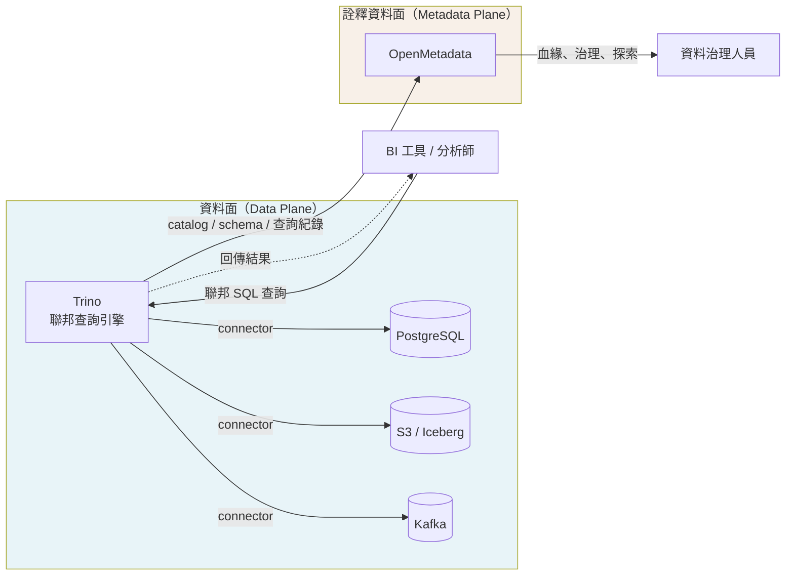
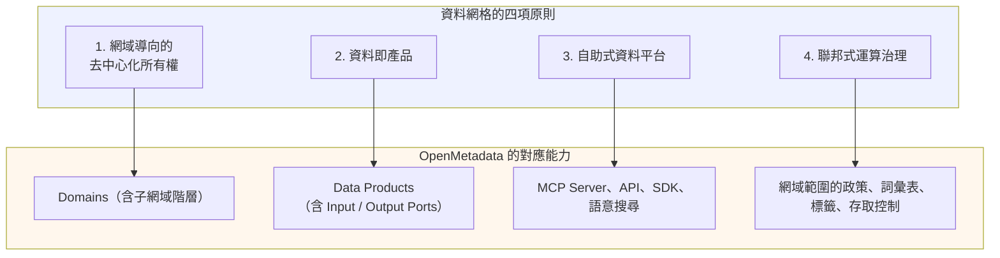
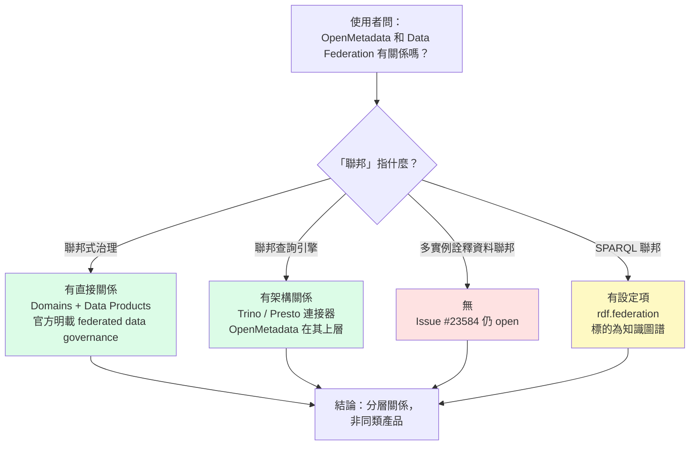

# OpenMetadata 與 Data Federation 的關聯性

## 摘要

**OpenMetadata 不是資料聯邦（Data Federation）引擎，這兩者的關聯是「分層」而非「同類」的關係。**

「Data Federation」一詞在業界至少有三種不同意義，OpenMetadata 與其中兩種有實質關聯，與第三種的關聯則仍停留在未實作的社群需求階段：

| Data Federation 的語意 | 與 OpenMetadata 的關聯 | 成熟度 |
| --- | --- | --- |
| 1. 查詢聯邦（federated query / 聯邦式資料庫系統） | OpenMetadata 是它的**治理與詮釋資料層**，可透過 Trino、Presto 連接器吸收其詮釋資料，但本身不執行聯邦查詢 | 官方正式支援（PROD 連接器） |
| 2. 聯邦式治理（federated governance，資料網格的第四原則） | OpenMetadata 用 Domains（網域）與 Data Products（資料產品）**直接實作**，官方文件明確使用「federated data governance」字樣 | 官方正式支援 |
| 3. 聯邦式詮釋資料（多個 OpenMetadata 實例共享單一檢視） | **尚未實作**，仍是開放中的功能請求 | 未實作 |
| 4. 附帶發現：SPARQL 聯邦查詢 | OpenMetadata 的 RDF 知識圖層有 `rdf.federation` 設定，可在允許清單內對外部 SPARQL 端點做聯邦查詢 | 有設定項，預設關閉 |

換句話說：**OpenMetadata 站在「詮釋資料面」，Data Federation 站在「資料面」**。OpenMetadata 幫你理解與治理被聯邦起來的資料，但不會替你聯邦查詢那些資料。

---

## 一、詞彙定義

### 1.1 OpenMetadata

OpenMetadata 是一套開源的詮釋資料（metadata）平台，自我定位為「The Open Context Layer for Data and AI」，用於建立資料資產的統一知識圖譜。其官方說明指出它整合了技術詮釋資料、資料品質訊號、血緣（lineage）、欄位級血緣、擁有者、使用情況、政策、對話、詞彙表、分類、指標、網域、資料合約與資料產品，並提供 130 種以上的連接器、語意搜尋、API、SDK 與 MCP 伺服器[^readme]。

其授權為 Apache License 2.0，GitHub 上約有 15,510 顆星、2,459 個 fork，主要語言為 TypeScript，倉庫於 2026-10-18 仍有更新[^gh-repo]。最新版本為 2.0.5，於 2026-10-08 發布，屬維護性版本，內容集中在連接器與血緣的可靠性修復[^rel205]。

其架構分為三個層次[^readme]：

1. **API 層**：REST API、MCP Server、多語言 SDK，並以 700 多個 JSON Schema 描述實體。
2. **擷取框架（Ingestion Framework）**：由 130 多個連接器負責從各類資料系統蒐集與正規化詮釋資料。
3. **UI 層**：供技術與非技術使用者探索、治理與文件化資料資產的協作介面。

資料流為：**Collect（蒐集）→ Normalize（正規化）→ Connect（連結）→ Govern（治理）→ Activate（透過 MCP、API、SDK、語意搜尋啟用）**[^readme]。

### 1.2 Data Federation（資料聯邦）

**聯邦式資料庫系統（Federated Database System, FDBS）** 是一種中介式資料庫管理系統，它把多個自主的資料庫系統透明地映射成單一的「聯邦資料庫」。其關鍵特性是：各構成資料庫彼此透過網路連接、可能地理上分散，但**維持自主性**，因此聯邦不會對各來源資料庫造成實質的資料整合（不會搬移或複製資料）[^fdbs]。

FDBS 的運作方式是：使用者送出單一查詢，系統把查詢**分解成子查詢**送往相關的構成資料庫，再**合成各子查詢的結果集**；由於不同資料庫可能使用不同查詢語言，系統可能需以包裝器（wrapper）轉譯子查詢[^fdbs]。

FDBS 的三個核心維度是**自主性（autonomy）、異質性（heterogeneity）、分散性（distribution）**。其經典的五層綱要架構為[^fdbs]：

| 層級 | 說明 |
| --- | --- |
| Local Schema | 各構成資料庫以原生資料模型表達的概念模型 |
| Component Schema | 該資料庫願意分享的子集，並轉譯為共同資料模型 |
| Export Schema | 提供給特定聯邦使用的子集，可含存取控制資訊 |
| Federated Schema | 多個 Export Schema 整合而成的聯邦綱要 |
| External Schema | 針對特定聯邦使用者或應用自 Federated Schema 萃取的視觀表 |

在**資料虛擬化**（data virtualization）的框架中，資料聯邦被視為其中一項能力：「資料聯邦：合併來自多個來源系統的結果集」[^datavirt]。這界定了兩者的層級關係：聯邦是虛擬化的一項技術，虛擬化是更大的架構概念。

值得注意的是，**目前並沒有主流廠商把產品直接命名為「Data Federation」**，此詞屬通用技術類別。各廠商以自有名稱提供此能力，例如 Microsoft 的 PolyBase[^polybase]、IBM Db2 內建的 federation[^fdbs]、SAP HANA 的 Smart Data Access、Teradata 的 QueryGrid，以及以 Trino 為核心的方案[^trino-concepts]。

### 1.3 聯邦式治理（Federated Governance）與資料網格

資料網格（Data Mesh）由 Zhamak Dehghani 於 2020 年提出，包含四項原則[^dehghani]：

1. 以網域為導向的去中心化資料所有權與架構
2. 資料即產品（data as a product）
3. 自助式資料基礎設施即平台
4. **聯邦式運算治理（federated computational governance）**

其中第四項的定義是：由各網域資料產品擁有者與資料平台產品擁有者組成的聯邦進行決策，各網域保有自主與在地決策權，同時共同制定並遵循一套全域規則，以確保生態系健全且可互通。Dehghani 強調此模式的目標是在**集中化與去中心化之間取得均衡**，並將決策**以運算方式嵌入平台自動執行**[^dehghani]。

這正是 OpenMetadata 的 Domains 功能所對應的理論基礎。

### 1.4 聯邦式詮釋資料（Federated Metadata）

在資料目錄（data catalog）領域，「聯邦」另有一義：**多個目錄實例之間共享並彙整詮釋資料，形成單一企業級檢視**。

以同類產品 DataHub 為例，其架構文件描述「Federated Metadata Serving」：DataHub 開源倉庫提供單一的 metadata service（GMS），但也支援由不同團隊各自擁有與營運的聯邦式 metadata service；這些聯邦服務透過 Kafka 與中央的搜尋索引和圖譜通訊，在維持各團隊對自身詮釋資料解耦所有權的同時，支援全域的搜尋與探索。官方明言此架構「非常適合正在實踐資料網格的公司」，並指出 LinkedIn 內部即以此方式運行 DataHub[^datahub-arch]。

這個語意與 1.2 的資料聯邦不同：**它聯邦的是「描述資料的資料」，不是資料本身**。

---

## 二、OpenMetadata 與 Data Federation 的四個關聯層次

### 2.1 層次一：OpenMetadata 消費聯邦引擎的詮釋資料（官方支援）

OpenMetadata 提供 Trino 與 Presto 的官方連接器，兩者都標示為 PROD（正式可用）階段。以 Trino 連接器為例，支援的能力包括：詮釋資料、查詢使用情況、資料剖析（Data Profiler）、資料品質、血緣、欄位級血緣、dbt 整合、樣本資料與自動分類；不支援的能力為擁有者、標籤與預存程序[^trino-connector]。

該連接器的連線設定中有一個 **Catalog** 欄位，說明為「Trino 提供 catalog 功能，所有資料庫都儲存於其中」[^trino-connector]。這是必要的，因為在 Trino 的模型裡，完全合格的資料表名稱永遠以 catalog 為根，例如 `example.test_data.test` 指向 `example` catalog 下 `test_data` schema 中的 `test` 資料表；不同 catalog 可各自使用不同連接器指向不同資料源，且可在同一段 SQL 中查詢[^trino-concepts]。

**關鍵區分**：OpenMetadata 透過這個連接器**讀取** Trino 的情境資訊（catalog、schema、table、查詢紀錄、血緣），它並**不經由 Trino 查詢資料**。聯邦查詢的執行者始終是 Trino，OpenMetadata 只是把聯邦結果的「說明書」收進目錄。



### 2.2 層次二：OpenMetadata 實作聯邦式治理（核心關聯）

這是兩者最實質、也最容易被忽略的關聯。OpenMetadata 的官方標準文件對 Domains 的定義是[^om-domains]：

> Domains 在 OpenMetadata 中提供一套框架，依業務職能、團隊所有權與組織結構來組織資料資產。這種以網域為導向的做法可實現**聯邦式資料治理（federated data governance）**、清晰的問責與大規模組織的可擴展資料管理。

同一份文件進一步說明[^om-domains]：

> Domains 讓聯邦式治理成為可能：不同團隊擁有並管理其網域專屬的資料資產，同時維持組織層級的共同標準與政策。

在實作指南中，OpenMetadata 直接把自己連上資料網格[^om-marketplace]：

> 在 Open Metadata 中，我們透過 Domains 與 Data Products 支援資料網格（Data Mesh），讓你能有效管理與組織資料資產。每個網域可以獨立管理，這與資料網格的原則一致：資料所有權分散於不同團隊。

網域的型態沿用資料網格的分類，分為三種[^om-domains-guide]：

| 網域型態 | 說明 |
| --- | --- |
| Source-aligned | 靠近線上服務與交易資料庫的網域，含事件與交易資料 |
| Aggregate | 從多個 source-aligned 網域蒐集與策展資料，提供彙總資料與資料產品，例如 Customer 360 |
| Consumer-aligned | 面向使用者的網域，最終產物組合多個網域的資料，供業務使用者或資料公民作決策 |

**聯邦治理的具體內涵**則來自 OpenMetadata 團隊在 2023 年建立的 epic 議題，其中明列聯邦式治理是「透過標準化促進所有資料產品的互通性，由治理小組建立組織政策來推動」，包含五類政策[^issue12142]：互通性政策、文件政策、安全政策、隱私政策、合規政策。該 epic 已於 2023-09-28 關閉，狀態為 completed[^issue12142]，表示對應功能已交付。

因此：**Data Federation 若指「聯邦式治理」，OpenMetadata 不只是有關聯，而是它的一級功能提供者。**



### 2.3 層次三：跨實例的聯邦式 OpenMetadata（尚未實作）

如果 Data Federation 指的是「多個 OpenMetadata 實例互享詮釋資料、對外呈現單一檢視」，這個功能**並不存在**。

對應的功能請求是 GitHub Issue #23584「Federated OMD system」，於 2025-09-26 由使用者 celticht32 提出，原文為[^issue23584]：

> 我們需要能夠擁有聯邦式的 OMD 叢集。在大型企業層級，單一 OMD 實例有時會變得難以管理。因此，若能設定個別網域，再將它們聯邦到一個 master，用於血緣與詮釋資料管理、擷取與匯出，將會很好用。

該議題的狀態為 **open**，標籤為 enhancement，指派給維護者 mohityadav766，至今僅有 2 則留言[^issue23584]。其歷程事件的軌跡如下[^issue23584-timeline]：

| 日期 | 事件 |
| --- | --- |
| 2025-09-26 | 議題建立，被加入組織的 Roadmap 專案 |
| 2025-10-31 | 使用者 GregorioBlazquez 留言表達強烈需求 |
| 2025-12-04 | 由維護者 chirag-madlani 指派給工程師並設定為 Feature 型態 |
| 2026-01-05 | 由共同創辦人 harshach 自 Roadmap 專案移除 |
| 2026-04-16 | 同一使用者追問「Is there any update?」，未獲回覆 |

兩則留言的內容值得完整引用，因為它們說明了需求動機。2025-10-31 的留言指出[^issue23584-c1]：

> 在我們的組織中，我們在單一自架的 OpenMetadata 實例上，以邏輯多租戶（網域、團隊與角色）管理多個外部客戶。聯邦式 OMD 架構對我們而言是必要的，它能實現對每個客戶的真正隔離，同時保有集中化的血緣與詮釋資料可視性。我們對此功能非常感興趣，並樂於在可用時提供回饋或測試。

2026-04-16 的追問僅有一句「Is there any update?」，未被回覆[^issue23584-c2]。

**推論與界線**：從「被加入 Roadmap 專案」到「被移出」，可合理推論此功能曾被評估但已被降優先，然而官方並未留下任何說明文字，因此**此為基於事件軌跡的推論，而非官方陳述**。可確定的事實是：該議題至報告撰寫時仍為 open，且無對應的實作或文件。

另外存在一則社群討論 #15245「How to implement a Federated OpenMetadata?」，內容為詢問是否能以聯邦方式設定 OpenMetadata，讓各自獨立營運的公司實例共享單一檢視，用於資料網格網路場景[^disc15245]。**須註明：本報告撰寫時，該討論頁面的內文無法透過擷取工具取得**（僅能取得 GitHub 的頁面框架），因此上述描述為二手資訊，未經直接驗證。

作為對照：同類的 DataHub 在架構層級已原生支援聯邦式 metadata service，並已在 LinkedIn 生產環境使用[^datahub-arch]。這說明「聯邦式詮釋資料」在目錄產品的技術上是可行且已存在的設計，OpenMetadata 目前尚未採用。

### 2.4 層次四：RDF 知識圖層的 SPARQL 聯邦（同形異義）

OpenMetadata 的程式碼中確實存在名為 `federation` 的設定項。在官方 `openmetadata.yaml` 中[^om-yaml]：

```yaml
rdf:
  enabled: ${RDF_ENABLED:-false}
  ...
  federation:
    enabled: ${RDF_FEDERATION_ENABLED:-false}
    allowedEndpoints: ${RDF_FEDERATION_ALLOWED_ENDPOINTS:-[]}
```

這是一個**必須避免誤解的項目**。此處的聯邦對象是 RDF 三元組儲存（triplestore），而非企業的業務資料庫。

背景是 OpenMetadata 的 RDF 知識圖功能（Beta 階段，預設關閉）：它把詮釋資料以 RDF 三元組形式存放在 Apache Jena Fuseki 中，與主要關聯式資料庫並存，帶來三項能力：SPARQL 查詢、本體推論與以 JSON-LD 表達的標準化連結資料（linked data）[^om-rdf]。

在此之上，`rdf.federation` 控制的是**允許對哪些外部 SPARQL 端點發出聯邦查詢**。相關實作可見於 Pull Request #28042，該 PR 新增了 `SparqlFederationGuard`（以 Jena 的 ElementWalker 偵測 SERVICE 子句）與 `rdf.federation.allowedEndpoints` 允許清單，並附有 `SparqlFederationGuardTest` 測試[^pr28042]。

換言之：**這是 SPARQL 語言規格意義下的聯邦查詢（`SERVICE` 子句跨端點查詢），語彙與資料工程界的 Data Federation 同形但其標的完全不同**。它聯邦的是知識圖譜的查詢，不是業務資料的查詢。若讀者只看到設定項名稱就推論 OpenMetadata 支援資料聯邦，將是錯誤的。

### 2.5 層次對照總表



| 面向 | 聯邦查詢引擎（Trino / Denodo / Dremio 等） | OpenMetadata |
| --- | --- | --- |
| 主要職責 | 執行跨來源查詢，合成結果集 | 建立並治理資料資產的知識圖譜 |
| 是否搬移資料 | 否（零複製，查詢時即時存取） | 不涉入資料流動 |
| 處理的對象 | 業務資料（rows、tables） | 詮釋資料（描述、血緣、政策、品質） |
| 查詢語言 | SQL / VQL 等 | 透過 API、SDK、MCP 存取詮釋資料圖 |
| 與治理的關係 | 是治理的執行點之一 | 是治理的定義與記錄處 |
| 典型使用者 | 分析師、BI 工具、應用程式 | 資料治理人員、資料工程師、AI 代理 |

支持此分工的官方證據是 OpenMetadata 的跨資料庫血緣設計。其文件說明，當各資料庫以獨立服務擷取時，OpenMetadata 解析查詢、視觀表或預存程序中的參照時，是在**自己的詮釋資料儲存中**查找已擷取的資產，並註明[^cross-db-lineage]：

> 查找發生在 OpenMetadata 的詮釋資料儲存內。連接器不會跨資料庫或跨專案查詢，服務帳號也不需要存取自身資料庫或專案以外的資產。

這段話清楚劃出了邊界：OpenMetadata 的「跨來源」能力，是**以詮釋資料拼湊出跨來源的血緣**，而不是**以查詢聯邦實際拼接資料**。

---

## 三、實務上的搭配方式

若組織同時採用聯邦查詢引擎與 OpenMetadata，兩者的分工可歸納為三點：

1. **讓聯邦引擎成為受治理的資產**：以 Trino 或 Presto 官方連接器擷取 catalog、schema、table 與查詢紀錄，使經由聯邦引擎暴露的虛擬資料表在目錄中可見、可被賦予擁有者與標籤[^trino-connector]。

2. **以血緣解釋聯邦的組成**：聯邦引擎的價值在於把多來源結果合成單一查詢結果，但其組成關係對使用者是不透明的。OpenMetadata 的血緣與欄位級血緣可補上這層解釋，讓上游變更的影響範圍可被追蹤[^readme]。

3. **以網域界定責任邊界**：把各來源系統的負責團隊對應到 Domains，並以 Data Products 包裝可供消費的產出，將聯邦治理落地為可指派的所有權與政策[^om-domains]。

反之，若組織的目標是**讓多個 OpenMetadata 實例共享單一檢視**（例如多客戶多租戶情境），目前的建議是：**不要預期此功能會在短期內可用**。可行的替代路徑是在單一實例中以 Domains、Teams 與 Roles 做邏輯隔離；但須注意此路徑曾被指出存在可視性滲漏問題，即受網域限制的使用者仍可能看到其他網域的名稱、動態訊息與全域血緣[^issue24180]。該議題已於 2026-06-22 關閉[^issue24180]，但關閉狀態不等同於所有隔離需求皆已滿足。

關於第三方工具的相容性，另有一個實務缺口：**Denodo 與 Starburst 沒有官方連接器，Dremio 僅有社群維護的連接器**。OpenMetadata 官方連接器清單中可見 Presto 與 Trino 為正式支援項目，但未收錄 Denodo、Starburst 與 Dremio[^om-connectors]。Dremio 方面存在由 TIKI-Institut 維護的社群連接器，以 Arrow Flight API 實作，授權 Apache-2.0，但僅有 2 顆星、最後推送時間為 2025-09-17[^dremio-conn]。依開源專案的活躍度判斷標準，此連接器的長期維護性存在風險，導入前應自行評估。

---

## 四、批判性反思：本報告的來源限制

1. **官方敘述帶有行銷成分**。OpenMetadata 的 README 自稱「最大且成長最快的開源 AI 情境、資料目錄與詮釋資料管理專案」[^readme]，這屬自我宣稱，本報告僅將其作為該專案定位的描述，不可作為市占或品質的客觀證據。相對客觀的量化指標是 15,510 顆星與 2,459 個 fork[^gh-repo]，但星數本身也受行銷與社群活動影響。

2. **連接器清單可能與程式碼不同步**。本報告對「Denodo、Starburst、Dremio 無官方連接器」的判斷，依據是官方連接器文件與文件索引[^om-connectors]，而非逐一檢視原始碼。文件可能落後於實作，但三個名稱在文件中完全缺席，仍具相當的參考價值。

3. **Roadmap 狀態屬推論**。「Issue #23584 曾被評估但已被降優先」的判斷，來自 GitHub 專案事件（加入與移出 Roadmap 專案）的事件軌跡[^issue23584-timeline]，官方未留下任何文字說明。這是**基於行為證據的推論**，讀者應據此調整確信度。

4. **部分來源無法直接驗證**。社群討論 #15245 的內文無法透過擷取工具取得[^disc15245]；本報告已就該項標註為二手資訊。此外，網路上若干第三方比較文章（如資料虛擬化工具評比、自架資料網格平台比較）品質不一，本報告未將其作為主要事實依據。

5. **版本與時效**。OpenMetadata 迭代快速，本報告的事實基準為 2026-10-19 所見的官方文件與 GitHub 狀態；2.0.5 於 2026-10-08 發布[^rel205]，距今僅十餘日。詮釋資料平台的連接器與功能狀態可能隨版本變動，讀者應以導入當時的官方文件為準。

6. **「Data Federation」一詞本身的模糊性是主要風險來源**。由於沒有主流廠商以該名稱販售產品[^fdbs]，且資料虛擬化、聯邦查詢、聯邦治理、聯邦詮釋資料四個概念共用同一個詞根，任何關於「X 與 Data Federation 的關係」的討論，若不先界定語意，都容易得到看似矛盾卻各自成立的結論。本報告的主要貢獻即在於把這四種語意拆開，逐一對應到 OpenMetadata 的實際支援狀態。

---

## 參考文獻

Cross Database Lineage (n.d.). Retrieved 2026-10-19, from OpenMetadata Documentation Web site: https://docs.open-metadata.org/v2.0.x/how-to-guides/data-lineage/cross-database-lineage [^cross-db-lineage]

Data Federation vs. Data Virtualization (2022, December 20). Retrieved 2026-10-19, from StreamSets Web site: https://streamsets.com/blog/data-federation-vs-data-virtualization/ [^datavirt]

DataHub Architecture Overview (n.d.). Retrieved 2026-10-19, from DataHub Documentation Web site: https://raw.githubusercontent.com/datahub-project/datahub/master/docs/architecture/architecture.md [^datahub-arch]

Dehghani, Z. (2020, December 3). Data Mesh Principles and Logical Architecture. Retrieved 2026-10-19, from https://martinfowler.com/articles/data-mesh-principles.html [^dehghani]

Denodo (n.d.). Data Virtualization. Retrieved 2026-10-19, from https://www.denodo.com/en/data-management/data-virtualization [^denodo]

Domains (n.d.). Retrieved 2026-10-19, from OpenMetadata Documentation Web site: https://docs.open-metadata.org/v2.0.x/how-to-guides/data-marketplace/domains [^om-domains-guide]

Domains & Data Products (n.d.). Retrieved 2026-10-19, from OpenMetadata Documentation Web site: https://docs.open-metadata.org/v2.0.x/how-to-guides/data-marketplace [^om-marketplace]

Domains Overview (n.d.). Retrieved 2026-10-19, from OpenMetadata Standards Web site: https://openmetadatastandards.org/domains/overview/ [^om-domains]

Enable RDF (Knowledge Graph) (Beta) (n.d.). Retrieved 2026-10-19, from OpenMetadata Documentation Web site: https://docs.open-metadata.org/v2.0.x/deployment/rdf-knowledge-graph [^om-rdf]

Federated database system (n.d.). Retrieved 2026-10-19, from Wikipedia Web site: https://en.wikipedia.org/wiki/Federated_database_system [^fdbs]

Federated OMD system (2025, September 26). [Issue #23584]. Retrieved 2026-10-19, from GitHub Web site: https://github.com/open-metadata/OpenMetadata/issues/23584 [^issue23584]

Federated OMD system [Discussion comment 3471962429] (2025, October 31). Retrieved 2026-10-19, from GitHub Web site: https://github.com/open-metadata/OpenMetadata/issues/23584#issuecomment-3471962429 [^issue23584-c1]

Federated OMD system [Discussion comment 4260524132] (2026, April 16). Retrieved 2026-10-19, from GitHub Web site: https://github.com/open-metadata/OpenMetadata/issues/23584#issuecomment-4260524132 [^issue23584-c2]

Federated OMD system [Issue timeline] (n.d.). Retrieved 2026-10-19, from GitHub Web site: https://api.github.com/repos/open-metadata/OpenMetadata/issues/23584/timeline [^issue23584-timeline]

How to implement a Federated OpenMetadata? (n.d.). [Discussion #15245]. Retrieved 2026-10-19, from GitHub Web site: https://github.com/open-metadata/OpenMetadata/discussions/15245 [^disc15245]

Improve domain isolation in UI and lineage for multi-tenant setups (2025, November 5). [Issue #24180]. Retrieved 2026-10-19, from GitHub Web site: https://github.com/open-metadata/OpenMetadata/issues/24180 [^issue24180]

Microsoft (2026, September 21). PolyBase overview for SQL Server. Retrieved 2026-10-19, from Microsoft Learn Web site: https://learn.microsoft.com/en-us/sql/relational-databases/polybase/polybase-guide?view=sql-server-ver17 [^polybase]

Ollivier, N. (2026, May 11). feat(rdf): SPARQL playground, MCP knowledge-graph tools, insights endpoints. [Pull request #28042]. Retrieved 2026-10-19, from GitHub Web site: https://github.com/open-metadata/OpenMetadata/pull/28042 [^pr28042]

open-metadata (n.d.). OpenMetadata [GitHub repository]. Retrieved 2026-10-19, from https://github.com/open-metadata/OpenMetadata [^gh-repo]

open-metadata (n.d.). openmetadata.yaml [Source code configuration file]. Retrieved 2026-10-19, from https://raw.githubusercontent.com/open-metadata/OpenMetadata/main/conf/openmetadata.yaml [^om-yaml]

OpenMetadata (n.d.). README.md [GitHub repository documentation]. Retrieved 2026-10-19, from https://raw.githubusercontent.com/open-metadata/OpenMetadata/main/README.md [^readme]

OpenMetadata Connectors (n.d.). Retrieved 2026-10-19, from OpenMetadata Documentation Web site: https://docs.open-metadata.org/v2.0.x/connectors [^om-connectors]

OpenMetadata Release 2.0.5 (2026, October 8). Retrieved 2026-10-19, from GitHub Web site: https://github.com/open-metadata/OpenMetadata/releases/tag/2.0.5-release [^rel205]

sureshms (2023, June 25). Add support for Domains and Data As A Product in OpenMetadata. [Epic issue #12142]. Retrieved 2026-10-19, from GitHub Web site: https://github.com/open-metadata/OpenMetadata/issues/12142 [^issue12142]

TIKI-Institut (n.d.). openmetadata-dremio-connector [GitHub repository]. Retrieved 2026-10-19, from https://github.com/TIKI-Institut/openmetadata-dremio-connector [^dremio-conn]

Trino Connector (n.d.). Retrieved 2026-10-19, from OpenMetadata Documentation Web site: https://docs.open-metadata.org/v2.0.x/connectors/database/trino [^trino-connector]

Trino (n.d.). Trino concepts. Retrieved 2026-10-19, from Trino Documentation Web site: https://trino.io/docs/current/overview/concepts.html [^trino-concepts]

---

## 註腳來源對照

[^readme]: OpenMetadata (n.d.). README.md. Retrieved 2026-10-19, from https://raw.githubusercontent.com/open-metadata/OpenMetadata/main/README.md

[^gh-repo]: open-metadata (n.d.). OpenMetadata [GitHub repository]. Retrieved 2026-10-19, from https://github.com/open-metadata/OpenMetadata

[^rel205]: OpenMetadata Release 2.0.5 (2026, October 8). Retrieved 2026-10-19, from https://github.com/open-metadata/OpenMetadata/releases/tag/2.0.5-release

[^fdbs]: Federated database system (n.d.). Retrieved 2026-10-19, from Wikipedia Web site: https://en.wikipedia.org/wiki/Federated_database_system

[^datavirt]: Data Federation vs. Data Virtualization (2022, December 20). Retrieved 2026-10-19, from StreamSets Web site: https://streamsets.com/blog/data-federation-vs-data-virtualization/

[^polybase]: Microsoft (2026, September 21). PolyBase overview for SQL Server. Retrieved 2026-10-19, from https://learn.microsoft.com/en-us/sql/relational-databases/polybase/polybase-guide?view=sql-server-ver17

[^trino-concepts]: Trino (n.d.). Trino concepts. Retrieved 2026-10-19, from https://trino.io/docs/current/overview/concepts.html

[^dehghani]: Dehghani, Z. (2020, December 3). Data Mesh Principles and Logical Architecture. Retrieved 2026-10-19, from https://martinfowler.com/articles/data-mesh-principles.html

[^datahub-arch]: DataHub Architecture Overview (n.d.). Retrieved 2026-10-19, from https://raw.githubusercontent.com/datahub-project/datahub/master/docs/architecture/architecture.md

[^trino-connector]: Trino Connector (n.d.). Retrieved 2026-10-19, from https://docs.open-metadata.org/v2.0.x/connectors/database/trino

[^om-domains]: Domains Overview (n.d.). Retrieved 2026-10-19, from https://openmetadatastandards.org/domains/overview/

[^om-marketplace]: Domains & Data Products (n.d.). Retrieved 2026-10-19, from https://docs.open-metadata.org/v2.0.x/how-to-guides/data-marketplace

[^om-domains-guide]: Domains (n.d.). Retrieved 2026-10-19, from https://docs.open-metadata.org/v2.0.x/how-to-guides/data-marketplace/domains

[^issue12142]: sureshms (2023, June 25). Add support for Domains and Data As A Product in OpenMetadata [Epic issue #12142]. Retrieved 2026-10-19, from https://github.com/open-metadata/OpenMetadata/issues/12142

[^issue23584]: Federated OMD system (2025, September 26). [Issue #23584]. Retrieved 2026-10-19, from https://github.com/open-metadata/OpenMetadata/issues/23584

[^issue23584-timeline]: Federated OMD system [Issue timeline] (n.d.). Retrieved 2026-10-19, from https://api.github.com/repos/open-metadata/OpenMetadata/issues/23584/timeline

[^issue23584-c1]: Federated OMD system [Discussion comment 3471962429] (2025, October 31). Retrieved 2026-10-19, from https://github.com/open-metadata/OpenMetadata/issues/23584#issuecomment-3471962429

[^issue23584-c2]: Federated OMD system [Discussion comment 4260524132] (2026, April 16). Retrieved 2026-10-19, from https://github.com/open-metadata/OpenMetadata/issues/23584#issuecomment-4260524132

[^disc15245]: How to implement a Federated OpenMetadata? (n.d.). [Discussion #15245]. Retrieved 2026-10-19, from https://github.com/open-metadata/OpenMetadata/discussions/15245

[^om-yaml]: open-metadata (n.d.). openmetadata.yaml [Source code configuration file]. Retrieved 2026-10-19, from https://raw.githubusercontent.com/open-metadata/OpenMetadata/main/conf/openmetadata.yaml

[^om-rdf]: Enable RDF (Knowledge Graph) (Beta) (n.d.). Retrieved 2026-10-19, from https://docs.open-metadata.org/v2.0.x/deployment/rdf-knowledge-graph

[^pr28042]: Ollivier, N. (2026, May 11). feat(rdf): SPARQL playground, MCP knowledge-graph tools, insights endpoints [Pull request #28042]. Retrieved 2026-10-19, from https://github.com/open-metadata/OpenMetadata/pull/28042

[^cross-db-lineage]: Cross Database Lineage (n.d.). Retrieved 2026-10-19, from https://docs.open-metadata.org/v2.0.x/how-to-guides/data-lineage/cross-database-lineage

[^om-connectors]: OpenMetadata Connectors (n.d.). Retrieved 2026-10-19, from https://docs.open-metadata.org/v2.0.x/connectors

[^dremio-conn]: TIKI-Institut (n.d.). openmetadata-dremio-connector [GitHub repository]. Retrieved 2026-10-19, from https://github.com/TIKI-Institut/openmetadata-dremio-connector

[^issue24180]: Improve domain isolation in UI and lineage for multi-tenant setups (2025, November 5). [Issue #24180]. Retrieved 2026-10-19, from https://github.com/open-metadata/OpenMetadata/issues/24180

[^denodo]: Denodo (n.d.). Data Virtualization. Retrieved 2026-10-19, from https://www.denodo.com/en/data-management/data-virtualization
