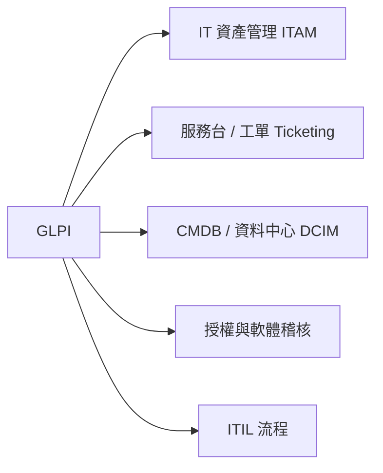
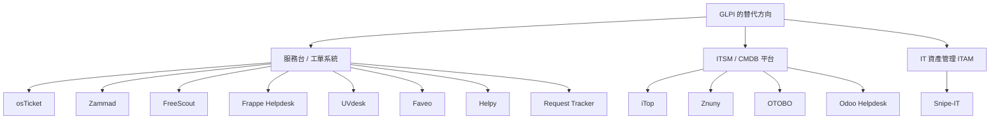
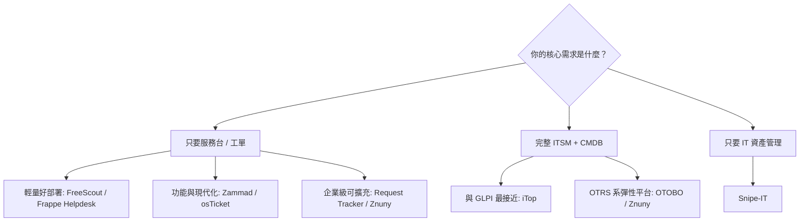

# GLPI 的 FOSS 替代方案調查

## 摘要

GLPI（Gestionnaire Libre de Parc Informatique）是一套以 PHP 撰寫的自由開源 IT 資產與服務管理軟體，採 GPL-3.0 授權，在 GitHub 上約有 6,473 顆星，功能涵蓋 IT 資產管理（ITAM）、資料中心管理（DCIM）、ITIL 服務台（Service Desk）、授權追蹤與軟體稽核[^glpi-gh]。由於「GLPI 替代方案」一詞並沒有一個單一對象，因為 GLPI 本身同時結合了「服務台／工單系統」與「IT 資產管理／CMDB」兩大領域，因此本文將替代方案分為三類分別討論：(1) 純服務台／工單系統，(2) ITIL/ITSM 與 CMDB 平台，(3) 專注於 IT 資產管理（ITAM）的工具。若要完整取代 GLPI，通常需要「服務台 + 資產管理」兩套工具組合，或選擇同時具備兩者的 ITSM 平台（如 iTop、OTOBO）。

以下所有星數與授權資訊，皆於 2026-10-19 由 GitHub REST API 直接查詢取得。

## 一、GLPI 本體特徵（作為比較基準）

- 主要語言：PHP
- 授權：GNU GPL v3.0
- 開源倉庫星數：約 6,473
- 定位：自由開源的資產與 IT 管理套件，包含服務台、授權追蹤與軟體稽核[^glpi-gh]

## 二、分類總覽

## 三、純服務台／工單系統

### 1. osTicket

- 開源倉庫：[osTicket/osTicket](https://github.com/osTicket/osTicket)
- 語言：PHP｜授權：GPL-2.0｜星數：約 3,987
- 定位：成熟的開源工單系統官方倉庫（1.8 版之後），將電子郵件、網頁表單與電話進線整合到同一套多使用者介面中[^osticket-gh]。

適合想要簡單、無繁雜功能的企業服務台；但不含 IT 資產管理與 CMDB 功能。

### 2. Zammad

- 開源倉庫：[zammad/zammad](https://github.com/zammad/zammad)
- 語言：Ruby｜授權：AGPL-3.0｜星數：約 6,018
- 定位：以網頁為基礎的開源服務台／客戶支援系統[^zammad-gh]。

以現代化介面與多工處理著名，涵蓋知識庫、SLA、觸發器自動化；同樣不含 IT 資產管理。

### 3. FreeScout

- 開源倉庫：[freescout-help-desk/freescout](https://github.com/freescout-help-desk/freescout)
- 語言：PHP（Laravel）｜授權：AGPL-3.0｜星數：約 4,604
- 定位：自由自架的 omnichannel AI 強化服務台與共用信箱，社群定位為 Zendesk／Help Scout 的免費替代方案[^freescout-gh]。

部署容易（可跑在共享主機），代理、工單與信箱無人數上限。

### 4. Frappe Helpdesk

- 開源倉庫：[frappe/helpdesk](https://github.com/frappe/helpdesk)
- 語言：Vue / Python（Frappe Framework）｜授權：AGPL-3.0｜星數：約 3,437
- 定位：現代、精簡、自由且開源的客戶服務軟體[^frappe-gh]。

若組織已採用 Frappe／ERPNext 生態系，整合性佳。

### 5. UVdesk

- 開源倉庫：[uvdesk/community-skeleton](https://github.com/uvdesk/community-skeleton)
- 語言：PHP（Symfony）｜授權：OSL-3.0｜星數：約 19,636
- 定位：開源社群版服務台，提供完整的工單支援系統，強調可擴充與協作[^uvdesk-gh]。

偏電子商務與多通路支援（Shopify、Magento、WooCommerce 等整合）。註：星數偏高部分可能來自其社群曝光與議題互動，唯工單功能本身仍以服務台為主。

### 6. Faveo Helpdesk

- 開源倉庫：[faveosuite/faveo-helpdesk](https://github.com/faveosuite/faveo-helpdesk)
- 語言：PHP（Laravel）｜授權：OSL-3.0｜星數：約 1,255
- 定位：以 Laravel 框架打造的開源工單系統[^faveo-gh]。

### 7. Helpy

- 開源倉庫：[helpyio/helpy](https://github.com/helpyio/helpy)
- 語言：Ruby｜授權：MIT｜星數：約 2,470
- 定位：現代開源服務台／客戶支援應用，具知識庫、社群討論與整合電子郵件的支援工單[^helpy-gh]。
- **維護狀態警示**：最後一次推送為 2023-03-08，距今超過兩年半，專案活躍度明顯低落，選用前應謹慎評估[^helpy-gh]。

### 8. Request Tracker (RT)

- 開源倉庫：[bestpractical/rt](https://github.com/bestpractical/rt)
- 語言：Perl｜授權：GPL-2.0｜星數：約 1,163
- 定位：企業級議題追蹤系統，是開源工單追蹤領域的老牌工具，可透過外掛延伸資產管理與 ITSM 功能[^rt-gh]。

## 四、ITSM / CMDB 平台（最接近 GLPI 整體定位）

### 1. iTop

- 開源倉庫：[Combodo/iTop](https://github.com/Combodo/iTop)
- 語言：PHP｜授權：AGPL-3.0｜星數：約 1,202
- 定位：簡單、以網頁為基礎的 CMDB 與 IT 服務管理工具[^itop-gh]。

ITIL 導向，提供可自訂的組態管理資料庫（CMDB）、服務台、事件／問題／變更管理與服務目錄，在「資產 + 服務管理」上與 GLPI 最為接近。

### 2. Znuny

- 開源倉庫：[znuny/Znuny](https://github.com/znuny/Znuny)
- 語言：Perl｜授權：GPL-3.0｜星數：約 605
- 定位：自由、開源、多用途的網頁工單系統，適用於客戶服務、服務台與 IT 服務管理，高度可客製[^znuny-gh]。

為 OTRS Community Edition 的延續分支，主打長期永續與透明治理。

### 3. OTOBO

- 開源倉庫：[RotherOSS/otobo](https://github.com/RotherOSS/otobo)
- 語言：Perl｜授權：GPL-3.0｜星數：約 337
- 定位：最具彈性的網頁工單系統之一，用於客戶服務、服務台與 IT 服務管理[^otobo-gh]。

屬 OTRS 系的分支演進，涵蓋 ITSM、CSM 與企業服務管理（ESM），具 CMDB、知識庫與流程工作流。

### 4. Odoo Helpdesk

- 開源倉庫：[odoo/odoo](https://github.com/odoo/odoo)
- 語言：Python｜授權：LGPL v3（GitHub 標示為 Other/NOASSERTION）｜星數：約 55,146
- 定位：Odoo 開源 ERP 生態系的一部分，Helpdesk 模組提供工單追蹤、SLA、罐頭回覆、多通路支援與知識庫[^odoo-gh]。

若組織已使用 Odoo ERP，可直接整合 CRM、發票與工時；但它是 ERP 的一環，並非獨立輕量的服務台。

## 五、專注 IT 資產管理（ITAM）

### Snipe-IT

- 開源倉庫：[grokability/snipe-it](https://github.com/grokability/snipe-it)
- 語言：PHP（Laravel）｜授權：AGPL-3.0｜星數：約 15,049
- 定位：自由開源的 IT 資產／授權管理系統[^snipeit-gh]。

追蹤硬體、軟體授權、配件、零組件與耗材，支援條碼／QR 產生、折舊、借還與稽核。它是純 ITAM 工具，**不含服務台**，常與 osTicket、Zammad 等搭配，補上 GLPI 的資產管理面。

## 六、比較表

| 工具 | 類別 | 語言 | 授權 | GitHub 星數（2026-10-19） | 是否含資產管理 |
|---|---|---|---|---|---|
| GLPI（基準） | ITSM + ITAM | PHP | GPL-3.0 | 6,473 | 是 |
| iTop | ITSM / CMDB | PHP | AGPL-3.0 | 1,202 | 是（CMDB） |
| Znuny | ITSM / 工單 | Perl | GPL-3.0 | 605 | 部分（外掛） |
| OTOBO | ITSM / 工單 | Perl | GPL-3.0 | 337 | 部分（CMDB） |
| osTicket | 服務台 | PHP | GPL-2.0 | 3,987 | 否 |
| Zammad | 服務台 | Ruby | AGPL-3.0 | 6,018 | 否 |
| FreeScout | 服務台 | PHP | AGPL-3.0 | 4,604 | 否 |
| Frappe Helpdesk | 服務台 | Vue/Python | AGPL-3.0 | 3,437 | 否 |
| UVdesk | 服務台 | PHP | OSL-3.0 | 19,636 | 否 |
| Faveo Helpdesk | 服務台 | PHP | OSL-3.0 | 1,255 | 否 |
| Helpy | 服務台 | Ruby | MIT | 2,470 | 否（已停更） |
| Request Tracker | 工單 | Perl | GPL-2.0 | 1,163 | 外掛 |
| Odoo Helpdesk | ITSM / ERP | Python | LGPL v3 | 55,146 | 否（靠 ERP 模組） |
| Snipe-IT | ITAM | PHP | AGPL-3.0 | 15,049 | 是（純 ITAM） |

## 七、選型建議

- 若目標是**完整取代 GLPI 的服務台 + 資產管理**：優先評估 **iTop**（PHP、AGPL、CMDB 導向）與 **OTOBO / Znuny**（ITSM + CMDB）。
- 若只需要**工單/服務台**：依易用性與活躍度推薦 **FreeScout**、**Zammad**、**Frappe Helpdesk**；企業級可擴充性則看 **Request Tracker**、**Znuny**。
- 若只需要**IT 資產管理**：**Snipe-IT** 是最成熟且活躍的選擇，建議與任一服務台工具搭配使用。
- 注意 **Helpy** 已停止活躍維護；**Faveo** 與 **UVdesk** 採 OSL-3.0（非 GPL/AGPL 系）授權，採用前請確認授權條款符合自身需求。

## 八、來源評估與批判性反思

1. **資料時效性**：GitHub 的星數、授權與「最後推送」時間只反映查詢當下（2026-10-19）的狀態，開源專案活躍度變化快速，實際選型前應重新確認各專案的最近提交與發行節奏。
2. **星數不等於品質**：星數高低受行銷、社群曝光與議題互動影響。例如 UVdesk 星數高達約 19,636，但其倉庫語言標示為 CSS 且以 skeleton 形式呈現，需實際檢視程式碼與發行狀態；反之 OTOBO、Znuny 星數較低，卻是成熟的 OTRS 系 ITSM 平台。因此星數僅宜作為活躍度的粗略參考。
3. **授權差異的實務影響**：GLPI 採 GPL-3.0，而 Zammad、FreeScout、iTop、Snipe-IT、Frappe Helpdesk 等採 AGPL-3.0，對「以網路提供服務」的情境會產生額外的原始碼釋出義務；若組織有商用再散布或 SaaS 需求，授權選擇（GPL vs AGPL vs OSL vs MIT）將是關鍵決策點。
4. **功能對應的非對稱性**：GLPI 的獨特之處在於「服務台 + 資產管理 + CMDB + 授權稽核」四位一體。多數被稱為「替代方案」的專案其實只覆蓋其中一或兩塊，實際部署往往需要工具組合（如 Snipe-IT + Zammad），這點在評估時容易被低估。
5. **來源限制**：本次調查原欲參考社群比較網站（如 AlternativeTo），但該站以 HTTP 403 拒絕存取，故本報告主要以 GitHub REST API 與各專案官方倉庫描述為第一手來源；社群評論與使用者口碑未納入，讀者若重視實際使用體驗，應另行查證第三方評測。

## 參考文獻

[^glpi-gh]: glpi-project. (n.d.). *glpi*. GitHub. Retrieved 2026-10-19, from https://github.com/glpi-project/glpi

[^osticket-gh]: osTicket. (n.d.). *osTicket*. GitHub. Retrieved 2026-10-19, from https://github.com/osTicket/osTicket

[^zammad-gh]: zammad. (n.d.). *zammad*. GitHub. Retrieved 2026-10-19, from https://github.com/zammad/zammad

[^znuny-gh]: znuny. (n.d.). *Znuny*. GitHub. Retrieved 2026-10-19, from https://github.com/znuny/Znuny

[^otobo-gh]: RotherOSS. (n.d.). *otobo*. GitHub. Retrieved 2026-10-19, from https://github.com/RotherOSS/otobo

[^itop-gh]: Combodo. (n.d.). *iTop*. GitHub. Retrieved 2026-10-19, from https://github.com/Combodo/iTop

[^snipeit-gh]: grokability. (n.d.). *snipe-it*. GitHub. Retrieved 2026-10-19, from https://github.com/grokability/snipe-it

[^freescout-gh]: freescout-help-desk. (n.d.). *freescout*. GitHub. Retrieved 2026-10-19, from https://github.com/freescout-help-desk/freescout

[^faveo-gh]: faveosuite. (n.d.). *faveo-helpdesk*. GitHub. Retrieved 2026-10-19, from https://github.com/faveosuite/faveo-helpdesk

[^uvdesk-gh]: uvdesk. (n.d.). *community-skeleton*. GitHub. Retrieved 2026-10-19, from https://github.com/uvdesk/community-skeleton

[^frappe-gh]: frappe. (n.d.). *helpdesk*. GitHub. Retrieved 2026-10-19, from https://github.com/frappe/helpdesk

[^helpy-gh]: helpyio. (n.d.). *helpy*. GitHub. Retrieved 2026-10-19, from https://github.com/helpyio/helpy

[^rt-gh]: bestpractical. (n.d.). *rt*. GitHub. Retrieved 2026-10-19, from https://github.com/bestpractical/rt

[^odoo-gh]: odoo. (n.d.). *odoo*. GitHub. Retrieved 2026-10-19, from https://github.com/odoo/odoo
