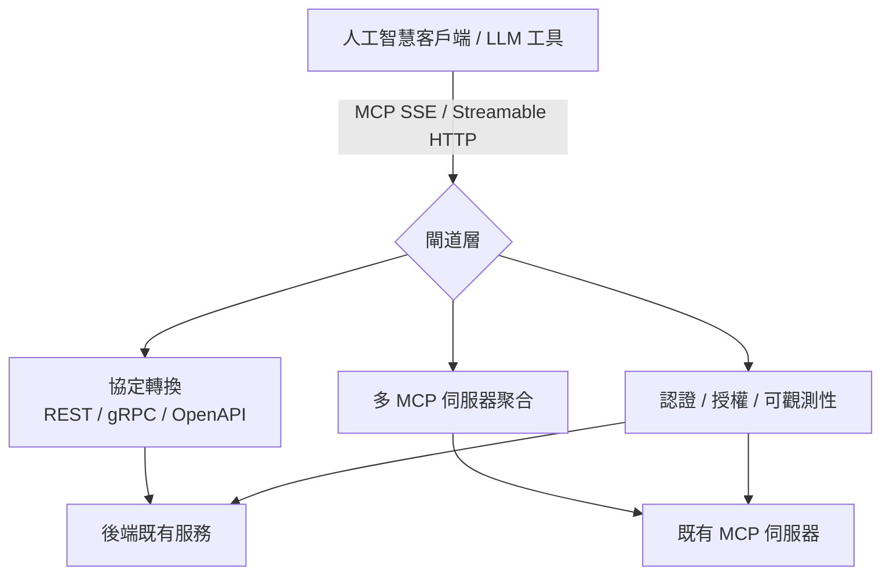
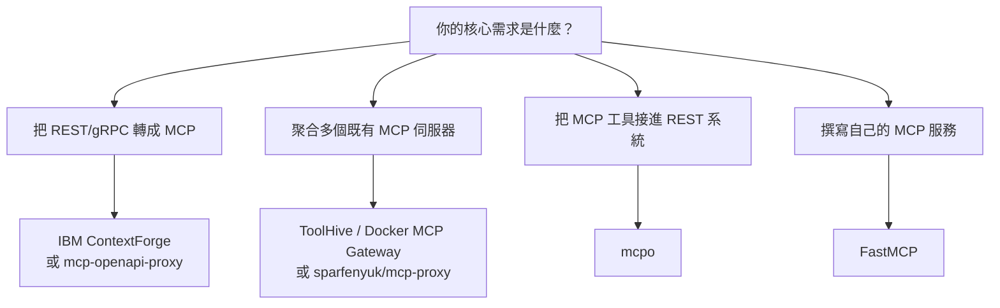

# Unla（MCP Gateway）的開源替代方案調查

## 摘要

Unla（前身為 MCP Gateway）是一套以 Go 語言撰寫、採用 MIT 授權的輕量級「MCP 閘道」服務，主要用途是把既有的 MCP 伺服器、RESTful API、gRPC 服務與 WebSocket 端點，在不修改原始碼的前提下，透過 YAML 設定即時轉換為符合 Model Context Protocol（MCP）規格的伺服器[^unla]。本報告以「尋找 Unla 的 FOSS（自由與開源軟體）替代品」為目標，透過網路檢索找出功能定位相近的開源專案，並比較其授權、語言、功能與社群熱度。

需要先釐清的是：Unla 同時具備三種角色——(1) 協定轉換（REST/gRPC/WebSocket → MCP）、(2) 多個 MCP 伺服器的聚合與代理（MCP → MCP）、以及 (3) 集中式管理（管理介面、多租戶、OAuth/JWT 認證、可觀測性）。目前沒有任何單一專案能在所有面向完全對等，因此替代方案必須依照讀者實際需求（偏「轉換」、偏「聚合」或偏「控管」）分別選擇。

---

## 一、基準對象：Unla 的功能輪廓

Unla 的定位與主要能力如下，作為後續比較的基準：

- **語言與授權**：Go 語言撰寫，採用 MIT 授權，GitHub 星數約 2.2k（約 201 個 fork）[^unla]。
- **協定轉換**：支援 RESTful → MCP、gRPC → MCP、WebSocket → MCP，以及 MCP → MCP 代理；同時支援 MCP 的 SSE 與 Streamable HTTP 兩種傳輸，並處理文字、圖片與音訊等回應型別[^unla]。
- **設定驅動**：純 YAML 設定、無須撰寫程式碼；支援設定熱更新（hot-reload）、設定版本控管，並可將設定持久化於磁碟、SQLite、PostgreSQL 或 MySQL[^unla]。
- **管理與安全**：內建網頁管理介面、多租戶隔離、基於 OAuth 的預先認證，以及以 JWT 保護的 API 伺服器[^unla]。
- **部署**：支援 Docker、Kubernetes（Helm）與多副本水平擴充，並具備 OpenTelemetry 可觀測性[^unla]。
- **狀態**：專案仍處於快速開發階段，作者聲明會優先維持向後相容，但在早期迭代期間無法百分之百保證[^unla]。

---

## 二、開源替代方案總覽

下表整理功能定位最接近 Unla 的 FOSS 專案。星數為檢索當日之約略值，可能隨時變動。

| 專案 | 類型 | 語言 | 授權 | 星數（約） | REST/OpenAPI→MCP | 多伺服器聚合 | 管理介面/認證 |
|---|---|---|---|---|---|---|---|
| IBM ContextForge | 企業級閘道/登錄/代理 | Python 等 | Apache-2.0 | 4.7k | 是（含 gRPC） | 是 | 是 |
| Stacklok ToolHive | MCP 執行與管理平台 | Go | Apache-2.0 | 2.3k | 否（以聚合為主） | 是 | 是 |
| Docker MCP Gateway | 容器化 MCP 閘道 | Go | MIT | 1.6k | 否（以聚合為主） | 是 | 是 |
| sparfenyuk/mcp-proxy | 傳輸協定代理 | Python | MIT | 2.8k | 否 | 是（具名伺服器） | 部分（認證） |
| mcpo | MCP → REST/OpenAPI | Python | MIT | 4.4k | 反向（MCP→REST） | 是 | 部分（API key/OAuth） |
| mcp-openapi-proxy | OpenAPI → MCP | Python | MIT | 約 158 | 是（OpenAPI） | 否 | 部分（認證） |
| FastMCP | MCP 開發框架 | Python/TS | Apache-2.0 | 28.1k | 是（`from_openapi()`） | 是（客戶端模式） | 應用層自行處理 |
| WSO2 API Manager | API 管理平台（含 MCP） | Java | Apache-2.0 | 大型 monorepo | 是 | 是 | 是 |

---

## 三、各替代方案詳述

### 3.1 IBM ContextForge MCP Gateway（最接近的對等替代）

ContextForge 是 IBM 主導的開源 AI 閘道、登錄與代理，可置於任何 MCP、A2A 或 REST/gRPC API 之前，對外提供單一統一端點，並集中處理探索、護欄與管理[^cf]. 其 **REST-to-MCP Tool Adapter** 能將 REST API 自動轉為工具並抽取 JSON Schema，支援標頭/權杖/自訂認證與重試、逾時、速率限制策略；另有基於反射的 **gRPC → MCP 轉換**[^cf]。

- **社群與授權**：星數約 4.7k、約 928 個 fork；Apache-2.0 授權；以 Python 為主，混用 JavaScript、HTML、Rust 等[^cf]。
- **功能對應**：具備工具閘道、代理閘道、API 閘道、40 多個外掛、OpenTelemetry 可觀測性、管理 UI（HTMX + Alpine.js）、Redis 聯邦、PyPI/Docker/Helm 部署，以及 7,000 多項測試[^cf]。
- **與 Unla 的差異**：功能面幾乎是 Unla 的超集，且社群規模更大；但以 Python 為主要語言、體系較龐大，相較 Unla 的「單一 Go 二進位、輕量」取向，部署與資源占用較重[^cf]。

### 3.2 Stacklok ToolHive

ToolHive 是一套企業級開源平台，用於執行與管理 MCP 伺服器，會將每個 MCP 伺服器包裝在隔離容器中，並施加身分與存取政策，生產環境可觀測性佳[^th].

- **社群與授權**：星數約 2.3k、約 319 個 fork；Apache-2.0 授權；Go 語言[^th]。
- **功能對應**：閘道元件可將多個工具編排為單一「虛擬 MCP」、強制 OIDC/OAuth/SSO 認證與稽核、並透過語意化工具搜尋將權杖用量降低最多約 85%；另提供登錄伺服器、Kubernetes Operator 與桌面 UI（ToolHive Studio）[^th]。
- **與 Unla 的差異**：重心在「以容器隔離方式執行與治理既有 MCP 伺服器」，而非把 REST/gRPC 轉為 MCP；若需求是協定轉換，仍須搭配其他工具[^th]。

### 3.3 Docker MCP Gateway

由 Docker 官方維護的 CLI 外掛（`docker-mcp`），以容器方式執行、管理與聚合 MCP 伺服器，對 AI 應用提供統一介面[^dmg].

- **社群與授權**：星數約 1.6k、約 287 個 fork；MIT 授權；Go 語言[^dmg]。
- **功能對應**：容器隔離、密鑰管理、OAuth 流程、以 OCI 為基礎的伺服器目錄、動態探索、日誌與呼叫追蹤、以 profile 分組並透過 OCI 登錄分享、工具允許清單，支援 stdio/SSE/串流傳輸[^dmg]。
- **與 Unla 的差異**：優勢是與 Docker 生態深度整合、容器化隔離；但同樣偏向「聚合與執行既有 MCP 伺服器」，並不主打把 REST/gRPC 轉為 MCP，且需依賴 Docker[^dmg]。

### 3.4 sparfenyuk/mcp-proxy

在 Streamable HTTP/SSE 與 stdio 兩種 MCP 傳輸之間進行橋接的代理[^mp].

- **社群與授權**：星數約 2.8k；MIT 授權；Python 語言[^mp]。
- **功能對應**：支援具名伺服器（在單一代理後方託管多個 MCP 伺服器）、JSON 設定檔、OAuth2/權杖/摘要/帳密認證、CORS、自訂標頭、Docker 支援與 `/status` 健康端點[^mp]。
- **與 Unla 的差異**：專注於「傳輸橋接」，特別適合把僅支援 stdio 的用戶端連上遠端 MCP 伺服器；不具備 REST/OpenAPI 轉換與完整管理 UI[^mp]。

### 3.5 mcpo（反向：MCP → REST/OpenAPI）

mcpo 將任何 MCP 伺服器（stdio、SSE 或 Streamable HTTP）的工具以 RESTful OpenAPI 端點形式公開，並自動產生 Swagger UI[^mcpo].

- **社群與授權**：星數約 4.4k、約 510 個 fork；MIT 授權；Python 語言[^mcpo]。
- **功能對應**：支援單一 `config.json` 同時服務多個工具並可熱重載、OAuth 2.1 動態客戶端註冊、API key 認證、反向代理子路徑與 Docker 映像[^mcpo]。
- **與 Unla 的差異**：方向相反——Unla 是「REST → MCP」，mcpo 是「MCP → REST」。若讀者其實想把 MCP 工具接進 Open WebUI 或其他 OpenAPI 原生系統，mcpo 才是有意義的對應工具[^mcpo].

### 3.6 mcp-openapi-proxy（OpenAPI → MCP）

讀取 OpenAPI 規格並為每個端點動態建立一個 MCP 工具[^moap].

- **社群與授權**：星數約 158（相對小眾，屬此類需求的小型專案）；MIT 授權；Python 語言[^moap]。
- **功能對應**：低階模式（一端點一工具）與 FastMCP 簡單模式、支援工具/提示/資源三種表面、工具白名單與命名前綴、豐富的認證選項（Bearer/自訂/API key）與規格快取、自動產生 `readOnlyHint` 等工具註記[^moap]。
- **與 Unla 的差異**：專注於 OpenAPI 單一來源轉換，無多租戶與管理介面；但因星數偏低，採用前宜評估維護活躍度[^moap].

### 3.7 FastMCP

MCP 伺服器與客戶端的開發框架，內建 `FastMCP.from_openapi()` 可在執行時把 OpenAPI 文件轉為 MCP 工具，無須程式碼產生步驟[^fm].

- **社群與授權**：星數約 28.1k；Apache-2.0 授權；Python（另有 TypeScript 版本）[^fm]。
- **功能對應**：完整伺服器/客戶端/互動式應用支援，號稱驅動各語言約 70% 的 MCP 伺服器[^fm].
- **與 Unla 的差異**：屬於「開發框架」而非「現成閘道」；要達成 Unla 的零程式碼設定與管理體驗，仍需自行以框架組裝服務[^fm].

### 3.8 大型 API 管理平台（含 MCP 能力）

部分成熟 API 管理平台已內建 MCP 閘道功能，可視為「企業既有基礎設施」路線的替代方案：

- **WSO2 API Manager**：Apache-2.0 授權、以 Java 撰寫，可從 OpenAPI 定義或既有 API 建立 MCP 伺服器，並代理既有 MCP 伺服器，於開發者入口與 API 併列展示[^wso2].
- **Kong AI MCP Proxy**：以 Lua/OpenResty 撰寫的外掛，可將受 Kong 管理的 API 轉為 MCP 伺服器，但僅在 Kong AI Gateway 企業版提供[^kong].
- **Tyk MCP Gateway**：以 Go 撰寫，社群核心為 MPL-2.0；代理遠端 MCP 伺服器為各授權皆具，REST → MCP 轉換則屬企業版功能[^tyk].

此類平台功能完整但多為「開放核心（open-core）」或偏向企業版，且與既有 API 管理體系綁定，較不適合追求單一輕量服務的使用者[^wso2][^kong][^tyk].

---

## 四、選擇建議

- **最接近 Unla 的一站式替代**：IBM ContextForge MCP Gateway，功能涵蓋轉換、聚合、管理介面與可觀測性，且授權寬鬆、社群更大[^cf].
- **偏容器化隔離與執行治理**：Stacklok ToolHive 或 Docker MCP Gateway[^th][^dmg].
- **僅需傳輸橋接**：sparfenyuk/mcp-proxy[^mp].
- **需要 MCP → REST 的反向整合**：mcpo[^mcpo].
- **以小規模或自建服務為主**：mcp-openapi-proxy 或 FastMCP[^moap][^fm].

---

## 五、來源評估與限制

- **資料時效性**：本報告的星數、fork 數與功能描述均源自檢索當日（2026-10-19）之網頁內容，專案迭代快速，數字與功能可能已有變動；Unla 本身即聲明處於快速開發階段而無法完全保證相容性[^unla].
- **來源權威性**：專案功能與授權資訊主要取自各專案的 GitHub 儲存庫與官方文件，屬第一手來源；但未逐一執行安裝實測，屬「文件層級」的比較。
- **商業傾向**：Kong、Tyk、Gravitee 等屬開放核心模式，官方敘述可能偏重企業版功能，採用前應以實際授權條款為準[^kong][^tyk].
- **未涵蓋範圍**：部分企業級平台（如 Gravitee、GitHub 內部 `gh-aw`）因未提供完整公開原始碼或資訊不足，未納入功能對等比較[^kong].
- **命名變動**：Unla 曾以「MCP Gateway」為名，檢索時須注意名稱差異以避免混淆[^unla].

---

## 註腳

[^unla]: AmoyLab. (n.d.). Unla: A lightweight MCP gateway (MIT licensed) that converts existing MCP servers, REST APIs, and gRPC services into MCP servers via YAML configuration. Retrieved 2026-10-19, from https://github.com/AmoyLab/Unla
[^cf]: IBM. (n.d.). MCP Context Forge [AI gateway, registry and proxy for MCP/A2A/REST/gRPC]. Retrieved 2026-10-19, from https://github.com/IBM/mcp-context-forge
[^th]: Stacklok. (n.d.). ToolHive [Open-source platform for running and managing MCP servers]. Retrieved 2026-10-19, from https://github.com/stacklok/toolhive
[^dmg]: Docker. (n.d.). Docker MCP Gateway [CLI plugin for running and aggregating MCP servers as containers]. Retrieved 2026-10-19, from https://github.com/docker/mcp-gateway
[^mp]: sparfenyuk. (n.d.). mcp-proxy [A bridge between Streamable HTTP/SSE and stdio MCP transports]. Retrieved 2026-10-19, from https://github.com/sparfenyuk/mcp-proxy
[^mcpo]: Open WebUI. (n.d.). mcpo [A simple, secure proxy exposing MCP servers as OpenAPI/REST endpoints]. Retrieved 2026-10-19, from https://github.com/open-webui/mcpo
[^moap]: matthewhand. (n.d.). mcp-openapi-proxy [Dynamically register OpenAPI endpoints as MCP tools]. Retrieved 2026-10-19, from https://github.com/matthewhand/mcp-openapi-proxy
[^fm]: PrefectHQ. (n.d.). FastMCP [The fast, Pythonic way to build MCP servers and clients]. Retrieved 2026-10-19, from https://github.com/PrefectHQ/fastmcp
[^wso2]: WSO2. (n.d.). WSO2 API Manager [Open-source API management suite with MCP gateway support]. Retrieved 2026-10-19, from https://github.com/wso2/product-apim
[^kong]: Kong. (n.d.). Kong AI MCP Proxy [Plugin to convert Kong-managed APIs into MCP servers]. Retrieved 2026-10-19, from https://github.com/Kong/kong
[^tyk]: Tyk. (n.d.). Tyk MCP Gateway [MCP protocol support within the Tyk API Gateway]. Retrieved 2026-10-19, from https://github.com/TykTechnologies/tyk
