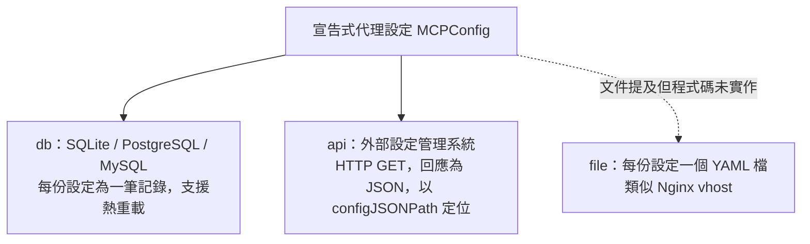
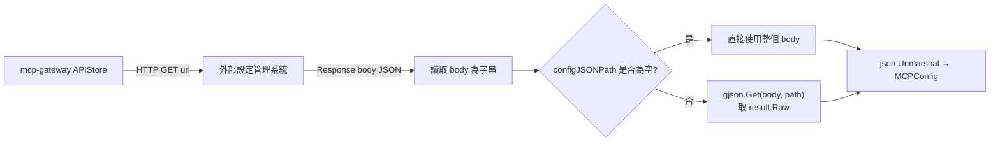
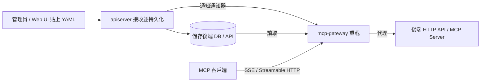
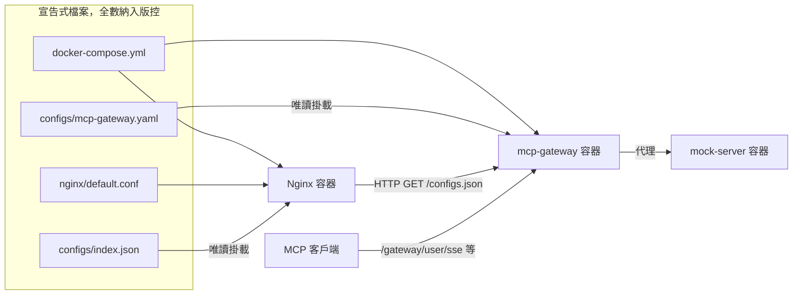

# Unla (MCP Gateway) 的宣告式 Gateway Proxy 設定與其套用方式

## 摘要

Unla（MCP Gateway）是一套以 Go 撰寫的輕量級閘道服務，能在「不修改任何一行程式碼」的前提下，把既有的 MCP 服務與一般 API 轉換為符合 MCP（Model Context Protocol）規範的服務[^index]。其核心是「宣告式設定（Configuration-Driven）」：使用者撰寫一份描述路由、服務、工具與被代理 MCP 服務的 YAML（即官方文件中的 Gateway Proxy Configuration），閘道即依此自動生成對外的 MCP 端點與請求／回應轉換邏輯[^index][^gateways]。

本報告聚焦於**這份宣告式設定的內容格式，以及它如何被儲存、驗證與套用**，而非閘道服務本身的行程設定檔。

截至 2026-10-19，該專案在 GitHub 上約有 2,243 顆星、201 個 fork，授權為 MIT[^repo]。

## 名詞釐清：兩種「設定」不可混為一談

Unla 的文件中有兩類「設定檔」，用途完全不同，必須先區分，否則會誤解「套用」的對象：

| 類別 | 代表檔案 | 用途 | 對應文件頁 |
|---|---|---|---|
| **宣告式代理設定** | `proxy-mock-server.yaml`、`proxy-mcp-exp.yaml` 等 | 定義要暴露的服務、路由與工具（本報告主角） | `/configuration/gateways`[^gateways] |
| 服務行程設定 | `mcp-gateway.yaml` | 設定閘道行程本身：儲存後端、通知機制、session、日誌等 | `/configuration/mcp-gateway`[^mcp-gw] |
| 服務行程設定 | `apiserver.yaml` | 設定管理 API 與 Web UI 行程：帳號、資料庫、JWT、OAuth | `/configuration/apiserver`[^apiserver] |

換言之，`mcp-gateway.yaml` 與 `apiserver.yaml` 只是「承載與套用」宣告式設定的底層機制；真正決定「哪個 API 變成哪個 MCP tool」的是宣告式代理設定。本報告先說明後者的結構，再說明前者如何驅動其儲存與套用。

## 宣告式代理設定的結構

宣告式代理設定以 YAML 撰寫，頂層欄位對應 Go 結構 `MCPConfig`[^mcpgo]。主要欄位如下：

| YAML 欄位 | 型別 | 說明 |
|---|---|---|
| `name` | string | 代理服務名稱，全域唯一 |
| `tenant` | string | 多租戶識別碼，用於資料隔離與權限管理 |
| `routers` | list | 路由前綴與 CORS 定義 |
| `servers` | list | HTTP 服務層級的中繼資料與共用設定 |
| `tools` | list | 將 REST API 端點包裝成 MCP tool 的定義 |
| `mcpServers` | list | 被代理的 MCP 服務（stdio / SSE / streamable-http） |
| `prompts` | list | 提示（prompt）模板定義 |

其中 `routers` 每個項目包含 `server`（對應 `servers` 或 `mcpServers` 的 `name`）、`prefix`（路由前綴，全域唯一、不可重複），以及 `cors`、`auth`、`ssePrefix`[^mcpgo][^gateways]。

### 由 prefix 自動衍生的 MCP 端點

設定中只需給予一個 `prefix`，閘道即自動衍生三個端點[^gateways]：

- SSE：`${prefix}/sse`
- SSE 訊息（POST）：`${prefix}/message`
- Streamable HTTP：`${prefix}/mcp`

例如 `prefix: "/gateway/user"` 會產生 `/gateway/user/sse`、`/gateway/user/message`、`/gateway/user/mcp`[^quickstart]。

## 兩種代理模式

### 一、HTTP 服務代理（REST → MCP）

以 `tools` 描述如何把後端 REST API 轉為 MCP tool。每個 tool 的核心欄位包括 `method`、`endpoint`、`headers`、`args`、`requestBody`、`responseBody`[^gateways]：

```yaml
name: "mock-server"
tenant: "default"

routers:
  - server: "mock-server"
    prefix: "/gateway/user"
    cors:
      allowOrigins: ["*"]
      allowMethods: ["GET", "POST", "OPTIONS"]
      allowHeaders: ["Content-Type", "Authorization", "Mcp-Session-Id"]
      exposeHeaders: ["Mcp-Session-Id"]
      allowCredentials: true

servers:
  - name: "mock-server"
    description: "Mock User Service"
    allowedTools:
      - "register_user"
    config:
      Cookie: 123
      Authorization: 'Bearer {{ env "AUTH_TOKEN" }}'

tools:
  - name: "register_user"
    description: "Register a new user"
    method: "POST"
    endpoint: "http://localhost:5236/users"
    headers:
      Content-Type: "application/json"
      Authorization: "{{.Config.Authorization}}"
    args:
      - name: "username"
        position: "body"
        required: true
        type: "string"
        description: "Username"
        default: ""
    requestBody: |-
      { "username": "{{.Args.username}}" }
    responseBody: |-
      { "id": "{{.Response.Data.id}}" }
```

參數的 `position`（擺放位置）支援 `header`、`query`、`path`、`body`、`form-data`；`type` 支援 `string`、`number`、`boolean`、`array`、`object`（陣列可再以 `items` 定義元素結構）[^gateways]。

`header` 與 `query` 參數會自動注入下游請求（標頭鍵為參數名；query 附加於 URL），`form-data` 則自動組裝為 multipart/form-data，此時無需指定 `requestBody`[^gateways]。

模板中可引用的來源包括[^gateways]：

| 來源 | 說明 |
|---|---|
| `.Config` | 服務層級設定（`servers[].config`） |
| `.Args` | 由 MCP 請求參數直接取值 |
| `.Request.Headers` | 進來的請求標頭 |
| `.Response.Data` | 回應 JSON 內的欄位路徑 |
| `.Response.Body` | 直接透傳整個回應內容 |

另支援 `toJSON`（序列化物件／陣列）與 `{{ env "VAR" }}`（環境變數，可附預設值）等函式[^gateways]。

### 二、MCP 服務代理（MCP → MCP）

以 `mcpServers` 直接代理既有的 MCP 服務，支援三種傳輸型別[^gateways][^mcpgo]：

| `type` | 傳輸方式 | 必要欄位 | 適用情境 |
|---|---|---|---|
| `stdio` | 標準輸入輸出 | `command`、`args`、`env` | 需在本機啟動的 MCP 服務（如 npx 套件） |
| `sse` | Server-Sent Events | `url` | 上游支援 SSE 的 MCP 服務 |
| `streamable-http` | HTTP 串流 | `url` | 上游支援 Streamable HTTP 的 MCP 服務 |

此外另有 `policy`（`onStart` 或 `onDemand`）與 `preinstalled`（是否於閘道啟動時即安裝）兩個控制欄位[^mcpgo]。範例如下：

```yaml
name: "proxy-mcp-exp"
tenant: "default"

routers:
  - server: "amap-maps"
    prefix: "/gateway/stdio-proxy"

mcpServers:
  - type: "stdio"
    name: "amap-maps"
    command: "npx"
    args: ["-y", "@amap/amap-maps-mcp-server"]
    env:
      AMAP_MAPS_API_KEY: "{{.Request.Headers.Apikey}}"

  - type: "sse"
    name: "mock-user-sse"
    url: "http://localhost:3000/gateway/user/sse"

  - type: "streamable-http"
    name: "mock-user-mcp"
    url: "http://localhost:3000/gateway/user/mcp"
```

上游 MCP 服務代理時，請求與回應都必須支援 `Mcp-Session-Id` 標頭，否則客戶端無法正常使用（Streamable HTTP 尤然）[^gateways]。

## 設定的儲存方式（套用的前提）

宣告式代理設定本身可存放於後端，由 `mcp-gateway.yaml` 的 `storage.type` 決定[^mcp-gw][^storage]。



- **db 儲存（官方建議、程式碼支援）**：支援 SQLite3、PostgreSQL、MySQL，每份設定為一筆記錄，支援動態更新與熱重載。於資料庫中，`routers`/`servers`/`tools`/`prompts`/`mcp_servers` 各自以 JSON 文字欄位儲存，讀取時再以 `json.Unmarshal` 還原為 `MCPConfig`[^gateways][^mcp-gw][^dbmodel]。
- **api 儲存（程式碼支援、唯讀）**：閘道以 HTTP GET 向外部端點取得設定，回應必須是 **JSON**（非 YAML），可設定 `url`、`configJSONPath`、`timeout`、`ignoreInvalidConfig`[^mcp-gw][^apistore]。

### api 儲存的具體實作

「以 `configJSONPath` 擷取」的實際流程，定義於 `internal/mcp/storage/api.go` 的 `APIStore.request()`[^apistore]：



1. 對 `storage.api.url` 送出 `GET`（timeout 為 `storage.api.timeout`）。
2. 將回應 body 讀為字串。
3. 若 `configJSONPath` 為空，直接使用整個 body；否則以 `gjson.Get(body, configJSONPath)` 取值，並只取該節點的 `.Raw`。若路徑不存在，回報 `configJSONPath is not in response` 錯誤[^apistore]。
4. `List()` 將結果 `json.Unmarshal` 為 `[]json.RawMessage`，再逐筆 `json.Unmarshal` 為 `config.MCPConfig`（依 `MCPConfig` 的 `json` 標籤）。若個別設定解析失敗，當 `ignoreInvalidConfig: true` 時會略過並記錄 warning，否則整體失敗[^apistore]。

因此，**組態在「宣告式撰寫」階段確實是 YAML，但在 api 儲存路徑的傳輸階段必須是 JSON**（符合 `MCPConfig` 的 JSON 結構）。`configJSONPath` 是 gjson 路徑（例如回應為 `{"data":{"configs":[...]}}` 時可設 `data.configs`），用來從外層 JSON 中定位設定陣列。原始碼註解亦明言此 APIStore 非通用用途，需外部服務配合其回應格式，或自行修改[^apistore]。

此外，api 儲存為**唯讀**：`Create`、`Update`、`Delete` 皆為空實作，且不支援版本控制（`ListVersions` 等回傳 `nil`）；`ListUpdated` 直接等同 `List`，因來源永遠視為最新[^apistore]。

> **重要查證**：官方文件在 Gateway Proxy Configuration 頁面另列出一種「檔案儲存（File Storage）」，描述為「每份設定各自存成一個 YAML 檔，類似 Nginx 的 vhost 寫法，檔名建議使用服務名稱，例如 `mock-server.yaml`」[^gateways]。然而截至 2026-10-19，**程式碼並未實作此選項**：儲存工廠 `internal/mcp/storage/factory.go` 的 `NewStore` 僅接受 `type: "db"` 與 `type: "api"`，其餘值一律回傳 `unsupported storage type` 錯誤[^factory]；`StorageConfig` 結構亦只有 `Database` 與 `API` 兩個子欄位[^storage]。因此，該「檔案儲存」應視為文件上尚未落實（或已移除）的描述，並非當前可用的部署選項。


## 如何套用一份宣告式設定

### 路徑一：透過 Web UI 貼上（最快）

官方 Quick Start 的流程是：啟動 all-in-one 容器後，開啟 `http://localhost:8080/` 以管理員帳號登入，點選「Add MCP Server」，將 `proxy-mock-server.yaml` 的內容貼上並儲存[^quickstart]。儲存後設定即進入儲存後端，並由 `apiserver` 通知 `mcp-gateway` 套用，對外端點隨即可用。



`apiserver` 只能以 `sender` 角色存在，`mcp-gateway` 建議以 `receiver` 角色運作；叢集部署時 `mcp-gateway` 可採 `both`[^mcp-gw]。

### 路徑二：由外部 API 提供設定（JSON）

採 api 儲存時，由外部設定管理系統以 HTTP 提供設定，閘道以 `storage.api.url` 取得回應、以 `storage.api.configJSONPath`（gjson 路徑）定位其中的設定陣列，再逐筆解析為 JSON 結構的 `MCPConfig`[^mcp-gw][^apistore]。此路徑的回應必須是 JSON，而非 YAML，詳見上節「設定的儲存方式」的實作說明。

> 官方文件另描述的「檔案儲存（直接落盤）」目前無程式碼支援，詳見上節「設定的儲存方式」的查證[^factory]。

### 完整宣告式範例：Docker Compose + Nginx + configJSONPath

以下示範「完全宣告式」的最小可行架構：**不啟用 `apiserver`、不使用資料庫**，改由 Nginx 以靜態檔案提供設定 JSON，`mcp-gateway` 以 `storage.type: api` 週期性抓取。整個部署的狀態都落在一組檔案上（Compose 檔、Nginx 設定、gateway 設定、設定 JSON），可全部納入版本控制。



#### 1. 目錄結構

```text
unla-declarative/
├── docker-compose.yml
├── nginx/
│   └── default.conf
└── configs/
    ├── mcp-gateway.yaml
    └── index.json
```

#### 2. `docker-compose.yml`

```yaml
services:
  nginx:
    image: nginx:1.27-alpine
    volumes:
      - ./nginx/default.conf:/etc/nginx/conf.d/default.conf:ro
      - ./configs/index.json:/usr/share/nginx/html/configs.json:ro
    ports:
      - "8081:80"
    restart: unless-stopped

  mcp-gateway:
    image: ghcr.io/amoylab/unla/mcp-gateway:latest
    depends_on:
      - nginx
      - mock-server
    ports:
      - "5235:5235"
    environment:
      - TZ=Asia/Taipei
    volumes:
      - ./configs/mcp-gateway.yaml:/etc/unla/mcp-gateway.yaml:ro
    restart: unless-stopped

  mock-server:
    image: ghcr.io/amoylab/unla/mock-server:latest
    ports:
      - "5236:5236"
    restart: unless-stopped
```

> gateway 的設定檔掛載到 `/etc/unla/mcp-gateway.yaml`，是因為 `GetCfgPath` 會依序尋找 `./mcp-gateway.yaml`、`./configs/mcp-gateway.yaml`，最後回退到 `/etc/unla/mcp-gateway.yaml`，而官方映像檔的工作目錄為 `/app`、預設已在 `/etc/unla/` 放了一份[^cfgpath][^gwimage]。`mock-server` 僅為讓範例可立即執行，可替換為任何後端 API。

#### 3. `nginx/default.conf`

```nginx
server {
    listen 80;

    location = /configs.json {
        root /usr/share/nginx/html;
        default_type application/json;
        add_header Cache-Control "no-store";
    }
}
```

`default_type application/json` 確保回應帶正確的 `Content-Type`；`no-store` 避免快取造成重載讀到舊設定。

#### 4. `configs/mcp-gateway.yaml`

```yaml
port: 5235
pid: /var/run/mcp-gateway.pid
reload_interval: 10s
reload_switch: true

logger:
  level: info
  format: console
  output: stdout

storage:
  type: api
  api:
    url: "http://nginx/configs.json"
    configJSONPath: "configs"
    timeout: 5s
    ignoreInvalidConfig: false

session:
  type: memory

notifier:
  role: receiver
  type: signal
  signal:
    signal: SIGHUP
    pid: /var/run/mcp-gateway.pid
```

重點：`storage.type: api` 使閘道不碰資料庫；`configJSONPath: configs` 對應 JSON 內的頂層 `configs` 陣列；`reload_interval: 10s` 讓週期 ticker 每 10 秒重抓一次（原始碼會把 ≤ 1s 的值改寫為 600s，故勿設過小）[^configgo]。

#### 5. `configs/index.json`（等同宣告式代理設定，但為 JSON）

```json
{
  "configs": [
    {
      "name": "mock-server",
      "tenant": "default",
      "routers": [
        {
          "server": "mock-server",
          "prefix": "/gateway/user",
          "cors": {
            "allowOrigins": ["*"],
            "allowMethods": ["GET", "POST", "OPTIONS"],
            "allowHeaders": ["Content-Type", "Authorization", "Mcp-Session-Id"],
            "exposeHeaders": ["Mcp-Session-Id"],
            "allowCredentials": true
          }
        }
      ],
      "servers": [
        {
          "name": "mock-server",
          "description": "Mock User Service",
          "allowedTools": ["register_user"],
          "config": {
            "Authorization": "Bearer {{ env \"AUTH_TOKEN\" }}"
          }
        }
      ],
      "tools": [
        {
          "name": "register_user",
          "description": "Register a new user",
          "method": "POST",
          "endpoint": "http://mock-server:5236/users",
          "headers": {
            "Content-Type": "application/json",
            "Authorization": "{{.Config.Authorization}}"
          },
          "args": [
            {
              "name": "username",
              "position": "body",
              "required": true,
              "type": "string",
              "description": "Username",
              "default": ""
            }
          ],
          "requestBody": "{ \"username\": \"{{.Args.username}}\" }",
          "responseBody": "{ \"id\": \"{{.Response.Data.id}}\", \"username\": \"{{.Response.Data.username}}\" }"
        }
      ]
    }
  ]
}
```

#### 6. 啟動與驗證

```bash
# 啟動
docker compose up -d

# 以內建 test 子命令驗證設定（載入 storage 後執行 ValidateMCPConfigs）
docker compose exec mcp-gateway ./mcp-gateway test -c /etc/unla/mcp-gateway.yaml
```

```bash
# 對外端點（由 prefix /gateway/user 自動衍生）
# SSE              : http://localhost:5235/gateway/user/sse
# SSE message (POST): http://localhost:5235/gateway/user/message
# Streamable HTTP  : http://localhost:5235/gateway/user/mcp
```

#### 7. 修改設定後如何套用

編輯 `configs/index.json` 後，有兩種方式讓閘道生效：

1. **等待週期重載**：`reload_interval`（本例 10 秒）到期時，ticker 會呼叫 `ReloadConfigs` 重新抓取[^gwmain]。
2. **主動觸發**：執行 `docker compose exec mcp-gateway ./mcp-gateway reload -c /etc/unla/mcp-gateway.yaml`，它會依 PID 檔送出 `SIGHUP`[^gwmain]。

因 api 儲存為唯讀且不支援版本控制，`ReloadConfigs` 只是重新 GET 該網址，故 Nginx 端檔案一更新即為最新狀態[^apistore]。

#### 8. 此架構的取捨與注意事項

- **優點**：零資料庫依賴、零 `apiserver`，全部狀態皆為檔案，天然適合 GitOps；Nginx 只是靜態檔伺服器，維運負擔極低。
- **限制**：api 儲存為**唯讀**，無法透過 Web UI 管理、**無版本控制與回滾**（`ListVersions` 等回傳 `nil`），`Create`/`Update`/`Delete` 皆為空實作[^apistore]。若需 UI 管理與版本歷史，應改用 `storage.type: db` 搭配 `apiserver`。
- **格式陷阱**：回應必須是 **JSON**，且 `configJSONPath` 必須存在，否則閘道回報 `configJSONPath is not in response` 並拒絕套用[^apistore]。
- **環境變數差異**：`mcp-gateway.yaml` 支援 `${VAR:default}` 展開（於載入時以正規表達式置換）[^configgo]；但 `index.json` 不會被閘道展開，其中若要引用環境變數，須使用 Go Template 的 `{{ env "VAR" }}`，且該函式是在工具被呼叫時才求值[^gateways]。
- **維持 YAML 為單一真實來源（可選）**：由於閘道只吃 JSON，若團隊偏好以 YAML 撰寫，可在 CI 先用 `yq -o=json`（或 `python -c 'import json,sys,yaml;...'`）把 YAML 轉為 JSON 後再發佈，讓「撰寫用 YAML、傳輸用 JSON」二者兼顧。
- **驗證前移**：可在 CI 中執行 `mcp-gateway test`，於部署前先擋掉 prefix 重複、參照錯誤等問題，呼應上節的驗證規則[^validator]。


### 熱重載機制

設定變更後不需重啟服務即可套用，官方文件對「服務行程設定」描述為三個步驟，此機制同樣服務於宣告式設定的套用[^mcp-gw]：

1. **偵測更新**：透過已設定的通知方式（signal / api / redis）觸發重載。
2. **設定驗證**：重載前先驗證新設定，確保服務穩定。
3. **平滑切換**：驗證通過後平滑切換，不中斷既有連線。

### 通知機制（Notifier）

通知機制是「設定變更」與「閘道重載」之間的橋樑，於 `mcp-gateway.yaml` 設定，支援四種類型[^mcp-gw][^gateways]：

| 類型 | 說明 | 適用 |
|---|---|---|
| `signal` | 送出作業系統訊號（如 `SIGHUP`），類似 `nginx -s reload` | 單機部署 |
| `api` | 呼叫 HTTP 端點（如 `POST /_reload`） | 遠端管理 |
| `redis` | 透過 Redis 發布／訂閱（主題 `mcp-gateway:reload`） | 單機或叢集 |
| `composite` | 複合方式，預設同時啟用 `signal` 與 `api` | 彈性情境 |

## 套用前的驗證與注意事項

官方文件建議在套用設定前進行以下驗證[^gateways]：

1. **YAML 語法**：確認縮排與語法正確。
2. **環境變數**：確認所有必要環境變數已設定。
3. **儲存連線**：確認資料庫或 Redis 連線設定正確。
4. **參照關係**：確認引用關係正確，例如 server 名稱與 `routers[].server` 對應。
5. **模板語法**：確認 Go Template 語法與變數引用正確。
6. **端點可達性**：確認所有 endpoint 可存取。
7. **權限**：確認 PID 檔路徑具寫入權限。

### 執行期驗證邏輯

依原始碼 `internal/common/config/validator.go` 的實作，套用時會執行以下檢查[^validator]：

- 設定名稱長度不超過 50 字元；
- 同一設定內 `servers` 名稱不重複、`tools` 名稱不重複；
- router 引用的 server 必須存在（`servers` 或 `mcpServers` 皆算）；
- `servers[].allowedTools` 引用的 tool 必須存在；
- **跨所有設定的 `prefix` 不可重複**（全域檢查，比對前會去除結尾斜線）。

此驗證與 `mcp-gateway.yaml` 的 `storage` 來源無關，是套用宣告式設定時共用的守門邏輯[^validator]。

## 最佳實踐

官方針對設定套用提出的最佳實踐[^gateways][^mcp-gw]：

- **安全**：以環境變數存放敏感資訊（如資料庫密碼、API key）；正式環境限制 CORS Origins，避免使用 `"*"`；啟用 OAuth2 認證；定期輪換金鑰與權杖。
- **效能**：設定合理的逾時與重載間隔；使用 Redis 叢集提升 session 儲存效能；選擇合適日誌等級；避免在模板中做複雜運算。
- **可維護性**：使用具意義的工具與服務名稱、詳盡描述；保持設定檔簡潔可讀；設定日誌輪替；定期檢視並更新設定。
- **部署**：單機建議 `db`（SQLite）搭配 `signal` 或 `composite`、session 用 memory 或 redis；叢集建議 `db`（PostgreSQL/MySQL）搭配 `redis` 或 `composite`、session 使用 redis。

## 結論

Unla 的宣告式 Gateway Proxy 設定，主體是一份描述 `routers` / `servers` / `tools` / `mcpServers` 的 YAML，內容與 `/configuration/gateways` 頁定義一致。它的套用路徑為：**撰寫 YAML → 以 Web UI 貼上或由外部 API 提供 → 存入 db／api 後端 → `apiserver` 經 notifier 通知 → `mcp-gateway` 依驗證規則（含跨設定 prefix 不可重複）驗證後熱重載生效 → 對外自動衍生 `/sse`、`/message`、`/mcp` 端點**。

至於 `mcp-gateway.yaml` 與 `apiserver.yaml`，它們是驅動上述流程的行程設定（儲存後端、通知機制、session、日誌、JWT 等），本身並不描述要被暴露的 API 或 MCP 服務。使用者只要撰寫一份宣告式 YAML，即可在不改動既有服務程式碼的情況下，把 REST API 或既有 MCP Server 轉換為可被 MCP 客戶端存取的端點。

## 參考資料

[^repo]: AmoyLab. (n.d.). *Unla - MCP Gateway* [Source code]. GitHub. Retrieved 2026-10-19, from https://github.com/AmoyLab/Unla

[^index]: AmoyLab. (n.d.). *Unla - MCP Gateway*. Unla (MCP Gateway) Documentation. Retrieved 2026-10-19, from https://docs.unla.amoylab.com/en/index.md

[^quickstart]: AmoyLab. (n.d.). *Quick Start*. Unla (MCP Gateway) Documentation. Retrieved 2026-10-19, from https://docs.unla.amoylab.com/en/quickstart.md

[^gateways]: AmoyLab. (2026-01-12). *Gateway Proxy Configuration*. Unla (MCP Gateway) Documentation. Retrieved 2026-10-19, from https://docs.unla.amoylab.com/en/configuration/gateways

[^mcp-gw]: AmoyLab. (n.d.). *MCP Gateway Configuration*. Unla (MCP Gateway) Documentation. Retrieved 2026-10-19, from https://docs.unla.amoylab.com/en/configuration/mcp-gateway

[^apiserver]: AmoyLab. (n.d.). *API Server Configuration*. Unla (MCP Gateway) Documentation. Retrieved 2026-10-19, from https://docs.unla.amoylab.com/en/configuration/apiserver

[^mcpgo]: AmoyLab. (n.d.). *internal/common/config/mcp.go* [Source code]. GitHub. Retrieved 2026-10-19, from https://raw.githubusercontent.com/AmoyLab/Unla/main/internal/common/config/mcp.go

[^validator]: AmoyLab. (n.d.). *internal/common/config/validator.go* [Source code]. GitHub. Retrieved 2026-10-19, from https://raw.githubusercontent.com/AmoyLab/Unla/main/internal/common/config/validator.go

[^storage]: AmoyLab. (n.d.). *internal/common/config/storage.go* [Source code]. GitHub. Retrieved 2026-10-19, from https://raw.githubusercontent.com/AmoyLab/Unla/main/internal/common/config/storage.go

[^factory]: AmoyLab. (n.d.). *internal/mcp/storage/factory.go* [Source code]. GitHub. Retrieved 2026-10-19, from https://raw.githubusercontent.com/AmoyLab/Unla/main/internal/mcp/storage/factory.go

[^apistore]: AmoyLab. (n.d.). *internal/mcp/storage/api.go* [Source code]. GitHub. Retrieved 2026-10-19, from https://raw.githubusercontent.com/AmoyLab/Unla/main/internal/mcp/storage/api.go

[^dbmodel]: AmoyLab. (n.d.). *internal/mcp/storage/model.go* [Source code]. GitHub. Retrieved 2026-10-19, from https://raw.githubusercontent.com/AmoyLab/Unla/main/internal/mcp/storage/model.go

[^configgo]: AmoyLab. (n.d.). *internal/common/config/config.go* [Source code]. GitHub. Retrieved 2026-10-19, from https://raw.githubusercontent.com/AmoyLab/Unla/main/internal/common/config/config.go

[^cfgpath]: AmoyLab. (n.d.). *pkg/helper/config.go* [Source code]. GitHub. Retrieved 2026-10-19, from https://raw.githubusercontent.com/AmoyLab/Unla/main/pkg/helper/config.go

[^gwmain]: AmoyLab. (n.d.). *cmd/mcp-gateway/main.go* [Source code]. GitHub. Retrieved 2026-10-19, from https://raw.githubusercontent.com/AmoyLab/Unla/main/cmd/mcp-gateway/main.go

[^gwimage]: AmoyLab. (n.d.). *deploy/docker/multi/mcp-gateway/Dockerfile* [Source code]. GitHub. Retrieved 2026-10-19, from https://raw.githubusercontent.com/AmoyLab/Unla/main/deploy/docker/multi/mcp-gateway/Dockerfile
