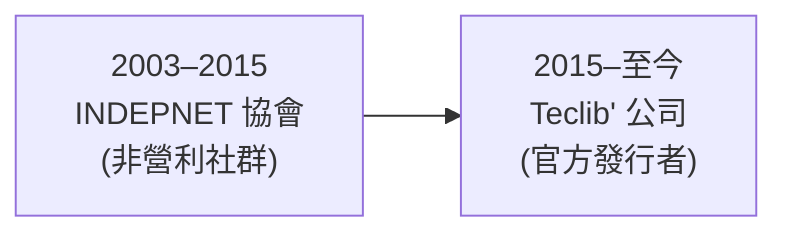

# GLPI 專案背景調查

## 摘要

GLPI（法文全稱 *Gestionnaire Libre de Parc Informatique*，英文意為「Free IT Equipment Manager」）是一套以 PHP 撰寫、以 GNU GPL v3 授權的開源 IT 資產管理（ITAM）、IT 服務管理（ITSM）、問題追蹤與服務台（Service Desk）系統[^wiki]。專案於 2003 年由法國的 INDEPNET 非營利協會發起，2015 年由法國公司 Teclib' 接手成為官方發行者（editor）[^wiki][^about]。本報告調查其公司背景、團隊、社群、資金與商業模式。

本報告為獨立文件，所有上下文皆收錄於文中。

---

## 1. 專案是什麼

GLPI 是一套網頁式應用，協助企業管理資訊系統。功能涵蓋：資產盤點、行政與財務管理、ITIL 相容的服務台（工單、問題、變更管理）、授權管理、知識庫、專案管理與報表[^wiki]。它以 PHP 撰寫，搭配 MySQL／MariaDB 資料庫[^wiki]。

| 項目 | 內容 |
|---|---|
| 全名 | Gestionnaire Libre de Parc Informatique |
| 類型 | ITAM / ITSM / 服務台 / 問題追蹤 |
| 語言 | PHP |
| 授權 | GNU GPL v3 |
| 官方網站 | www.glpi-project.org |
| 程式碼託管 | github.com/glpi-project/glpi |
| 最新版本 | 12.0.0（2026-10-07）[^ghrel] |

---

## 2. 起源與創始團隊（2003）

GLPI 社群專案始於 2003 年，由法國的 **INDEPNET** 協會主導[^wiki]。原始作者為三人[^wiki][^20years]：

- **Jean-Mathieu Doléans**
- **Julien Dombre**
- **Bazile Lebeau**

起源故事：Bazile Lebeau 被任職單位要求導入一套 IT 資產管理方案，他找到 Christian Bauer 的開源專案 **IRMA**，但 Bauer 表示不再繼續開發；Lebeau 遂取用 IRMA 原始碼加以修改，最終誕生 GLPI，並於 2003 年以 GPL 釋出[^20years]。第一版 GLPI 0.2 於 2003 年 11 月 17 日發布[^wiki]。

### INDEPNET 協會時期（2003–2015）

INDEPNET 是一個法國 1901 年法（association loi 1901）非營利協會[^wiki]。2008 年，協會建立了「夥伴網絡」（Partners' Network），讓合作夥伴能以財務與專業方式參與專案[^wiki]。

到 2015 年，協會遭遇難以克服的困境。創始成員在受訪時說明[^scoffoni]：

> 「當使用者社群呈指數成長時，貢獻者團隊卻維持不變、甚至逐漸縮減……協會可用的資源始終過於有限，無法讓我們所期望的開發者專業化／受薪化。」

他們坦言：「我們已不願維持協會模式。經過這 13 年的辛勞，即使我們不後悔，我們也已被這段經歷徹底耗盡。」

---

## 3. 公司接手：Teclib'

### 公司基本資料

| 項目 | 內容 |
|---|---|
| 公司名稱 | TECLIB S.A.S.（品牌寫作 Teclib'） |
| 成立年份 | 2011 年[^about] |
| 總部 | 231 Rue Saint-Honoré, 75001 Paris, France[^privacy] |
| 執行長／負責人 | Pascal Aubry[^scoffoni] |
| 員工數 | 60 人以上（Teclib Group）[^about] |
| 法律形式 | SAS（簡化股份公司），資本額 €445,930[^privacy] |
| 巴黎商業登記 | RCS Paris 513 893 503[^privacy] |
| 事業部門 | 軟體發行（GLPI）＋ 專業服務（旗下機構 "Buy The Way"）[^about] |

Teclib' 於 2009 年開始整合 GLPI 並投入開發，2011 年成為 GLPI 第一個白金（Platinum）夥伴，並於 2011 年正式成立公司[^about][^wiki]。

### 2015 年的經營權移轉

2015 年夏天，GLPI 社群領導者決定將產品路線圖（roadmap）管理與開發領導權移交給 Teclib'，使 Teclib' 成為 GLPI 的官方發行者，負責軟體 R&D[^wiki]。官方公告由 Jean-Mathieu Doléans 於 2015 年 7 月 3 日發布，標題為「Une nouvelle vie pour GLPI」（給 GLPI 的新生命），其中寫道[^20years]：

> 「我們選擇轉向創業模式，將專案管理交給 TECLIB 公司。」

> 「作為專案的歷史夥伴，TECLIB 在技術與理念上最有可能保障專案的成長，同時保留其使用者與自由授權模式。」

> 「此移交將是漸進式的，現有團隊將與 TECLIB 並肩合作，提供最好的支援。」

Teclib' 的 Pascal Aubry 表示，專案治理「仍維持社群性質」（reste communautaire），程式碼維持原有授權[^scoffoni]。他並定位 Teclib' 為「自由軟體的發行者」（éditeur de logiciel libre）[^scoffoni]。

受訪的 Philippe Scoffoni 觀察指出，這種「發行者模式」在專業自由軟體界已成主流，與 Linux、Apache、Eclipse、The Document Foundation、OpenStack 等產業基金會模式互補[^scoffoni]。

---

## 4. 治理模式

GLPI **沒有** 正式開源基金會（如 Linux Foundation 形式）的治理架構。其治理沿革為：

- **2003–2015**：由法國非營利協會 INDEPNET 主導，社群貢獻模式[^wiki]。
- **2015–現在**：Teclib' 為官方發行者，掌控路線圖與核心開發，但仍以「社群與發行者共同合作」方式接受社群貢獻[^wiki]。
- 程式碼維持 GPL v3 開源[^wiki]。
- 此模式近似 GitLab 的「公司支持型開源專案」，而非基金會型[^scoffoni]。

---

## 5. 資金與投資

### 資金狀態

GLPI／Teclib' **沒有已知的創投（VC）融資**。根據 Tracxn 資料（最後更新 2026-09-13），Teclib 累計有 2 輪融資，皆為 **Grant（獎助金／獎金）** 性質，金額未公開；機構投資者僅 1 家：Europa（歐盟相關計畫）[^tracxn]。公司為私人持股的 S.A.S.，未揭露營收[^privacy]。

（注意：Tracxn 屬第三方商業資料庫，其融資資訊無法從公司官方來源交叉驗證，可信度中等，應謹慎採信。）

### 收入來源

| 收入來源 | 說明 |
|---|---|
| GLPI Network Cloud（SaaS） | 由 Teclib' 代管的雲端服務，主要收入 |
| 自架版支援訂閱（GLPI Network） | 官方 N3 支援與維護 |
| 外掛／Marketplace | 專屬外掛分級訂閱 |
| 專業服務 | 旗下 "Buy The Way" 機構提供顧問服務 |
| 夥伴網絡 | 認證整合商推廣／服務 GLPI |

官方在 20 週年頁面說明其資金循環理念[^20years]：

> 「付費支援訂閱是發展自由專案的一種良性方式，因為其收入完全用於擴大開發團隊。」

### 定價（歐元，未稅）

**GLPI Network Cloud**[^pricing]：

| 方案 | 價格 | 最低用戶數 | 磁碟 | 可用性 | 備份 |
|---|---|---|---|---|---|
| Public Cloud | €19／用戶／月 | 1 位代理 | 5 GB | 97% | 每日一次 |
| Private Cloud | €21／用戶／月 | 25 位代理 | 50 GB | 99% | 每小時增量 |
| Private Custom-Made | 依報價 | 客製 | 客製 | 客製 SLA | 客製 |

提供 **45 天免費試用**（僅 Public Cloud、免信用卡）[^pricing]。

**自架版支援訂閱**[^pricing]：

| 分級 | 價格（EUR／月） | 技術人員 | 資產數 | 實例數 |
|---|---|---|---|---|
| Basic | €100 | 最多 10 | 最多 500 | 1 生產 + 1 測試 |
| Standard | €300 | 最多 50 | 最多 5,000 | 2 + 2 |
| Advanced | €1,000 | 超過 50 | 超過 5,000 | 4 + 4 |
| Enterprise | €4,500 | 無限 | 無限 | 無限 |

Enterprise 額外含：優先支援、危機處理團隊、每年一次與開發團隊 Q&A、3 個官方培訓名額等[^pricing]。

---

## 6. 社群規模

| 指標 | 數值 | 來源 |
|---|---|---|
| GitHub 星星 | **6,472** | GitHub API（2026-10-19）[^ghapi] |
| GitHub 分叉 | 1,836 | [^ghapi] |
| GitHub 訂閱者（watchers） | 178 | [^ghapi] |
| GitHub 提交數 | 36,314 | [^ghapi] |
| 最大貢獻者 | moyooo（10,601 次貢獻） | [^ghcontrib] |
| GitHub 組織可見成員 | 至少 8 位開發者 | [^ghpeople] |
| 支援語言 | 45 種 | [^wiki] |
| 官方夥伴 | 100+（2025 年） | [^about] |
| 全球使用者 | 宣稱 10M+（官方 LinkedIn） | [^linkedin] |
| LinkedIn 追蹤者 | 8,559 | [^linkedin] |
| 論壇 | forum.glpi-project.org（Discourse 架構） | [^community] |
| 翻譯平台 | Transifex（GLPI Project 專案約 1,800 名貢獻者） | [^transifex] |
| 外掛生態 | github.com/pluginsGLPI 約 61 個外掛儲存庫 | [^pluginsorg] |

歷史里程碑：2012 年 GLPI 下載量突破 **100 萬**；2025 年官方夥伴超過 100 家[^about]。

### 外掛分級（Marketplace）

外掛分為社群外掛與專屬外掛三級：**Basic（€1,200）／Standard（€3,600）／Advanced（€12,000）**[^plugins]。此為自架版外掛套裝的一次性授權分級（依官方外掛頁所列金額）。

---

## 7. 主要客戶

官方列出的客戶包含公部門與企業[^20years]：

> 「GLPI 客戶包含公司與公共機構，在 Teclib 我們很自豪名單中有 Burger King France、Deezer、Airbus、Comdata、Radio France、Telefonica Colombia、SETEC、La Poste、Conseil d'État 等名字。」

其他提及的客戶還包括：Giesecke+Devrient、SNCF/Hexafret、ARSEAA、Météo France、西班牙科學部等[^20years][^customers]。

---

## 8. 版本演進

| 日期 | 版本 | 備註 |
|---|---|---|
| 2003-11-17 | 0.2 | 第一版[^wiki] |
| 2012-04-04 | 0.83 | 介面改版、行動裝置支援[^wiki][^20years] |
| 2015-10-09 | 0.90 | Teclib 接手後首個大版本[^wiki] |
| 2022-04-20 | 10.0 | 全面介面重設計、原生盤點、REST API[^wiki][^20years] |
| 2025-10-01 | 11.0 | 夥伴突破 100 家[^wiki][^about] |
| 2026-10-07 | 12.0.0 | 最新版本[^ghrel] |

---

## 9. 資料來源批判與限制

- **Wikipedia 條目帶有利益衝突警示**：英文維基 GLPI 條目頁首標註「主要貢獻者與條目主題有密切關聯」，需依中立觀點清理（標記於 2016 年 6 月）[^wiki]。因此維基內容可能偏向官方敘事，本報告已儘量以官方一手來源與第三方來源交叉比對。
- **官方來源的偏誤**：glpi-project.org 的 about／20 週年／pricing 頁面屬 Teclib' 自家行銷內容，對公司成就與客戶名單的描述可能選擇性呈現。
- **融資資訊薄弱**：VC／資金資訊僅見於 Tracxn 等第三方商業資料庫，且與公司官方揭露不一致（Tracxn 稱有 2 輪 Grant 融資，官方未提及），無法獨立驗證，可信度有限。
- **使用者數量不可驗證**：「10M+ 使用者」為官方 LinkedIn 行銷宣稱，無獨立第三方稽核。
- **員工數落差**：官方稱 60+ 人，LinkedIn 列 11–50 人，Tracxn 列 10 人（2024-07），彼此矛盾，實際數字存疑[^about][^linkedin][^tracxn]。
- **Teclib' 與 Teclib 命名**：品牌寫作 Teclib'（帶尾隨撇號），部分來源寫作 Teclib，指同一實體[^about][^privacy]。

---

## 參考文獻

[^wiki]: Wikipedia. (n.d.). *GLPI*. Retrieved 2026-10-19, from https://en.wikipedia.org/wiki/GLPI

[^about]: GLPI Project. (n.d.). *About Teclib - Driving Open Source Innovation with GLPI*. Retrieved 2026-10-19, from https://www.glpi-project.org/en/about-us/

[^privacy]: GLPI Project. (n.d.). *Privacy Policy*. Retrieved 2026-10-19, from https://www.glpi-project.org/en/privacy-policy/

[^20years]: GLPI Project. (n.d.). *GLPI 20 years*. Retrieved 2026-10-19, from https://glpi-project.org/glpi-20-years/

[^pricing]: GLPI Project. (n.d.). *GLPI Network Plans for Your Business - GLPI Prices*. Retrieved 2026-10-19, from https://www.glpi-project.org/en/pricing/

[^scoffoni]: Scoffoni, P. (2015, September 14). *GLPI : les porteurs du projet associatif passent la main à TECLIB*. Retrieved 2026-10-19, from https://philippe.scoffoni.net/glpi-porteurs-projet-associatif-passent-main-teclib/

[^ghapi]: GitHub. (n.d.). *glpi-project/glpi repository metadata*. Retrieved 2026-10-19, from https://api.github.com/repos/glpi-project/glpi

[^ghcontrib]: GitHub. (n.d.). *glpi-project/glpi contributors*. Retrieved 2026-10-19, from https://api.github.com/repos/glpi-project/glpi/contributors?per_page=1&anon=true

[^ghpeople]: GitHub. (n.d.). *People · glpi-project*. Retrieved 2026-10-19, from https://github.com/orgs/glpi-project/people

[^ghrel]: GitHub. (2026, October 7). *GLPI 12.0.0 release*. Retrieved 2026-10-19, from https://github.com/glpi-project/glpi/releases/tag/12.0.0

[^linkedin]: LinkedIn. (n.d.). *GLPI - developed by Teclib'*. Retrieved 2026-10-19, from https://www.linkedin.com/company/glpi-developed-by-teclib/

[^tracxn]: Tracxn. (2026, September 13). *Teclib - Company Profile*. Retrieved 2026-10-19, from https://tracxn.com/d/companies/teclib/

[^community]: GLPI Project. (n.d.). *Community*. Retrieved 2026-10-19, from https://www.glpi-project.org/en/community/

[^transifex]: Transifex. (n.d.). *GLPI Project*. Retrieved 2026-10-19, from https://explore.transifex.com/glpi/

[^plugins]: GLPI Project. (n.d.). *Plugins*. Retrieved 2026-10-19, from https://www.glpi-project.org/en/plugins/

[^pluginsorg]: GitHub. (n.d.). *pluginsGLPI*. Retrieved 2026-10-19, from https://github.com/pluginsGLPI

[^customers]: GLPI Project. (n.d.). *Customers*. Retrieved 2026-10-19, from https://www.glpi-project.org/en/customers/
