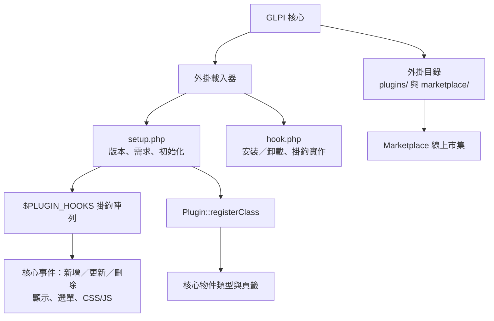

# GLPI 的外掛／擴充機制

## 摘要

GLPI（Gestionnaire Libre de Parc Informatique）是一套以 PHP 撰寫的自由開源 IT 資產管理與 ITIL 服務台軟體，官方描述為「Free Asset and IT Management Software package, Data center management, ITIL Service Desk, licenses tracking and software auditing」[^gh]。本報告針對一個具體問題進行查證：GLPI 是否具備外掛或擴充機制（plugin/extension mechanism）？

結論是肯定的。GLPI 提供一套完整且官方文件化（documented）的外掛機制，包含：專用的外掛目錄、強制性的 `setup.php` 與 `hook.php` 檔案、以 `$PLUGIN_HOOKS` 陣列為核心的「掛鉤（hooks）」系統、用於註冊物件類型與頁籤的 `Plugin::registerClass()`、自 GLPI 10.0 起支援的 PSR-4 自動載入（autoload），以及自 9.5 版起內建的 Marketplace 線上市集[^index][^req][^hooks][^guide]。本報告將逐一說明這些構面，並以 Mermaid 圖示輔助說明。

## 背景：GLPI 是什麼

GLPI 由法國公司 Teclib' 主導開發，原始碼託管於 GitHub 的 `glpi-project/glpi` 儲存庫，採 GPL-3.0 授權[^gh]。官方程式碼文件明確指出，GLPI「provides facilities to develop plugins, and there are many plugins that have been already published」[^index]。換言之，外掛機制並非社群私下的非官方作法，而是核心團隊刻意設計、並以專門的開發者文件（developer documentation）加以規範的一級功能[^index]。

## 外掛機制的整體架構

下圖呈現 GLPI 外掛機制的主要構面與彼此的關係。此為概念示意圖，非實際檔案路徑的完整列舉。



## 外掛目錄：plugins/ 與 marketplace/

GLPI 外掛在檔案系統上以「一個子目錄」的形式存在於 GLPI 安裝根目錄下的 `plugins/` 目錄中[^req][^index]。開發者文件描述：「This is a sub-directory in the `plugins` of GLPI; that would contains all related files」[^index]。

外掛目錄名稱有嚴格限制：官方文件明確警告，外掛主目錄名稱「may contain only alphanumeric characters (no `-` or `_` or accented characters or else)」，即僅允許英數字元，不得包含連字號、底線或重音字元[^guide]。這是因為目錄名稱同時扮演外掛的內部識別名稱（內部 key），會與函式命名慣例（如 `plugin_<name>_...`）及 PSR-4 命名空間對應[^guide][^req]。

除此之外，GLPI 另有一個 `marketplace/` 目錄，用於存放透過內建 Marketplace 安裝的外掛。開發者文件在 PSR-4 對照表中將 `GlpiPlugin` 命名空間描述為「maps (virtually) to /plugins or /marketplace」，佐證兩者並存[^guide]。當同一外掛同時存在於兩處時，需留意其優先順序與安裝來源的差異。

## 必要檔案：setup.php 與 hook.php

每一個外掛「must at least provides `setup.php` and `hook.php` files」，這兩者是強制性的最低要求[^req]。

### setup.php

`setup.php` 是外掛的進入點，會被 GLPI 核心自動載入，用來取得版本資訊、檢查前置需求等[^req]。官方規格要求其中至少定義兩個函式：

- `plugin_version_<name>()`：回傳外掛的中繼資料（名稱、版本、作者、授權、首頁、`requirements` 需求陣列）。此資訊會顯示於 GLPI 外掛管理介面[^req]。
- `plugin_init_<name>()`：在每個頁面載入時呼叫，用於將掛鉤填入全域 `$PLUGIN_HOOKS` 陣列、呼叫 `Plugin::registerClass()` 等初始化工作[^req]。

此外還有若干選用函式：

- `plugin_<name>_boot()`：在 GLPI 開機序列中、session 載入前與作用中外掛初始化前執行，用於註冊無狀態（stateless）路徑等早期設定[^req]。
- `plugin_<name>_check_prerequisites()`：安裝前檢查環境是否合適[^req]。
- `plugin_<name>_check_config($verbose)`：每個頁面檢查設定，若回傳 `false` 會自動停用該外掛[^req]。
- `plugin_<name>_options()`：自 GLPI 10.0 起可定義外掛選項，例如 `Plugin::OPTION_AUTOINSTALL_DISABLED` 可停用從 Marketplace 下載後自動呼叫安裝掛鉤的行為[^req]。

### hook.php

`hook.php` 存放 GLPI 在使用者操作時可能呼叫的掛鉤函式。最基本的兩個為安裝與卸載掛鉤[^req]：

- `plugin_<name>_install()`：執行資料庫建表、預設值建立等工作[^req]。
- `plugin_<name>_uninstall()`：移除資料表、清理產生的檔案等[^req]。

## 目錄結構與 PSR-4 自動載入

官方文件的建議目錄結構大致如下：`front/`（直接輸出給使用者的 PHP 頁面）、`inc/`（傳統類別檔）與／或 `src/`（新版 PSR-4 類別檔）、`locale/`（在地化檔案）、`tools/`（腳本工具），再加上 `README.md`、`LICENSE` 以及必要的 `setup.php`、`hook.php`、可選的 `MyPlugin.xml` 與 `MyPlugin.png`[^guide]。

其中 `inc` 與 `src` 的關係值得注意：`inc` 是「legacy way」存放類別，`src` 是「new way」並依賴 PSR-4 自動載入[^guide]。自 GLPI 10.0 起，開發者可將類別置於 `src/` 目錄，使用命名空間 `GlpiPlugin\MyPlugin;`。官方對照表說明了對應規則：`GlpiPlugin` 映射到 `/plugins` 或 `/marketplace`，`MyPlugin` 映射到 `/myplugin/src`，`SubFolder` 映射到 `/src/SubFolder/`，`ClassName` 映射到 `../ClassName.php`[^guide]。例如 `GLPI_ROOT/marketplace/myplugin/src/Test.php` 對應類別 `GlpiPlugin\MyPlugin\Test`，而 `src/ChildClass/ResultOutcomes.php` 對應 `GlpiPlugin\MyPlugin\ChildClass\ResultOutcomes`[^guide]。當使用 PSR-4 時，`inc` 目錄「should no longer be present」，即不應同時並存[^guide]。

另有一項重要的檔案寫入規範：外掛「may never ask user to give them write access on their own directory」，亦即外掛不得要求使用者授予其自身目錄的寫入權限，而應改用 `GLPI_PLUGIN_DOC_DIR/{plugin_name}`（預設解析為 `glpi_dir/files/_plugins/{plugin_name}`）來存放資料[^guide]。這是為了避免外掛更新時覆蓋資料，以及降低安全風險的設計。

## 掛鉤（Hooks）系統

GLPI 掛鉤機制的核心是全域 `$PLUGIN_HOOKS` 陣列，於外掛的 `setup.php` 中、`plugin_init_<name>()` 內填入[^hooks]。官方規格定義其結構為三層：第一層鍵是掛鉤名稱，第二層鍵是外掛名稱，值則可以是「要在 `hook.php` 中呼叫的函式名稱字串」，或是「用以呼叫某物件靜態方法的陣列」[^hooks]：

```php
// 呼叫函式
$PLUGIN_HOOKS['hook_name']['plugin_name'] = 'function_name';
// 呼叫物件的靜態方法
$PLUGIN_HOOKS['other_hook']['plugin_name'] = ['ObjectName', 'methodName'];
```

官方文件將掛鉤依參數型態分為數類[^hooks]：

- **無參數掛鉤**：例如 `display_central`、`post_init`、`init_session`、`change_entity`、`change_profile`、`display_login`、`add_plugin_where`[^hooks]。
- **以 item 為參數的掛鉤**：需綁定到特定 itemtype，例如 `pre_item_update['myPlugin'] = ['Computer' => ..., 'Phone' => ...]`。涵蓋 `item_empty`、`pre_item_add`、`post_prepareadd`、`item_add`、`pre_item_update`、`item_update`、`pre_item_purge`、`pre_item_delete`、`item_purge`、`item_delete`、`pre_item_restore`、`item_restore` 等[^hooks]。
- **以參數陣列為參數的掛鉤**：陣列含 `item` 與 `options` 兩個鍵，例如 `post_item_form`、`pre_item_form`、`pre_show_item`、`post_show_item`、`pre_show_tab`、`post_show_tab`、`item_transfer`[^hooks]。
- **函式型掛鉤（Functions hooks）**：與標準掛鉤宣告方式相同，但會「wait as output what have been passed as argument」，即接收參數並需回傳之，例如 `unlock_fields`、`restrict_ldap_auth`、`infocom`、`retrieve_more_field_from_ldap`、`migratetypes`[^hooks]。
- **自動掛鉤（Automatic hooks）**：只要在 `hook.php` 中存在對應函式即自動被呼叫，函式命名須為 `plugin_{plugin_name}_{hook_name}`，例如 `getDropDown`、`getAddSearchOptions`、`getAddSearchOptionsNew`、`AssignToTicket`、`dynamicReport`、`MassiveActions`[^hooks]。

此外還有與 CSS/JS 相關的掛鉤：`add_css` 與 `add_javascript` 可將樣式與腳本加入「all pages headers」；自 9.2 起會自動偵測壓縮檔（`plugin.min.css`、`plugin.min.js`）[^hooks]。自 10.0.18 起另有 `add_css_anonymous_page`、`add_javascript_anonymous_page`、`add_javascript_module_anonymous_page`、`add_header_tag_anonymous_page` 用於匿名頁面[^hooks]。與外掛生命週期相關的則有 `post_plugin_install`、`post_plugin_enable`、`post_plugin_disable`、`post_plugin_uninstall`、`post_plugin_clean`[^hooks]。

## 物件註冊與擴充：Plugin::registerClass

GLPI 並未要求外掛「必須繼承單一的 Plugin 基底類別」。相反地，掛鉤以函式與命名慣例註冊，而外掛若要新增可被核心視為正式 itemtype 的物件，則使用核心類別 `Plugin` 的 `registerClass()` 方法[^index][^guide]。外掛的物件類別通常繼承核心的 `CommonDBTM`，因而取得完整的 CRUD、搜尋與顯示能力[^guide]。

`Plugin::registerClass()` 可搭配選項，例如以 `addtabon` 把外掛類別的頁籤加到既有核心物件（如 `Computer`）上。官方在〈Tips & tricks〉章節即收錄「Add a tab on a core object」等主題[^index]。這使得外掛不僅能新增獨立功能，也能「擴充」既有核心物件的介面，符合「extension mechanism」的定義。

## 選單、頁籤與搜尋選項

外掛可透過以下方式擴充 GLPI 的使用者介面：

- **選單**：`redefine_menus` 掛鉤可「Add, edit or remove items from the GLPI menus」，它接收目前選單定義並須回傳新定義[^hooks]。另有 `helpdesk_menu_entry` 與 `helpdesk_menu_entry_icon` 掛鉤可為精簡介面使用者加入連結與圖示[^hooks]。開發者教學文件亦收錄「Adding to menu and breadcrumb」主題[^index]。
- **頁籤（tabs）**：可透過 `Plugin::registerClass()` 的 `addtabon` 對核心物件加頁籤，或在外掛自有物件覆寫 `defineTabs()`；教學文件有「Defining tabs」與「Add several tabs」等說明[^index][^guide]。
- **搜尋選項（search options）**：可透過自動掛鉤 `getAddSearchOptions`（舊方法）或 `getAddSearchOptionsNew`（新方法）為既有 itemtype 加入搜尋選項，兩者皆以 itemtype 字串為參數並回傳搜尋選項陣列[^hooks]。

## Marketplace 線上市集

GLPI 自 9.5 版起內建 Marketplace 線上市集，開發者可將外掛發布至官方外掛目錄網站 `plugins.glpi-project.org`，該目錄由核心文件所引用[^index][^guide]。外掛目錄使用 `MyPlugin.xml` 檔案作為中繼資料（metadata），官方文件說明其「can be used to reference your plugin on the plugins directory website」[^guide]。這構成一個「發布—安裝—更新」的完整生態系，而不只是本機層級的外掛載入。

## 版本相容性與需求宣告

外掛需在 `plugin_version_<name>()` 回傳的資訊陣列中以 `requirements` 鍵宣告相容性[^req]。官方規格列出 `glpi` 與 `php` 兩個維度：

- `glpi` 子鍵可含 `min`（最低 GLPI 版本）、`max`（最高支援版本）、`dev`（是否支援開發版）、`params`（必須設定的 GLPI 參數名）、`plugins`（所依賴的其他外掛，須已安裝且啟用）[^req]。
- `php` 子鍵可含 `min`、`max`、`params`，以及 `exts`（PHP 擴充檢查）[^req]。

`exts` 使用多維陣列，以擴充名稱為鍵，可指定是否必要及檢查用的類別或函式；例如 `'mysqli' => ['required' => true]` 會用 `extension_loaded()` 檢查，`'fileinfo' => ['required' => true, 'class' => 'finfo']` 用 `class_exists()` 檢查，`'json' => ['required' => true, 'function' => 'json_encode']` 用 `function_exists()` 檢查[^req]。此外，官方特別警告，雖然 `minGlpiVersion` 這個舊鍵已被棄用一段時間，許多外掛仍持續提供它，若存在會自動被當作最低 GLPI 版本使用[^req]。這點對外掛相容性判斷相當重要，讀者在使用實務上不可忽略。

## GitHub 活躍度指標

依 GitHub REST API 於 2026-10-19 取得的資料，`glpi-project/glpi` 的星數（stargazers_count）為 **6,472**，分支（forks）數為 1,836，開啟中的議題（open issues）為 473，授權為 GPL-3.0，主要語言為 PHP，預設分支為 `12.0/bugfixes`[^gh]。星數遠高於 100 的門檻，顯示本專案具備相當高的社群關注度與成熟度，適合作為研究對象。

## 來源批判性反思

本報告所引用的事實，主要來自 GLPI 官方的開發者文件（Hosted on Read the Docs）與官方 GitHub 儲存庫，這些屬於第一手（primary）且具權威性的來源；其中開發者文件明確由 Teclib' 版權所有，屬專案維護者自身發布[^index][^guide][^req][^hooks]。需注意的是，這些文件為「滾動更新」的 `master` 版本文件，內容會隨 GLPI 版本演進而變動，因此本報告所描述的行為係以擷取當日（2026-10-19）之文件版本為準；不同 GLPI 版本（例如 9.x 與 10.x、11.x）之間可能存在差異，報告中已針對已知的版本界線（如 PSR-4 自 10.0、Marketplace 自 9.5、部分匿名頁掛鉤自 10.0.18）加以標註。

另一點須留意的偏差（bias）是：官方文件自然偏向呈現機制「如何運作」的正面描述，未必完整揭露其限制或已知痛點。因此對於「外掛機制是否好用」這類評價性問題，本報告不予斷言，僅就機制的「存在性」與「技術構面」陳述可被來源佐證的事實。此外，關於 Marketplace 的詳細安裝流程，本報告僅取得官方來源對其「存在」與「發布檔案」的佐證，未逐項驗證其伺服器端運作細節，讀者若需操作層級的精確步驟，宜再查閱官方 Help Center 或實作測試。

## 結論

GLPI 確實具備外掛／擴充機制，且該機制為官方設計並文件化的核心功能。其特徵可歸納如下：

1. **載入方式**：外掛置於 `plugins/`（或 `marketplace/`）目錄，每個外掛一個子目錄，目錄名僅限英數字元[^guide][^req]。
2. **必要檔案**：`setup.php` 與 `hook.php` 為強制最低要求[^req]。
3. **掛鉤系統**：以全域 `$PLUGIN_HOOKS` 陣列為核心，覆蓋核心生命週期、item CRUD、顯示、選單、CSS/JS 等事件[^hooks]。
4. **物件擴充**：以 `Plugin::registerClass()` 註冊 itemtype，並可藉 `addtabon` 為核心物件加上頁籤，物件通常繼承 `CommonDBTM`[^guide][^index]。
5. **現代化支援**：自 GLPI 10.0 起支援 `src/` 目錄的 PSR-4 自動載入與 `GlpiPlugin\...` 命名空間[^guide]。
6. **生態系**：自 9.5 起內建 Marketplace，並有官方外掛目錄網站與 `MyPlugin.xml` 中繼資料[^index][^guide]。

因此，對於「GLPI 是否有外掛／擴充機制」這一問題，答案是明確的「有」，且機制層次完整，從檔案結構、掛鉤事件、物件註冊到發布市集皆有官方規範可循。

## 參考文獻

[^gh]: glpi-project. (2026). GLPI [Computer software]. GitHub. Retrieved 2026-10-19, from https://github.com/glpi-project/glpi （另有 GitHub REST API 回應：https://api.github.com/repos/glpi-project/glpi）

[^index]: GLPI Project. (n.d.). Plugins. GLPI Developer Documentation. Retrieved 2026-10-19, from https://glpi-developer-documentation.readthedocs.io/en/master/plugins/index.html

[^guide]: GLPI Project. (n.d.). Guidelines. GLPI Developer Documentation. Retrieved 2026-10-19, from https://glpi-developer-documentation.readthedocs.io/en/master/plugins/guidelines.html

[^req]: GLPI Project. (n.d.). Requirements. GLPI Developer Documentation. Retrieved 2026-10-19, from https://glpi-developer-documentation.readthedocs.io/en/master/plugins/requirements.html

[^hooks]: GLPI Project. (n.d.). Hooks. GLPI Developer Documentation. Retrieved 2026-10-19, from https://glpi-developer-documentation.readthedocs.io/en/master/plugins/hooks.html
