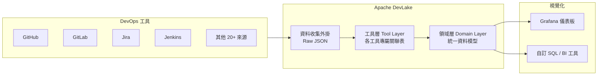
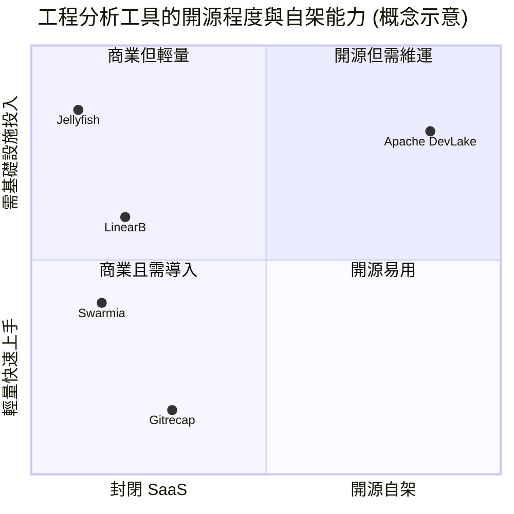

# Apache DevLake 是什麼？

## 摘要

Apache DevLake 是一套開源的「開發資料平台」(dev data platform)，用來彙整、分析並視覺化散落在各種 DevOps 工具中的資料，藉此萃取有助於工程卓越、開發者體驗與社群成長的洞見[^intro]。它由 Apache 軟體基金會 (ASF) 治理，採用 Apache License 2.0，核心以 Go 語言撰寫，並搭配 Grafana 儀表板呈現資料[^gh]。

本文說明 DevLake 的定位、核心理念、架構、支援的資料來源、技術堆疊、授權與 Apache 專案狀態，並簡要比較同類工具。

## 一、它是什麼

DevLake 的官方定義為：一套開源的開發資料平台，能「彙整 (ingest)、分析並視覺化來自 DevOps 工具的零散資料，以萃取工程卓越、開發者體驗與社群成長的洞見」[^intro]。它鎖定的對象是「想更了解自身開發流程、並以資料驅動方式改進實務的開發團隊」，訴求是「只要連接資料並查詢即可」[^intro]。

## 二、核心理念：鬆耦合的資料收集 + 資料轉換

DevLake 的設計重點在於把「資料收集」與「資料轉換」解耦，並以「外掛 (plugin) + 儀表板 (dashboard)」的方式組裝[^concepts]。其資料流可分為三層：

1. **資料收集 (Raw Layer)**：資料收集外掛呼叫各工具的 API，將原始回應以 JSON 形式存放[^concepts]。
2. **工具層 (Tool Layer)**：把原始 JSON 正規化成各工具專屬的關聯式結構，例如 GitHub 的 `pull_requests` 表、GitLab 的 `merge_requests` 表[^concepts]。
3. **領域層 (Domain Layer)**：在工具層之上建立統一綱要，把不同工具中的相似實體 (例如 GitHub PR 與 GitLab MR) 收斂成同一個實體。因此 Cycle Time、DORA 等指標只要針對領域層實作一次，即可套用到所有資料來源[^concepts]。

使用者透過 **Config UI** 定義「Blueprint」(藍圖)，宣告要連接哪些資料來源、收集哪些範圍、如何轉換、多久同步一次；再由 **Grafana** 儀表板以 SQL 查詢領域層來呈現預先建好的視覺化[^arch]。

## 三、架構元件

依官方 Architecture 頁面，主要元件如下[^arch]：

| 元件 | 角色 |
|---|---|
| **Config UI** | 網頁介面，用來建立、觸發與除錯 Blueprint，定義資料流線的「在哪裡」(資料連線)、「什麼」(資料範圍)、「如何」(轉換規則)、「何時」(同步頻率)。 |
| **API Server** | DevLake 主要的程式化介面。 |
| **Runner** | 執行任務；預設在 API Server 內執行，另提供以 Temporal 為基礎的 runner (Beta) 供正式環境使用。 |
| **Database** | 儲存 DevLake 中介資料與使用者資料；自 v0.11 起支援 MySQL 與 PostgreSQL。 |
| **Plugins** | 模組化元件，分為資料收集外掛與資料轉換外掛兩類。 |
| **Dashboards** | 隨 DevLake 附帶的預建 Grafana 儀表板 (JSON 格式)，可用 SQL 客製或替換為自家 BI 工具。 |

官方並強調三項設計原則[^arch]：**可擴充** (外掛系統 + dbt 外掛支援自訂轉換)、**可攜** (模組化設計，支援 Docker Compose 與 Helm)、**穩健** (SDK 處理 API 速率限制、重試與增量同步)。

## 四、支援的資料來源

依官方 Supported Data Sources 頁面，主要外掛與狀態如下[^sources]：

| 資料來源 | 涵蓋領域 | 狀態 |
|---|---|---|
| GitHub | SCM、程式碼審查、議題追蹤、CI/CD (Actions) | 可用 |
| GitLab | SCM、程式碼審查、議題追蹤、CI/CD | 可用 |
| Jira | 議題追蹤 (Cloud 與 Server/Data Center 7.x+) | 可用 |
| Jenkins | CI/CD (2.263.x+) | 可用 |
| Azure DevOps (Beta) | CI/CD、SCM、程式碼審查 (Cloud) | 可用 |
| SonarQube | 程式碼品質 (8.x、9.x) | 可用 |
| PagerDuty / Opsgenie / incident.io / Grafana IRM | 事故追蹤 (Cloud) | 可用 |
| CircleCI | CI/CD (Cloud) | 可用 |
| BitBucket、TAPD、Zentao、Teambition (Beta) | SCM／議題追蹤 | 進階模式 |
| Gitee、Bamboo CI、Feishu、AE | 多領域 | 開發中 (UI 尚未提供) |
| Webhook | 任意工具 — 可直接推送資料 | 可用 |

若某個 CI/CD 工具尚未被支援，可透過 **Webhook** 功能主動把資料推送到 DevLake[^intro]。

## 五、技術堆疊

依 GitHub 語系統計與官方文件[^gh][^arch]：

| 層級 | 技術 |
|---|---|
| 後端 (API Server、Runner、外掛) | **Go** (約 9.85 MB，主要語言) |
| 前端 (Config UI) | **TypeScript** (約 981 KB) 與少量 JavaScript |
| 資料轉換 (dbt) | **Python** (約 232 KB) |
| 資料庫 | **MySQL** 或 **PostgreSQL** (可選) |
| 儀表板 | **Grafana** (預建 JSON 儀表板) |
| 容器化部署 | Docker Compose (本機) / Helm (Kubernetes) |
| 正式環境排程 (Beta) | Temporal.io |
| 授權 | Apache License 2.0 |

## 六、GitHub 專案現況

截至本文撰寫時，`apache/devlake` 倉庫的公開統計為[^ghapi]：

- **Star 數**：3,173
- **Fork 數**：827
- **觀察者 (watchers)**：45
- **未解議題**：58
- **主要語言**：Go
- **授權**：Apache License 2.0
- **建立時間**：2021-07-08

最新版本為 `v1.0.3-beta18` (2026-09-27 發布)；最近一次正式 ASF source release 為 `1.0.2-incubating` (2025-07-01)[^releases]。

## 七、Apache 專案狀態

- **2022-04-29**：進入 Apache Incubator[^incubator]。
- **2025 年 7 月**：畢業投票通過，從 Incubator 畢業為頂層專案 (Top-Level Project, TLP)[^board]。
- **2025-09-24**：ASF 董事會正式成立 Apache DevLake 專案[^board]。
- **畢業時社群指標**：累積 205+ 位貢獻者、1,640+ 位 Slack 成員、17+ 位 committer，孵育期間共 13 次發布[^incubator]。

畢業後倉庫由 `apache/incubator-devlake` 遷移至 `apache/devlake`[^board]。

## 八、與同類工具的比較

DevLake 在工程分析 (engineering analytics) 領域中，定位為少數「主要、開源、可自架」的選項。與商業 SaaS 工具相比，其差異大致如下[^gitrecap][^deckgauge]：

- **價格**：DevLake 為免費自架；多數同類工具採企業報價或按人頭計費[^gitrecap]。
- **架構特性**：DevLake 提供完整 SQL 存取權與原始資料擁有權，但代價是需要自行部署與維運 (Docker 或 Kubernetes、資料庫管理)[^gitrecap]。
- **資料來源廣度**：官方聲稱支援 20+ 來源，屬相對廣泛者[^gitrecap]。
- **上手時間**：需數天建置基礎設施，相較於部分採「五分鐘上手」的雲端工具明顯較長[^gitrecap]。

## 九、來源反思

本報告的事實主要來自 (1) Apache DevLake 官方文件與網站、(2) Apache 基金會與 Incubator 官方頁面及董事會紀錄、(3) GitHub 官方 API 與倉庫頁面、(4) 第三方比較文章。前兩者與 GitHub API 屬第一手、權威性高，可信度最佳。第三方比較文章 (如 Gitrecap、Deckgauge) 可能帶有商業推廣動機 (其本身即為同類工具)，故其「競品比較」與價格描述僅供參考，非中立事實。此外，GitHub 統計數字 (star、fork) 為動態值，會隨時間變動，報告中已註明擷取日期。官方網站頁尾仍顯示「incubating」字樣，與已畢業的事實不一致，推測為網站快取或尚未更新所致[^intro]，讀者引用時應以 ASF 董事會與畢業公告為準。

## 參考文獻

[^intro]: Apache DevLake. (n.d.). *Introduction*. Retrieved 2026-10-19, from https://devlake.apache.org/docs/Overview/Introduction

[^arch]: Apache DevLake. (n.d.). *Architecture*. Retrieved 2026-10-19, from https://devlake.apache.org/docs/Overview/Architecture

[^concepts]: Apache DevLake. (n.d.). *Key Concepts*. Retrieved 2026-10-19, from https://devlake.apache.org/docs/Overview/KeyConcepts

[^sources]: Apache DevLake. (n.d.). *Supported Data Sources*. Retrieved 2026-10-19, from https://devlake.apache.org/docs/Overview/SupportedDataSources

[^gh]: GitHub. (n.d.). *apache/devlake*. Retrieved 2026-10-19, from https://github.com/apache/devlake

[^ghapi]: GitHub API. (2026, October 20). *Repositories — apache/devlake* [Data file]. Retrieved 2026-10-19, from https://api.github.com/repos/apache/devlake

[^releases]: GitHub. (n.d.). *Releases — apache/devlake*. Retrieved 2026-10-19, from https://github.com/apache/devlake/releases

[^incubator]: Apache Incubator. (n.d.). *Apache DevLake Incubation Status*. Retrieved 2026-10-19, from https://incubator.apache.org/projects/devlake.html

[^board]: The Apache Software Foundation. (2025, September 24). *Board meeting minutes — Apache DevLake*. Retrieved 2026-10-19, from https://www.apache.org/foundation/board/minutes/DevLake.html

[^gitrecap]: Gitrecap. (n.d.). *Best DORA metrics tools*. Retrieved 2026-10-19, from https://www.gitrecap.com/blog/best-dora-metrics-tools

[^deckgauge]: Deckgauge. (n.d.). *Compare*. Retrieved 2026-10-19, from https://deckgauge.com/compare/
