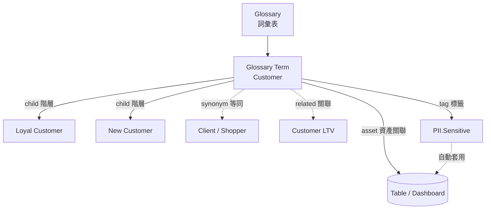
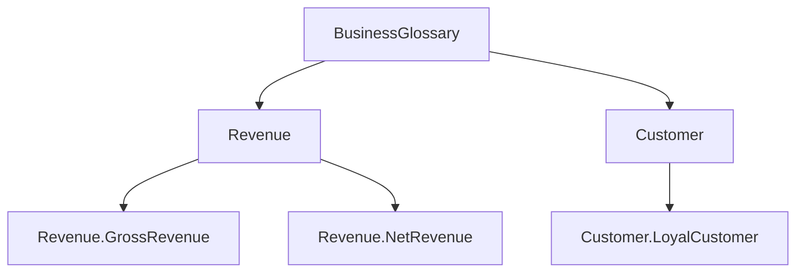
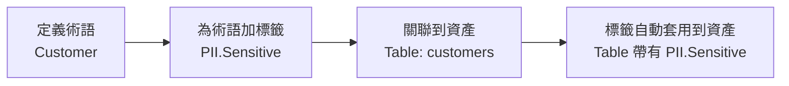

# OpenMetadata 的 Glossary（詞彙表）是什麼？

## 摘要

**Glossary（詞彙表）** 是 OpenMetadata 資料治理模組中的一項核心功能，用來定義組織內部重要概念與術語的**受控詞彙（Controlled Vocabulary）**，目的是讓不同團隊對資料有一致且共通的理解[^om-glossary]。它為資料加上「語意（semantics）」，回答的是「這筆資料在商業上代表什麼意思」這個問題，而不是「這筆資料屬於哪個技術分類」。

OpenMetadata 將 Glossary 建模為**索引典（Thesaurus）**，用術語（Glossary Term）之間的**階層關係、等同關係（同義詞）、關聯關係**來建立一張概念語意網路[^om-glossary]。詞彙表中的詞彙（Glossary Term）可再與資料資產（表格、儀表板、Topic 等）建立關聯，並可攜帶分類標籤（Tag），當詞彙被套用到資產時，其標籤會自動一併套用，形成自動化的中介資料擴充流程[^om-term][^om-assets]。

本報告為獨立文件，所有背景知識與引用均收錄於本文內。

---

## 一、什麼是 Glossary？

### 1.1 受控詞彙的概念

在資訊檢索領域，**受控詞彙（Controlled Vocabulary）** 指的是一份經過精心挑選的字詞清單，用來標記資訊單位，使資訊更容易被搜尋與取用；它要求使用事先由詞彙表設計者選定的「偏好術語」，與自然語言詞彙相對[^wiki-cv]。受控詞彙能解決三種語言問題：同形異義詞（homograph）、同義詞（synonym）與多義詞（polyseme），做法是在「概念」與「偏好術語」之間建立一對一的對應關係[^wiki-cv]。

**索引典（Thesaurus）** 則是受控詞彙的一種特殊形式。依國際標準 ISO 25964-1 的定義，索引典是「一種受控且結構化的詞彙，其中概念以術語表示，並經過組織使概念之間的關係被明確化，偏好術語另附同義詞或準同義詞的指引條目」[^wiki-thesaurus]。索引典同時服務「索引者」與「檢索者」，引導雙方選用同一個偏好術語來描述某個主題，以降低語意歧義、確保儲存與檢索的一致性[^isko]。

### 1.2 OpenMetadata 對 Glossary 的定義

OpenMetadata 官方文件將 Glossary 明確定義為：

> 「Glossary 是一種受控詞彙，用來描述組織內重要概念與術語，以促成對資料共通且一致的理解。」[^om-glossary]

其主要效益包括[^om-glossary]：

- 透過標準術語促進團隊協作
- 協助**資料治理（Data Governance）**
- 輔助資料探索、檢索與探索
- 協助新進成員理解組織術語

Glossary 在 OpenMetadata 使用者介面中的入口路徑為 **Govern >> Glossary**，所有詞彙表會列在左側導覽列；點選某一詞彙表後，會展開其完整的術語階層[^om-glossary]。

---

## 二、Glossary 的資料模型：索引典

OpenMetadata 將 Glossary 建模為索引典，術語之間支援三種標準關係[^om-glossary]：

| 關係類型 | 英文 | 說明 | 範例 |
|---|---|---|---|
| 階層關係 | Hierarchical | 父子術語巢狀，由一般到特定概念 | 「Customer」→「Loyal Customer」 |
| 等同關係 | Equivalent | 同義詞，同一概念的不同說法 | 「Customer」→「Client」、「Shopper」 |
| 關聯關係 | Associative | 相關但非階層、非等同的概念網路 | 「Customer」↔「Customer LTV」 |

上述三種關係正好對應索引典標準中的三種主要關係：階層（BT/NT，broader/narrower term）、等同（USE/UF）、關聯（RT，related term）[^isko]。

---

## 三、Glossary Term（詞彙術語）

**Glossary Term（詞彙術語）** 是詞彙表中的基本單位，代表某個概念的偏好術語[^om-term]。每個術語包含下列欄位[^om-term]：

| 欄位 | 必填 | 說明 |
|---|---|---|
| **Description（描述）** | 是 | 唯一且清楚的定義，用以建立一致的使用與理解 |
| **Synonyms（同義詞）** | 否 | 同一概念的其他說法，例如「Customer」的同義詞為 Client、Shopper、Purchaser |
| **Child Terms（子術語）** | 否 | 建立父子階層，由一般到特定，例如 Customer → Loyal/New/Online Customer |
| **Related Terms（相關術語）** | 否 | 建立關聯網路，例如 Customer ↔ Customer LTV、Customer Acquisition Cost |
| **Tags（標籤）** | 否 | 分類標籤；套用術語到資產時，標籤會一併套用到該資產 |
| **References（參考）** | 否 | 連結至術語來源的外部網路資源 |
| **Mutually Exclusive（互斥）** | 否 | 啟用後，同一詞彙表／術語下的多個子術語不能同時指派給同一資產（例如資產只能是 PII-Sensitive 或 PII-NonSensitive 其一） |
| **Reviewers（審查者）** | 否 | 可加入多位審查者，負責審查與核准術語變更 |
| **Assets（資產）** | 否 | 與術語關聯的資料資產，協助資料探索 |
| **Lifecycle Status（生命週期狀態）** | — | 例如 Draft（草稿）、Approved（已核准） |

### 3.1 術語詳細頁的三個分頁[^om-term]

- **Overview（總覽）**：顯示術語描述、同義詞、相關術語、參考、標籤、擁有者與審查者
- **Glossary Terms（詞彙術語）**：列出該父術語下的所有子術語，可再新增子術語
- **Assets（資產）**：列出所有關聯的資料資產，並依型別分組（例如 Tables、Topics、Dashboards），可新增或移除資產

### 3.2 階層與完整限定名稱（FQN）

Glossary 與其術語形成嚴格的階層樹，每個術語有以點號（dot）標示的**完整限定名稱（Fully Qualified Name, FQN）**[^om-glossary]：

- 頂層術語：`Glossary.TermName`，例如 `BusinessGlossary.Revenue`
- 巢狀術語：`Glossary.Parent.Child`，例如 `BusinessGlossary.Revenue.GrossRevenue`

---

## 四、如何建立與管理 Glossary

### 4.1 建立 Glossary 的欄位[^om-setup]

| 欄位 | 必填 | 說明 |
|---|---|---|
| **Name（名稱）** | 是 | 詞彙表的系統識別名稱 |
| **Display Name（顯示名稱）** | 否 | 介面上顯示的可讀名稱 |
| **Description（描述）** | 是 | 描述詞彙表的脈絡或領域 |
| **Tags（標籤）** | 否 | 可為詞彙表加上分類標籤 |
| **Mutually Exclusive（互斥）** | 否 | 啟用後同一詞彙表的多個術語不能同時指派給同一資產 |
| **Owner（擁有者）** | 否 | 可為 Team 或 User；設於詞彙表層級時，所有術語會繼承 |
| **Reviewers（審查者）** | 否 | 可加入多位審查者，觸發審批流程 |

### 4.2 審批流程（Approval Workflow）[^om-approval]

- 當新增術語、且該詞彙表已指派審查者時，審批流程會**自動觸發**
- 新術語以 **Draft（草稿）** 狀態出現
- 只有被指派的**審查者**可以核准或拒絕
- 會為審查者建立一項 **Task**，顯示於 Overview 分頁；使用者可在任務中回覆討論，並以 @mention 邀請他人
- 核准後標記為 **Approved**，拒絕則標記為 **Rejected**
- 若詞彙表**未指派任何審查者**，所有術語預設即為 **Approved**

### 4.3 匯入與匯出[^om-import][^om-export]

**匯出**：於 Govern > Glossary 點選 ⋮ 圖示並選擇 Export；若已有術語會下載 CSV，若無則下載空白 CSV 範本。

**匯入**：準備含下列欄位的 CSV：

| 欄位 | 說明 |
|---|---|
| **parent** | 定義階層，例如 `Banking.Account.Savings Account`，根層級留空 |
| **name\*** | 必填，術語名稱 |
| **displayName** | 術語的顯示名稱 |
| **description\*** | 必填，術語描述 |
| **synonyms** | 以分號分隔，例如 `Client;Shopper;Purchaser` |
| **relatedTerms** | 階層以 `.` 分隔，多個術語以 `;` 分隔 |
| **references** | 格式 `name;url;name;url` |
| **tags** | 既有標籤，格式如 `PII.Sensitive;PersonalData.Personal` |

匯入後可**拖放**術語以重新排列階層[^om-import]。

### 4.4 樣式（Styling）[^om-styling]

可為詞彙術語設定**圖示連結**與**字型顏色**：於術語頁面點選 ⋮ 圖示 → Style → 加入圖示圖片連結及／或變更字體顏色 → Submit。當資產被標上具顏色代碼的詞彙術語時，可更容易以視覺辨識。

---

## 五、Glossary Term 與資產、標籤的關係

### 5.1 與資料資產（Assets）

建立詞彙術語後，可將資料資產關聯到該術語，協助資料探索[^om-term]。此關聯透過術語的 **Assets 分頁**管理，資產會依型別分組（如 Tables、Topics、Dashboards），可依型別搜尋與篩選後選取並儲存[^om-term]。此外，管理員可透過資料資產規則（Data Asset Rule，例如「Tables can only have a single Glossary Term」）限制一張表僅能有單一詞彙術語，否則可關聯多個術語[^om-assets]。

### 5.2 與標籤（Tags）的串聯關係

標籤與詞彙術語之間有強大的串聯關係[^om-term][^om-assets]：

- 可將**分類標籤加到詞彙術語**上作為分類標記
- 當**詞彙術語被套用到資料資產**時，其關聯的標籤會**自動一併套用**到該資產
- 也就是說，若將某術語標上 `PII.Sensitive`，任何使用該術語的資產都會自動被套上此標籤

這形成一條自動化的中介資料擴充管線：定義術語 → 為術語加標籤 → 關聯到資產 → 標籤向下串聯[^om-assets]。

### 5.3 與 Classification（分類）的差異

OpenMetadata 的治理框架中有兩套平行的階層結構：**Glossary（詞彙表）** 與 **Classification（分類）／Tag（標籤）**。兩者概念不同但互補[^om-glossary][^om-term]：

| 面向 | Glossary（詞彙表） | Classification / Tags（分類／標籤） |
|---|---|---|
| 主要問題 | 資料在商業上**代表什麼** | 資料**屬於哪種類別** |
| 資料模型 | 索引典（含同義詞、階層、關聯） | 分類法（階層式標籤） |
| 關係 | 階層 + 等同（同義）+ 關聯 | 嚴格的父子階層（broader/narrower） |
| 對象 | 定義商業概念本身 | 標記資料資產的技術／治理屬性 |
| 範例 | 「Customer」為一詞彙術語 | 「PII.Sensitive.Email」為一標籤 |

Glossary 定義資料「意味著什麼」，Classification 定義資料「是什麼類型」；兩者並存並相互強化：詞彙術語可攜帶分類標籤，套用術語時標籤會一併串聯[^om-glossary][^om-assets]。

---

## 六、版本歷史

Glossary 與 Glossary Term 皆維護版本歷史，可於右上角查看，點選版本號會顯示版本歷史細節[^om-term]：

- **向後相容的變更**（例如描述、標籤或擁有權變更）產生**次版本**變更（+0.1，例如 0.1 → 0.2）
- **向後不相容的變更**（例如刪除術語）產生**主版本**變更（+1.0，例如 0.2 → 1.2）

---

## 七、API 端點

OpenMetadata 為 Glossary 管理提供完整的 REST API（建立／更新、列表、依 ID／FQN 取得、patch 更新、刪除、還原、版本查詢）。主要端點位於 `/v1/glossaryTerms`[^om-api]。

---

## 八、來源評析（Critical Reflection）

- **官方文件（docs.open-metadata.org）**：本報告的主要事實來源。此為專案官方文件，權威性高；惟不同版本路徑（v2.0.x 與 latest）內容可能略有差異，使用時應確認版本[^om-glossary][^om-term]。
- **受控詞彙與索引典的學術／標準來源**：Wikipedia、ISKO（International Society for Knowledge Organization）百科、以及 ISO 25964／ANSI-NISO Z39.19 等國際標準，屬於資訊科學領域公認的權威來源，用以補足 OpenMetadata 文件中未詳述的理論背景[^wiki-cv][^wiki-thesaurus][^isko]。
- **時效性**：OpenMetadata 為快速演進的開源專案，功能細節可能隨版本更新；本報告所述欄位與流程以官方 v2.0.x 文件為準，引用日期為 2026-10-19。

---

## 參考文獻

[^om-glossary]: OpenMetadata. (n.d.). Glossary | OpenMetadata Data Glossary Guide. Retrieved 2026-10-19, from https://docs.open-metadata.org/v2.0.x/how-to-guides/data-governance/glossary

[^om-term]: OpenMetadata. (n.d.). What is a Glossary Term. Retrieved 2026-10-19, from https://docs.open-metadata.org/v2.0.x/how-to-guides/data-governance/glossary/glossary-term

[^om-setup]: OpenMetadata. (n.d.). How to Setup a Glossary. Retrieved 2026-10-19, from https://docs.open-metadata.org/v2.0.x/how-to-guides/data-governance/glossary/setup

[^om-assets]: OpenMetadata. (n.d.). How to Add Assets to Glossary Terms. Retrieved 2026-10-19, from https://docs.open-metadata.org/v2.0.x/how-to-guides/data-governance/glossary/assets

[^om-approval]: OpenMetadata. (n.d.). Glossary Approval Workflow. Retrieved 2026-10-19, from https://docs.open-metadata.org/v2.0.x/how-to-guides/data-governance/glossary/approval

[^om-import]: OpenMetadata. (n.d.). How to Bulk Import a Glossary. Retrieved 2026-10-19, from https://docs.open-metadata.org/v2.0.x/how-to-guides/data-governance/glossary/import

[^om-export]: OpenMetadata. (n.d.). Glossary Export. Retrieved 2026-10-19, from https://docs.open-metadata.org/v2.0.x/how-to-guides/data-governance/glossary/export

[^om-styling]: OpenMetadata. (n.d.). Glossary Styling. Retrieved 2026-10-19, from https://docs.open-metadata.org/v2.0.x/how-to-guides/data-governance/glossary/styling

[^om-api]: OpenMetadata. (n.d.). Glossary Terms API Reference. Retrieved 2026-10-19, from https://docs.open-metadata.org/v2.0.x/api-reference/governance/glossary-terms

[^wiki-cv]: Wikipedia. (n.d.). Controlled vocabulary. Retrieved 2026-10-19, from https://en.wikipedia.org/wiki/Controlled_vocabulary

[^wiki-thesaurus]: Wikipedia. (n.d.). Thesaurus (information retrieval). Retrieved 2026-10-19, from https://en.wikipedia.org/wiki/Thesaurus_(information_retrieval)

[^isko]: Dextre Clarke, S. G. (n.d.). Thesaurus (for information retrieval). ISKO Encyclopedia of Knowledge Organization. Retrieved 2026-10-19, from https://www.isko.org/cyclo/thesaurus
