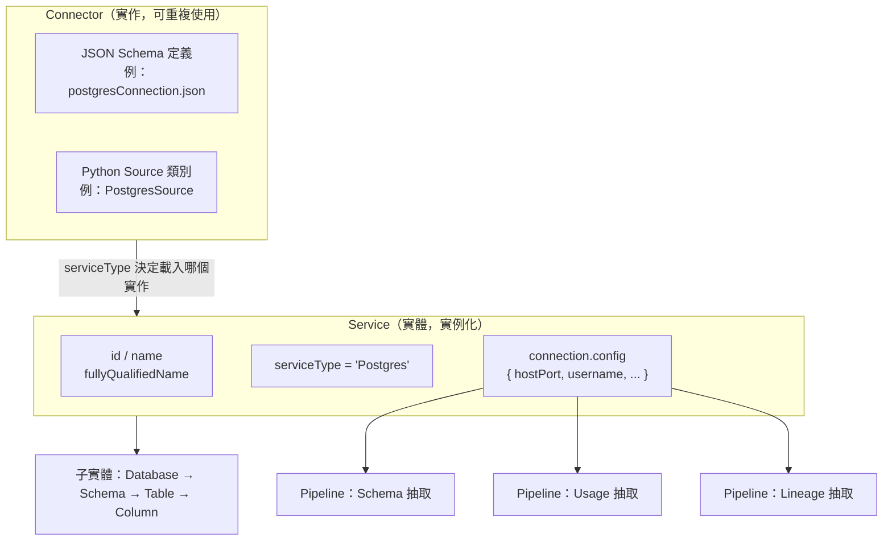

# OpenMetadata 中 Service 與 Connector 的關係

## 摘要

在 OpenMetadata 中，**Service（服務）** 是一個中繼資料實體（entity），代表對某個外部資料平台的「一個具體實例」的連線；而 **Connector（連接器）** 是「如何連上並抽取中繼資料」的實作，由一份 JSON Schema 定義加上 Python 抽取程式碼組成。一句話總結：**Connector 定義「怎麼連」，Service 是該連接器針對某個真實系統的「具體實例化」**，並在其中存放實際的連線參數（host、port、憑證等）[^hld]。

本報告為獨立文件，所有需要的背景皆收錄於文中。

---

## 1. 基本定義

### Service（服務）

Service 是 OpenMetadata 各類資料資產的**最上層容器**。它代表連往某個外部平台的一個具體運行實例，例如「正式的 PostgreSQL 叢集」、「Tableau 開發伺服器」或「Airflow 排程器」[^dataassets]。資料資產普遍遵循以下階層模式[^standards]：

```
Service → Container 1 → Asset 1 → Sub-Asset 1
```

依平台類別，Service 分為多種類型，各有對應的子實體階層[^dataassets][^standards]：

| Service 類型 | 代表平台 | 子實體階層 |
|---|---|---|
| DatabaseService | Postgres、MySQL、Snowflake、BigQuery | Service → Database → Schema → Table → Column |
| DashboardService | Tableau、Looker、PowerBI、Superset | Service → Dashboard → Chart、DataModel |
| MessagingService | Kafka、Kinesis、Pub/Sub、Redpanda | Service → Topic → Schema Fields |
| PipelineService | Airflow、Dagster、Prefect、dbt、Fivetran | Service → Pipeline → Task |
| MLModelService | MLflow、SageMaker、Vertex AI | Service → MLModel → Features |
| StorageService | S3、GCS、ADLS、MinIO | Service → Container → Files |
| SearchService | Elasticsearch、OpenSearch | Service → SearchIndex → Fields |
| APIService | 一般 REST API 平台 | Service → APICollection → APIEndpoint |
| MetadataService | Amundsen、Atlas、Alation | Service → （匯入的中繼資料實體） |

### Connector（連接器）

Connector 是連接並從來源系統抽取中繼資料的**實作**。官方架構文件定義，抽取框架（Ingestion Framework）「是所有 Connector 的基礎，亦即定義 OpenMetadata 與外部系統之間互動的元件」[^hld]。

Connector 同時包含兩部分：
1. **JSON Schema 定義**：宣告連線所需的參數。
2. **Python 抽取程式碼**：實際連線並把外部資料轉成 OpenMetadata 的實體格式[^deepdive]。

Connector 的分類與 Service 類型完全對應（Database、Dashboard、Messaging、Pipeline、ML Model、Storage、Search、API 連接器）[^connectors]。

---

## 2. 兩者的核心關係

關係可濃縮為：

| 概念 | 定義 | 舉例 |
|---|---|---|
| **Connector** | 針對某一平台類型的實作（JSON Schema + Python 程式碼） | 「BigQuery 連接器」 |
| **Service Type** | 標識平台的 enum 值 | `databaseServiceType` 中的 `"BigQuery"` |
| **Connection Type** | 含實際認證／連線參數的 JSON Schema | `bigQueryConnection.json` |
| **Service 實體** | 帶有真實設定的一個連接器實例 | `my-bigquery-prod`，含實際專案 ID 與憑證 |

**連接器是「類別（class）」，Service 是該類別的「實例（instance）」。** 當你在介面上建立一個 Service，其實是選擇一種連接器型別、填入設定，背後便由該連接器類別建立一個實例，並以 Service 中的 `connection` 設定初始化[^custom]。因此你可以在同一種連接器上建立多個 Service，例如 `postgres-prod`、`postgres-staging`、`postgres-dev`，各自帶著不同的 host／port／憑證[^custom][^standards]。

官方也建議：「多環境：為 dev／staging／prod 建立各自獨立的 service」[^standards]。

---

## 3. 對應機制：serviceType 決定一切

每個 Service 實體都有一個**必填的 `serviceType` enum 欄位**，用來識別該服務的具體平台／廠牌。它決定了三件事[^dbservice][^standards]：

1. 執行時要載入哪一個連接器程式碼；
2. 要對照哪一份連線設定 Schema 做驗證；
3. 要使用哪一套子實體階層。

以 `DatabaseService` 為例，`serviceType` 的 enum 值包含[^dbservice]：

```
BigQuery, BigTable, Mysql, Redshift, Snowflake, Postgres, Timescale,
Mssql, Oracle, Athena, Hive, Impala, Presto, Trino, Vertica, Glue,
MariaDB, Druid, Db2, Clickhouse, Databricks, AzureSQL, DynamoDB,
SingleStore, SQLite, DeltaLake, Salesforce, PinotDB, Datalake, ...
```

每個平台（例如 `Postgres`）都有專屬的連線 Schema，其 `type` 欄位被固定為該平台值。以 `postgresConnection.json` 為例，其 `postgresType` 定義只有一個 enum 值 `"Postgres"`[^pgconn]：

```json
"postgresType": {
  "description": "Service type.",
  "type": "string",
  "enum": ["Postgres"],
  "default": "Postgres"
}
```

---

## 4. connection 欄位：Service 如何「內嵌」連接器設定

Service 實體把連線設定**內嵌**在自身的 `connection` 欄位中。`DatabaseService` 的 JSON Schema 定義如下[^dbservice]：

```json
"connection": {
  "$ref": "#/definitions/databaseConnection"
}
```

而 `databaseConnection` 內的 `config` 使用 `oneOf` 列舉所有可能的連線型別 Schema，形成「可辨識聯合（discriminated union）」[^dbservice]：

```json
"config": {
  "mask": true,
  "oneOf": [
    { "$ref": "./connections/database/bigQueryConnection.json" },
    { "$ref": "./connections/database/mysqlConnection.json" },
    { "$ref": "./connections/database/postgresConnection.json" }
    /* ... 其餘數十種連線 Schema */
  ]
}
```

當你建立 Service 並選擇 `serviceType = "Postgres"` 後，`config` 就必須符合 `postgresConnection.json` 的結構。該 Schema 定義的實際連線屬性包括 `hostPort`、`username`、`database`、`authType`，以及 `sslMode`、`sslConfig`、各類 `*FilterPattern`、`connectionOptions` 等；並以 `supports*` 布林旗標宣告此連線支援哪些能力（中繼資料抽取、usage、lineage、profiler、dbt 等）[^pgconn]。

`config` 上的 `mask: true` 表示敏感欄位（密碼、權杖）在 API 回應中會被遮蔽[^dbservice][^pgconn]。

---

## 5. 一對一還是多對多？

- **一個 Service 恰有一個連線設定。** Schema 中 `connection` 是單一 object 屬性，不是陣列，因此一個 Service 名稱即對應一個外部系統連線[^dbservice]。
- **一個連接器型別可建立多個 Service 實例**（如前述 prod／staging／dev）[^custom][^standards]。
- **一個 Service 可掛多條抽取管線（pipelines）。** `pipelines` 欄位是 `entityReferenceList`（陣列），可從同一連線抽取不同類型的中繼資料，如 schema、usage、lineage、profiling[^dbservice]。

因此「一條連線、多個管線；一種連接器、多個服務」，但「一個服務只有一個連線」。

---

## 6. 關係如何儲存

Service 實體以 JSON 文件形式存於 OpenMetadata 資料庫，但**關係不內嵌在 JSON 文件中**。官方說明[^hld]：

> 「實體以 JSON 文件形式儲存於資料庫中……這個 JSON 不儲存任何關係。例如某位 User 擁有某個 Dashboard，這項資訊會被具體化在一張獨立的 `entity_relationship` 表作為圖節點，其邊（edge）帶有關係類型（例如 `contains`、`uses`、`follows`……）。」

Service 相關的關係參照包含[^dbservice]：
- `pipelines` → 此服務部署的抽取管線
- `owners` → 擁有的 User／Team
- `followers` → 追蹤者
- `dataProducts`／`domains` → 所屬資料產品／領域
- `ingestionRunner` → 負責的抽取代理
- `dataContract` → 資料合約參照

Service 的必填欄位為 `["id", "name", "serviceType"]`[^dbservice]。

---

## 7. 示意圖



連接器類別階層（資料庫類）為[^deepdive]：

```
Source
 └─ DatabaseServiceSource
     └─ CommonDbSourceService
         └─ PostgresSource / MySQLSource / SnowflakeSource / ...
```

---

## 8. 來源批判與限制

- 官方文件與 Standards 網站（openmetadatastandards.org）皆由 OpenMetadata／Collate 專案維護，屬第一方來源，對自身架構的描述應屬權威，但仍可能選擇性呈現。
- JSON Schema 內容直接取自 GitHub `main` 分支原始檔，反映撰寫當下（2026-10-19）的狀態；OpenMetadata 迭代快速，欄位與 enum 值可能隨版本變動。
- 不同文件版本（v1.13.x、v2.0.x、v2.1.x-SNAPSHOT、latest）內容略有差異，本報告以能取得的最具體原文為準。
- `serviceType` enum 的完整清單未逐一列舉（來源稱 40 餘至 60 餘項，各文件敘述不一），本報告僅列代表性項目。

---

## 參考文獻

[^hld]: OpenMetadata. (n.d.). *High level design*. Retrieved 2026-10-19, from https://docs.open-metadata.org/api-reference/main-concepts/high-level-design

[^dataassets]: OpenMetadata. (n.d.). *Data assets*. Retrieved 2026-10-19, from https://docs.open-metadata.org/api-reference/data-assets

[^standards]: OpenMetadata Standards. (n.d.). *Data assets overview*. Retrieved 2026-10-19, from https://openmetadatastandards.org/data-assets/overview/

[^connectors]: OpenMetadata. (n.d.). *Connectors*. Retrieved 2026-10-19, from https://docs.open-metadata.org/latest/connectors

[^deepdive]: OpenMetadata. (n.d.). *Metadata ingestion | Technical architecture*. Retrieved 2026-10-19, from https://docs.open-metadata.org/latest/developers/contribute/codebase-deep-dives/metadata-ingestion

[^dbservice]: OpenMetadata. (n.d.). *databaseService.json* [Source code]. Retrieved 2026-10-19, from https://github.com/open-metadata/OpenMetadata/blob/main/openmetadata-spec/src/main/resources/json/schema/entity/services/databaseService.json

[^pgconn]: OpenMetadata. (n.d.). *postgresConnection.json* [Source code]. Retrieved 2026-10-19, from https://github.com/open-metadata/OpenMetadata/blob/main/openmetadata-spec/src/main/resources/json/schema/entity/services/connections/database/postgresConnection.json

[^custom]: OpenMetadata. (n.d.). *Custom connectors*. Retrieved 2026-10-19, from https://docs.open-metadata.org/connectors/custom-connectors
