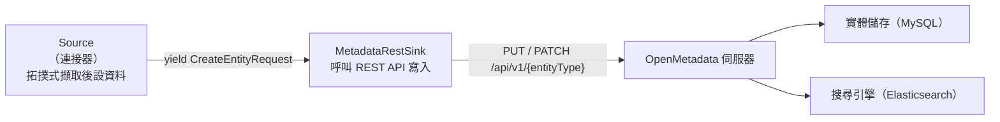
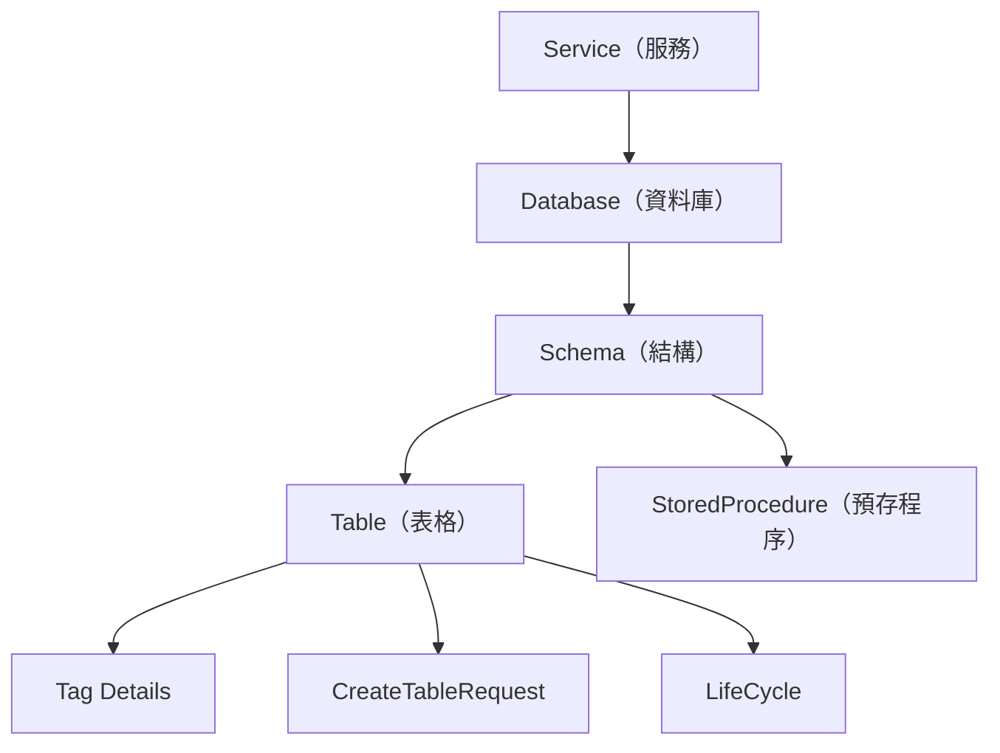
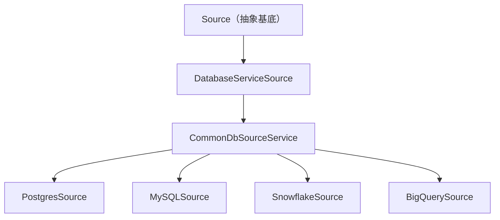
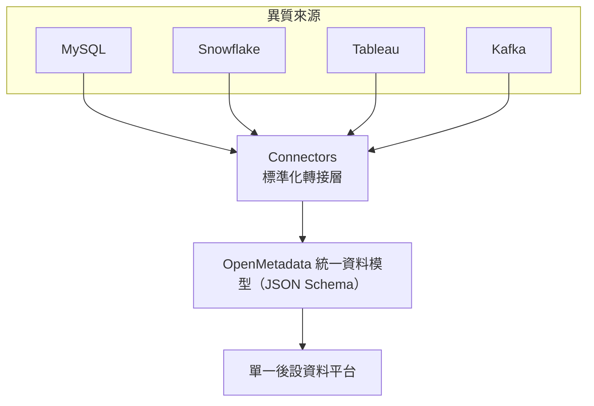

# OpenMetadata 的 Connector 是什麼？它能做什麼？

本報告探討資料治理平台 OpenMetadata 中的核心概念「Connector（連接器）」，說明其定義、功能、架構，並回答「沒有 Connector 會怎樣」，以及 Connector 究竟解決了什麼問題。

## 1. 背景：OpenMetadata 是什麼

OpenMetadata 是一個開源的資料治理與後設資料（metadata）平台，採用 Apache License 2.0 授權，在 GitHub 上約有 15.5k 顆星[^gh]。其目標可用官方文件中一句話概括：

> 「The goal of OpenMetadata is to serve as a centralised platform where users can gather and collaborate around data. This is possible thanks for different workflows that users can deploy and schedule, which will connect to the data sources to extract metadata.」（OpenMetadata 的目標是成為一個集中式平台，讓使用者能圍繞資料進行彙整與協作。這要歸功於使用者可部署與排程的各種工作流程，這些流程會連線到資料來源以擷取後設資料。）[^ing]

換言之，OpenMetadata 本身**不生產**後設資料，它是一座「空倉庫」。要讓倉庫有內容，就必須靠 Connector 把外部系統的後設資料拉進來。

## 2. Connector 的定義

### 2.1 官方定義

OpenMetadata 官方文件對 Connector 的說明相當直接。在連接器總覽頁上寫著：

> 「OpenMetadata can extract metadata from the following list of connectors below.」（OpenMetadata 可從下列連接器清單中擷取後設資料。）[^conn]

較技術性的定義出現在自訂連接器（Custom Connectors）文件中：

> 「A connector is a class that extends from `from metadata.ingestion.api.steps import Source`.」（Connector 是一個繼承自 `Source` 的類別。）[^custom]

在擷取框架（Ingestion Framework）的說明中，Connector 被描述為框架的基本組成單位：

> 「OpenMetadata Ingestion is a simple framework to build connectors and ingest metadata of various systems through OpenMetadata APIs. It could be used in an orchestration framework (e.g. Apache Airflow) to ingest metadata.」（OpenMetadata 擷取框架是一個用於建構連接器、並透過 OpenMetadata API 擷取各種系統後設資料的簡易框架。它可搭配排程框架（例如 Apache Airflow）使用。）[^ireadme]

### 2.2 一句話總結

> **Connector 是一個「特定外部系統的轉接器」：它知道如何連上某個資料庫、儀表板、排程工具或訊息佇列，把該系統的後設資料讀出來，翻譯成 OpenMetadata 的標準實體格式，再送回 OpenMetadata 伺服器。**

## 3. Connector 能擷取什麼（功能）

Connector 不只是讀取表格名稱，它能擷取多種類型的後設資料[^ingcode]：

表 1：Connector 可擷取的後設資料類型

- **實體後設資料（Entities metadata）**：資料庫、schema、表格（table）、欄位（column）、儀表板、pipeline、Topic、ML Model 等結構性資訊。
- **使用量（Query usage）**：哪些查詢與表格最常被使用（使用量排名）。
- **血緣（Lineage）**：資料實體之間的上下游關係。
- **資料剖析（Data profiles）**：欄位統計、資料分布、取樣。
- **資料品質（Data quality tests）**：自動化品質測試結果，可整合 Great Expectations、dbt 等工具。

## 4. Connector 的分類

OpenMetadata 依「來源系統類型」將連接器分為以下類別[^conn][^ingcode]：

表 2：OpenMetadata 連接器分類

| 類別 | 說明 | 範例 |
| --- | --- | --- |
| API | REST API 服務 | REST（通用） |
| Database | SQL 與 NoSQL 資料庫 | MySQL、PostgreSQL、Snowflake、BigQuery、Redshift、MongoDB、Databricks、Oracle、MSSQL、ClickHouse 等數十種 |
| Dashboard | BI 與視覺化工具 | Tableau、PowerBI、Looker、Metabase、Superset、Grafana、Redash、Qlik、QuickSight 等 |
| Drive | 檔案／雲端硬碟服務 | Google Drive、SFTP、Custom Drive |
| Messaging | 事件串流平台 | Kafka、Kinesis、Pub/Sub、Redpanda |
| Pipeline | 資料排程／ETL 工具 | Airflow、Airbyte、Dagster、dbt Cloud、Fivetran、Glue、NiFi、Flink、Prefect、OpenLineage、KafkaConnect |
| ML Model | 機器學習平台 | MLflow、Sagemaker |
| Storage | 雲端物件儲存 | S3、GCS |
| Metadata | 其他後設資料平台（用於遷移） | AlationSink、Amundsen、Atlas |
| Search | 搜尋引擎 | Elasticsearch、OpenSearch |

每個連接器會被標記為 **PROD**（正式支援）或 **BETA**（可能有功能限制），提醒使用者成熟度的差異[^conn]。

## 5. Connector 的運作架構

### 5.1 Source → Sink 核心流程

擷取框架位於 `ingestion/src/metadata/ingestion/`，每一個擷取工作流程都遵循 **Source → Sink**（來源 → 匯）的模式，由 `workflow/metadata.py` 統籌[^ingcode]：

- **Source（連接器本體）**：以「拓撲」方式擷取後設資料，並為每個實體產生 `CreateEntityRequest`。
- **MetadataRestSink**：對每個請求呼叫 `PUT /api/v1/{entityType}`，若內容有變則改以 `PATCH`。

值得注意的是，**連接器並不直接寫入資料庫**。它只呼叫 OpenMetadata 伺服器的 REST API，由伺服器再落地到 MySQL 並建立 Elasticsearch 索引[^ingcode]。

### 5.2 拓撲（Topology）驅動的擷取

每個 Source 不以手寫迴圈走訪資料，而是宣告一棵 `TopologyNode` 樹，由框架深度優先走訪。每個節點包含[^ingcode]：

- **producer**：產生原始項目的方法（例如取得資料庫名稱清單）。
- **stages**：把每個項目轉換成實體請求的處理步驟。
- **children**：要遞迴進入的子節點。
- **post_process**：所有子節點完成後執行的清理工作。

以資料庫服務的拓撲為例[^ingcode]：

類別繼承關係亦反映這種抽象化：所有 SQL 資料庫連接器共用 `CommonDbSourceService`，再各自覆寫資料庫特有的方法[^ingcode]：

### 5.3 增量擷取（Fingerprinting）

每個實體都帶有一個由後設資料計算出的 `sourceHash`。Sink 藉此決定[^ingcode]：

- **CREATE**：實體尚不存在。
- **PATCH**：實體存在但雜湊不同（後設資料已變更）。
- **SKIP**：實體存在且雜湊相同（沒有變更）。

如此一來，只有真正變動的實體會被寫入，達成增量擷取，避免每次都全量重寫。

### 5.4 遷移用的連接器外掛

連接器本質上是外掛（plugin）。以標準契約來看，一個連接器會提供 `{__init__, service_spec, metadata, connection}.py` 等檔案，並含有一個繼承自 `CommonDbSourceService` 等的 `<Name>Source` 類別。這些 `ServiceSpec` 在執行時由 `DefaultSourceLoader` 動態載入，因此損壞的契約會在「擷取執行時」才失敗，而非提交時——這正是真正的外掛系統[^gh]。

## 6. 沒有 Connector 會怎樣？（Connector 解決的問題）

### 6.1 沒有 Connector 的世界

Connector 是後設資料**進入** OpenMetadata 的唯一常規通道，OpenMetadata 本身不內建任何後設資料。因此若沒有 Connector，結果會是一個「空殼」[^ing][^ingcode]：

- 沒有任何實體後設資料（表格、儀表板、Topic 等）。
- 沒有使用量後設資料（無法得知哪些表格最常被查詢）。
- 無法呈現任何血緣（lineage）關係。
- 無法設定資料剖析（profile）或資料品質測試。
- 介面上的搜尋與探索只會回傳空結果。
- 協作功能（資料文件、擁有者、標籤）無資料資產可依附，形同虛設。

用 OpenMetadata 官方 README 的話來說，AI 時代的問題不是「又一個原始資料庫連接器」，而是缺少脈絡：

> 「AI does not need another raw database connector. AI needs context + memory.」（AI 不需要另一個原始資料庫連接器，AI 需要的是脈絡與記憶。）[^gh]

直接連上倉儲或儀表板只暴露了「原始結構」，卻無法告訴 AI 助理資料是什麼意思、是否已認證、誰擁有它、適用哪些政策等[^gh]。Connector 正是把這層「脈絡」標準化地灌入平台的入口。

### 6.2 問題本質：異質來源無法互通

真正的痛點在於**異質性（heterogeneity）**。每個外部系統（資料庫、儀表板、訊息佇列、排程工具、ML 平台、儲存系統）都以完全不同的方式暴露後設資料，欄位型別、命名、階層結構各異。

Connector 提供的解法是「**可插拔的標準化抽象層**」：無論來源是什麼，都被正規化（normalize）成 OpenMetadata 由 JSON Schema 定義的統一資料模型。技術上，像 `ColumnTypeParser` 就是把各家資料庫特有型別對映到 OpenMetadata 的 `DataType` 列舉，並處理 JSON、ARRAY、STRUCT、MAP 等複合型別[^ingcode]。

### 6.3 Connector 解決的問題總結

- **異質來源難以統一**：以標準化抽象層把不同來源收斂到同一模型。
- **手動登記後設資料不可行**：以自動化工作流程取代人工輸入。
- **無法掌握資料全貌**：掌握技術後設資料、血緣、品質、使用量，形成統一的知識圖譜。
- **缺乏對 AI／代理的脈絡供給**：提供語意與脈絡，使 AI 助理與代理能正確理解資料[^gh]。

## 7. 自訂連接器（Custom Connector）

若官方未支援某來源，可自行開發連接器。重點步驟如下[^custom]：

1. **準備連接器**：建立一個繼承自 `Source` 的類別，實作 Source API 要求的必要方法；最關鍵的是 `_iter` 產生器，負責送出 Create Entity Requests。
2. **產生資料**：用 `Either` 包裝執行狀態——`right` 放正確的 `CreateEntityRequest`，`left` 放要追蹤的例外（`StackTraceError`）。
3. **打包**：加入 `setup.py` 或 `pyproject.toml`，讓擷取容器可安裝使用。
4. **準備擷取映像**：以 `FROM openmetadata/ingestion:<version>` 為基礎，`pip install` 自訂連接器。
5. **執行**：以 Docker Compose 或 Kubernetes 部署自訂映像。
6. **設定**：於介面 `Database Services > Add New Service > Custom`，填入 `Source Python Class Name`（完整模組名稱），讓框架能匯入該類別。

## 8. 來源批判性反思

本報告的資訊主要來自三大類來源，可信度與限制如下：

- **OpenMetadata 官方文件與程式碼倉庫**：為第一手權威來源，定義與架構描述可靠。但其內容會隨版本變動（文件同時存在 v1.6、v1.12、v1.13、v2.0 等多個版本），本報告已註明引用的版本脈絡。此外，官方文件在總覽頁多用「清單」方式呈現連接器，缺少一段統一的、正式的「Connector 定義」段落，因此本報告的定義是由多處（總覽頁、自訂連接器頁、擷取框架 README）拼湊而成。
- **第三方（如 Atlan）介紹文章**：由商業廠商撰寫，可能帶有推廣其自身產品的動機，本報告僅在架構描述上審慎採用，並優先以官方來源佐證。
- **GitHub star 數**：星數會隨時間變動，本報告標註為擷取當時的近似值（約 15.5k），僅供成熟度參考，非品質保證[^gh]。

整體而言，各來源對「Connector 是擷取外部後設資料並轉為 OpenMetadata 標準格式的適配器」這一核心定義看法一致，彼此可相互佐證；歧異主要出現在文件版本與細節完整度，而非概念本身。

## 9. 結論

在 OpenMetadata 中，**Connector 是把外部資料系統接進平台的「翻譯轉接器」**。它解決了「異質資料來源無法統一、後設資料需人工登記」的根本問題：透過可插拔的標準化抽象層與拓撲驅動的擷取流程，把資料庫、儀表板、pipeline、訊息佇列等各路後設資料，正規化為 OpenMetadata 的統一模型，並以增量方式寫入平台。沒有 Connector，OpenMetadata 只是一個空殼，既無法呈現資料全貌，也無法為 AI 與代理提供可信的資料脈絡。

## 參考文獻

[^gh]: OpenMetadata. (n.d.). *OpenMetadata: The Open Context Layer for Data and AI*. GitHub. Retrieved 2026-10-19, from https://github.com/open-metadata/OpenMetadata

[^conn]: OpenMetadata. (n.d.). *Connectors*. OpenMetadata Documentation (v2.0.x). Retrieved 2026-10-19, from https://docs.open-metadata.org/v2.0.x/connectors

[^ing]: OpenMetadata. (n.d.). *Ingestion*. OpenMetadata Documentation (v2.0.x). Retrieved 2026-10-19, from https://docs.open-metadata.org/v2.0.x/connectors/ingestion

[^custom]: OpenMetadata. (n.d.). *Custom Connectors*. OpenMetadata Documentation (v1.13.x). Retrieved 2026-10-19, from https://docs.open-metadata.org/v1.13.x/connectors/custom-connectors

[^ingcode]: OpenMetadata. (n.d.). *Metadata Ingestion* [Codebase Deep-Dives]. OpenMetadata Documentation (v1.13.x). Retrieved 2026-10-19, from https://docs.open-metadata.org/v1.13.x/developers/contribute/codebase-deep-dives/metadata-ingestion

[^ireadme]: OpenMetadata. (n.d.). *Ingestion Framework README*. GitHub. Retrieved 2026-10-19, from https://github.com/open-metadata/OpenMetadata/blob/main/ingestion/README.md

[^workflow]: OpenMetadata. (n.d.). *Workflow README*. GitHub. Retrieved 2026-10-19, from https://github.com/open-metadata/OpenMetadata/blob/main/ingestion/src/metadata/workflow/README.md
