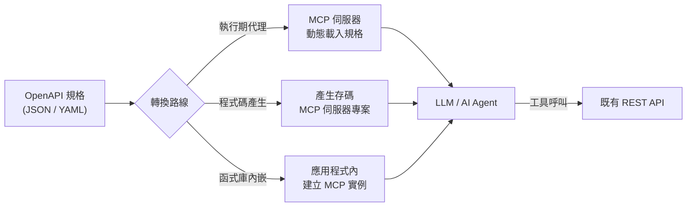
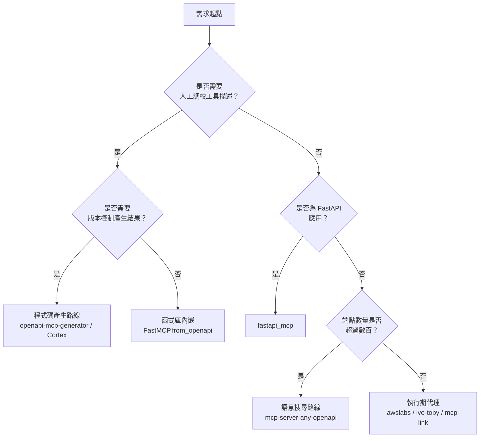

# 將 OpenAPI 規格轉換為 MCP 伺服器的自由開源軟體（FOSS）方案調查

## 摘要

本報告調查目前可用的自由開源軟體（Free and Open Source Software，FOSS）工具，用途是將既有的 OpenAPI（前身為 Swagger）規格文件轉換為 Model Context Protocol（MCP）伺服器，使大型語言模型（LLM）與 AI 代理程式能直接呼叫既有的 REST API。

調查發現此類工具在 2025 至 2026 年間大量湧現，可歸納為四種技術路線：**執行期代理（runtime proxy）**、**程式碼產生（code generation）**、**函式庫內嵌（library integration）**，以及**反向轉換（MCP 轉 OpenAPI／CLI）**。其中星數最高且最具代表性的專案包括 AWS Labs 的 `openapi-mcp-server`、Cortex、`mcp2cli`、`fastapi_mcp` 與 FastMCP。值得注意的是，MCP 官方組織並未提供任何 OpenAPI 轉換的參考伺服器，所有方案皆屬社群或廠商貢獻[^official]。

本報告所有星數與授權資訊均於 2026-10-22 透過 GitHub REST API 與各專案 README 直接查證，非憑印象陳述。

---

## 一、背景：為何需要 OpenAPI 轉 MCP

OpenAPI 是描述 REST API 的業界標準規格格式，廣泛用於文件產生、SDK 產生與 API 測試。MCP 則是由 Anthropic 於 2024 年底提出的開放協定，用以標準化 LLM 與外部工具、資料來源之間的溝通方式[^mcpintro]。

兩者的落差在於：OpenAPI 描述的是「HTTP 端點與資料結構」，而 MCP 描述的是「可供模型呼叫的工具（tools）、資源（resources）與提示（prompts）」。若沒有轉換工具，開發者必須為每個既有 API 手寫 MCP 伺服器，成本極高。因此「OpenAPI 轉 MCP」成為一個明確的工程需求。

---

## 二、四種技術路線的取捨

### 2.1 執行期代理（Runtime Proxy）

伺服器在啟動時載入 OpenAPI 規格，將每個端點即時映射為 MCP 工具，並在模型呼叫時代理轉發 HTTP 請求至真正的 API。

- **優點**：零程式碼產生、規格更新即時生效、部署簡單。
- **缺點**：規格龐大時工具數量爆炸，佔用模型上下文；執行期解析增加延遲。
- **代表專案**：`awslabs/openapi-mcp-server`、`ivo-toby/mcp-openapi-server`、`automation-ai-labs/mcp-link`、`matthewhand/mcp-openapi-proxy`。

### 2.2 程式碼產生（Code Generation）

以命令列工具讀取 OpenAPI 規格，產出一份完整、可編輯的 MCP 伺服器專案原始碼。

- **優點**：可版本控制、可人工調校工具描述、可加入自訂驗證與授權邏輯。
- **缺點**：規格變更需重新產生；產生流程增加建置複雜度。
- **代表專案**：`harsha-iiiv/openapi-mcp-generator`、`cortex-docs/cortex`、`taskade/mcp`、`higress-group/openapi-to-mcpserver`。

### 2.3 函式庫內嵌（Library Integration）

不產生獨立伺服器，而是在既有應用程式中以函式庫 API 動態建立 MCP 實例。

- **優點**：與既有框架（如 FastAPI）深度整合、可共用授權與中介層。
- **缺點**：需修改應用程式碼；僅適用特定語言生態。
- **代表專案**：`PrefectHQ/fastmcp`（`FastMCP.from_openapi`）、`tadata-org/fastapi_mcp`。

### 2.4 反向轉換（Reverse）

將 MCP 伺服器反向暴露為 OpenAPI 或 CLI，屬於生態系互補工具，並非直接的 OpenAPI 轉 MCP。

- **代表專案**：`open-webui/mcpo`（MCP 轉 OpenAPI）、`knowsuchagency/mcp2cli`（MCP／OpenAPI 轉 CLI）。

---

## 三、主要 FOSS 專案清單

以下星數與授權皆於 2026-10-22 查證。星數為 GitHub `stargazers_count`。

| 專案 | 星數 | 授權 | 語言 | 路線 |
|---|---|---|---|---|
| PrefectHQ/fastmcp | 28,172 | Apache-2.0 | Python | 函式庫 |
| tadata-org/fastapi_mcp | 12,022 | MIT | Python | 函式庫 |
| awslabs/openapi-mcp-server | 9,809（monorepo） | Apache-2.0 | Python | 執行期代理 |
| oomol-lab/open-connector | 6,067 | Apache-2.0 | TypeScript | 授權閘道 |
| open-webui/mcpo | 4,409 | MIT | Python | 反向（MCP→OpenAPI） |
| cortex-docs/cortex | 3,272 | MIT | TypeScript | 程式碼產生 |
| knowsuchagency/mcp2cli | 2,423 | MIT | Python | 反向（→CLI） |
| open-webui/openapi-servers | 1,083 | MIT | Python | 參考實作 |
| janwilmake/openapi-mcp-server | 905 | MIT | TypeScript | 執行期探索 |
| harsha-iiiv/openapi-mcp-generator | 641 | MIT | TypeScript | 程式碼產生 |
| automation-ai-labs/mcp-link | 625 | MIT | Go | 執行期代理 |
| postmanlabs/postman-mcp-server | 324 | Apache-2.0 | TypeScript | 平台整合 |
| getdatanaut/openmcp | 303 | MIT | TypeScript | 程式碼產生 |
| ivo-toby/mcp-openapi-server | 301 | MIT | TypeScript | 執行期代理 |
| higress-group/openapi-to-mcpserver | 291 | Apache-2.0 | Go | 程式碼產生 |
| speakeasy-api/gram | 274 | AGPL-3.0 | Go | MCP 閘道 |
| ckanthony/openapi-mcp | 198 | 未標示 | Go | 執行期代理 |
| brizzai/auto-mcp | 194 | Apache-2.0 | Go | 執行期代理 |
| taskade/mcp | 169 | MIT | TypeScript | 程式碼產生 |
| matthewhand/mcp-openapi-proxy | 158 | MIT | Python | 執行期代理 |
| Goldziher/spikard | 123 | MIT | Rust | 程式碼產生 |
| twilio-labs/mcp | 113 | MIT | TypeScript | 程式碼產生 |
| ReAPI-com/mcp-openapi | 90 | MIT | TypeScript | 規格目錄 |
| baryhuang/mcp-server-any-openapi | 82 | MIT | Python | 語意搜尋 |
| kadykov/mcp-openapi-schema-explorer | 76 | MIT | TypeScript | 資源瀏覽 |
| gujord/OpenAPI-MCP | 69 | MIT | Python | 執行期代理 |
| agentic-community/openapi-to-mcp | 20 | Apache-2.0 | Python | AI 輔助產生 |
| ChristopherDond/MCP-Generator | 20 | MIT | TypeScript | 程式碼產生 |
| evcc-io/openapi-mcp | 6 | MIT | Go | 執行期代理 |

---

## 四、重點專案深入說明

### 4.1 AWS Labs `openapi-mcp-server`

隸屬於 `awslabs/mcp` 單一倉庫（monorepo），是該倉庫中唯一專門處理任意 OpenAPI 規格的伺服器[^awsmcp]。特色包括：

- 以標籤（tag）過濾端點、多規格組合（multi-spec composition），每個規格可獨立授權。
- 支援 Basic、Bearer Token、API Key（header／query／cookie）與 Cognito 授權。
- 內建 SSRF 防護：DNS 固定、IP 允許清單、不跟隨重導向、回應主體上限 10 MiB。
- 僅解析內部 `#/components/...` 參照，拒絕外部 `$ref`，以避免 SSRF 風險。
- 僅支援 stdio 傳輸，不支援 HTTP／SSE。
- 僅支援 OpenAPI 3.x，不支援 Swagger 2.x。

安裝方式為 `pip install "awslabs.openapi-mcp-server"` 或 `uvx awslabs.openapi-mcp-server@latest`[^awsreadme]。

### 4.2 Cortex

Cortex 是功能最完整的「文件＋SDK＋MCP」產生平台，可從 OpenAPI、AsyncAPI、GraphQL、gRPC、OpenRPC 產生互動式文件、11 種語言的型別化 SDK，以及 MCP 伺服器[^cortex]。使用 `cortex mcp generate` 指令產生 MCP 輸出。授權為 MIT，星數 3,272。

### 4.3 `harsha-iiiv/openapi-mcp-generator`

專為 OpenAPI 轉 MCP 設計的命令列產生器，星數 641、MIT 授權，支援四種傳輸模式[^harsha]：

| 傳輸模式 | 說明 |
|---|---|
| `stdio` | 預設，JSON-RPC over stdio |
| `web` | SSE，內建測試用戶端 UI |
| `streamable-http` | HTTP POST，具工作階段管理 |
| `cloudflare-worker` | 部署至 Cloudflare Workers 免費方案 |

授權支援透過環境變數設定 API Key、Bearer Token、Basic Auth 與 OAuth2，並可選擇產生可編輯的 `src/auth.ts` 掛鉤。

### 4.4 `ivo-toby/mcp-openapi-server`

TypeScript 執行期代理，星數 301、MIT 授權，可從 URL、檔案、stdin 或內嵌字串載入規格[^ivotoby]。支援靜態標頭、雙向 TLS（mTLS），以及可動態更新權杖的 `AuthProvider` 介面。README 明確警告標籤過濾僅是工具介面控制，並非授權機制。

### 4.5 FastMCP 與 `fastapi_mcp`

FastMCP 提供 `FastMCP.from_openapi()` 類別方法，底層使用 `OpenAPIProvider`（v3.0.0+）[^fastmcp]。預設將規格中每個端點轉為一個 MCP 工具，並可用 `RouteMap` 自訂映射為資源或排除。授權需自行在 `httpx` 用戶端設定，FastMCP 不會從規格協商授權。

官方文件同時提出重要警告：對於端點眾多的複雜 API，LLM 在「精心設計的 MCP 伺服器」上的表現明顯優於「自動轉換的 OpenAPI 伺服器」，建議將自動轉換用於原型驗證而非正式鏡射整份 API[^fastmcp]。

`tadata-org/fastapi_mcp` 則專注於 FastAPI 生態，星數 12,022、MIT 授權，並已列入 MCP 官方倉庫的社群資源清單[^official]。

### 4.6 其他值得注意的方案

- **`automation-ai-labs/mcp-link`**（625 星、MIT、Go）：以 URL 查詢參數傳入 OpenAPI 規格網址與 API 基礎網址，即可在執行期轉換，無需產生程式碼[^mcplink]。
- **`baryhuang/mcp-server-any-openapi`**（82 星、MIT）：以 FAISS 與 MiniLM 嵌入進行語意搜尋，適合端點數高達數千的大型 API，避免工具清單爆量[^bary]。
- **`kadykov/mcp-openapi-schema-explorer`**（76 星、MIT）：以 MCP 資源模板提供低 token 消耗的規格瀏覽，適合讓模型自行探索規格[^kadykov]。
- **`openmcp`**（303 星、MIT）：強調「只產生你需要的工具」，可選擇性輸出工具子集[^openmcp]。
- **`twilio-labs/mcp`**（113 星、MIT）：提供 OpenAPI 轉 MCP 工具產生器，並將 Twilio 全系列 API 暴露為 MCP 工具[^twilio]。
- **`oomol-lab/open-connector`**（6,067 星、Apache-2.0）：並非單純轉換器，而是開源授權閘道，將 1,500 多個 SaaS 供應商透過 SDK、CLI、MCP、HTTP 與 OpenAPI 連接至 AI 代理[^openconnector]。

---

## 五、選型建議

- **快速原型驗證**：`automation-ai-labs/mcp-link` 或 `awslabs/openapi-mcp-server`，零程式碼即可上線。
- **正式產品、需人工調校**：`harsha-iiiv/openapi-mcp-generator`（專用產生器）或 `cortex-docs/cortex`（含文件與 SDK）。
- **Python 生態、深度整合**：`PrefectHQ/fastmcp` 的 `from_openapi` 或 `tadata-org/fastapi_mcp`。
- **大型 API（數千端點）**：`baryhuang/mcp-server-any-openapi` 的語意搜尋，或 `kadykov/mcp-openapi-schema-explorer` 的資源瀏覽。
- **企業治理需求**：`speakeasy-api/gram`（MCP 閘道，AGPL-3.0 授權需注意傳染性）或 `oomol-lab/open-connector`。

---

## 六、來源批判與限制

1. **星數不等於品質**：多個高星專案（如 `mcpo`、`mcp2cli`）實際上是反向轉換工具，並非 OpenAPI 轉 MCP，若僅看星數排序容易誤判。本報告已於表格標明路線。
2. **授權差異顯著**：多數專案為 MIT 或 Apache-2.0，但 `speakeasy-api/gram` 採 AGPL-3.0，若用於商業服務需評估傳染性條款；`ckanthony/openapi-mcp` 倉庫未標示授權檔，商用前應主動確認。
3. **維護活躍度落差大**：部分專案最後推送時間為 2025 年（如 `getdatanaut/openmcp`、`baryhuang/mcp-server-any-openapi`），可能已停止維護；選型時應檢查 `pushed_at` 而非僅看星數。
4. **官方缺席**：MCP 官方組織（`modelcontextprotocol`）並未提供 OpenAPI 轉換伺服器，官方參考伺服器僅有 Everything、Fetch、Filesystem、Git、Memory、Sequential Thinking、Time 等[^official]。這意味著此領域缺乏權威標準，社群方案品質參差不齊。
5. **自動轉換的效能代價**：FastMCP 官方文件明確指出，自動轉換的伺服器在複雜 API 上的 LLM 表現顯著低於人工設計的伺服器[^fastmcp]。這是所有自動轉換方案共同的結構性限制。
6. **查證方法**：本報告的星數、授權、語言與最後推送時間，均透過 GitHub REST API 端點（`https://api.github.com/repos/{owner}/{repo}`）於 2026-10-22 直接取得，而非引用二手整理文章。功能細節則以各專案 README 原文為準。

---

## 參考文獻

[^official]: Model Context Protocol. (n.d.). *Servers*. Retrieved 2026-10-22, from https://github.com/modelcontextprotocol/servers

[^mcpintro]: Anthropic. (n.d.). *Introducing the Model Context Protocol*. Retrieved 2026-10-22, from https://www.anthropic.com/news/model-context-protocol

[^awsmcp]: AWS Labs. (n.d.). *Open source MCP Servers for AWS*. Retrieved 2026-10-22, from https://github.com/awslabs/mcp

[^awsreadme]: AWS Labs. (n.d.). *OpenAPI MCP Server*. Retrieved 2026-10-22, from https://raw.githubusercontent.com/awslabs/mcp/main/src/openapi-mcp-server/README.md

[^cortex]: Cortex. (n.d.). *Cortex - Generates interactive API documentation, typed SDKs, and MCP servers*. Retrieved 2026-10-22, from https://github.com/cortex-docs/cortex

[^harsha]: harsha-iiiv. (n.d.). *A tool that converts OpenAPI specifications to MCP server*. Retrieved 2026-10-22, from https://github.com/harsha-iiiv/openapi-mcp-generator

[^ivotoby]: ivo-toby. (n.d.). *MCP Server for turning OpenAPI specifications into a MCP Resource*. Retrieved 2026-10-22, from https://github.com/ivo-toby/mcp-openapi-server

[^fastmcp]: Prefect. (n.d.). *OpenAPI Integration*. Retrieved 2026-10-22, from https://gofastmcp.com/integrations/openapi

[^mcplink]: Automation AI Labs. (n.d.). *Convert Any OpenAPI V3 API to MCP Server*. Retrieved 2026-10-22, from https://github.com/automation-ai-labs/mcp-link

[^bary]: Huang, B. (n.d.). *A MCP server that enables Claude to discover and call any API endpoint through semantic search*. Retrieved 2026-10-22, from https://github.com/baryhuang/mcp-server-any-openapi

[^kadykov]: Kadykov. (n.d.). *MCP server providing token-efficient access to OpenAPI/Swagger specs*. Retrieved 2026-10-22, from https://github.com/kadykov/mcp-openapi-schema-explorer

[^openmcp]: Datanaut. (n.d.). *Turn any openapi file into an mcp server, with just the tools you need*. Retrieved 2026-10-22, from https://github.com/getdatanaut/openmcp

[^twilio]: Twilio Labs. (n.d.). *Monorepo providing OpenAPI to MCP Tool generator*. Retrieved 2026-10-22, from https://github.com/twilio-labs/mcp

[^openconnector]: Oomol Lab. (n.d.). *Open-source auth gateway connecting 1500+ SaaS providers to AI agents*. Retrieved 2026-10-22, from https://github.com/oomol-lab/open-connector
