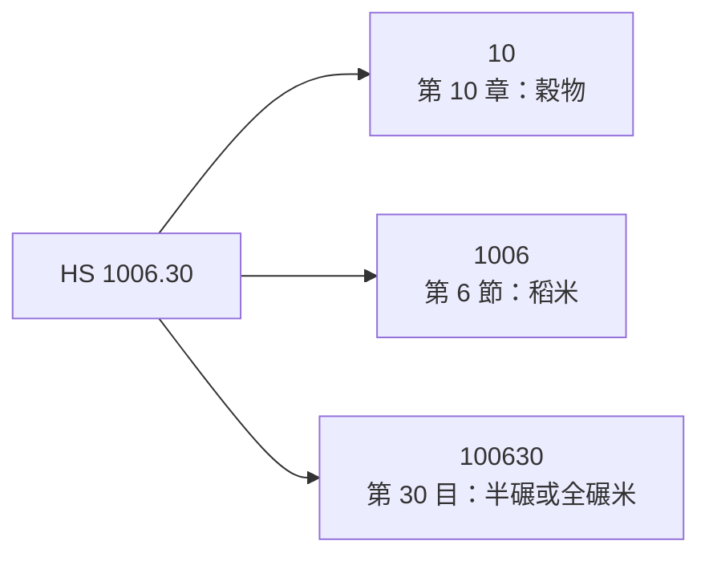
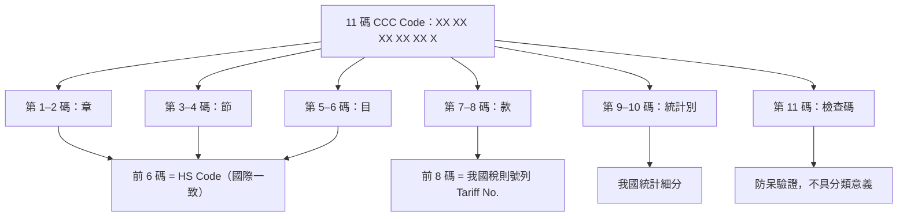
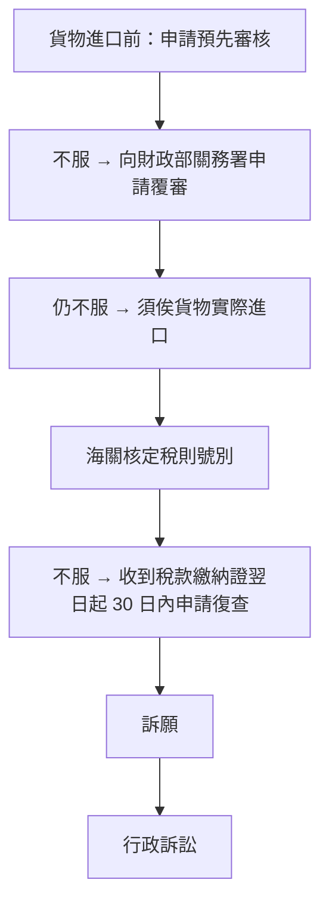

# 關稅貨品分類編號是怎麼規定的？

## 摘要

各國對進出口貨物課徵關稅時，並不會「一事一議」地為每件商品臨時決定稅率，而是先建立一套**貨品分類編號系統**，把千百萬種商品歸納成有限的分類格。這套編號並非各國自行發明，而是以世界關稅組織（WCO, World Customs Organization）制定的**國際商品統一分類制度**（Harmonized Commodity Description and Coding System，簡稱 HS）為共同基礎，各國再於其後增列本國細分碼。本文說明這套編號的國際架構、位數規則、編號如何決定（解釋準則）、修訂週期，並以台灣的 11 碼「貨品分類號列」為例說明本國層級的規定方式與法制依據。

---

## 一、編號的國際基礎：HS 制度

### 1.1 由誰制定

HS 由**世界關稅組織（WCO）**制定與維護，總部設於比利時布魯塞爾。其法律依據為《國際商品統一分類制度公約》（The International Convention on the Harmonized Commodity Description and Coding System）。該公約於 1983 年簽署，HS 於 **1988 年 1 月 1 日**正式生效[^wco-hs]。

WCO 透過**HS 委員會**（Harmonized System Committee，由 HS 公約縮約方代表組成）執行日常維護工作，其任務包括確保 HS 的統一解釋與適用、對分類問題作出裁決、解決爭議，以及準備修正案[^wco-hs]。

截至 2025 年 7 月 30 日，HS 公約共有 **163 個縮約方**；實際採用 HS 的國家、領域與關稅／經濟聯盟則達 **212 個**，全球 **98% 以上**的國際貿易商品都以 HS 分類[^wco-faq][^wco-hs]。

### 1.2 分類的層級結構

HS 是一套**階層式**的分類體系，由粗到細分為四層[^wco-hs][^wco-faq]：

| 層級 | 英文名稱 | 位數 | HS 2022 年版數量 |
|------|----------|------|------------------|
| 部類 | Section | （無碼） | 21 個 |
| 章 | Chapter | 前 2 碼 | 96 章（第 1–97 章，第 77 章保留） |
| 節 | Heading | 前 4 碼 | 約 1,228 節 |
| 目 | Subheading | 前 6 碼 | 約 5,612 目 |

也就是說，**HS 的核心編號只有 6 位數字**，前 2 碼是章、前 4 碼是節、全部 6 碼是目。以下以 6 位碼 `1006.30` 為例：

### 1.3 排列邏輯

HS 的部類與章大致依**加工程度**與**技術複雜度**排列：前面幾部類多為天然、初級商品（動植物、礦產），後面幾部類則為高度加工品（機械、精密儀器）。例如第 1 章為活動物、第 85 章為電機設備。此外，每個部類與章前面都附有**法律註釋**（Section/Chapter Notes），與稅則號別的文字同具法律效力[^wco-hs][^wiki-hs]。

---

## 二、編號怎麼「規定」出來的：解釋準則

編號本身只是一組格子，真正決定「這件貨物該放哪一格」的，是 HS 的**一般解釋準則**（General Rules for the Interpretation，GRI／GIR）。共 **6 條**，必須**依序適用**：前一條無法解決時，才能往下適用下一條[^wiki-gri]。

| 順序 | 準則 | 核心內容 |
|:---:|:---:|:---|
| 1 | GRI 1 | 依稅則號別文字及部類／章註釋分類；標題本身僅供參考，無法律效力 |
| 2 | GRI 2 | 未完成品、未組裝／拆散品、混合物與組合材料的處理 |
| 3 | GRI 3 | 可歸入兩個以上號別時：(a) 最具體描述優先 → (b) 主要特徵原則 → (c) 數字順序最後者 |
| 4 | GRI 4 | 最類似物品原則（罕用，用於新型產品） |
| 5 | GRI 5 | 特殊容器（如相機盒）與一般包裝材料的分類 |
| 6 | GRI 6 | 上述準則比照適用於子目層級；僅同一層級的子目可互相比較 |

其中 GRI 1 確立了一個關鍵觀念：**類、章及分章的標題僅供參考**，真正有法律效力的是稅則號別所列名稱與類註、章註；若號別文字與註釋已足以確定分類，就不得再援用後續規則[^wiki-gri]。

---

## 三、編號會變動：修訂週期

HS 並非固定不變。WCO 約每 **5 年**修訂一次（官方文件亦敘明為「每 5 至 6 年」更新一次），以反映科技發展、貿易模式變化及新的監管需求（例如環境保護、公共衛生）[^wco-hs][^wco-faq]。

已生效的版本沿革與下一次改版如下[^wco-hs][^wco-faq][^wco-2028]：

| 版本 | 生效年 |
|------|--------|
| HS 1988（初版） | 1988 |
| HS 1996 | 1996 |
| HS 2002 | 2002 |
| HS 2007 | 2007 |
| HS 2012 | 2012 |
| HS 2017 | 2017 |
| **HS 2022（第 7 版，現行）** | **2022** |
| HS 2028（第 8 版） | 2028-01-01（已議定） |

目前現行版本為 **HS 2022**，自 2022 年 1 月 1 日生效。下一次改版 **HS 2028** 為第 8 版，是第 7 次檢討週期（2019 年 7 月至 2025 年 6 月，因 COVID-19 疫情由 5 年延長為 6 年）的成果；WCO 理事會已於 2025 年 6 月 26 日建議通過 299 組修正，將於 **2028 年 1 月 1 日**生效，屆時為 1,229 節、5,852 目[^wco-2028][^wco-faq]。

改版之所以需要如此長的週期，是因為修正案須經數年技術審議與貿易界諮詢，之後各會員國還需要時間翻譯、完成國內立法程序、編製對照表並訓練關務人員[^wco-hs][^wco-2028]。

---

## 四、各國的本國細分：以台灣 11 碼為例

HS 公約體系下，**全球統一僅到 6 位碼**。6 位碼之後，各國可依內政、統計與貿易管理需要自行增列位數，因此各國編號長度不同（例如台灣 11 碼、韓國 10 碼、中國 10 碼、美國 10 碼、歐盟 8 或 10 碼），**只有前 6 碼能跨國通用**[^wco-hs]。

台灣自**民國 78 年（1989 年）1 月 1 日**起，正式實施以 HS 為基礎編定而成的《海關進口稅則》；在此之前，台灣於民國 60 年（1971 年）8 月起採用的是布魯塞爾稅則分類（BTN／CCCN）為基礎的稅則。此後隨 HS 改版逐次換版，現行版本為民國 112 年（2023 年）6 月 23 日起實施的 HS 2022 年版[^tw-hs]。

### 4.1 台灣的 11 碼結構

台灣的完整編號稱為**中華民國輸出入貨品分類號列**（CCC Code, Commodity Classification Code），共 **11 碼**，其組成如下[^trade-faq]：

| 位數 | 名稱 | 主管／來源 | 用途 |
|------|------|-----------|------|
| 第 1–2 碼 | 章（Chapter） | WCO（HS 架構） | 全球一致 |
| 第 3–4 碼 | 節（Heading） | WCO（HS 架構） | 全球一致 |
| 第 5–6 碼 | 目（Subheading） | WCO（HS 架構） | 前 6 碼即國際 HS Code |
| 第 7–8 碼 | 款 | 我國海關稅則 | 前 8 碼為我國稅則號列 |
| 第 9–10 碼 | 統計別 | 我國貿易統計 | 統計與輸出入管理 |
| 第 11 碼 | 檢查碼 | 系統產生 | 驗證號列是否輸入正確 |

經濟部國際貿易署的官方說明為：「中華民國輸出入貨品分類號列 CCC Code 計 11 碼，包括：章（2 碼）、節（4 碼）、目（6 碼），前 6 碼為 HS 架構（HS Code），前 8 碼為我國稅則號列（Tariff NO），第 9 至 10 碼為統計別，第 11 碼檢查碼。」[^trade-faq]

### 4.2 台灣各層級的實際數量

依 HS 2022 年版，台灣稅則（第 1 章至第 97 章）計有[^tw-hs]：

- 4 位碼**節**：1,228 節
- 6 位碼**目**：5,612 目
- 8 位碼**款**：9,335 款
- 第 98 章（關稅配額產品）：8 位碼 32 款

其中第 98 章為台灣為關稅配額產品特別增設，不在國際 HS 第 1–97 章範圍內[^tw-hs]。

### 4.3 法制依據：稅則須經立法程序

台灣的稅則編號與稅率並非行政機關自行公告即可施行。《關稅法》第 3 條規定[^tw-customs-act]：

> 關稅之徵收及進出口貨物稅則之分類，除本法另有規定者外，依海關進口稅則之規定。海關進口稅則，**另經立法程序制定公布之**。
> 財政部為研議海關進口稅則之修正及特別關稅之課徵等事項，得邀集有關機關及學者專家審議之。

亦即**《海關進口稅則》須經立法院以法律形式制定與修正**，體現租稅法律主義；財政部則負責研議修正並邀集有關機關與學者專家審議[^tw-customs-act]。

### 4.4 有疑義時：預先審核與救濟

由於分類涉及專業判斷，實務上可能出現歸類爭議。台灣設有**預先審核**制度，《關稅法》第 21 條規定：納稅義務人或其代理人得於**貨物進口前**，向海關申請預先審核進口貨物之稅則號別，海關應以書面答復；不服者得於貨物進口前向財政部關務署申請**覆審**[^tw-customs-act]。

貨物進口後如對海關核定之稅則號別不服，則依《關稅法》第 45 條至第 47 條的**復查、訴願、行政訴訟**程序救濟[^tw-customs-act]：

---

## 五、查詢與應用

由於編號會隨 HS 改版而變動，查詢時須注意版本。台灣官方查詢管道包括：財政部關務署「關港貿單一窗口」的稅則稅率綜合查詢作業，以及經濟部國際貿易署的貨品分類及輸出入規定查詢[^trade-faq]。

編號的用途遠不止課稅。依 WCO 說明，HS 同時被政府、國際組織與民間用於：內部稅收、貿易政策、**原產地規則**、管制商品（廢棄物、麻醉藥品、化學武器、臭氧層破壞物質、瀕危物種等）之監控、運費費率、運輸統計、價格監控、配額管制、國民所得編算與經濟研究分析，被形容為「商品的通用經濟語言」[^wco-hs]。

---

## 六、批判性反思：來源的可靠性與限制

- **官方一手來源具優先性**：本文關於制度架構、修訂週期與位數規則的核心敘述，主要來自 WCO 官方頁面與台灣財政部關務署、經濟部國際貿易署、全國法規資料庫等官方來源。這些來源具有制度性權威，惟 WCO 的「一般解釋準則」條文細節本文另以維基百科輔助，屬二手整理，若須引用條文原文，應以 WCO 正式出版品（Explanatory Notes、《HS 公約》本文）為準[^wco-hs][^wiki-gri]。
- **時效性風險**：HS 每 5 至 6 年改版一次，且台灣隨之換版。本文所述「現行版本為 HS 2022」係截至 2026 年 10 月的狀態；**HS 2028 已議定於 2028 年 1 月 1 日生效**，屆時節（1,229）與目（5,852）數量、部分號別歸類均將改變。任何實務查詢都應重新確認當時生效的版本[^wco-2028]。
- **各國細分碼不可跨國通用**：網路上常見將「HS Code」與「CCC Code／Tariff No.」混用。需注意只有前 6 碼具國際一致性，第 7 碼以後為各國自訂，同一商品在不同國家的完整編號可能不同，跨國比對資料時須先對齊至 6 位碼[^wco-hs][^trade-faq]。
- **未取得 WCO 付費資料**：WCO 的《解釋註釋》（Explanatory Notes）與分類意見彙編屬付費出版物，本文未能查證其細節內容，故涉及個案歸類的判斷（例如某特定商品究竟落於哪一號別），本文未作斷言，須以主管機關的預先審核或個案裁定為準[^wco-hs][^tw-customs-act]。

---

## 參考文獻

[^wco-hs]: World Customs Organization. (n.d.). *What is the Harmonized System (HS)?* Retrieved 2026-10-22, from https://www.wcoomd.org/en/topics/nomenclature/overview/what-is-the-harmonized-system.aspx

[^wco-faq]: World Customs Organization. (n.d.). *Frequently asked questions*. Retrieved 2026-10-22, from https://www.wcoomd.org/en/topics/nomenclature/overview/harmonized_system_faq.aspx

[^wco-2028]: World Customs Organization. (n.d.). *HS Nomenclature 2028 Edition*. Retrieved 2026-10-22, from https://www.wcoomd.org/en/topics/nomenclature/instrument-and-tools/hs-nomenclature-2028-edition.aspx

[^wiki-hs]: Wikipedia. (n.d.). *Harmonized System*. Retrieved 2026-10-22, from https://en.wikipedia.org/wiki/Harmonized_System

[^wiki-gri]: Wikipedia. (n.d.). *General Rules for the Interpretation of the Harmonized System*. Retrieved 2026-10-22, from https://en.wikipedia.org/wiki/General_Rules_for_the_Interpretation_of_the_Harmonized_System

[^tw-hs]: 財政部關務署. (2017-09-28). 我國採行HS制度. Retrieved 2026-10-22, from https://web.customs.gov.tw/singlehtml/29?cntId=cus1_64879_29

[^trade-faq]: 經濟部國際貿易署. (n.d.). 中華民國進出口貿易統計 常見問答. Retrieved 2026-10-22, from https://publicinfo.trade.gov.tw/cuswebo/FSC3000F/FSC3300

[^tw-customs-act]: 全國法規資料庫. (n.d.). 關稅法. Retrieved 2026-10-22, from https://law.moj.gov.tw/LawClass/LawAll.aspx?pcode=G0350001
