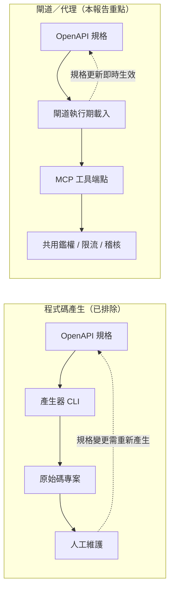
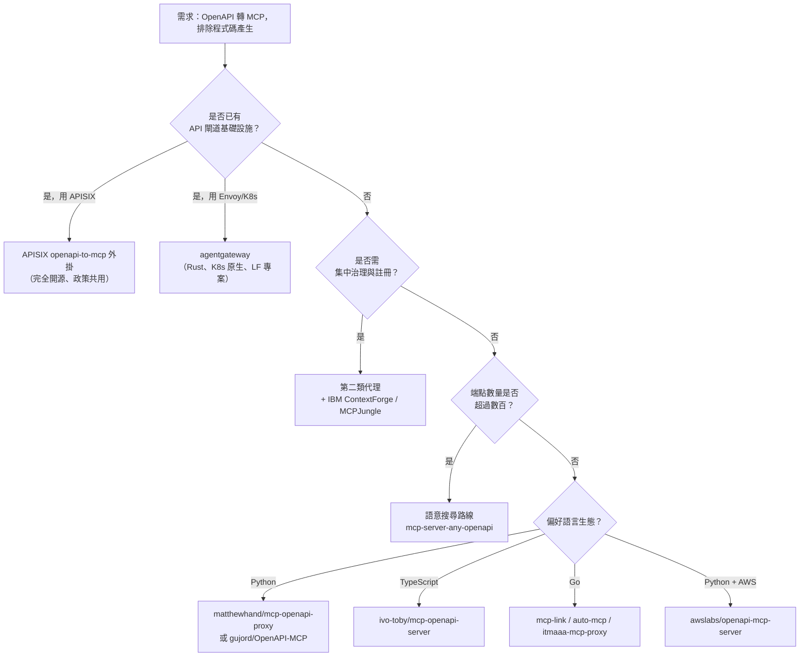

# 以閘道與代理方案將 OpenAPI 轉換為 MCP 伺服器的 FOSS 調查

## 摘要

本報告調查可將既有 OpenAPI（前身為 Swagger）規格轉換為 Model Context Protocol（MCP）伺服器的自由開源軟體（Free and Open Source Software，FOSS）方案。依照需求，**排除純程式碼產生器（code generator）**，並**優先採用閘道（gateway）與代理（proxy）路線**，也就是在執行期（runtime）動態載入 OpenAPI 規格、即時生成 MCP 工具，不需產生任何原始碼。

調查結果顯示，可分成三類：

1. **內建 OpenAPI 支援的通用閘道**：`agentgateway`、`Apache APISIX`、`Higress`。這類方案把 OpenAPI 轉 MCP 當成閘道的一個原生功能，可與既有路由、限流、鑑權、可觀測性政策共用。
2. **專用 OpenAPI→MCP 代理**：`awslabs/openapi-mcp-server`、`ivo-toby/mcp-openapi-server`、`matthewhand/mcp-openapi-proxy`、`automation-ai-labs/mcp-link`、`brizzai/auto-mcp` 等。這類方案功能聚焦、部署輕量，但需獨立運行一個行程。
3. **MCP 閘道（不解析 OpenAPI）**：`IBM ContextForge`、`MCPJungle`、`docker/mcp-gateway`、`microsoft/mcp-gateway`。這類方案聚合既有的 MCP 伺服器，**本身不具備 OpenAPI 轉換能力**，需與第 2 類方案搭配使用。

**最重要的發現**：`IBM ContextForge` 雖然是最知名的開源 MCP 閘道之一，但其「REST-to-MCP 工具轉接器」**只支援逐一登記端點**，並**不會解析 OpenAPI 規格**自動產生工具[^contextforge]。真正在閘道層原生解析 OpenAPI 的 FOSS 方案，是 `agentgateway` 與 `Apache APISIX`。Kong 的 `ai-mcp-proxy` 外掛雖具備此能力，但屬**企業版專有**，不符合 FOSS 要求[^kong]。

本報告所有星數、授權與語言，均於 2026-10-22 透過 GitHub REST API 與各專案官方文件直接查證。

---

## 一、範圍界定

### 1.1 納入條件

- 以 **OpenAPI／Swagger 規格**為輸入，於**執行期**將端點映射為 MCP 工具。
- 授權為公認的開源授權（MIT、Apache-2.0、MPL-2.0 等）。
- 不需產生或編譯任何 MCP 伺服器原始碼。

### 1.2 排除條件

| 排除類型 | 範例 | 排除原因 |
|---|---|---|
| 程式碼產生器 | `harsha-iiiv/openapi-mcp-generator`、`cortex-docs/cortex`、`higress-group/openapi-to-mcpserver` | 依需求排除；產生原始碼而非執行期轉換 |
| 專有企業外掛 | Kong `ai-mcp-proxy`（Kong Gateway 3.12+ 企業版） | 非 FOSS[^kong] |
| 反向轉換工具 | `open-webui/mcpo`（MCP→OpenAPI） | 方向相反[^mcpo] |
| 純傳輸橋接 | `sparfenyuk/mcp-proxy`（stdio ↔ Streamable HTTP） | 不解析 OpenAPI，僅轉換 MCP 傳輸層[^sparfenyuk] |
| 僅瀏覽規格 | `kadykov/mcp-openapi-schema-explorer` | 提供規格瀏覽資源，非工具代理（仍具互補價值） |

### 1.3 為何偏好閘道／代理路線



閘道／代理路線的優勢在於：規格更新即時生效、無需版本控制產生結果、可與既有 API 管理政策（金鑰、限流、可觀測性）共用同一層。代價是執行期解析的延遲，以及規格龐大時工具數量膨脹佔用模型上下文。

---

## 二、方案總覽

以下星數、授權、語言皆於 2026-10-22 查證。

| 方案 | 星數 | 授權 | 語言 | 類別 | 執行期解析 OpenAPI |
|---|---|---|---|---|---|
| apache/apisix（`openapi-to-mcp` 外掛） | 17,247 | Apache-2.0 | Lua | 通用閘道 | 是 |
| higress-group/higress | 9,623 | Apache-2.0 | Go | 通用閘道 | 是（透過 MCP 外掛） |
| awslabs/mcp（`openapi-mcp-server`） | 9,809 | Apache-2.0 | Python | 專用代理 | 是 |
| agentgateway/agentgateway | 5,487 | Apache-2.0 | Rust | 通用閘道 | 是 |
| IBM/mcp-context-forge | 4,678 | Apache-2.0 | Python | MCP 閘道 | **否**（僅逐一登記） |
| docker/mcp-gateway | 1,613 | MIT | Go | MCP 閘道 | 否 |
| mcpjungle/MCPJungle | 1,310 | MPL-2.0 | Go | MCP 閘道 | 否 |
| microsoft/mcp-gateway | 891 | MIT | C# | MCP 閘道 | 否 |
| automation-ai-labs/mcp-link | 625 | MIT | Go | 專用代理 | 是 |
| getdatanaut/openmcp | 303 | MIT | TypeScript | 專用代理 | 是 |
| ivo-toby/mcp-openapi-server | 301 | MIT | TypeScript | 專用代理 | 是 |
| speakeasy-api/gram | 274 | AGPL-3.0 | Go | MCP 閘道 | 否 |
| ckanthony/openapi-mcp | 198 | 未標示 | Go | 專用代理 | 是 |
| brizzai/auto-mcp | 194 | Apache-2.0 | Go | 專用代理 | 是 |
| matthewhand/mcp-openapi-proxy | 158 | MIT | Python | 專用代理 | 是 |
| danishjsheikh/swagger-mcp | 83 | MIT | Go | 專用代理 | 是 |
| baryhuang/mcp-server-any-openapi | 82 | MIT | Python | 專用代理（語意搜尋） | 是 |
| itmaaa/mcp-proxy | 76 | Apache-2.0 | Go | 專用代理 | 是 |
| gujord/OpenAPI-MCP | 69 | MIT | Python | 專用代理 | 是 |
| mroops0111/openapi-mcp-gateway | 7 | MIT | Python | 專用代理 | 是 |
| pvliesdonk/openapi-mcp | 0 | MIT | Python | 專用代理 | 是 |

---

## 三、第一類：內建 OpenAPI 支援的通用閘道

### 3.1 Apache APISIX（`openapi-to-mcp` 外掛）

APISIX 是 Apache 軟體基金會的雲原生 API 閘道，17,247 星、Apache-2.0 授權、以 Lua 撰寫於 NGINX 之上[^apisixrepo]。其 `openapi-to-mcp` 外掛直接內建於發行版中，是目前**最成熟且完全開源**的閘道原生 OpenAPI 轉 MCP 方案。

官方文件對其行為描述明確：

> 「`openapi-to-mcp` 外掛將既有 HTTP API 暴露給 MCP 用戶端（例如 LLM 代理），且不需變更該 API。它抓取 API 的 OpenAPI 文件，為每個操作產生一個 MCP 工具，並自行回應 MCP 協定。當用戶端呼叫工具時，外掛送出對應的 HTTP 請求至該 API，並將回應作為工具結果回傳。」[^apisixplugin]

關鍵規格：

| 項目 | 內容 |
|---|---|
| 傳輸 | Streamable HTTP（無狀態）、HTTP+SSE |
| MCP 協定版本 | 2024-10-07、2024-11-05、2025-03-26、2025-06-18、2025-11-25 |
| 支援方法 | `initialize`、`ping`、`tools/list`、`tools/call` |
| 規格格式 | OpenAPI 3.x（JSON／YAML）；Swagger 2.0 盡力支援 |
| 參照解析 | 支援內部與 `http(s)` `$ref` |
| 快取 | 文件首次請求時抓取，工具快取一小時 |

設定範例（直接由 Admin API 建立路由）：

```json
{
  "id": "mcp",
  "uri": "/mcp",
  "plugins": {
    "openapi-to-mcp": {
      "transport": "streamable_http",
      "openapi_url": "https://petstore3.swagger.io/api/v3/openapi.json",
      "base_url": "https://petstore3.swagger.io/api/v3",
      "headers": {
        "Authorization": "Bearer ${http_x_api_token}"
      }
    }
  }
}
```

憑證可透過 APISIX 變數從呼叫端標頭轉發（如上例的 `${http_x_api_token}`），且 `key-auth`、`limit-count` 等其他外掛會在 MCP 請求被回應之前先行執行，被拒絕的請求永遠不會觸及工具[^apisixplugin]。這正是閘道路線的核心價值：鑑權、限流與稽核與 MCP 工具共用同一層政策。

已知限制：SSE 傳輸的工作階段存放於單一 APISIX 實例的共享字典，若部署於多實例負載平衡後方，同一工作階段的請求必須導向同一實例；Streamable HTTP 則無此限制。另外，宣告 `explode: false` 的陣列參數會以 `tags=a,b` 形式送出，若上游 API 期望 `tags[]=a&tags[]=b` 的括號形式，需另加改寫查詢字串的外掛。

### 3.2 agentgateway

agentgateway 原為 Solo.io 的 Gloo AI Gateway，現已加入 Agentic AI Foundation，5,487 星、Apache-2.0 授權、以 Rust 撰寫[^agwrepo]。它提供 `openapi` 目標型別，可將 OpenAPI 規格中的每個操作轉為一個 MCP 工具，工具名稱取自 `operationId`[^agwdoc]。

設定範例：

```yaml
mcp:
  port: 3000
  statefulMode: stateless
  targets:
  - name: openapi
    openapi:
      schema:
        file: openapi.json
      host: localhost:8080
```

`schema` 支援三種來源：本機檔案（`file`）、遠端 URL（`url`）、內嵌字串（區塊純量）。`host` 指定上游 REST 伺服器。由於 OpenAPI 後端本質無狀態，可設 `statefulMode: stateless`，閘道會自動為每個請求包裝初始化序列[^agwdoc]。

已知限制：路徑參數一律視為必填（即使規格標示 `required: false`）；閘道會在送出請求前驗證路徑參數，若缺少、為空、型別非字串或數字、或字串含空段落／`.`／`..`，會直接以 HTTP 500 與 JSON-RPC 錯誤碼 `-32603` 拒絕；每個操作必須有唯一的 `operationId` 以避免工具名稱衝突。官方文件**未記載** OpenAPI 目標的鑑權設定欄位，憑證需透過閘道的後端鑑權機制處理[^agwdoc]。

### 3.3 Higress

Higress 是阿里巴巴開源、基於 Istio 與 Envoy 的 AI 原生 API 閘道，9,623 星、Apache-2.0 授權、以 Go 撰寫[^higressrepo]。Higress 本身透過 Wasm 外掛機制承載遠端 MCP 伺服器，屬於「設定檔部署後即執行期服務」的混合模式。實務上需先以 `higress-group/openapi-to-mcpserver`（291 星、Apache-2.0、Go）產生 MCP 伺服器設定 YAML，再熱部署進 Higress[^higresstool]。由於產生步驟屬程式碼產生路線，此處僅列出作為閘道選項的補充說明。

---

## 四、第二類：專用 OpenAPI→MCP 代理

### 4.1 AWS Labs `openapi-mcp-server`

隸屬 `awslabs/mcp` 單一倉庫（9,809 星、Apache-2.0），是該倉庫中唯一處理任意 OpenAPI 規格的伺服器[^awsmcp]。它於啟動時載入 OpenAPI 3.x 規格（URL 或本機路徑），將每個端點動態轉為 MCP 工具，並在模型呼叫時實際發出 HTTP 請求[^awsreadme]。

特色包括：標籤過濾（`--include-tags`）、多規格組合（每個規格可獨立授權）、Basic／Bearer／API Key（header、query、cookie）／Cognito 授權、可關閉回應結構驗證、內建 Prometheus 指標。

安全設計值得注意：DNS 固定的 URL 驗證、IP 允許清單、不跟隨重導向、回應主體上限 10 MiB，且僅解析內部 `#/components/...` 參照，拒絕外部 `$ref` 以防 SSRF。

已知限制：僅支援 OpenAPI 3.x（不支援 Swagger 2.x）；規格必須先打包成單一文件；僅支援 stdio 傳輸，無 HTTP／SSE；不跟隨重導向；規格主體上限 10 MiB；附加規格不會繼承主 API 的憑證[^awsreadme]。

### 4.2 ivo-toby `mcp-openapi-server`

TypeScript 執行期代理，301 星、MIT 授權，npm 套件為 `@ivotoby/openapi-mcp-server`[^ivotoby]。可從 URL、本機檔案、stdin 或內嵌字串載入規格，並將端點暴露為 MCP 工具，另可選支援提示與資源。

支援 stdio 與 Streamable HTTP 兩種傳輸；鑑權支援靜態標頭（`--headers`／`API_HEADERS`）、雙向 TLS（`--client-cert`、`--client-key`、`--ca-cert` 等），以及程式庫層的 `AuthProvider` 介面（支援權杖更新、到期處理與 401／403 自動重試）。

已知限制：MCP 對工具名稱有 64 字元上限；一次僅能提供一個規格來源（`--openapi-spec`、`--spec-from-stdin`、`--spec-inline` 三選一）；自訂工具僅限程式庫 API；HTTP 傳輸預設僅綁定 `127.0.0.1`，並驗證 Origin 標頭以防 DNS 重綁定。README 明確警告標籤過濾**不是**授權機制，敏感端點仍須由上游 API 的鑑權模型保護[^ivotoby]。

### 4.3 matthewhand `mcp-openapi-proxy`

Python 實作，158 星、MIT 授權，PyPI 套件為 `mcp-openapi-proxy`[^matthewhand]。以 `uvx mcp-openapi-proxy` 即可執行。

支援雙模式：低階模式（預設）將每個 OpenAPI 端點註冊為獨立 MCP 工具；FastMCP 簡易模式（`OPENAPI_SIMPLE_MODE=true`）則只暴露固定的 `list_functions()` 與 `call_function()` 兩個工具，適合端點極多的情境。

鑑權彈性為其最大特色：`API_KEY` 走 Bearer（預設）、`API_AUTH_TYPE` 可改成自訂前綴（如 NetBox 的 `Token`）、`API_AUTH_TYPE=api-key` 搭配 `API_AUTH_HEADER` 可將金鑰放入自訂標頭（如 VirusTotal 的 `x-apikey`）、`STRIP_PARAM` 以 JMESPath 從酬載移除參數（如 Slack 的 `token`）、`EXTRA_HEADERS` 可加任意標頭（如 Notion 的 `Notion-Version`）。此外提供工具註解（`readOnlyHint`、`destructiveHint` 等）、規格磁碟快取（預設 86,400 秒）、`GET /healthz` 健康端點，以及 `MCP_ALLOWED_HOSTS` 主機允許清單以防 DNS 重綁定[^matthewhand]。

### 4.4 automation-ai-labs `mcp-link`

Go 撰寫，625 星、MIT 授權，是專用代理中星數最高者[^mcplink]。最大特色是**以 URL 查詢參數傳入規格與上游網址**，無需設定檔：

```
http://localhost:8080/sse?s=[OpenAPI-URL]&u=[API-URL]
```

同時提供託管版本 `mcp-link.vercel.app`，並預先設定 Brave、GitHub、Figma、Stripe、Slack、Notion 等服務的連結。已知限制：最後一次推送為 2025-04-03，維護活躍度已明顯降低。

### 4.5 其他值得注意的專用代理

- **`brizzai/auto-mcp`**（194 星、Apache-2.0、Go）：宣稱可將任意 OpenAPI／Swagger 定義轉為功能完整的 MCP 伺服器[^automcp]。
- **`danishjsheikh/swagger-mcp`**（83 星、MIT、Go）：讀取 Swagger 2.0／OpenAPI 3.0 規格，於執行期動態定義工具，支援 stdio、SSE 與 StreamableHTTP，並可依路徑與方法進行包含／排除過濾[^danish]。
- **`itmaaa/mcp-proxy`**（76 星、Apache-2.0、Go）：強調「受管理的 MCP 工具」，附儀表板、鑑權、路徑控制與 Prometheus 指標，並以 MySQL 保存狀態，可在 UI 中啟用／停用端點[^itmaaa]。
- **`gujord/OpenAPI-MCP`**（69 星、MIT、Python，PyPI 套件 `openapi-mcp-proxy`）：以 FastMCP 為底，除工具外還會將元件結構描述轉為 MCP 資源、並依 CRUD 偵測自動產生範例提示；鑑權支援 OAuth2 客戶端憑證流程（含權杖快取與更新）與帳密登入[^gujord]。
- **`baryhuang/mcp-server-any-openapi`**（82 星、MIT、Python）：以 FAISS 與 MiniLM 嵌入做語意搜尋，適合端點數達數千的大型 API，避免一次列出所有工具而爆量佔用上下文[^bary]。
- **`getdatanaut/openmcp`**（303 星、MIT、TypeScript）：主打「只產生你需要的工具」，可選擇性輸出工具子集；最後推送為 2025-08-06，維護活躍度下降[^openmcp]。
- **`ckanthony/openapi-mcp`**（198 星、Go）：以 Docker 化方式提供，讀取 Swagger／OpenAPI 檔案並即時產生工具，支援 API 金鑰注入與端點過濾；**倉庫未標示授權檔**，商用前應主動確認[^ckanthony]。

---

## 五、第三類：MCP 閘道（不解析 OpenAPI）

這一類方案常被誤認為可以「從 OpenAPI 產生 MCP 工具」，但實際上它們只聚合既有的 MCP 伺服器。若要處理 OpenAPI，必須搭配第二類方案。

### 5.1 IBM ContextForge

`IBM/mcp-context-forge` 4,678 星、Apache-2.0 授權、Python 撰寫，是一個 AI 閘道、註冊表與代理，可置於任何 MCP、A2A 或 REST／gRPC API 之前，提供統一端點、集中式探索、護欄與可觀測性[^contextforge]。

它確實提供「REST-to-MCP 工具轉接器」，具備自動 JSON Schema 擷取、標頭／權杖／自訂鑑權、重試、逾時與限流政策。**但這是逐一登記端點的機制**，需要為每個端點提供 URL、HTTP 方法、輸入結構與鑑權資訊，例如：

```json
{
  "tool": {
    "name": "weather-api",
    "description": "Get weather information for a city",
    "url": "https://api.weather.com/v1/current",
    "integration_type": "REST",
    "request_type": "POST",
    "input_schema": {
      "type": "object",
      "properties": { "city": { "type": "string" } },
      "required": ["city"]
    }
  }
}
```

文件中所有「OpenAPI」字樣皆指涉**閘道自身的** API 文件端點（`/openapi.json`、`/docs`、`/redoc`），而非匯入外部規格[^contextforge]。因此 ContextForge **不具備** OpenAPI 規格匯入並自動產生工具的能力；若需要此能力，應搭配第二類的代理方案，再以 ContextForge 做集中治理。

### 5.2 其他 MCP 閘道

- **`mcpjungle/MCPJungle`**（1,310 星、MPL-2.0、Go）：自架的 MCP 閘道與註冊表，支援工具群組、存取控制、OpenTelemetry 與鑑權，聚合既有多個 MCP 伺服器[^mcpjungle]。
- **`docker/mcp-gateway`**（1,613 星、MIT、Go）：Docker CLI 外掛，於容器中編排與管理 MCP 伺服器，提供統一 MCP 端點，支援設定檔、目錄、密鑰與 OAuth[^dockergw]。
- **`microsoft/mcp-gateway`**（891 星、MIT、C#）：Kubernetes 環境的反向代理與生命週期管理層，具工作階段感知的狀態路由；倉庫中的 `openapi/` 目錄是其**自身 API 規格**，非轉換功能[^msgw]。
- **`speakeasy-api/gram`**（274 星、**AGPL-3.0**、Go）：企業級 MCP 閘道，提供治理路徑與政策強制；授權具傳染性，商用需審慎評估[^gram]。

---

## 六、選型建議



- **已在用 API 閘道**：首選 `Apache APISIX` 的 `openapi-to-mcp` 外掛，是唯一完全開源、內建於閘道發行版、且能與鑑權／限流／稽核政策共用的方案。
- **Kubernetes／Envoy 環境**：`agentgateway`，Rust 效能佳、Linux 基金會專案、具備完整的 LLM 與 MCP 閘道能力。
- **需要集中治理**：以第二類代理處理 OpenAPI 轉換，再以 `IBM ContextForge` 或 `MCPJungle` 做統一註冊與政策。
- **大型 API（數千端點）**：`baryhuang/mcp-server-any-openapi` 的語意搜尋，或 `matthewhand/mcp-openapi-proxy` 的 FastMCP 簡易模式（僅暴露兩個工具）。
- **快速驗證**：`mcp-link` 以 URL 參數即可啟動，無需設定檔。

---

## 七、來源批判與限制

1. **最知名的方案不等於最合適的方案**：`IBM ContextForge` 常被列為「OpenAPI 轉 MCP 的開源閘道」，但查證後確認其 REST 轉接器**不解析 OpenAPI 規格**，僅支援逐一登記端點[^contextforge]。若僅依賴二手整理文章的敘述，極易誤判。
2. **企業外掛偽裝成開源**：Kong 的 `ai-mcp-proxy` 具備完整的 OpenAPI 轉換模式（`conversion-listener`、`conversion-only`），但屬 **AI Gateway 企業版**，需付費授權，非 FOSS[^kong]。Kong 核心閘道雖為 Apache-2.0，外掛本身不在其中。
3. **MCP 閘道與 OpenAPI 轉換是兩件事**：`MCPJungle`、`docker/mcp-gateway`、`microsoft/mcp-gateway`、`speakeasy-api/gram` 皆只聚合既有 MCP 伺服器。選型時須明確區分「聚合 MCP」與「產生 MCP」。
4. **維護活躍度落差大**：`mcp-link`（最後推送 2025-04-03）與 `openmcp`（2025-08-06）雖星數不低，但已明顯放緩。選型時應檢查 `pushed_at`，而非僅看星數。
5. **授權風險**：`ckanthony/openapi-mcp`（198 星）倉庫未標示授權檔，商用前須主動確認；`speakeasy-api/gram` 為 AGPL-3.0，具傳染性條款。
6. **低星但值得關注的新專案**：`pvliesdonk/openapi-mcp`（0 星）與 `mroops0111/openapi-mcp-gateway`（7 星）皆為 2026 年新專案，功能對題但社群驗證不足，不建議直接用於正式環境。
7. **自動轉換的結構性限制**：所有執行期轉換方案都面臨同一問題，即端點數量膨脹會佔用模型上下文，且自動產生的工具描述品質不如人工設計。部分方案（語意搜尋、簡易模式、工具子集）正是為緩解此問題而生。
8. **查證方法**：本報告的星數、授權、語言與推送時間，均透過 GitHub REST API（`https://api.github.com/repos/{owner}/{repo}`）於 2026-10-22 取得；功能細節以各專案官方文件或 README 原文為準，並盡量引用原文語句。

---

## 參考文獻

[^apisixrepo]: Apache Software Foundation. (n.d.). *The Cloud-Native API Gateway and AI Gateway*. Retrieved 2026-10-22, from https://github.com/apache/apisix

[^apisixplugin]: Apache Software Foundation. (n.d.). *openapi-to-mcp*. Retrieved 2026-10-22, from https://apisix.apache.org/docs/apisix/plugins/openapi-to-mcp/

[^agwrepo]: Agentgateway. (n.d.). *Next Generation Agentic Proxy for AI Agents and MCP servers*. Retrieved 2026-10-22, from https://github.com/agentgateway/agentgateway

[^agwdoc]: Agentgateway. (n.d.). *OpenAPI*. Retrieved 2026-10-22, from https://agentgateway.dev/docs/standalone/latest/integrations/mcp/servers/openapi/

[^higressrepo]: Higress. (n.d.). *AI Gateway | AI Native API Gateway*. Retrieved 2026-10-22, from https://github.com/higress-group/higress

[^higresstool]: Higress. (n.d.). *A tool&lib that can automatically convert OpenAPI documents into Higress remote MCP server configurations*. Retrieved 2026-10-22, from https://github.com/higress-group/openapi-to-mcpserver

[^awsmcp]: AWS Labs. (n.d.). *Open source MCP Servers for AWS*. Retrieved 2026-10-22, from https://github.com/awslabs/mcp

[^awsreadme]: AWS Labs. (n.d.). *OpenAPI MCP Server*. Retrieved 2026-10-22, from https://raw.githubusercontent.com/awslabs/mcp/main/src/openapi-mcp-server/README.md

[^ivotoby]: ivo-toby. (n.d.). *MCP Server for turning OpenAPI specifications into a MCP Resource*. Retrieved 2026-10-22, from https://github.com/ivo-toby/mcp-openapi-server

[^matthewhand]: Hand, M. (n.d.). *MCP server that dynamically exposes REST APIs defined by OpenAPI specs*. Retrieved 2026-10-22, from https://github.com/matthewhand/mcp-openapi-proxy

[^gujord]: gujord. (n.d.). *The OpenAPI-MCP proxy translates OpenAPI specs into MCP tools*. Retrieved 2026-10-22, from https://github.com/gujord/OpenAPI-MCP

[^mcplink]: Automation AI Labs. (n.d.). *Convert Any OpenAPI V3 API to MCP Server*. Retrieved 2026-10-22, from https://github.com/automation-ai-labs/mcp-link

[^automcp]: brizzai. (n.d.). *Transform any OpenAPI/Swagger definition into a fully-featured Model Context Protocol (MCP) server*. Retrieved 2026-10-22, from https://github.com/brizzai/auto-mcp

[^danish]: Sheikh, D. (n.d.). *mcp server which will dynamically define tools based on swagger*. Retrieved 2026-10-22, from https://github.com/danishjsheikh/swagger-mcp

[^itmaaa]: itmaaa. (n.d.). *Turn OpenAPI/Swagger services into managed MCP tools with a dashboard, authentication, path controls, and metrics*. Retrieved 2026-10-22, from https://github.com/itmaaa/mcp-proxy

[^bary]: Huang, B. (n.d.). *A MCP server that enables Claude to discover and call any API endpoint through semantic search*. Retrieved 2026-10-22, from https://github.com/baryhuang/mcp-server-any-openapi

[^openmcp]: Datanaut. (n.d.). *Turn any openapi file into an mcp server, with just the tools you need*. Retrieved 2026-10-22, from https://github.com/getdatanaut/openmcp

[^ckanthony]: ckanthony. (n.d.). *Dockerized MCP Server to allow your AI agent to access any API with existing api docs*. Retrieved 2026-10-22, from https://github.com/ckanthony/openapi-mcp

[^contextforge]: IBM. (n.d.). *An AI Gateway, registry, and proxy that sits in front of any MCP, A2A, or REST/gRPC APIs*. Retrieved 2026-10-22, from https://github.com/IBM/mcp-context-forge

[^mcpjungle]: MCPJungle. (n.d.). *One place to manage & connect to all your MCP servers*. Retrieved 2026-10-22, from https://github.com/mcpjungle/MCPJungle

[^dockergw]: Docker. (n.d.). *docker mcp CLI plugin / MCP Gateway*. Retrieved 2026-10-22, from https://github.com/docker/mcp-gateway

[^msgw]: Microsoft. (n.d.). *MCP Gateway is a reverse proxy and management layer for MCP servers*. Retrieved 2026-10-22, from https://github.com/microsoft/mcp-gateway

[^gram]: Speakeasy. (n.d.). *The AI control plane for every agent in your enterprise*. Retrieved 2026-10-22, from https://github.com/speakeasy-api/gram

[^kong]: Kong. (n.d.). *AI MCP Proxy*. Retrieved 2026-10-22, from https://developer.konghq.com/plugins/ai-mcp-proxy/

[^mcpo]: Open WebUI. (n.d.). *A simple, secure MCP-to-OpenAPI proxy server*. Retrieved 2026-10-22, from https://github.com/open-webui/mcpo

[^sparfenyuk]: sparfenyuk. (n.d.). *A bridge between Streamable HTTP and stdio MCP transports*. Retrieved 2026-10-22, from https://github.com/sparfenyuk/mcp-proxy
