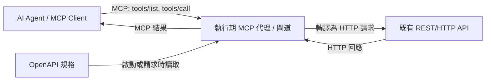

# 將既有 HTTP API 轉換為 MCP Server 的 FOSS 閘道／代理方案

## 摘要

本報告調查「把既有的 HTTP（REST）API 轉換成 MCP（Model Context Protocol）Server」的開源（FOSS）方案，並依需求**排除程式碼產生器（code generator）**，優先收錄**在執行期（runtime）動態轉換的閘道器（gateway）／代理（proxy）**。

主要發現：此領域可分為三類。第一類是「單一 API 導向」的輕量代理，直接吃 OpenAPI 規格檔，把每個端點動態註冊成 MCP 工具，代表作為 `mcp-openapi-proxy`[^mwproxy] 與 AWS Labs 的 OpenAPI MCP Server[^aws]。第二類是「多後端聚合」的 AI 閘道器，除了 MCP 之外還處理 LLM 路由、A2A、認證、可觀測性，代表作為 Higress[^higress]、agentgateway[^agentgw]、IBM ContextForge[^forge] 與 mcp-ecosystem/mcp-gateway[^mcpgtw]。第三類是「名為 proxy、實為產生器」的方案，例如 Higress 生態的 `openapi-to-mcpserver` 是離線把 OpenAPI 轉成設定檔的 CLI，並非執行期代理，本報告將其標記為排除項[^o2m]。

選型上，若只要「一個既有 API 快速變成 MCP」，`mcp-openapi-proxy` 或 AWS Labs OpenAPI MCP Server 最省事；若要「多個 API 與多個 MCP Server 統一治理」，則選 Higress、agentgateway 或 IBM ContextForge。

---

## 背景：為何需要把 HTTP API 轉成 MCP

MCP 是一種讓大型語言模型（LLM）與外部工具、資料來源互動的協定[^mcp]。既有企業內部或第三方服務多半只提供 REST/HTTP API，並以 OpenAPI（Swagger）規格描述。要讓 AI Agent 直接呼叫這些 API，就需要一個「橋接層」把 OpenAPI 的操作（operation）轉譯為 MCP 的 tool。

若採用**程式碼產生器**，必須在開發期把規格檔編譯成程式碼或設定檔，之後 API 變更時要重新產生與重新部署。相對地，**執行期代理／閘道**則在啟動或請求時動態讀取 OpenAPI 規格，即時把端點曝露為 MCP 工具，維護成本較低，這也是本次研究偏好的方向。

---

## 篩選條件

| 條件 | 說明 |
|---|---|
| 授權 | 必須是 FOSS（開源授權，如 Apache-2.0、MIT） |
| 方向 | OpenAPI/REST → MCP（不是反向的 MCP → OpenAPI） |
| 機制 | 執行期動態轉換的 proxy/gateway，**排除**純程式碼或設定檔產生器 |
| 用途 | 能實際把既有 HTTP API 曝露為可呼叫的 MCP 工具 |

> 註：部分專案的 GitHub 星數於 2026-10-22 透過 GitHub API 與專案頁面查得，星數會隨時間變動，僅作為社群活躍度的參考。

---

## 方案一：單一 API 導向的執行期代理

### 1. mcp-openapi-proxy（matthewhand）

以 Python 實作的 MCP Server，會**動態**讀取 OpenAPI 規格，把規格中的每個端點註冊成一個 MCP 工具（例如 `/chat/completions` 會變成 `chat_completions()`）[^mwproxy]。截至 2026-10-22 約有 158 顆星，採 MIT 授權[^mwproxyapi]。

重點特性[^mwproxy]：

- 雙協定堆疊：同時支援 MCP 1.x（舊式 stdio 握手）與 MCP 2.x（2026-07-28 版、原生無狀態 Streamable HTTP）。
- 工具註解（tool annotations）：GET 會標記 `readOnlyHint`／`idempotentHint`，其他方法標記 `destructiveHint`，方便用戶端判斷風險。
- 端點過濾：以 `TOOL_WHITELIST` 白名單控制要曝露的路徑，避免大型 API 一次產生上百個工具。
- 認證彈性：支援 Bearer、自訂 header（`API_AUTH_TYPE=api-key` + `API_AUTH_HEADER`）、自訂 scheme 前綴（如 NetBox 的 `Token`），以及以 JMESPath 處理需要把權杖放在 payload 的 API（如 Slack）。
- 支援 stdio 與 Streamable HTTP 兩種傳輸，並提供 `GET /healthz` 健康檢查。
- 以 `uvx mcp-openapi-proxy` 即可執行。

作者提供了跨多個主流 Agent CLI（Codex、Gemini、Qwen、opencode、Vibe、Letta 等）的實測矩陣，並列出多個真實 API 範例（Notion、Asana、Slack、NetBox、Home Assistant、WordPress 等）[^mwproxy]。這使其成為「單一 API 快速 MCP 化」最直接的選擇。

### 2. AWS Labs OpenAPI MCP Server

位於 `awslabs/mcp` 單體倉庫中的子專案，以 Python 實作，會**在執行期**從 OpenAPI 3.x 規格動態建立 MCP 工具與資源[^aws]。其母倉庫 `awslabs/mcp` 於 2026-10-22 約有 9,809 顆星、Apache-2.0 授權[^awsapi]。

重點特性[^aws]：

- 動態工具產生：自動把 OpenAPI 端點轉成 MCP 工具。
- 多規格組合（multi-spec composition）：可用 `ADDITIONAL_SPECS` 把多個 API 合併到同一個 MCP Server，每個規格有各自的認證設定。
- 標籤過濾：以 `--include-tags`／`--exclude-tags` 控制曝露的操作。
- 操作提示（operation prompts）：為每個操作產生自然語言提示。
- 認證支援：Basic、Bearer、API Key、Cognito。
- 安全設計：對規格 URL 做 SSRF 防護、DNS 釘選（防 DNS rebinding）、拒絕外部 `$ref`、限制規格檔案大小與路徑。

需注意其傳輸以 **stdio** 為主[^aws]，若要供遠端用戶端使用，通常需再搭配一個 stdio↔HTTP 的橋接器。

### 3. gujord/OpenAPI-MCP

以 Python 與 FastMCP 為基礎的代理，把 OpenAPI 規格轉譯為 MCP 工具、資源與提示，支援 stdio、SSE 與 Streamable HTTP[^gujord]。截至 2026-10-22 約 69 顆星，MIT 授權[^gujord]。社群規模較小，適合作為輕量替代方案評估。

### 4. itmaaa/mcp-proxy

以 Go 實作，主打「把 OpenAPI/Swagger 服務變成可管理的 MCP 工具」，附帶儀表板、認證（basic/bearer/api_key）、路徑控制與 Prometheus 指標[^itmaaa]。截至 2026-10-22 約 76 顆星，Apache-2.0 授權[^itmaaa]。適合想要「代理 + 管理後台」的小型部署。

---

## 方案二：多後端聚合的 AI 閘道器

這一類不只是「把一個 API 轉成 MCP」，而是把**多個 MCP Server 與多個 REST API 聚合在單一端點**，並加上認證、限流、稽核與可觀測性。

### 1. Higress（CNCF Sandbox）

Higress 是基於 Istio 與 Envoy 的雲原生 API 閘道，可用 Go/Rust/JS 撰寫 Wasm 外掛擴充[^higress]。截至 2026-10-22 約 9,623 顆星，Apache-2.0 授權，為 CNCF Sandbox 專案[^higressapi]。

其 MCP 能力透過 Wasm 外掛實作[^higress]：

- `mcp-server` 外掛：載入設定後，**在執行期**把 REST API 定義轉成 MCP 工具；收到 `tools/list` 或 `tools/call` 時，依工具定義組出 HTTP 請求、呼叫真實 API，再用回應模板格式化結果。
- `mcp-router` 外掛：依工具名稱前綴把 `tools/call` 路由到正確的後端 MCP Server。
- 提供 `openapi-to-mcpserver` 工具，可把 OpenAPI 規格**轉成** `mcp-server` 外掛所需的設定檔。

**重要區別**：`openapi-to-mcpserver`（約 291 顆星、Apache-2.0）本身是**離線產生設定檔的 CLI**，屬於程式碼／設定產生器，依本次需求應**排除**[^o2m]。但 Higress 的 `mcp-server` 外掛載入設定後是在**執行期**服務 MCP 請求，因此 Higress 本體符合「閘道／代理」的定位。換言之，Higress 是「產生器 + 執行期外掛」的組合，若要完全避開產生步驟，需自行以設定檔描述工具。

Higress 的優勢在於生產級特性：統一認證授權、細粒度限流、完整稽核日誌、可觀測性，以及無中斷的熱更新[^higress]。

### 2. agentgateway（Linux Foundation）

以 Rust 實作的代理，自稱為「Agentic AI 的完整連線方案」，同時提供 LLM Gateway、MCP Gateway 與 A2A Gateway[^agentgw]。截至 2026-10-22 約 5,487 顆星，Apache-2.0 授權，並為 Linux Foundation 專案[^agentgwapi]。

其 MCP Gateway 支援工具聯邦（tool federation）、stdio/HTTP/SSE/Streamable HTTP 傳輸、**OpenAPI 整合**與 OAuth 認證[^agentgw]。此外還有 CEL 政策引擎的細粒度 RBAC、限流、TLS 與 OpenTelemetry。適合需要「一個閘道同時管 LLM、MCP、A2A」的環境。

### 3. IBM ContextForge（mcp-context-forge）

IBM 開源的註冊表（registry）與代理，可聯邦化（federate）任何 MCP Server、A2A Server 或 REST/gRPC API，並提供集中治理、探索與可觀測性[^forge]。截至 2026-10-22 約 4,678 顆星，Apache-2.0 授權[^forgeapi]。

與本主題相關的能力[^forge]：

- **REST-to-MCP 工具轉接器**：把 REST API 轉成工具，自動擷取 JSON Schema、支援 header／權杖／自訂認證，並具備重試、逾時與限流策略。
- **REST/gRPC 服務虛擬化**：把非 MCP 服務包裝成「虛擬 MCP Server」。
- **gRPC-to-MCP 轉譯**：透過 server reflection 自動探索服務與方法。
- 支援 HTTP、JSON-RPC、WebSocket、SSE、Streamable HTTP 等傳輸，並有 Admin UI 與 OpenTelemetry 可觀測性。

需注意 ContextForge 啟動時**強制要求** `JWT_SECRET_KEY` 與 `AUTH_ENCRYPTION_SECRET` 兩個密鑰，且部署較重（可用 SQLite 單機，也可用 PostgreSQL + Redis 多副本）[^forge]。

### 4. mcp-ecosystem/mcp-gateway（Unla）

以 Go 實作的閘道器，主打「設定驅動、零程式碼」地把 RESTful API、gRPC、WebSocket 轉成 MCP，並代理既有 MCP Server[^unla]。截至 2026-10-22 約 2,200 顆星，MIT 授權[^unla]。

其運作方式為兩段式[^unla]：先用 `openapi-converter` CLI 把 OpenAPI 3.x／Swagger 2.0 規格**轉成**閘道設定 YAML，再把設定載入執行中的閘道（透過 Web UI 或設定儲存），之後閘道即以 SSE 或 Streamable HTTP 服務 MCP 用戶端。同樣地，`openapi-converter` 屬產生器，但閘道本體是執行期代理。其餘特性包括熱重載、多租戶、OAuth2 與 OpenTelemetry 追蹤。

### 5. lasso-security/mcp-gateway

以外掛為基礎的 MCP 閘道，用以協調多個 MCP Server，並讓開發者在其上建構企業級 Agent[^lasso]。截至 2026-10-22 約 396 顆星，MIT 授權[^lasso]。其定位偏向 MCP 聚合與安全，**並非**專門的 OpenAPI→MCP 轉換器，適合已有多個 MCP Server 需要集中管理的情境。

### 6. Docker MCP Gateway

Docker 官方的 MCP 閘道（`docker mcp` CLI 外掛），負責在 AI 用戶端與多個 MCP Server 容器之間做協定轉譯、路由與生命週期管理[^dockermcp]。截至 2026-10-22 約 1,613 顆星，MIT 授權[^dockermcpapi]。

**關鍵限制**：它**不**內建「吃 OpenAPI 規格、動態產生 MCP 工具」的能力，只會路由到「已經會說 MCP」的 Server[^dockermcp]。Docker MCP Catalog 中的 OpenAPI Toolkit 是「操作 OpenAPI 規格」的 MCP Server，並非把任意 REST API 轉成工具[^dockermcp]。因此若需求是「既有 HTTP API → MCP」，Docker MCP Gateway 需搭配其他轉換器才成立。

---

## 對照表

| 專案 | 語言 | 星數（2026-10-22） | 授權 | 執行期代理？ | OpenAPI→MCP？ | 定位 |
|---|---|---|---|---|---|---|
| mcp-openapi-proxy[^mwproxy] | Python | 158 | MIT | 是 | 是（原生） | 單一 API 代理 |
| AWS Labs OpenAPI MCP Server[^aws] | Python | 9,809（母倉庫） | Apache-2.0 | 是 | 是（原生） | 單一／多規格代理 |
| gujord/OpenAPI-MCP[^gujord] | Python | 69 | MIT | 是 | 是 | 輕量代理 |
| itmaaa/mcp-proxy[^itmaaa] | Go | 76 | Apache-2.0 | 是 | 是 | 代理 + 管理後台 |
| Higress[^higress] | Go | 9,623 | Apache-2.0 | 是（Wasm 外掛） | 是（需設定檔） | 雲原生 AI 閘道 |
| agentgateway[^agentgw] | Rust | 5,487 | Apache-2.0 | 是 | 是 | LLM/MCP/A2A 閘道 |
| IBM ContextForge[^forge] | Python | 4,678 | Apache-2.0 | 是 | 是 | 註冊表 + 閘道 |
| mcp-ecosystem/mcp-gateway[^unla] | Go | 2,200 | MIT | 是 | 是（需轉換器） | 設定驅動閘道 |
| lasso-security/mcp-gateway[^lasso] | Python | 396 | MIT | 是 | 否（MCP 聚合） | MCP 聚合／安全 |
| Docker MCP Gateway[^dockermcp] | Go | 1,613 | MIT | 是 | 否（僅路由） | MCP 容器閘道 |
| ~~Higress openapi-to-mcpserver~~[^o2m] | Go | 291 | Apache-2.0 | **否** | 是（離線產生設定） | **已排除：產生器** |
| ~~open-webui/mcpo~~[^mcpo] | Python | 4,409 | MIT | 是 | **反向**（MCP→OpenAPI） | **已排除：方向相反** |

---

## 架構示意

下圖說明執行期代理的基本資料流：用戶端以 MCP 協定連線，代理在執行期把 OpenAPI 端點對應為 MCP 工具，並把 `tools/call` 轉譯成對上游 HTTP API 的請求。

---

## 選型建議

| 情境 | 建議方案 | 理由 |
|---|---|---|
| 只要把「一個」既有 API 快速 MCP 化 | mcp-openapi-proxy 或 AWS Labs OpenAPI MCP Server | 直接吃 OpenAPI 規格，執行期動態產生工具，安裝最輕[^mwproxy][^aws] |
| 需要多個 API + 多個 MCP Server 統一治理 | IBM ContextForge 或 mcp-ecosystem/mcp-gateway | 具備聯邦、註冊表、認證與可觀測性[^forge][^unla] |
| 已在用 Kubernetes/Envoy，想要生產級閘道 | Higress 或 agentgateway | Wasm 外掛／Rust 高效能，具備限流、稽核、熱更新[^higress][^agentgw] |
| 需要同時管理 LLM 路由與 MCP | agentgateway | 單一代理同時涵蓋 LLM Gateway、MCP Gateway、A2A Gateway[^agentgw] |
| 已有多個 MCP Server，只想集中聚合 | lasso-security/mcp-gateway | 專注 MCP 聚合與安全[^lasso] |
| 以 Docker 容器化 MCP Server 為主 | Docker MCP Gateway（需另搭轉換器） | 本身不含 OpenAPI→MCP，須補上轉換元件[^dockermcp] |

---

## 風險與注意事項

1. **認證資訊外洩**：代理通常以環境變數保存上游 API 金鑰，需確保代理本身不被未授權存取，並避免把金鑰寫入日誌[^mwproxy]。
2. **工具數量膨脹**：大型 API（如 Asana、Slack、NetBox）端點數十上百，若不設白名單或標籤過濾，會產生過多工具而拖累 LLM 的工具選擇品質；多數方案都提供白名單或標籤過濾機制[^mwproxy][^aws]。
3. **產生器與代理的界線**：Higress 與 mcp-ecosystem/mcp-gateway 的「OpenAPI 轉換」步驟是離線 CLI，若要求純執行期、零產生流程，需確認實際部署時是否接受這個前置步驟[^o2m][^unla]。
4. **傳輸相容性**：部分方案（如 AWS Labs OpenAPI MCP Server）以 stdio 為主，供遠端使用時需額外的 stdio↔HTTP 橋接[^aws]。
5. **協定版本演進**：MCP 協定仍在演進（例如 2026-07-28 版導入無狀態 Streamable HTTP），選型時應確認方案支援的協定版本與用戶端相容性[^mwproxy]。
6. **SSRF 與規格來源安全**：以遠端 URL 載入 OpenAPI 規格時，存在 SSRF 風險；AWS Labs 的方案提供了 DNS 釘選與外部 `$ref` 拒絕等防護，可作為安全設計的參考基準[^aws]。
7. **星數不等於品質**：高星數專案未必最貼合需求（例如 Docker MCP Gateway 星數高但不做 OpenAPI→MCP），低星數專案也可能剛好契合特定情境，應以功能與維護狀態為主要判準[^dockermcp]。

---

## 結論

在「既有 HTTP API → MCP」且「排除程式碼產生器、偏好執行期閘道／代理」的前提下，最貼近需求的是 **mcp-openapi-proxy** 與 **AWS Labs OpenAPI MCP Server** 這類單一 API 代理；若需要集中治理多個 API 與 MCP Server，則以 **IBM ContextForge**、**Higress**、**agentgateway** 與 **mcp-ecosystem/mcp-gateway** 為主要候選。需特別留意 **Higress 的 `openapi-to-mcpserver`** 與 **Docker MCP Gateway** 的定位差異，前者是離線設定產生器、後者不含 OpenAPI→MCP 能力，兩者都不宜直接當成「執行期 OpenAPI→MCP 代理」使用。

---

## 參考文獻

[^mcp]: Model Context Protocol. (n.d.). *Introduction*. Retrieved 2026-10-22, from https://modelcontextprotocol.io/introduction

[^mwproxy]: matthewhand. (n.d.). *mcp-openapi-proxy* [Computer software]. Retrieved 2026-10-22, from https://github.com/matthewhand/mcp-openapi-proxy

[^mwproxyapi]: GitHub. (2026). *Repository metadata: matthewhand/mcp-openapi-proxy*. Retrieved 2026-10-22, from https://api.github.com/repos/matthewhand/mcp-openapi-proxy

[^aws]: Amazon Web Services Labs. (n.d.). *AWS Labs OpenAPI MCP Server*. Retrieved 2026-10-22, from https://github.com/awslabs/mcp/tree/main/src/openapi-mcp-server

[^awsapi]: GitHub. (2026). *Repository metadata: awslabs/mcp*. Retrieved 2026-10-22, from https://api.github.com/repos/awslabs/mcp

[^gujord]: gujord. (n.d.). *OpenAPI-MCP* [Computer software]. Retrieved 2026-10-22, from https://github.com/gujord/OpenAPI-MCP

[^itmaaa]: itmaaa. (n.d.). *mcp-proxy* [Computer software]. Retrieved 2026-10-22, from https://github.com/itmaaa/mcp-proxy

[^higress]: Higress Group. (n.d.). *Higress: AI Native API Gateway*. Retrieved 2026-10-22, from https://github.com/higress-group/higress

[^higressapi]: GitHub. (2026). *Repository metadata: higress-group/higress*. Retrieved 2026-10-22, from https://api.github.com/repos/higress-group/higress

[^o2m]: Higress Group. (n.d.). *openapi-to-mcpserver* [Computer software]. Retrieved 2026-10-22, from https://github.com/higress-group/openapi-to-mcpserver

[^agentgw]: agentgateway. (n.d.). *agentgateway: Next Generation Agentic Proxy for AI Agents and MCP servers*. Retrieved 2026-10-22, from https://github.com/agentgateway/agentgateway

[^agentgwapi]: GitHub. (2026). *Repository metadata: agentgateway/agentgateway*. Retrieved 2026-10-22, from https://api.github.com/repos/agentgateway/agentgateway

[^forge]: IBM. (n.d.). *ContextForge (mcp-context-forge): An AI Gateway, registry, and proxy*. Retrieved 2026-10-22, from https://github.com/IBM/mcp-context-forge

[^forgeapi]: GitHub. (2026). *Repository metadata: IBM/mcp-context-forge*. Retrieved 2026-10-22, from https://api.github.com/repos/IBM/mcp-context-forge

[^unla]: mcp-ecosystem. (n.d.). *mcp-gateway (Unla)* [Computer software]. Retrieved 2026-10-22, from https://github.com/mcp-ecosystem/mcp-gateway

[^lasso]: Lasso Security. (n.d.). *mcp-gateway* [Computer software]. Retrieved 2026-10-22, from https://github.com/lasso-security/mcp-gateway

[^dockermcp]: Docker. (n.d.). *docker/mcp-gateway: docker mcp CLI plugin / MCP Gateway*. Retrieved 2026-10-22, from https://github.com/docker/mcp-gateway

[^dockermcpapi]: GitHub. (2026). *Repository metadata: docker/mcp-gateway*. Retrieved 2026-10-22, from https://api.github.com/repos/docker/mcp-gateway

[^mcpo]: open-webui. (n.d.). *mcpo: A simple, secure MCP-to-OpenAPI proxy server*. Retrieved 2026-10-22, from https://github.com/open-webui/mcpo
