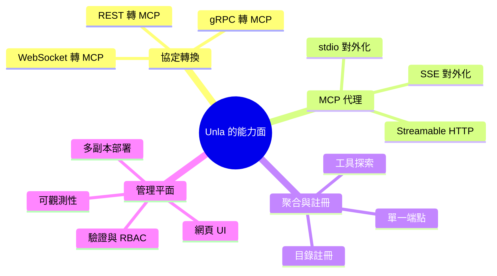

# Unla 的 FOSS 替代方案：開源 MCP Gateway 專案調查

## 摘要

Unla（原名 `mcp-ecosystem/mcp-gateway`，現位於 `AmoyLab/Unla`）是一套以 Go 撰寫的輕量級 MCP Gateway，主要能力是「零程式碼改動」地把既有的 RESTful API、gRPC 服務、WebSocket 端點轉換為符合 MCP（Model Context Protocol，模型上下文協定）的端點，並可代理既有的 MCP Server，附帶管理介面、多租戶、Session 持久化與 Docker／Kubernetes 部署能力[^unla]。截至 2026 年 10 月下旬，該專案約有 2,245 顆星、187 個 fork、101 個未關閉議題，採用 MIT 授權，最後推送時間為 2026-10-20，仍持續維護中[^unla-api]。

本報告的目標，是找出與 Unla 定位相近、同樣採用自由／開源軟體（FOSS）授權的替代專案。需要先釐清的是：「Unla 的替代品」其實橫跨數個功能層次，因為 Unla 本身同時揉合了四種角色：

1. **協定轉換器**：把 REST／gRPC／WebSocket 轉成 MCP。
2. **MCP 代理**：在既有 MCP Server 前面加上一層閘道。
3. **聚合器／註冊中心**：把多個 MCP Server 收攏到單一端點，並提供可探索的目錄。
4. **管理平面**：提供網頁 UI、驗證、可觀測性與跨副本部署。

因此，沒有一個專案能一對一完全對應 Unla，但有一批 FOSS 專案各自覆蓋其中部分或大部分能力。以下依「與 Unla 的核心重疊度」分組介紹。

## 一、定位最接近：能做 REST／gRPC 轉 MCP 的閘道

### 1.1 IBM ContextForge（mcp-context-forge）

IBM 的 ContextForge 是本清單中，與 Unla「REST API 轉 MCP」核心能力重疊度最高的專案。它是一套開源註冊中心與代理，能把 MCP Server、A2A（Agent-to-Agent）代理，以及 REST／gRPC API 聯邦式地收攏到單一端點之後[^contextforge]。其關鍵在於**協定轉換**：能把既有的 REST／gRPC 服務轉換為 MCP 相容的工具定義，並提供**虛擬伺服器組合**，讓多個 MCP Server 對外表現為單一邏輯端點[^contextforge]。此外它內建 40 多種外掛（PII 過濾、機密偵測、內容審核）、管理後台、以 Redis 為後端的快取、OpenTelemetry 可觀測性、RBAC 與 SSO 整合[^contextforge]。授權為 Apache 2.0，主要語言為 Python（部分效能關鍵路徑可搭配 Rust sidecar），約 4.7k 顆星[^contextforge-gh]。

與 Unla 的差異：ContextForge 以 Python 為主而非 Go，較偏「註冊中心＋外掛生態」的取向，但對需要 REST／gRPC 轉 MCP 的使用者來說，這是最直接的替代選項之一。

### 1.2 agentgateway（Linux Foundation / AAIF）

agentgateway 是一套以 Rust 撰寫、捐贈給 Agentic AI Foundation（隸屬 Linux Foundation）的 AI 優先雲原生閘道，同時處理 agent-to-LLM、agent-to-tool（MCP）與 agent-to-agent（A2A）三類流量[^agentgateway]。在 MCP 面向上，它支援工具聯邦、stdio／HTTP／SSE／Streamable HTTP 多種傳輸、OpenAPI 整合與 OAuth 驗證；在 LLM 面向上則提供路由、預算／花費控制、負載平衡與容錯切換[^agentgateway]。授權 Apache 2.0，約 5.5k 顆星，可獨立執行或部署於 Kubernetes，並有 Solo.io 提供企業版發行[^agentgateway-gh]。

與 Unla 的差異：agentgateway 更偏「資料平面／政策引擎」取向，涵蓋範圍比 Unla 廣（含 LLM 路由與 A2A），MCP 轉換主要透過 OpenAPI 整合而非完整的 REST／gRPC／WebSocket 覆蓋。

### 1.3 MCP Gateway & Registry（agentic-community）

此專案由社群（與 AWS 生態相關）維護，是一套企業級控制平面，管理 MCP Server、A2A 代理、技能與自訂資產[^acgw]。它以 nginx 作為資料平面（反向代理）、FastAPI 作為控制平面，支援 Keycloak／Entra ID／Okta／Auth0／Cognito 等身分整合，具備語意搜尋、虛擬 MCP Server、逐使用者出口驗證（3LO／OBO）、安全掃描、稽核日誌、外部註冊中心聯邦與動態工具探索[^acgw]。授權 Apache 2.0，約 1.0k 顆星，可部署於 Amazon EKS、ECS 或 Docker Compose[^acgw-gh]。

與 Unla 的差異：它亦具備通用 HTTP 代理能力，能將 REST 後端轉為 MCP 工具，但整體設計偏重企業治理與註冊中心，而非 Unla 的輕量單體部署體驗。

## 二、MCP 聚合器與註冊中心（附管理介面）

### 2.1 MCPHub（samanhappy/mcphub）

MCPHub 在功能輪廓上與 Unla 相當接近：它是一套「連一次、到處曝露」的 MCP 閘道，將所有連線的 MCP Server 透過穩定的 SSE／Streamable HTTP／stdio 端點對外提供，並附帶網頁儀表板、OAuth 2.0、Bearer 金鑰、逐使用者憑證與可觀測性[^mcphub]。它還內建以向量語意搜尋（pgvector）為基礎的智慧路由、伺服器別名與群組、熱替換設定、健康檢查、工具結果壓縮，以及 PostgreSQL 資料庫模式[^mcphub]。授權 Apache 2.0，約 2.6k 顆星，語言為 TypeScript（Node.js／Express 後端、React 前端），提供 Docker 映像[^mcphub-gh]。

與 Unla 的差異：MCPHub 以 MCP 聚合與管理為核心，並不以「REST／gRPC／WebSocket 無程式碼轉換」為主打；但若需求偏重「多 MCP Server 收攏＋儀表板」，它是相當直接的替代。

### 2.2 MCPJungle

MCPJungle 是一套以單一 Go 二進位檔提供的輕量閘道與註冊中心，具備工具群組與逐客戶端存取權杖，能將 stdio 伺服器作為子程序在閘道內執行；本機使用 SQLite，團隊情境可切換至 PostgreSQL，且不需 Kubernetes[^mcpjungle]。授權 MPL-2.0，約 1.3k 顆星[^mcpjungle]。

與 Unla 的差異：同樣是 Go 單體、部署簡單，但定位偏「輕量註冊與分組」，不含 REST／gRPC 無程式碼轉換。

### 2.3 Obot

Obot 是一套以 MCP 閘道為核心的 AI 治理平台，提供受治理的單一進入點、虛擬 MCP Server（vMCP，組合多個目錄內的伺服器）、MCP 通道、工具搜尋、OAuth 與憑證管理、請求／回應過濾，另含 LLM 閘道、託管的 MCP 執行環境、稽核日誌與 Git 後端目錄[^obot]。授權 MIT，約 1.1k 顆星，語言 Go[^obot-gh]。

與 Unla 的差異：Obot 的治理與聊天客戶端功能更完整，但 MCP 轉換仍以代理既有伺服器為主。

### 2.4 Archestra

Archestra 將 MCP 閘道、註冊中心、LLM 代理、代理程式、聊天與護欄整合於一；內含 900 多個經評估的 MCP Server 目錄，並提供組織／團隊／使用者／代理層級的硬性 LLM 花費上限與確定性的 Session 護欄[^archestra]。授權 AGPL-3.0（部分企業檔案另授權），約 4.3k 顆星[^archestra]。

與 Unla 的差異：AGPL-3.0 對商業再散佈的限制比 Unla 的 MIT 嚴格，使用前須評估授權相容性；功能亦偏「平台化」。

## 三、輕量協定橋接（stdio／SSE／HTTP 轉換）

這類專案不處理 REST／gRPC 轉 MCP，也不提供完整管理平面，但能解決 Unla 的「代理既有 MCP Server」與「傳輸對外化」需求，且部署極為輕量。

### 3.1 Supergateway

Supergateway 讓 stdio 形式的 MCP Server 能透過 SSE、WebSocket 或 Streamable HTTP 執行，並支援雙向轉換（stdio↔SSE、SSE↔stdio、Streamable HTTP↔stdio）、多伺服器設定檔、API 金鑰驗證、CORS、工具前綴／過濾與健康檢查端點[^supergateway]。授權 MIT，約 2.9k 顆星，語言 TypeScript／Node.js[^supergateway]。

### 3.2 mcpo（open-webui/mcpo）

mcpo 是一套「MCP 轉 OpenAPI 代理伺服器」，能把任意 MCP Server 指令曝露為標準的 RESTful OpenAPI HTTP 伺服器，並在 `http://localhost:8000/docs` 自動產生互動式 Swagger 文件[^mcpo]。它支援 stdio、SSE 與 Streamable HTTP 三種伺服器型別、設定檔一次服務多工具、熱重載、API 金鑰與 OAuth 2.1 驗證、Docker 映像[^mcpo]。授權 MIT，約 4.4k 顆星，語言 Python[^mcpo-gh]。

與 Unla 的差異：mcpo 方向相反，是把 MCP **輸出成** OpenAPI，而非把 REST **轉成** MCP；但對「讓既有 OpenAPI 工具鏈使用 MCP」的整合場景非常實用。

### 3.3 mcp-proxy（sparfenyuk）

sparfenyuk 的 mcp-proxy 是 Streamable HTTP／SSE 與 stdio 之間的雙向橋接：一種模式讓僅支援 stdio 的客戶端（如 Claude Desktop）連上遠端 SSE 伺服器，另一種模式把本機 stdio 伺服器以 SSE／HTTP 對外曝露[^sparfenyuk]。支援具名伺服器、OAuth2 客戶端憑證、Digest 驗證、自訂 CORS、無狀態模式與 Docker 映像[^sparfenyuk]。授權 MIT，約 2.8k 顆星，語言 Python[^sparfenyuk-gh]。

### 3.4 mcp-proxy（TBXark）

TBXark 的 mcp-proxy 以 Go 撰寫，能聚合多個 MCP 資源伺服器並透過單一 HTTP 進入點提供，支援 stdio／SSE／Streamable HTTP 客戶端型別、對下游伺服器的 OAuth 權杖更新、線上 Claude 設定轉換器與 Docker 支援[^tbxark]。授權 MIT，約 741 顆星[^tbxark-gh]。

### 3.5 mcp-proxy（punkpeye）

punkpeye 的 mcp-proxy 是 TypeScript 實作的 Streamable HTTP 與 SSE 代理，供使用 stdio 傳輸的 MCP Server 使用，同時支援 CLI 與 Node.js SDK，是 FastMCP 內部所依賴的元件[^punkpeye]。授權 MIT，約 293 顆星[^punkpeye-gh]。

### 3.6 其他輕量橋接

- **Docker MCP Gateway**：Docker CLI 外掛，把每個 MCP Server 跑在隔離容器中，具備簽章映像、密鑰管理、OAuth 流程與 300 多個伺服器的目錄；授權 MIT，約 1.6k 顆星，語言 Go[^dockergw-gh]。
- **acehoss/mcp-gateway**：把 MCP stdio 伺服器橋接到 HTTP+SSE 與 REST API，並為所有工具產生 OpenAPI schema，支援 YAML 設定與 Basic／Bearer 驗證；授權 MIT，約 131 顆星，語言 TypeScript[^acehoss-gh]。
- **matthisholleville/mcp-gateway**：企業導向代理閘道，含 Okta OAuth2／JWT、細粒度工具權限、速率限制、Prometheus 指標與 PostgreSQL；授權 Apache 2.0，約 13 顆星，語言 Go[^matthisholleville-gh]。
- **Lasso Security mcp-gateway**：外掛式安全閘道，內建機密遮罩、Microsoft Presidio PII 遮罩、載入前伺服器信譽掃描與追蹤，並代理既有 MCP；授權 MIT，約 396 顆星，語言 Python[^lasso]。

## 四、其他值得注意的專案

- **Bifrost（maximhq）**：同時是 LLM 閘道與 MCP 閘道的 Go 二進位檔，支援 23 種以上 LLM 供應商、六種驗證型別、逐虛擬金鑰的工具過濾，並以「Code Mode」大幅降低工具 schema 的輸入 token；授權 Apache 2.0，約 9.0k 顆星[^bifrost]。
- **Microsoft MCP Gateway**：以 C#（.NET）撰寫的 Kubernetes 反向代理與管理層，支援 Session 感知路由、MCP Server 生命週期管理、Azure Entra ID 驗證與 Tool Gateway Router；授權 MIT，約 893 顆星[^msgw]。
- **Kuadrant MCP Gateway**：以 Envoy 為基礎、面向 Kubernetes Gateway API 與 Istio 的 MCP 閘道，依 IdP 角色宣告控制工具存取並提供逐使用者稽核；授權 Apache 2.0，約 107 顆星，語言 Go[^kuadrant]。
- **Lunar MCPX（TheLunarCompany）**：把本機與遠端 MCP Server 聚合於單一端點並提供逐代理工具控制，另含伺服器審查與沙箱；授權 MIT，約 504 顆星[^lunar]。
- **Metorial**：面向企業全面導入的 MCP 與技能閘道，具 SSO＋SCIM、逐使用者 OAuth、逐人稽核日誌與 1,100 多個伺服器目錄；採開放核心（open core）模式，約 3.3k 顆星[^metorial]。

## 五、綜合比較

下表整理各專案與 Unla 核心能力的對應關係（星星數為 2026 年 10 月下旬擷取之近似值）。

| 專案 | 星數 | 授權 | 語言 | REST／gRPC 轉 MCP | MCP 聚合 | 管理 UI | 備註 |
|---|---|---|---|---|---|---|---|
| **Unla（基準）** | 2.2k | MIT | Go | ✅ REST／gRPC／WebSocket | ✅ | ✅ | 本報告的比較基準 |
| IBM ContextForge | 4.7k | Apache 2.0 | Python | ✅ REST／gRPC | ✅ | ✅ | 定位最接近 |
| agentgateway | 5.5k | Apache 2.0 | Rust | 經 OpenAPI | ✅ | 部分 | 另含 LLM／A2A 閘道 |
| MCP Gateway & Registry | 1.0k | Apache 2.0 | Python | 通用 HTTP | ✅ | ✅ | 企業治理取向 |
| MCPHub | 2.6k | Apache 2.0 | TypeScript | ❌ | ✅ | ✅ | 功能輪廓相近 |
| MCPJungle | 1.3k | MPL-2.0 | Go | ❌ | ✅ | 部分 | 輕量單體 |
| Obot | 1.1k | MIT | Go | ❌ | ✅ | ✅ | 含 LLM 閘道 |
| Archestra | 4.3k | AGPL-3.0 | — | ❌ | ✅ | ✅ | 授權須留意 |
| Bifrost | 9.0k | Apache 2.0 | Go | ❌ | ✅ | 部分 | LLM＋MCP 閘道 |
| Supergateway | 2.9k | MIT | TypeScript | ❌ | 部分 | ❌ | 傳輸橋接 |
| mcpo | 4.4k | MIT | Python | ❌（反向） | 部分 | ❌ | MCP→OpenAPI |
| mcp-proxy（sparfenyuk） | 2.8k | MIT | Python | ❌ | 部分 | ❌ | 雙向傳輸橋接 |
| mcp-proxy（TBXark） | 741 | MIT | Go | ❌ | ✅ | ❌ | 單一 HTTP 進入點 |
| mcp-proxy（punkpeye） | 293 | MIT | TypeScript | ❌ | ❌ | ❌ | FastMCP 依賴 |
| Microsoft MCP Gateway | 893 | MIT | C# | ❌ | ✅ | ✅ | 僅 Kubernetes |
| Docker MCP Gateway | 1.6k | MIT | Go | ❌ | ✅ | 部分 | 容器隔離 |
| acehoss/mcp-gateway | 131 | MIT | TypeScript | 經 OpenAPI | 部分 | ❌ | 產生 OpenAPI |
| Lasso mcp-gateway | 396 | MIT | Python | ❌ | ✅ | ❌ | 安全護欄 |
| Kuadrant MCP Gateway | 107 | Apache 2.0 | Go | ❌ | ✅ | ❌ | 僅 K8s／Istio |
| Lunar MCPX | 504 | MIT | — | ❌ | ✅ | 部分 | 逐代理控制 |
| Metorial | 3.3k | 開放核心 | — | ❌ | ✅ | ✅ | 部分功能閉源 |

## 六、選型建議

- **若最在意「REST／gRPC 無程式碼轉 MCP」且想找最接近的替代**：優先評估 **IBM ContextForge**；它在協定轉換與註冊中心能力上最貼近 Unla，且有 IBM 背書與 Apache 2.0 授權[^contextforge]。
- **若偏好 Go 單體與簡單部署，且需求偏「多 MCP 聚合＋儀表板」**：可考慮 **MCPHub**（TypeScript 但部署類似）或 **MCPJungle**（純 Go）[^mcphub][^mcpjungle]。
- **若需要 LLM 路由與 MCP 治理合一的資料平面**：**agentgateway** 或 **Bifrost** 是涵蓋面更廣的選擇，但兩者都不以 REST／gRPC 無程式碼轉換為主[^agentgateway][^bifrost]。
- **若只需把既有 MCP Server 對外曝露為 SSE／HTTP**：**Supergateway** 或任一 **mcp-proxy** 即足夠，體積與維運成本最低[^supergateway][^sparfenyuk][^tbxark]。
- **若反過來想讓 MCP 工具被既有 OpenAPI 工具鏈（如 Open WebUI）使用**：**mcpo** 是最直接的方案[^mcpo]。

需提醒的是，本調查的星數與功能描述皆為 2026 年 10 月下旬由公開網頁擷取，這些專案迭代速度普遍很快，實際選型前應以各專案官方倉庫與文件的最新狀態為準。

## 七、來源評析

本報告的關鍵事實（Unla 的定位、授權與星數）直接取自其 GitHub 倉庫頁面與 GitHub API 回應，屬第一手來源[^unla][^unla-api]。各替代專案的星數、授權與功能描述，主要來自其 GitHub 倉庫首頁與官方文件，再由多篇第三方比較文章（如 getmaxim.ai、Metorial、Scalekit 的「最佳開源 MCP 閘道」彙整）交叉印證[^cmp1][^cmp2][^cmp3]。第三方彙整文章常帶有推廣自家產品的傾向（例如 Metorial 的文章會強調自身優勢），因此在功能描述上本報告優先採用官方倉庫與官方文件，僅將第三方文章用於交叉確認與補充。此外，部分專案的星數在不同來源間存在落差（例如 MCPJungle 與 Archestra），本報告已在表中標示為近似值。星數本身是會快速變動且易受關注度影響的指標，僅能反映社群熱度，不等同於程式碼品質或適合度，選型時仍應實際評估功能、授權相容性與維運成本。

[^unla]: AmoyLab. (2026). Unla — MCP Gateway [電腦軟體]. Retrieved 2026-10-23, from https://github.com/AmoyLab/Unla
[^unla-api]: GitHub API. (2026). Repository: AmoyLab/Unla [資料檔]. Retrieved 2026-10-23, from https://api.github.com/repos/AmoyLab/Unla
[^contextforge]: IBM. (2026). ContextForge AI Gateway — Architecture. Retrieved 2026-10-23, from https://ibm.github.io/mcp-context-forge/architecture/
[^contextforge-gh]: IBM. (2026). mcp-context-forge [電腦軟體]. Retrieved 2026-10-23, from https://github.com/IBM/mcp-context-forge
[^agentgateway]: Agentgateway. (2026). Agentgateway — AI-first gateway. Retrieved 2026-10-23, from https://agentgateway.dev/
[^agentgateway-gh]: Agentgateway. (2026). agentgateway [電腦軟體]. Retrieved 2026-10-23, from https://github.com/agentgateway/agentgateway
[^acgw]: Agentic Community. (2026). MCP Gateway & Registry. Retrieved 2026-10-23, from https://agentic-community.github.io/mcp-gateway-registry/
[^acgw-gh]: Agentic Community. (2026). mcp-gateway-registry [電腦軟體]. Retrieved 2026-10-23, from https://github.com/agentic-community/mcp-gateway-registry
[^mcphub]: MCPHub. (2026). MCPHub — Connect once, expose everywhere. Retrieved 2026-10-23, from https://docs.mcphub.app/
[^mcphub-gh]: Samanhappy. (2026). mcphub [電腦軟體]. Retrieved 2026-10-23, from https://github.com/samanhappy/mcphub
[^mcpjungle]: MCPJungle. (2026). MCPJungle [電腦軟體]. Retrieved 2026-10-23, from https://github.com/mcpjungle/MCPJungle
[^obot]: Obot AI. (2026). Obot — AI governance platform. Retrieved 2026-10-23, from https://github.com/obot-platform/obot
[^obot-gh]: Obot AI. (2026). obot [電腦軟體]. Retrieved 2026-10-23, from https://github.com/obot-platform/obot
[^archestra]: Archestra AI. (2026). Archestra [電腦軟體]. Retrieved 2026-10-23, from https://github.com/archestra-ai/archestra
[^supergateway]: Supercorp AI. (2026). Supergateway [電腦軟體]. Retrieved 2026-10-23, from https://github.com/supercorp-ai/supergateway
[^mcpo]: Open WebUI. (2026). mcpo [電腦軟體]. Retrieved 2026-10-23, from https://github.com/open-webui/mcpo
[^mcpo-gh]: Open WebUI. (2026). mcpo [電腦軟體]. Retrieved 2026-10-23, from https://github.com/open-webui/mcpo
[^sparfenyuk]: Sparfenyuk. (2026). mcp-proxy [電腦軟體]. Retrieved 2026-10-23, from https://github.com/sparfenyuk/mcp-proxy
[^sparfenyuk-gh]: Sparfenyuk. (2026). mcp-proxy. Retrieved 2026-10-23, from https://pypi.org/project/mcp-proxy/
[^tbxark]: TBXark. (2026). mcp-proxy [電腦軟體]. Retrieved 2026-10-23, from https://github.com/TBXark/mcp-proxy
[^tbxark-gh]: TBXark. (2026). mcp-proxy. Retrieved 2026-10-23, from https://tbxark.github.io/mcp-proxy/
[^punkpeye]: Punkpeye. (2026). mcp-proxy [電腦軟體]. Retrieved 2026-10-23, from https://github.com/punkpeye/mcp-proxy
[^punkpeye-gh]: Punkpeye. (2026). mcp-proxy. Retrieved 2026-10-23, from https://www.npmjs.com/package/mcp-proxy
[^dockergw-gh]: Docker. (2026). mcp-gateway [電腦軟體]. Retrieved 2026-10-23, from https://github.com/docker/mcp-gateway
[^acehoss-gh]: Acehoss. (2026). mcp-gateway [電腦軟體]. Retrieved 2026-10-23, from https://github.com/acehoss/mcp-gateway
[^matthisholleville-gh]: Matthisholleville. (2026). mcp-gateway [電腦軟體]. Retrieved 2026-10-23, from https://github.com/matthisholleville/mcp-gateway
[^lasso]: Lasso Security. (2026). mcp-gateway [電腦軟體]. Retrieved 2026-10-23, from https://github.com/lasso-security/mcp-gateway
[^bifrost]: Maxim AI. (2026). Bifrost [電腦軟體]. Retrieved 2026-10-23, from https://github.com/maximhq/bifrost
[^msgw]: Microsoft. (2026). MCP Gateway. Retrieved 2026-10-23, from https://microsoft.github.io/mcp-gateway/
[^kuadrant]: Kuadrant. (2026). mcp-gateway [電腦軟體]. Retrieved 2026-10-23, from https://github.com/Kuadrant/mcp-gateway
[^lunar]: The Lunar Company. (2026). lunar [電腦軟體]. Retrieved 2026-10-23, from https://github.com/TheLunarCompany/lunar
[^metorial]: Metorial. (2026). metorial [電腦軟體]. Retrieved 2026-10-23, from https://github.com/metorial/metorial
[^cmp1]: Maxim AI. (2026). Best open source MCP gateways in 2026. Retrieved 2026-10-23, from https://www.getmaxim.ai/articles/best-open-source-mcp-gateways-in-2026/
[^cmp2]: Metorial. (2026). Best open source MCP gateways. Retrieved 2026-10-23, from https://metorial.com/comparisons/best-open-source-mcp-gateways
[^cmp3]: Scalekit. (2026). Best open source MCP gateways. Retrieved 2026-10-23, from https://www.scalekit.com/blog/best-open-source-mcp-gateways
