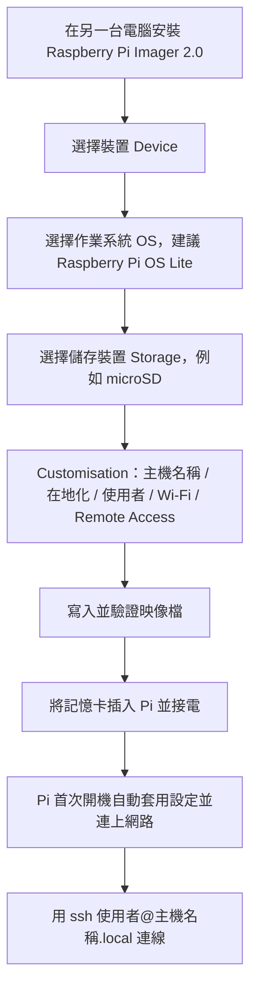

# 無螢幕、無圖形介面的 Raspberry Pi 安裝法（Headless 安裝）

## 摘要

「Headless」安裝指的是完全不接螢幕、鍵盤、滑鼠，直接透過網路（Wi-Fi 或乙太網路）與 SSH 遠端操作 Raspberry Pi[^headless-doc]。本文整理目前（2025 年末至 2026 年）官方推薦的完整流程，涵蓋：

1. 使用 Raspberry Pi Imager 2.0 的向導介面，在燒錄映像檔時就預先設定主機名稱、使用者帳密、Wi-Fi、SSH。
2. Raspberry Pi OS *Trixie* 起改用的 cloud-init 開機設定（`meta-data`、`network-config`、`user-data`）。
3. 不依賴 Imager 的手動開機分割區法（`ssh` 與 `userconf.txt`）。
4. 如何在沒有螢幕的情況下找出 Pi 的 IP、第一次以 SSH 連線，以及常見疑難排解。

> 名詞說明：Raspberry Pi OS 是 Raspberry Pi 基金會官方推出的作業系統，依版本代號命名（例如 Debian *Bookworm*、*Trixie*）。「Lite」版為純命令列、無桌面環境，最適合 headless 用途[^lite]。SSH（Secure Shell）是加密的遠端終端機協定[^ssh-doc]。

---

## 一、方案總覽

| 方案 | 適用情境 | 自動化程度 | 需不需要 Imager |
| --- | --- | --- | --- |
| A. Imager 2.0 向導（推薦） | 全新安裝，有另一台電腦 | 最高：一次設定完主機名稱、帳號、Wi-Fi、SSH | 需要 |
| B. cloud-init 手動設定 | 想自建可重複的映像範本、Trixie 之後 | 高：直接編輯開機分割區 YAML | 不需要 |
| C. 手動 `ssh` + `userconf.txt` | 已燒好映像、臨時補設定 | 低：僅能開啟 SSH 與建立使用者 | 不需要 |

官方明確建議：headless 安裝請優先使用 Raspberry Pi Imager 進行預先設定[^headless-doc]。



---

## 二、方案 A：Raspberry Pi Imager 2.0 向導（官方推薦）

Raspberry Pi Imager 是官方跨平台燒錄工具（Windows、macOS、Linux），支援下載並寫入 OS 映像[^install-doc]。2025 年 11 月 24 日發布的 2.0 版把原本藏在獨立視窗的「OS 客製化」功能提到主介面，改為逐步向導，並新增無障礙（螢幕閱讀器、鍵盤操作）支援[^imager2]。

### 操作流程

1. **安裝並啟動 Imager 2.0**：Windows／macOS 從官網下載安裝；Raspberry Pi OS 上可用 `sudo apt install rpi-imager`；其他 Linux 可下載 AppImage 後以 root 執行[^install-doc]。
   ```bash
   sudo ./imager-<version>-amd64.AppImage
   ```
2. **Device 頁**：選擇 Pi 型號後按 Next。
3. **OS 頁**：選擇作業系統。headless 建議選 **Raspberry Pi OS Lite**（命令列版）；也可用 *Use Custom* 選擇自備映像[^install-doc][^headless-doc]。
4. **Storage 頁**：插入 microSD 並選擇該裝置。務必保留 *Exclude system drives* 選項，避免誤刪主機硬碟[^install-doc]。
5. **Customisation 頁**（出現於支援客製化的 OS）：依序設定下列分頁[^install-doc]：

| 分頁 | 要填的內容 | headless 重點 |
| --- | --- | --- |
| Hostname | 僅限字母、數字、連字號 | 之後可用 `<hostname>.local` 連線 |
| Localisation | 城市（自動帶入時區與鍵盤配置） | 也決定 Wi-Fi 無線電規範網域（regulatory domain） |
| User | 使用者名稱與密碼 | 這就是 SSH 登入用的帳密 |
| Wi-Fi | SSID 與密碼，可勾 Hidden SSID | **headless 一定要在此設定**，Pi 開機就靠它上網 |
| Remote Access | 開啟 Enable SSH，選密碼或公鑰驗證 | 也可改設定 Raspberry Pi Connect |
| Raspberry Pi Connect | 連結 Raspberry Pi ID 帳號 | 另一種免設定的遠端存取方式 |

6. **Write 頁**：確認摘要後按 Write，系統會警告即將覆寫儲存媒體，選擇 *I understand, erase and write* 後開始寫入並驗證[^install-doc]。
7. 完成後，把記憶卡插入 Pi、接上電源，Pi 首次開機會套用上述設定並自動連網[^headless-doc]。

### 主機名稱與 mDNS

設定 Hostname 後，Pi 會透過 mDNS（多點傳送 DNS）向區網廣播，其他裝置即可用 `<hostname>.local` 或 `<hostname>.lan` 找到它；全新安裝的預設主機名稱是 `raspberrypi`，因此預設可用 `raspberrypi.local` 連線[^install-doc][^ip-doc]。

### Remote Access 的兩種驗證

- **Use password authentication**：使用 User 分頁設定的帳密登入[^install-doc]。
- **Use public key authentication**：使用 SSH 金鑰登入。Imager 會自動填入 `~/.ssh/id_rsa.pub`（若存在），否則可瀏覽選擇公鑰檔[^install-doc][^ssh-doc]。

---

## 三、方案 B：Trixie 之後的 cloud-init 開機設定

Raspberry Pi OS *Trixie* 映像（2025 年 11 月 24 日之後發布）改用 **cloud-init**，逐步汰換舊有的 `firstrun.sh` 機制。燒錄後，開機分割區（FAT32，標籤為 `bootfs`）會出現三個新檔案[^cloudinit]：

| 檔案 | 用途 |
| --- | --- |
| `meta-data` | 實例中介資料；一般保持不動，讓 cloud-init 得以處理其他檔案 |
| `network-config` | 網路設定（Wi-Fi／乙太網路、靜態 IP、VLAN、規範網域），採用 Netplan 格式 |
| `user-data` | 主要設定：使用者、SSH 金鑰、主機名稱、時區、套件，以及 Raspberry Pi 專屬的 `rpi:` 選項 |

> **關鍵：**`user-data` 開頭的 `#cloud-config` 標頭是**必要**的，缺少它 cloud-init 不會正確處理該檔[^cloudinit]。

### `user-data` 範例（官方部落格）

```yaml
#cloud-config

hostname: mypi2025
manage_etc_hosts: true

timezone: Europe/London

users:
  - name: pi
    groups: users,adm,dialout,audio,netdev,video,plugdev,cdrom,games,input,gpio,spi,i2c,render,sudo
    shell: /bin/bash
    lock_passwd: false
    plain_text_passwd: mysecretpassword123
    ssh_authorized_keys:
      - ssh-ed25519 mykeystuff
    sudo: ALL=(ALL) NOPASSWD:ALL

# Raspberry Pi 專屬選項（cc_raspberry_pi 模組）
rpi:
    spi: true
    i2c: true
    serial: true
    onewire: true
    enable_usb_gadget: true

# 僅 Raspberry Pi OS 提供，通用 cloud-init 映像沒有
enable_ssh: true

# 選用：只用金鑰登入時可關閉密碼驗證
# ssh_pwauth: false
```

### `network-config` 範例（官方部落格）

```yaml
network:
  version: 2
  wifis:
    renderer: NetworkManager
    wlan0:
      dhcp4: true
      # 務必改成你所在國家的 ISO/IEC 3166 代碼
      regulatory-domain: "GB"
      access-points:
        "My Net-Work":
          password: "mysupersecretpassword"
      # 開機時不要卡在等待此連線成功
      optional: true
```

### 與 Netplan 的關係

cloud-init 產生的網路設定會原封不動存入 `/etc/netplan/`，由 Netplan 作為 Raspberry Pi OS 網路的單一來源（source of truth），再渲染成 NetworkManager 的設定。若要手動套用，可執行[^cloudinit]：

```bash
sudo netplan generate
sudo netplan apply
```

此外，Raspberry Pi OS 額外修補了 Netplan 與 NetworkManager 的互通性：只有以 `netplan-` 為前綴的連線會被持久化，執行時產生的設定檔放在 `/run/NetworkManager/system-connections/`，而手動建立於 `/etc/NetworkManager/system-connections/` 的連線則不受影響[^cloudinit]。

> **版本相容性警告：**Trixie 映像使用 `"init_format": "cloudinit-rpi"` 格式，導致 **Imager 1.9.x 無法客製化 Trixie 映像**，必須使用 Imager 2.0 以上版本[^cloudinit]。Imager 2.0 也認得 Raspberry Pi 專屬的 `rpi:` 選項，可直接在介面上開啟 SPI、I2C 等[^cloudinit]。

---

## 四、方案 C：手動開機分割區設定（不經 Imager）

若映像已經燒好、但沒有透過 Imager 客製化，可直接在開機媒體的 `bootfs` 分割區建立兩個檔案[^headless-doc][^ssh-doc]：

1. **建立名為 `ssh` 的空檔案**（內容不拘，空檔即可啟用 SSH）。
2. **建立 `userconf.txt`**，內容為單一行：`<username>:<encrypted-password>`。

若在 Pi 本機操作，可用：

```bash
sudo touch /boot/firmware/ssh
```

在使用者名稱規則方面：必須以字母開頭，只能包含小寫字母、數字、底線與連字號，長度上限 31 個字元[^headless-doc]。

密碼需為**加密後**的字串，用 OpenSSL 產生：

```bash
openssl passwd -6
```

執行後依提示輸入並確認密碼，即輸出加密後的密碼雜湊，貼到 `userconf.txt` 冒號後方[^headless-doc]。

> **macOS 注意：**macOS 內建的 `ssl` 是 LibreSSL，不支援 `-6` 參數。請先執行 `openssl version` 確認，必要時用 `brew install openssl` 安裝真正的 OpenSSL[^headless-doc]。

### Wi-Fi 設定的重大變更

過去可在開機分割區放 `wpa_supplicant.conf` 來設定 Wi-Fi，**此功能從 Raspberry Pi OS Bookworm 起已不再提供**[^headless-doc]。也就是說：

- 若用手動檔案法（方案 C），只能靠**乙太網路**有線上網；Wi-Fi 必須改用 Imager（方案 A）或 cloud-init（方案 B）。
- Bookworm 之後的網路管理已由 `dhcpcd` 改為 NetworkManager；Trixie 又加入 Netplan 抽象層[^cloudinit]。

---

## 五、連線前的準備：找出 Pi 的 IP

headless 首次開機後，需先找出 Pi 在區網的 IP 或使用其 mDNS 名稱[^ip-doc]。

### 方法一：`<hostname>.local`（最快）

Raspberry Pi OS 內建 Avahi，支援 mDNS。預設主機名稱為 `raspberrypi`，可先測試：

```bash
ping raspberrypi.local
```

成功時會顯示其 IP，例如 `PING raspberrypi.local (192.168.1.131)`[^ip-doc]。若你改過主機名稱，`.local` 位址會跟著更新；忘記名稱時可在他台裝置安裝 Avahi 並用 `avahi-browse` 瀏覽區網主機[^ip-doc]。

### 方法二：路由器裝置清單

用瀏覽器登入路由器管理頁（常見為 `http://192.168.1.1`），查看「已連線裝置」清單；用有線連接時可篩選有線裝置以減少候選數量[^ip-doc]。

### 方法三：`nmap` 掃描子網

`nmap` 是自由開源的網路探索工具，支援 Linux、macOS、Windows。先用 `hostname -I`（Linux）等指令確認自己電腦的 IP，找出前三段相同的子網（例如 `192.168.1.0/24`），再執行 ping 掃描[^ip-doc]：

```bash
sudo nmap -sn 192.168.1.0/24
```

輸出中若出現 `Nmap scan report for raspberrypi (192.168.1.8)`，即為 Pi 的 IP[^ip-doc]。

### 方法四：手機 App

Fing 是免費的手機網路掃描器（Android、iOS）。將手機連上同一網路、開啟 App 重新整理，找到廠牌為「Raspberry Pi」的裝置即可看到 IP[^ip-doc]。

### 在 Pi 本機查詢（若已有其他管道）

```bash
hostname -I          # 直接輸出本機 IP
nmcli device show    # 顯示各介面詳細資訊，找 IP4.ADDRESS[1]
```

`nmcli` 輸出中，`GENERAL.TYPE` 為 `wifi` 或 `ethernet` 的區塊分別對應 Wi-Fi 與有線網卡，`IP4.ADDRESS[1]` 即為 IPv4 位址（忽略結尾的 `/24` 等[^ip-doc]）。

---

## 六、以 SSH 連線

在另一台電腦開啟終端機，將 `<ip address>` 換成 Pi 的 IP、`<username>` 換成你的帳號[^ssh-doc]：

```bash
ssh <username>@<ip address>
# 或使用 mDNS 名稱
ssh <username>@raspberrypi.local
```

第一次連線會出現安全警告，輸入 `yes` 接受後（僅首次出現）再輸入密碼，即可看到 Raspberry Pi 的命令提示字元 `<username>@<hostname> ~ $`[^ssh-doc]。

若要轉送圖形程式（X11 forwarding），可加 `-Y`，但 macOS 與 Windows 需另裝第三方 X server[^ssh-doc]：

```bash
ssh -Y <username>@<ip address>
```

### 設定免密碼登入（SSH 金鑰）

1. 產生金鑰（預設存於 `~/.ssh/id_rsa`；也可用 `-t ed25519` 產生更安全的 Ed25519 金鑰）[^ssh-doc]：
   ```bash
   ssh-keygen
   ```
2. 啟動 ssh-agent 並加入金鑰：
   ```bash
   eval "$(ssh-agent -s)"
   ssh-add ~/.ssh/id_rsa
   ```
3. 複製公鑰到 Pi：
   ```bash
   ssh-copy-id <username>@<ip address>
   ```

若系統不支援 `ssh-copy-id`，可改用 `scp`：先在 Pi 上 `mkdir .ssh && chmod 700 .ssh`，再從本機 `scp .ssh/id_rsa.pub <username>@<ip address>:.ssh/authorized_keys`，最後在 Pi 上 `chmod 644 .ssh/authorized_keys`[^ssh-doc]。

### 限制可連線的使用者

編輯 `/etc/ssh/sshd_config`，加入 `AllowUsers alice bob` 或 `DenyUsers jane john`，存檔後重啟服務[^ssh-doc]：

```bash
sudo systemctl restart ssh
```

---

## 七、疑難排解

| 症狀 | 可能原因 | 處理方式 |
| --- | --- | --- |
| `connection timed out` | IP 填錯，或 Pi 尚未開機完成 | 重新確認 Pi 的 IP；首次開機可能需等一兩分鐘才連上網[^ssh-doc][^ip-doc] |
| 無法解析 `raspberrypi.local` | 用戶端不支援 mDNS | 改用 IP 直連；Windows 可安裝 Bonjour，Linux 檢查 `avahi-daemon` 是否運作[^ip-doc] |
| `REMOTE HOST IDENTIFICATION HAS CHANGED` | 重新燒錄後 Pi 的 SSH 主機金鑰變了 | 執行 `ssh-keygen -R raspberrypi.local`（或對應 IP）清除舊金鑰後重連[^ssh-doc] |
| `Permission denied` | 帳號或密碼錯誤 | 檢查 Imager 的 User 設定或 `userconf.txt` 內容 |
| 找不到 Pi | Wi-Fi 未設定成功 | 手動檔案法不支援 Wi-Fi；確認是用 Imager／cloud-init 設定，或改用有線[^headless-doc] |
| SSH 沒開 | 未啟用 SSH | 用 Imager 重燒並開啟；或在本機 `sudo raspi-config` 於 Interfacing Options 啟用 SSH[^ssh-doc] |

> **補充：**若你已有桌面環境，也可從 Control Centre 的 Interfaces 分頁啟用 SSH；或以 `sudo touch /boot/firmware/ssh` 後 `sudo reboot` 的方式手動啟用[^ssh-doc]。

---

## 八、其他相關途徑

### 網路安裝（Network Install）

Raspberry Pi 4B、5、500、500+ 等旗艦機型支援「網路安裝」：**按住 Shift 鍵**同時接電，Pi 會經由有線網路下載 Imager 並安裝 OS，完全不需要讀卡機或另一台電腦。注意此方式**需要連接螢幕與鍵盤**，因此不算純 headless，但可省去另一台電腦[^install-doc]。

### Raspberry Pi Connect

Imager 2.0 可在燒錄階段就登入 Raspberry Pi Connect 帳號，Pi 首次開機即已連結你的帳號，之後可透過瀏覽器進行遠端螢幕分享或 shell 存取，是 SSH 之外的另一種免設定遠端方案[^imager2][^install-doc]。

### 有線與無線的取捨

- 有線（Ethernet）：插上網路線即自動連線，最穩定，適合手動檔案法[^headless-doc]。
- 無線（Wi-Fi）：部分無線模組與 Pi 型號不支援 5 GHz，需自行確認相容性[^headless-doc]。
- 純命令列 Lite 版**不支援 VNC**（遠端桌面），只能用 SSH 或 Raspberry Pi Connect[^headless-doc]。

---

## 九、安全性與來源評析

- **官方文件為最高權威**：本文主體流程取自 Raspberry Pi 官方文件與官方部落格，兩者對「Imager 預先設定」與「手動 `ssh` + `userconf.txt`」的描述一致，可互相印證[^headless-doc][^ssh-doc][^install-doc]。
- **cloud-init 為新制**：Trixie 於 2025 年 10 月發布、cloud-init 於同年 11 月底導入，屬相對新的變更；官方部落格文章下方的留言即反映 Imager 1.9.x 相容性問題造成不少使用者困擾，顯示此過渡期仍可能有版本踩雷風險[^cloudinit][^imager2]。
- **第三方指南的落差**：部分第三方教學仍聲稱「官方 Raspberry Pi OS 不支援 cloud-init」或仍使用 `wpa_supplicant.conf`，這些說法在 2025 年 11 月之後已過時，應以官方來源為準[^headless-doc][^cloudinit]。
- **安全建議**：headless 裝置一旦連上網路即成攻擊面，建議優先採用 SSH 金鑰驗證並關閉密碼登入（`ssh_pwauth: false`），或使用 `AllowUsers` 限制可登入帳號[^cloudinit][^ssh-doc]。

---

## 參考資料

[^headless-doc]: Raspberry Pi Ltd. (n.d.). *Set up your Raspberry Pi* [Raspberry Pi Documentation]. Retrieved 2026-10-23, from https://github.com/raspberrypi/documentation/blob/master/documentation/asciidoc/computers/getting-started/setting-up.adoc
[^install-doc]: Raspberry Pi Ltd. (n.d.). *Install an OS onto boot media* [Raspberry Pi Documentation]. Retrieved 2026-10-23, from https://github.com/raspberrypi/documentation/blob/master/documentation/asciidoc/computers/getting-started/install.adoc
[^ssh-doc]: Raspberry Pi Ltd. (n.d.). *Access a remote terminal with SSH* [Raspberry Pi Documentation]. Retrieved 2026-10-23, from https://github.com/raspberrypi/documentation/blob/master/documentation/asciidoc/computers/remote-access/ssh.adoc
[^ip-doc]: Raspberry Pi Ltd. (n.d.). *Find the IP address of your Raspberry Pi* [Raspberry Pi Documentation]. Retrieved 2026-10-23, from https://github.com/raspberrypi/documentation/blob/master/documentation/asciidoc/computers/remote-access/find-your-ip-address.adoc
[^cloudinit]: Oberosler, P. (2025, November 27). Cloud-init on Raspberry Pi OS. *Raspberry Pi News*. Retrieved 2026-10-23, from https://www.raspberrypi.com/news/cloud-init-on-raspberry-pi-os/
[^imager2]: Dewey, T. (2025, November 24). A new Raspberry Pi Imager. *Raspberry Pi News*. Retrieved 2026-10-23, from https://www.raspberrypi.com/news/a-new-raspberry-pi-imager/
[^trixie]: Long, S. (2025, October 2). Trixie — the new version of Raspberry Pi OS. *Raspberry Pi News*. Retrieved 2026-10-23, from https://www.raspberrypi.com/news/trixie-the-new-version-of-raspberry-pi-os/
[^lite]: Raspberry Pi Ltd. (n.d.). *Raspberry Pi OS* [Raspberry Pi Documentation]. Retrieved 2026-10-23, from https://www.raspberrypi.com/software/operating-systems/
