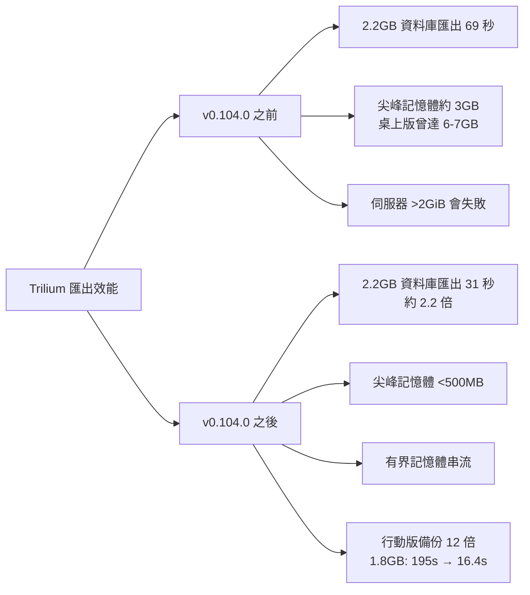

# Trilium Notes 匯出效能研究：硬體資源需求、速度與限制

## 摘要

Trilium Notes（現由 TriliumNext 團隊維護，原始專案 `zadam/trilium` 已封存）是一套以 Electron、Node.js 與 SQLite 為基礎的階層式知識庫筆記軟體[^repo]。本報告聚焦其**匯出（export）**行為的效能表現，涵蓋記憶體用量、匯出速度、硬體資源需求與已知限制。核心結論是：在 v0.104.0（2026 年 6 月）之前的版本，匯出／匯入大型資料庫（數 GB 等級）會造成嚴重的記憶體暴增（桌上版曾衝到約 6–7 GB）甚至失敗；在 v0.104.0 之後，官方透過「有界記憶體」（bounded-memory）串流化改造，將尖峰記憶體壓到 500 MB 以下，並讓匯出速度提升約 2 倍[^pr10313]。

## 1. 專案背景與社群規模

- TriliumNext/trilium 在 GitHub 上約有 **38.5k 顆星**、2.6k 次 fork[^repo]，屬於活躍且具規模的開源專案。
- 應用架構：Electron（桌面）／Node.js v24.x（伺服器）、後端資料庫為 SQLite（透過 `better-sqlite3`），官方文件稱其可擴展至 100,000 篇以上的筆記[^patterns]。
- 匯出與匯入原生支援的格式為 **HTML**（主要格式，另可匯出為靜態 HTML 供網站發布）、**Markdown**，以及 **OPML**（v1.0 純文字、v2.0 支援 HTML）；另有 Obsidian 與 Microsoft OneNote 的專用匯入器（僅匯入）[^docs]。

## 2. 匯出／匯入的記憶體與速度表現

### 2.1 官方文件的描述

官方文件的 import/export 說明頁指出：

> 「在大型匯入或匯出期間，記憶體用量可能會暴增，但會維持在**約 2 GB 左右**。此數據以 **2.4 GB 資料庫、約 21,000 篇筆記**進行測試。」[^docs]

由此可知官方的基準測試情境為「數 GB 資料庫、萬級筆記量」，並非一般輕量使用者的情境。

### 2.2 關鍵效能改造：PR #10313（v0.104.0）

最關鍵的效能改造是 PR #10313「Bounded-memory import & export for large archives」，於 **2026 年 6 月 28 日**合併進入 v0.104.0 里程碑[^pr10313]。其修正前後的量化數據如下[^pr10313]：

| 情境 | 改造前 | 改造後 |
|---|---|---|
| 桌上版（2.43 GB zip） | 記憶體暴增至約 6–7 GB | 逐項目（per-entry）有界記憶體 |
| 伺服器（超過 2 GiB） | 直接失敗（`fs.readFile` 上限） | 可正常運作，記憶體有界 |
| 匯出尖峰記憶體 | 約 3 GB | **低於 500 MB** |
| 串流橋接（160 MiB、慢速消費者） | 佇列中約 140 MiB | 約 24 MiB |
| 匯入儲存時間（20,145 篇筆記） | 141 秒 | 78 秒（約 1.8 倍） |
| 匯入總時間 | 4 分 35 秒 | 2 分 05 秒（約 2.2 倍） |
| 匯出時間（約 2.2 GB 資料庫） | 69 秒 | **31 秒（約 2.2 倍）** |
| 匯出檔案大小 | 基準 | +9.5%（因略過已壓縮項目的 deflate） |

其中大約 **2.2 GB 資料庫的匯出時間由 69 秒縮短為 31 秒**，是直接對應「匯出速度」最明確的官方數據。

### 2.3 有界記憶體如何達成

PR #10313 主要透過以下機制將匯出記憶體綁定在固定上限[^pr10313]：

1. **邊串流邊附加**：先把 zip 串流到 HTTP 回應，才附加內容，使 archiver 能逐個 blob 排空，尖峰記憶體不再隨未壓縮匯出總大小成長。
2. **輸入端背壓（backpressure）**：以 64 MiB 高水位線（high-water mark）與非同步 `waitForCapacity()`，當佇列位元組超過門檻時暫停筆記樹走訪。
3. **桌上版原生檔案串流**：透過原生儲存對話框直接寫入使用者選擇的檔案，繞過 Electron 的記憶體下載路徑。
4. **消除多餘的 blob 複製**：二進位附件不再被重複複製，`Buffer.from()` 改為零複製檢視（zero-copy view）。
5. **串流橋接背壓**：`ByteLengthQueuingStrategy` 搭配 1 MiB 高水位線，將 160 MiB 串流的在途記憶體由約 140 MiB 降至約 24 MiB。
6. **略過已壓縮項目的 deflate**，並將壓縮等級由 zlib 9 降為 6；**批次化筆記寫入**（每交易 ≤200 筆、≤50 MB）；以 BOM 檢查取代 `chardet` 的字元集偵測。

### 2.4 行動版備份速度：12 倍提升

行動版備份（屬於匯出／備份路徑）另有獨立的效能改造。PR #11490 於 **2026 年 9 月 14 日**合併，報告指出備份速度大幅改善：**1.8 GB 備份由 195 秒（9.3 MiB/s）縮短為 16.4 秒（110.6 MiB/s），約 12 倍**[^pr11490]。改善手段為以原生 `ArrayBuffer` 傳輸（`TriliumFileSink`）取代 Capacitor 外掛橋接（原先受 base64 JSON 開銷限制，上限約 13 MB/s），並以 `hash-wasm`（WASM，約 225 MiB/s）取代 `@noble/hashes`（純 JS SHA-256，約 32 MiB/s）[^pr11490]。

### 2.5 相關的同步（sync）效能

雖非嚴格意義的「匯出」，但同步與匯出共用底層的 blob 傳輸機制，可作為效能趨勢的旁證。PR #10351（同屬 v0.104.0）將約 2 GB 資料庫（約 21k 筆記、約 42k 個 blob、1.87 GB 內容）的**首次同步由約 12 分鐘縮短為約 1 分鐘**[^pr10351]。其手法包括：以位元組為界批次化 SQLite 交易（32 MB／16 MB）、平台原生 base64 編碼、僅索引的計數查詢、以回應大小估算取代重複序列化，以及將拉取回應上限由 1 MB 提高到 8 MB[^pr10351]。

## 3. 硬體／資源需求

- 官方**並未公布明確的最低硬體需求**（文件與 README 均無列出）[^docs][^repo]。
- 由於採用 Electron，桌面版本身的基礎記憶體開銷通常高於純原生應用；伺服器版則以 Node.js 執行。
- 就匯出而言，官方文件建議的預期值為：**大型匯出期間記憶體尖峰約在 2 GB 等級**[^docs]；而在 v0.104.0 之後的有界記憶體設計下，官方 PR 實測可壓到 **500 MB 以下**[^pr10313]。
- 官方以 **2.4 GB 資料庫、約 21,000 篇筆記**作為大型操作基準；並宣稱可擴展至 100,000 篇以上筆記[^docs][^patterns]。

> 說明：由於缺乏跨硬體、跨規模的系統性基準測試（benchmark），上述數據僅代表官方測試環境下的實測值，不能直接外推為所有裝置的保證表現。

## 4. 匯出相關限制

1. **單一項目大小上限約 374 MiB**：由同步協定決定（源自 V8 最大字串長度／同步 HTTP body 上限），單一檔案、附件或文字筆記超過此值者，匯入時會被拒絕[^docs]。
2. **上傳大小限制的變遷**：v0.104.0 之前的版本有 250 MiB 上傳上限（可透過環境變數 `TRILIUM_NO_UPLOAD_LIMIT` 繞過），v0.104.0 起移除此限制[^docs]。
3. **伺服器／網頁端無原生 PDF 匯出**：桌上版透過 Electron 的 `printToPDF()` 支援 PDF；伺服器／網頁端則仍為功能請求（issue #11621，於 2026 年 9 月仍為開啟狀態），替代方案是使用瀏覽器列印對話框[^pdfissue]。
4. **歷史上的大型匯出問題**：早期 issue 曾記錄「大型根節點匯出 HTML 卡住」（#731）與「匯出失敗後又成功」（#1417）等情形[^issue731][^issue1417]，這些問題在後續版本已陸續修正。

## 5. 綜合評估

| 面向 | 結論 |
|---|---|
| 匯出速度 | 約 2.2 GB 資料庫約 31 秒（v0.104.0 後）；行動版備份 1.8 GB 約 16.4 秒 |
| 記憶體需求 | 官方文件指大型匯出約 2 GB 尖峰；v0.104.0 後有界設計可壓到 500 MB 以下 |
| 硬體門檻 | 官方未公布最低需求；以 Electron 為基礎，屬一般消費級硬體可運行範圍 |
| 規模上限 | 宣稱可擴展至 10 萬篇以上筆記；單一項目上限約 374 MiB |
| 主要限制 | 伺服器端無原生 PDF 匯出；單一項目 374 MiB 上限 |

**實務建議**：若使用情境涉及數 GB 等級的資料庫匯出，務必使用 v0.104.0 或更新版本，以避免舊版的記憶體暴增與伺服器端逾 2 GiB 直接失敗的問題[^pr10313]。若關心行動裝置備份，則需 v0.104.0 之後含 PR #11490 的版本以獲得約 12 倍的速度提升[^pr11490]。

## 6. 來源批判性反思

- **一手且可信度較高的來源**：官方文件與 GitHub PR 屬專案自身發布的一手資料，對「自家改進後」的數字具權威性，但同時存在**自我行銷偏誤**（cherry-picking 最佳情境）的可能，例如匯出速度數據多以單一測試資料庫（約 2.2 GB）為準。
- **缺乏第三方獨立驗證**：本報告未找到獨立的第三方 benchmark。因此表中數字應理解為「官方測試環境下的實測值」，而非普適保證。
- **時效性**：核心效能數據集中於 2026 年 6 月至 9 月（v0.104.0–v0.105.0），距今（2026 年 10 月）仍屬近期，具參考價值；但舊版使用者的體驗可能與之顯著不同。
- **軟硬體未標明**：多數 PR 未完整揭露測試硬體規格（CPU、RAM、磁碟類型），使跨裝置外推受限。

## 註腳與參考文獻

[^repo]: TriliumNext. (n.d.). TriliumNext/trilium: Build your personal knowledge base with Trilium Notes. GitHub. Retrieved 2026-10-23, from https://github.com/TriliumNext/trilium

[^docs]: TriliumNext. (n.d.). Import & export. Trilium Notes Documentation. Retrieved 2026-10-23, from https://docs.triliumnotes.org/user-guide/concepts/import-export/

[^pr10313]: TriliumNext. (2026, June 28). Bounded-memory import & export for large archives (Pull request #10313) [Milestone: v0.104.0]. GitHub. Retrieved 2026-10-23, from https://github.com/TriliumNext/Trilium/pull/10313

[^pr10351]: TriliumNext. (2026, July 2). perf(sync): speed up initial sync (Pull request #10351) [Milestone: v0.104.0]. GitHub. Retrieved 2026-10-23, from https://github.com/TriliumNext/Trilium/pull/10351

[^pr11490]: TriliumNext. (2026, September 14). Mobile: working file saves, 12x faster backups (Pull request #11490). GitHub. Retrieved 2026-10-23, from https://github.com/TriliumNext/Trilium/pull/11490

[^patterns]: TriliumNext. (n.d.). Patterns of personal knowledge. Trilium Notes Documentation. Retrieved 2026-10-23, from https://docs.triliumnotes.org/user-guide/misc/patterns-of-personal-knowledge

[^pdfissue]: TriliumNext. (2026). Native export as PDF on server/web (Issue #11621). GitHub. Retrieved 2026-10-23, from https://github.com/TriliumNext/Trilium/issues/11621

[^issue731]: TriliumNext. (2019, December). Export HTML is stuck for large roots (Issue #731). GitHub. Retrieved 2026-10-23, from https://github.com/TriliumNext/Trilium/issues/731

[^issue1417]: TriliumNext. (2021, July). Export fails, then succeeds (Issue #1417). GitHub. Retrieved 2026-10-23, from https://github.com/TriliumNext/Trilium/issues/1417
