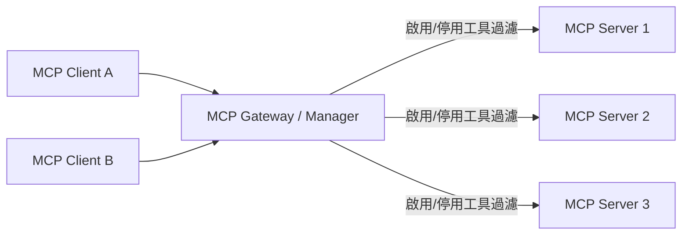

# MCP Gateway / Manager：可以逐一開關各 MCP Server 工具的方案

## 摘要

Model Context Protocol（MCP）讓 AI 用戶端（如 Cursor、Claude Desktop、VS Code 等）能以統一協定連接外部工具與資料來源[^mcp]。然而當連接的 MCP Server 數量成長後，用戶端會一次看到上百個工具，造成上下文（context window）浪費、模型選擇困難，以及安全與權限控管問題[^mcpproxy-why]。因此出現一類被稱為 **MCP Gateway / MCP Manager** 的中介軟體：它在用戶端與多個 MCP Server 之間提供單一端點，並允許管理者**逐一啟用或停用**特定伺服器的特定工具[^metamcp-readme][^mcphub-readme]。

本報告聚焦於「**可以針對每個 MCP Server 的工具做開／關（enable/disable）**」這項功能，盤點目前主流的開源方案，並比較其運作方式、授權、星數與定位。

## 問題背景：為什麼需要「工具開關」

### 上下文與工具數量爆炸

MCP 用戶端通常會把每個已連接伺服器的工具定義（名稱、描述、輸入 schema）全部載入模型上下文。工具越多，佔用的 token 越多、模型越容易誤選工具[^mcpproxy-why]。把不必要或高風險的工具從 `list_tools` 回應中過濾掉，是最直接的解法[^metamcp-readme]。

### 安全與最小權限

部分 MCP Server 提供「寫入」或「破壞性」操作（例如建立 issue、刪除檔案）。管理者往往希望只暴露唯讀工具，或在審核後才允許使用[^mcpproxy-security][^mcpjungle-readme]。逐一開關工具讓「最小權限原則」得以落實到工具層級。

### 多用戶端一致性

若沒有 gateway，每個用戶端（Cursor、Claude、自建 Agent）都要各自維護一份 MCP 設定，容易不一致且難以複製[^mcpjungle-readme]。集中式 gateway 讓「哪些工具被開啟」成為單一控制點。

## 運作原理



Gateway 向後端各 MCP Server 取得工具清單後，套用一層「工具過濾」再回傳給用戶端。過濾規則儲存在設定檔、資料庫或透過 Web UI／CLI 設定。被停用的工具通常會在 `tools/list`（列出工具）時被隱藏，用戶端因此看不到也無法呼叫[^metamcp-readme][^ptbsare-readme]。

## 主要方案盤點

以下方案皆為開源，且**支援工具層級的逐一開／關**（除非特別註明）。

### 1. MetaMCP

- **專案**：MCP Aggregator, Orchestrator, Middleware, Gateway in one docker[^metamcp-repo]
- **GitHub**：`metatool-ai/metamcp`[^metamcp-repo]
- **星數**：約 2,722[^metamcp-repo]
- **授權**：MIT[^metamcp-repo]
- **語言**：TypeScript（Next.js + Express + tRPC）[^metamcp-readme]

**工具開關方式**：MetaMCP 以「Namespace（命名空間）」為單位把多個伺服器聚合成一個端點。在 Namespace 之下可**啟用／停用 MCP Server 或個別工具層級**[^metamcp-readme]。其內建 middleware 之一「Filter inactive tools」會在請求／回應層過濾掉被停用的工具，藉此優化 LLM 的工具上下文[^metamcp-readme]。此外可在 Namespace 的 Tools 分頁逐一編輯工具名稱、標題、描述與 annotations（例如 `{"annotations": {"readOnlyHint": false}}`）[^metamcp-readme]。使用者可透過 Web UI 操作，官方亦提及以 Admin MCP 工具管理工具狀態[^metamcp-docs]。

**特色**：可透過 SSE 或 Streamable HTTP 暴露端點，支援 API Key 與 OAuth 驗證、多租戶、OIDC SSO、流量與速率限制[^metamcp-readme]。

### 2. MCPHub（samanhappy）

- **專案**：Self-hosted MCP gateway and control plane[^mcphub-repo]
- **GitHub**：`samanhappy/mcphub`[^mcphub-repo]
- **星數**：約 2,578[^mcphub-repo]
- **授權**：Apache-2.0[^mcphub-repo]
- **語言**：TypeScript（Node.js / Express + React）[^mcphub-readme]

**工具開關方式**：MCPHub 提供「Server and Group Management」，可把伺服器組成群組、管理可見性，並控制 **Tool、Prompt、Resource 的暴露**[^mcphub-readme]。用戶端可依路徑取得不同範圍：`/mcp`（全部伺服器）、`/mcp/{group}`（特定群組）、`/mcp/{server}`（特定伺服器）、`/mcp/$smart`（AI 智慧路由）[^mcphub-readme]。並支援 OAuth 2.0、bearer key、per-user 憑證與群組可見性控制[^mcphub-readme]。

**特色**：Web 儀表板、熱替換設定（hot-swappable config）、健康檢查、日誌與觀測、PostgreSQL 生產模式、Smart Routing（向量語意搜尋工具）[^mcphub-readme]。

### 3. MCPJungle

- **專案**：One place to manage & connect to all your MCP servers[^jungle-repo]
- **GitHub**：`mcpjungle/MCPJungle`[^jungle-repo]
- **星數**：約 1,309[^jungle-repo]
- **授權**：MPL-2.0[^jungle-repo]
- **語言**：Go[^jungle-repo]

**工具開關方式**：MCPJungle 以 CLI 提供明確的啟用／停用指令[^jungle-readme]：

```bash
# 停用 context7 伺服器的某個工具
mcpjungle disable tool context7__get-library-docs
# 重新啟用
mcpjungle enable tool context7__get-library-docs
# 停用整個伺服器的所有工具
mcpjungle disable tool context7
# 停用／啟用整個伺服器
mcpjungle disable server context7
mcpjungle enable server context7
```

被停用的工具不會出現在 MCPJungle 代理或任何 Tool Group 中，用戶端因此看不到也無法呼叫[^jungle-readme]。工具採 `<server-name>__<tool-name>` 的標準命名[^jungle-readme]。另有 **Tool Groups** 機制，可用 `included_tools`、`included_servers`、`excluded_tools` 精選要暴露給特定用戶端的工具子集[^jungle-readme]。企業模式下提供 ACL、用戶端權限與 OpenTelemetry 觀測[^jungle-readme]。

### 4. Docker MCP Gateway

- **專案**：docker mcp CLI plugin / MCP Gateway[^docker-repo]
- **GitHub**：`docker/mcp-gateway`[^docker-repo]
- **星數**：約 1,613[^docker-repo]
- **授權**：MIT[^docker-repo]
- **語言**：Go[^docker-repo]

**工具開關方式**：伺服器被組織為 **Profiles**，可在 profile 內以「白名單」逐一開關工具，語法為 `<server>.<tool>`[^docker-readme]：

```bash
# 啟用特定工具
docker mcp profile tools <profile-id> --enable github.create_issue --enable github.list_repos
# 停用特定工具
docker mcp profile tools <profile-id> --disable github.search_code
# 對整個伺服器啟用／停用所有工具
docker mcp profile tools <profile-id> --enable-all github
docker mcp profile tools <profile-id> --disable-all github
```

**特色**：每個 MCP Server 以獨立 Docker 容器隔離執行，具備 secrets 管理、OAuth 流程與 catalog 管理[^docker-readme]。

### 5. MCP Proxy Server（ptbsare）

- **專案**：MCP Proxy Server（改寫自 adamwattis 版本並加入 Web UI）[^ptbsare-repo][^ptbsare-readme]
- **GitHub**：`ptbsare/mcp-proxy-server`[^ptbsare-repo]
- **星數**：約 196[^ptbsare-repo]
- **授權**：MIT[^ptbsare-repo]
- **語言**：TypeScript[^ptbsare-repo]

**工具開關方式**：透過 Web Admin UI 或 `config/tool_config.json` 逐一啟用／停用工具，key 格式為 `<server_key>__<tool_name>`[^ptbsare-readme]：

```json
{
  "tools": {
    "unique-server-key1__tool-name-from-server": {
      "enabled": true,
      "displayName": "My Custom Tool Name",
      "description": "A more user-friendly description."
    },
    "another-sse-server__another-tool": {
      "enabled": false
    }
  }
}
```

`enabled` 設為 `false` 即對所有連線用戶端隱藏該工具[^ptbsare-readme]。伺服器層級則有 `active` 欄位控制整體啟用[^ptbsare-readme]。支援設定熱重載（live reload）與工具名稱／描述覆寫[^ptbsare-readme]。星數較低，但功能針對性強，適合作為輕量方案。

### 6. MCPProxy（smart-mcp-proxy/mcpproxy-go）

- **專案**：Supercharge AI Agents, Safely[^mcpproxy-repo]
- **GitHub**：`smart-mcp-proxy/mcpproxy-go`[^mcpproxy-repo]
- **星數**：約 398[^mcpproxy-repo]
- **授權**：MIT[^mcpproxy-repo]
- **語言**：Go[^mcpproxy-repo]

**工具開關方式**：以「隔離審核（quarantine）」模型為特色。新伺服器及其工具會被隔離，直到管理者審核批准後才會提供給 Agent[^mcpproxy-readme]。伺服器層級可用 `mcpproxy upstream enable/disable <server>` 開關[^mcpproxy-cli]。其設計強調安全性：可對隔離中的伺服器執行 Snyk、Semgrep、Trivy 等掃描器[^mcpproxy-readme]。以 `retrieve_tools` 的 BM25 搜尋按需載入工具 schema，減少上下文佔用[^mcpproxy-readme]。

### 7. IBM ContextForge MCP Gateway

- **專案**：open source registry and proxy federating MCP、A2A、REST/gRPC APIs[^ibm-repo]
- **GitHub**：`IBM/mcp-context-forge`[^ibm-repo]
- **星數**：約 4,685[^ibm-repo]
- **授權**：Apache-2.0[^ibm-repo]
- **語言**：Python（部分 Rust）[^ibm-repo]

**工具開關方式**：定位偏企業級 API Gateway，強調集中治理、發現與觀測[^ibm-readme]。它支援把工具註冊到 **virtual server**（虛擬伺服器），以 `associated_tools` 選擇要包含哪些工具，因此可視為以「伺服器綑綁工具」的方式控制工具暴露[^ibm-readme]。它並非以簡單的逐工具 on/off 切換為主軸，較偏向工具生命週期與 RBAC 管理[^ibm-readme]。適合需要大規模聯邦、認證與可觀測性的組織。

### 8. Microsoft MCP Gateway

- **專案**：reverse proxy and management layer for MCP servers[^ms-repo]
- **GitHub**：`microsoft/mcp-gateway`[^ms-repo]
- **星數**：約 894[^ms-repo]
- **授權**：MIT[^ms-repo]
- **語言**：C#（ASP.NET Core）[^ms-repo]

**工具開關方式**：以 Kubernetes 環境為主的反向代理與管理層，工具作為「已註冊資源」透過 CRUD API 管理，並以角色權限（RBAC）控制[^ms-repo]。偏向工具註冊生命週期與存取控制，而非單純的逐工具 toggle。

### 9. Obot

- **GitHub**：`obot-platform/obot`[^obot-repo]
- **星數**：約 1,120[^obot-repo]
- **授權**：MIT[^obot-repo]
- **語言**：Go[^obot-repo]

**工具開關方式**：完整 AI 治理平台，具備 RBAC 角色式工具範圍控制、OAuth 2.1、稽核日誌與 chat UI[^obot-repo]。可依角色限定可見工具。

### 不支援逐工具開關的相關專案（對照）

- **sparfenyuk/mcp-proxy**（約 2,804 星，MIT）：僅是 Streamable HTTP 與 stdio 之間的傳輸橋接，只有伺服器層級的 `disabled` 旗標，**無逐工具控制**[^sparfenyuk-repo]。
- **adamwattis/mcp-proxy-server**（約 202 星，MIT）：單純的聚合代理，暴露所有工具，**無工具過濾**；ptbsare 的版本才加入 Web UI 與工具控制[^adam-repo]。

## 方案比較

| 方案 | 星數 | 授權 | 逐工具開關 | 開關方式 | 定位 |
| --- | --- | --- | --- | --- | --- |
| MetaMCP | ~2,722[^metamcp-repo] | MIT | 支援 | Web UI（Namespace Tools 分頁）＋ middleware 過濾[^metamcp-readme] | 聚合／多租戶 Gateway |
| MCPHub (samanhappy) | ~2,578[^mcphub-repo] | Apache-2.0 | 支援 | Web UI 群組可見性，控制 Tool/Prompt/Resource 暴露[^mcphub-readme] | 自架控制平面 |
| MCPJungle | ~1,309[^jungle-repo] | MPL-2.0 | 支援 | CLI `enable/disable tool\|server`、Tool Groups[^jungle-readme] | 開發者／團隊 Gateway |
| Docker MCP Gateway | ~1,613[^docker-repo] | MIT | 支援 | CLI `profile tools --enable/--disable`（profile 白名單）[^docker-readme] | 容器隔離 Gateway |
| MCP Proxy Server (ptbsare) | ~196[^ptbsare-repo] | MIT | 支援 | Web UI 或 `tool_config.json` 的 `enabled`[^ptbsare-readme] | 輕量自架 |
| MCPProxy (mcpproxy-go) | ~398[^mcpproxy-repo] | MIT | 支援（審核式） | quarantine 審核＋ `upstream enable/disable`[^mcpproxy-readme] | 安全優先 |
| IBM ContextForge | ~4,685[^ibm-repo] | Apache-2.0 | 間接（virtual server） | `associated_tools` 綁定、RBAC[^ibm-readme] | 企業 API Gateway |
| Microsoft MCP Gateway | ~894[^ms-repo] | MIT | 間接（RBAC／資源） | CRUD API＋RBAC[^ms-repo] | Kubernetes 企業 |
| Obot | ~1,120[^obot-repo] | MIT | 支援（RBAC） | 角色式工具範圍[^obot-repo] | 治理平台 |

## 選用建議

- **想要最完整的 Web UI 逐工具管理**：**MetaMCP**，Namespace 的 Tools 分頁可逐一開關並覆寫工具中繼資料[^metamcp-readme]。
- **想要清晰的 CLI 逐工具開關**：**MCPJungle**（`enable tool`／`disable tool`）或 **Docker MCP Gateway**（`profile tools --enable/--disable`）[^jungle-readme][^docker-readme]。
- **重視容器隔離與 secrets 管理**：**Docker MCP Gateway**[^docker-readme]。
- **重視安全審核（工具變更需批准）**：**MCPProxy (mcpproxy-go)**[^mcpproxy-readme]。
- **偏好輕量、只需簡單開關**：**MCP Proxy Server (ptbsare)**，以 `tool_config.json` 或 Web UI 控制[^ptbsare-readme]。
- **企業級規模、需聯邦與可觀測性**：**IBM ContextForge** 或 **Microsoft MCP Gateway**[^ibm-readme][^ms-repo]。
- **需要群組／多用戶可見性**：**MCPHub (samanhappy)**[^mcphub-readme]。

## 來源評估（批判性反思）

- **官方文件優先**：本報告主要依據各專案 GitHub 上的 `README` 與 GitHub REST API 回傳的星數、授權、語言等客觀欄位，降低二手資訊偏誤[^metamcp-repo][^mcphub-repo][^docker-repo][^jungle-repo]。
- **星數會變動**：星數為抓取當日（2026-10-23）之概略值，僅供相對熱度參考，不代表品質保證[^metamcp-repo]。
- **維護活躍度差異**：部分專案（如 adamwattis/mcp-proxy-server）已多時未更新，功能可能落後[^adam-repo]；MetaMCP 作者亦在 README 提及近期維護延遲[^metamcp-readme]。
- **功能描述以官方為準**：各家對「工具開關」的實作深淺不同（有的在 `list_tools` 過濾、有的以群組或 RBAC 間接控制），實際行為仍應以其文件與原始碼為準驗證[^ibm-readme][^ms-repo]。
- **無單一最佳解**：選擇取決於部署規模、是否需容器隔離、是否需安全審核與 RBAC，建議先在隔離環境試用[^mcpproxy-security]。

[^mcp]: Model Context Protocol — 一個開放協定，用於標準化 AI 應用與外部資料來源及工具之間的連接。
[^mcpproxy-why]: MCPProxy. (n.d.). Why MCPProxy? Retrieved 2026-10-23, from https://github.com/smart-mcp-proxy/mcpproxy-go
[^metamcp-readme]: MetaMCP. (n.d.). metatool-ai/metamcp: MCP Aggregator, Orchestrator, Middleware, Gateway in one docker (README). Retrieved 2026-10-23, from https://github.com/metatool-ai/metamcp
[^mcphub-readme]: MCPHub. (n.d.). samanhappy/mcphub: Self-hosted MCP gateway and control plane for connecting, controlling, and operating MCP servers (README). Retrieved 2026-10-23, from https://github.com/samanhappy/mcphub
[^metamcp-repo]: GitHub. (n.d.). Repository metadata for metatool-ai/metamcp. Retrieved 2026-10-23, from https://api.github.com/repos/metatool-ai/metamcp
[^metamcp-docs]: MetaMCP. (n.d.). Documentation. Retrieved 2026-10-23, from https://docs.metamcp.com
[^mcphub-repo]: GitHub. (n.d.). Repository metadata for samanhappy/mcphub. Retrieved 2026-10-23, from https://api.github.com/repos/samanhappy/mcphub
[^jungle-readme]: MCPJungle. (n.d.). mcpjungle/MCPJungle: One place to manage & connect to all your MCP servers (README). Retrieved 2026-10-23, from https://github.com/mcpjungle/MCPJungle
[^jungle-repo]: GitHub. (n.d.). Repository metadata for mcpjungle/MCPJungle. Retrieved 2026-10-23, from https://api.github.com/repos/mcpjungle/MCPJungle
[^docker-readme]: Docker. (n.d.). docker/mcp-gateway: docker mcp CLI plugin / MCP Gateway (README). Retrieved 2026-10-23, from https://github.com/docker/mcp-gateway
[^docker-repo]: GitHub. (n.d.). Repository metadata for docker/mcp-gateway. Retrieved 2026-10-23, from https://api.github.com/repos/docker/mcp-gateway
[^ptbsare-readme]: MCP Proxy Server. (n.d.). ptbsare/mcp-proxy-server (README). Retrieved 2026-10-23, from https://github.com/ptbsare/mcp-proxy-server
[^ptbsare-repo]: GitHub. (n.d.). Repository metadata for ptbsare/mcp-proxy-server. Retrieved 2026-10-23, from https://api.github.com/repos/ptbsare/mcp-proxy-server
[^mcpproxy-readme]: MCPProxy. (n.d.). smart-mcp-proxy/mcpproxy-go: Supercharge AI Agents, Safely (README). Retrieved 2026-10-23, from https://github.com/smart-mcp-proxy/mcpproxy-go
[^mcpproxy-repo]: GitHub. (n.d.). Repository metadata for smart-mcp-proxy/mcpproxy-go. Retrieved 2026-10-23, from https://api.github.com/repos/smart-mcp-proxy/mcpproxy-go
[^mcpproxy-cli]: MCPProxy. (n.d.). CLI command reference. Retrieved 2026-10-23, from https://docs.mcpproxy.app/cli/command-reference/
[^mcpproxy-security]: MCPProxy. (n.d.). Security quarantine. Retrieved 2026-10-23, from https://docs.mcpproxy.app/features/security-quarantine/
[^ibm-readme]: IBM. (n.d.). IBM/mcp-context-forge: An AI Gateway, registry, and proxy (README). Retrieved 2026-10-23, from https://github.com/IBM/mcp-context-forge
[^ibm-repo]: GitHub. (n.d.). Repository metadata for IBM/mcp-context-forge. Retrieved 2026-10-23, from https://api.github.com/repos/IBM/mcp-context-forge
[^ms-repo]: GitHub. (n.d.). Repository metadata for microsoft/mcp-gateway. Retrieved 2026-10-23, from https://api.github.com/repos/microsoft/mcp-gateway
[^obot-repo]: GitHub. (n.d.). Repository metadata for obot-platform/obot. Retrieved 2026-10-23, from https://api.github.com/repos/obot-platform/obot
[^sparfenyuk-repo]: GitHub. (n.d.). Repository metadata for sparfenyuk/mcp-proxy. Retrieved 2026-10-23, from https://api.github.com/repos/sparfenyuk/mcp-proxy
[^adam-repo]: GitHub. (n.d.). Repository metadata for adamwattis/mcp-proxy-server. Retrieved 2026-10-23, from https://api.github.com/repos/adamwattis/mcp-proxy-server
