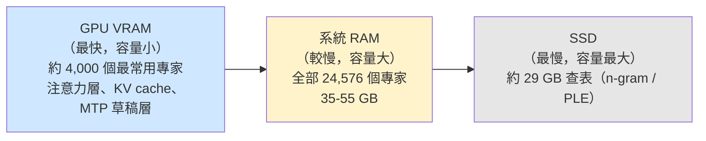
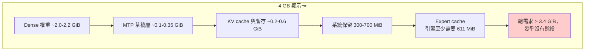

# Strata 能否只用 4 GB VRAM 的 NVIDIA 顯示卡運行？

## 摘要

**不行。** Strata 是以 Qwen3.8-Flash-Next（125B 參數的混合專家 MoE 模型）為核心的本機推論引擎，其官方最低需求為 **NVIDIA RTX 20/30/40/50 系列、12 GB VRAM 以上**，「8 GB 可跑，但很慢」[^readme][^install]。即使把模型壓到最小的 Coder IQ1_M、把情境長度降到 8K、把 draft 詞表切成英文，社群在 **6 GB** 的 RTX 2060 上仍然啟動失敗[^issue916]。4 GB 的顯示卡連引擎啟動所需的固定開銷（dense 權重加上最小 expert cache）都放不下，因此無法運行。

---

## 一、Strata 是什麼

Strata 是 Niko1221 的開源（MIT 授權）本機推論引擎，以 C++ 撰寫，搭配 CUDA / HIP / SYCL / Metal 核心與 Python 服務層[^readme][^api]。截至 2026-10-24，該專案約有 **31,310 顆星、3,359 個 fork**，建立於 2026-09-24[^api]。

它的唯一目標是在一般消費級 PC 上運行 Qwen3.8-Flash-Next——一個約 1,250 億參數的 MoE 模型（24,576 個專家，每 token 只啟用約 10 個）[^readme][^details]。作法是將工作分散到整台機器：

圖說：Strata 把 VRAM 當作「桌面」，RAM 當作「書架」，SSD 當作「檔案庫」[^readme]。GPU 上的 VRAM 只放最常用的專家；VRAM 越大、能快取的專家越多，速度越快[^details]。

---

## 二、官方硬體需求（含 VRAM 下限）

官方文件對顯示卡的要求如下表[^readme][^install][^older]：

| 項目 | 官方說法 |
|---|---|
| **建議 VRAM** | NVIDIA RTX 20/30/40/50 系列，**12 GB 以上** |
| **最低（可跑但慢）** | **8 GB**（INSTALL.md：「8 GB runs, slowly」） |
| **低於 8 GB** | 引擎會把保留量一路降到 300 MiB，並在顯示卡幾乎被填滿時發出警告；若仍不足會直接中止並印出「no VRAM is left for the expert cache」[^install] |
| **舊卡（實驗性）** | OLDER_GPUS.md 明言：「顯示卡需要有足夠的 VRAM 才有用：建議 12 GB 以上（2 GB 的 GT 1030 雖然也是 compute capability 6.1，但放不下模型任何部分）」[^older] |
| **記憶體（RAM + VRAM）總和** | 起步門檻 **32 GB**[^readme] |

換句話說，VRAM 從來不是「獨立」的下限，而是與系統 RAM 一起計入「RAM + VRAM」的總量。但實務上，引擎啟動時有**無法避免的 VRAM 固定開銷**（見下節），這正是 4 GB 卡無法跨越的門檻。

---

## 三、為什麼 4 GB 放不下：實際的 VRAM 組成

從社群回報的引擎 log 可以看出，即使使用最小的設定，VRAM 的固定開銷就已吃掉相當多[^issue916][^issue300]。以下以最省的 Coder IQ1_M、8K context、英文 draft 詞表、關閉圖片為例：

| 項目 | 估計 VRAM |
|---|---|
| Dense 投影權重（native 矩陣、Q5_K head） | 約 2.0-2.2 GiB |
| MTP 草稿層（英文詞表時約 86-133 MiB；預設含中日韓約 218-348 MiB） | 約 0.1-0.35 GiB |
| KV cache（8K context，Q4） | 約 0.1 GiB |
| 提示／注意力暫存區 | 約 0.1-0.5 GiB |
| **Expert cache 最小需求（引擎自身要求 241 slots = 611 MiB）** | 約 0.6 GiB |
| **合計** | **約 3.4-4.0 GiB** |

也就是說，4 GB 的卡要「每一 byte 都空著」才勉強碰到門檻，實務上不可能達成——因為顯示卡還要輸出畫面、作業系統與其他程式也會佔用 VRAM[^issue916][^issue3723]。引擎甚至在低於 8 GB 時就會印出警告並可能直接退出[^issue300]。

圖說：光是固定開銷加上引擎要求的最小 expert cache，就幾乎把 4 GB 用盡，且完全沒有留給顯示輸出與其他程式[^issue916]。

---

## 四、社群實測證據

官方文件與 GitHub 議題提供了直接的實測結果，顯示 **6 GB 就已經非常吃力**，4 GB 更不可能：

| 顯示卡 | VRAM | 結果 |
|---|---|---|
| RTX 2060（筆電） | 6 GB | **失敗**：即使改用 Coder IQ1_M、8K context、英文 draft 詞表，仍出現「no VRAM is left for the expert cache」，回報者嘗試 0.1.39、0.1.44、0.1.45、0.2.0 版本皆同[^issue916] |
| RTX 4050 | 6 GB | **成功（需改原始碼）**：使用者自行 patch 原始碼停用 MTP（省下約 800-900 MB VRAM），改用 IQ2_XS、64K context，約 20 tok/s[^issue916] |
| RX 5600（AMD） | 6 GB | 「6 GB 的卡只剩約 50 個 expert slot」，屬於極受限狀態[^older] |
| RX 5500 XT（AMD） | 8 GB | 可行：IQ3_S、8K context，解碼 15.3 tok/s（需自行編譯）[^older] |
| GTX 1080 Ti | 11 GB | 可行：IQ3_S、262K context，約 24 tok/s[^older] |
| RTX 5070 | 12 GB | 官方基準：Q2_0 解碼 94 tok/s、IQ3_S 53 tok/s[^readme] |

值得注意的是，**連 16 GB 的卡在極端 context（如 512K）下都會出現同一個 out-of-VRAM 錯誤**[^issue3723]，可見此錯誤是「資源不足」而非「卡太舊」。

---

## 五、是否有任何 4 GB 的例外路徑？

搜尋官方文件與議題後，**沒有**任何文件或社群回報指出 4 GB NVIDIA 顯示卡能成功啟動 Strata。可考慮的替代方向與其限制如下：

1. **改用更小的模型**：Strata 也支援 Qwen3.6-35B-A3B，但社群在 6 GB 的 RTX 2060 上連這個模型也啟動失敗[^issue916]；官方文件亦要求該模型約 32 GB RAM 起跳[^models]。
2. **DeepSeek V4.1-Flash**：官方稱其可在單張 12 GB 顯示卡加 46-64 GB RAM 上運行（其餘從 SSD 讀取）[^readme]，但仍以 12 GB 為前提，4 GB 不在其中。
3. **多卡合併**：Strata 支援 2-3 張同廠牌顯示卡分攤模型[^readme]，但「2 GB 的 GT 1030 放不下模型任何部分」的說明意味著單卡本身的 VRAM 下限依然存在[^older]。
4. **非顯示卡路徑**：Strata 也支援 AMD、Intel Arc 與 Apple Silicon[^readme]，但這與題目「NVIDIA GPU only 4 GB」的情境不同。

---

## 六、結論

**在 NVIDIA 顯示卡只有 4 GB VRAM 的條件下，Strata 無法運行。**

- 官方最低需求是 12 GB，8 GB 才勉強可跑（且很慢）[^readme][^install]。
- 引擎啟動有約 3.4-4.0 GiB 的固定 VRAM 開銷，4 GB 連這個門檻都難以跨越[^issue916]。
- 社群在 6 GB 卡上的實測多為失敗，唯一成功的案例需要修改原始碼停用 MTP[^issue916]。
- 官方對舊卡的說明直接點出：放不下模型任何部分的小 VRAM 卡沒有實用價值[^older]。

若要在此硬體上體驗 Strata，實務上可行的方向是：改用雲端或本機其他推論方案，或升級至至少 8 GB（建議 12 GB 以上）的顯示卡，並搭配 32 GB 以上的系統 RAM[^readme][^install]。

---

## 參考資料

[^readme]: Niko1221. (n.d.). *Strata: Qwen3.8-Flash-Next on any consumer hardware* [Computer software]. GitHub. Retrieved 2026-10-24, from https://github.com/Niko1221/Strata

[^install]: Niko1221. (n.d.). *Installing Strata* [Documentation]. GitHub. Retrieved 2026-10-24, from https://github.com/Niko1221/Strata/blob/main/docs/INSTALL.md

[^details]: Niko1221. (n.d.). *Strata - the details* [Documentation]. GitHub. Retrieved 2026-10-24, from https://github.com/Niko1221/Strata/blob/main/docs/DETAILS.md

[^models]: Niko1221. (n.d.). *Which model? Sizes, versions and what fits* [Documentation]. GitHub. Retrieved 2026-10-24, from https://github.com/Niko1221/Strata/blob/main/docs/MODELS.md

[^older]: Niko1221. (n.d.). *Older GPUs (experimental)* [Documentation]. GitHub. Retrieved 2026-10-24, from https://github.com/Niko1221/Strata/blob/main/docs/OLDER_GPUS.md

[^gyro]: Niko1221. (n.d.). *Gyro (agentionai rotor quants) on Strata* [Documentation]. GitHub. Retrieved 2026-10-24, from https://github.com/Niko1221/Strata/blob/main/docs/GYRO.md

[^issue916]: lollo78, grigoriitropin, sathya731, djismgaming, & Niko1221. (2026, October 5). *Unable to launch Strata on RTX 2060 6GB VRAM + 32 GB RAM* [Issue #916]. GitHub. Retrieved 2026-10-24, from https://github.com/Niko1221/Strata/issues/916

[^issue300]: sinand99. (2026, September 30). *Image encoder keeps failing on 8GB GPU* [Issue #300]. GitHub. Retrieved 2026-10-24, from https://github.com/Niko1221/Strata/issues/300

[^issue3723]: xvcezrqpbxtpzblrt. (2026, October 22). *[GUI] first-run and error UX: language before model download, taskbar icon, context-memory labels, out-of-VRAM reason* [Issue #3723]. GitHub. Retrieved 2026-10-24, from https://github.com/Niko1221/Strata/issues/3723

[^api]: GitHub. (2026, October 24). *Repository: Niko1221/Strata* [REST API response]. Retrieved 2026-10-24, from https://api.github.com/repos/Niko1221/Strata

## 來源評估

- **官方文件（README、INSTALL、MODELS、OLDER_GPUS、DETAILS、GYRO）** 為第一手且一致性高，皆指向 12 GB 建議、8 GB 最低；作者亦親自回覆議題，可信度高[^readme][^issue916]。
- **社群議題** 屬使用者實測，個別機器差異大，但多筆獨立回報（6 GB 失敗、6 GB 需改原始碼、8 GB 可行）互相佐證，可視為一致的趨勢[^issue916][^older]。
- **獨立檢查器（localrigcheck.com）與官方文件站（stratallm.org）** 亦給出相似的 VRAM 需求，但非原始來源，僅作旁證；本報告的結論主要建立於官方 repo 內容之上。
- **限制**：本次查證未涵蓋所有可能的社群分支或實驗性 patch；由於 Strata 改版頻繁（數日內即有多個引擎版本），4 GB 相關結論以 2026-10-24 的資料為準。
