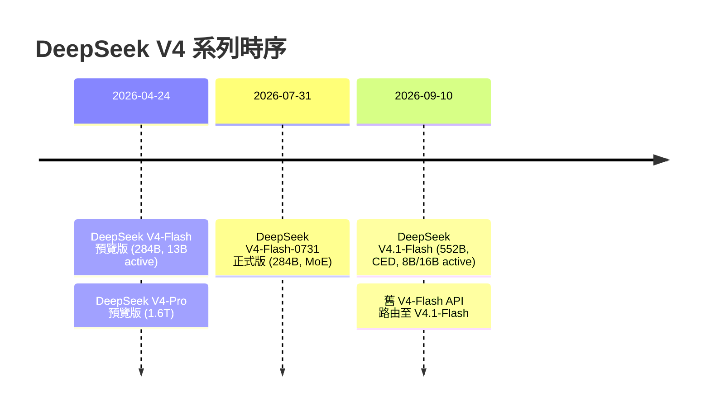

# Strata 能否執行 DeepSeek V4 Flash？

## 摘要

**結論取決於「DeepSeek V4 Flash」指的是哪個模型。** Strata（`Niko1221/Strata`）官方支援的是 **DeepSeek V4.1-Flash**（552B、2026-09-10 發布），自 **v0.2.4** 起可透過 Terminal（`strata launch` / `strata setup`）執行[^readme][^release]。但 Strata **並未支援原版的 DeepSeek V4-Flash**（284B、2026-07-31 正式版），在 v0.2.4 的 release note 與 README 中完全没有出現不含 `.1` 的「V4-Flash」[^release][^readme]。

因此：

| 使用者的問法 | 對應模型 | Strata 是否支援 |
| --- | --- | --- |
| 「DeepSeek V4 Flash」廣義指最新推理模型 | **DeepSeek V4.1-Flash**（又稱 V4.1 Flash） | **是**，自 Terminal 0.2.4 起[^readme][^release] |
| 「DeepSeek V4 Flash」嚴格指 284B 原始版 | **DeepSeek V4-Flash（0731）** | **否**，README 與 release note 均未提及[^readme][^release] |

## 背景：兩個容易混淆的模型

「DeepSeek V4 Flash」在 2026 年先後對應了兩個**架構不同**的模型，這是混淆的根源[^deepseek41][^lineage]。

| 規格 | DeepSeek V4-Flash（0731） | DeepSeek V4.1-Flash |
| --- | --- | --- |
| 發布日 | 2026-07-31（預覽 2026-04-24） | 2026-09-10 |
| 總參數 | 284B | 552B |
| 啟用參數 | 13B | 8B（prefill）/ 16B（decode） |
| 架構 | 標準 MoE | Causal Encoder-Decoder（CED）MoE |
| 多模態 | 純文字 | 原生圖像＋文字 |
| 授權 | MIT | MIT |
| 狀態 | 已於 2026-09-10 由 V4.1-Flash 取代 | 現行旗艦 |

上述規格來自 DeepSeek 官方發布與模型卡[^deepseek41][^hf41]，以及模型譜系整理[^lineage]。

## Strata 專案概况

Strata 是一套開源推論引擎，主打在消費級電腦上執行超大型 MoE 模型，透過把專家權重分散存放於 GPU VRAM、系統 RAM 與 SSD 來降低硬體門檻[^readme]。

| 項目 | 內容 |
| --- | --- |
| 專案 | `Niko1221/Strata` |
| 主要語言 | C++ |
| 授權 | MIT |
| 星星數 | 約 31,310[^ghapi] |
| 建立日 | 2026-09-24[^ghapi] |
| 主打模型 | Qwen3.8-Flash-Next（125B）[^readme] |
| 新增加 | DeepSeek V4.1-Flash（Terminal 0.2.4）[^readme][^release] |

## DeepSeek V4.1-Flash 在 Strata 上的支援細節

依據 v0.2.4 release note，DeepSeek 相關功能有以下重點[^release]：

- **僅在 Terminal 提供**：桌面 App 在該版仍是 0.2.3，尚未提供 DeepSeek。
- **量化版本**來自 `ISTA-DASLab`，共三種尺寸：

| 量化集 | 下載大小 | 相對原始模型品質 | 輸出速度 |
| --- | ---: | --- | --- |
| IQ1_M（1.75 bits） | 239 GB | 困惑度 +21%（KL 0.217） | 未測 |
| IQ2_XXS（2.00 bits） | 257 GB | 困惑度 +15.5%（KL 0.170） | RTX 3060 約 8–10 tok/s |
| IQ2_XS（2.25 bits） | 274 GB | 困惑度 +7.3%（KL 0.107） | 單張 R9700 約 11 tok/s |
| IQ4_NL（Engram 表，非模型） | 111 GB | 三種下載皆已包含 | 不適用 |

- **硬體需求**[^release]：
  - 顯示卡：12 GB 以上（NVIDIA RTX 30/40/50 或 Radeon AI PRO R9700）。
  - 記憶體：46 GB 可用，64 GB 為舒適測試值。
  - 磁碟：239–274 GB 的 SSD 空間。
  - 尚未支援 Mac 與 Strix Halo。
- **引擎分離**：DeepSeek 使用獨立的 `strata-dsv41` 引擎套件，與 Qwen 引擎並存，不會取代後者[^release]。
- 啟動方式：`strata launch --model ist-das-2.00bpw`（或 `ist-das-1.75bpw`、`ist-das-2.25bpw`）[^readme][^release]。

## 關鍵判斷：為何原版 V4-Flash 不被支援

- README 中關於 DeepSeek 的段落標題明確為「DeepSeek V4.1-Flash (in the Terminal, from 0.2.4)」，並只連向 `ISTA-DASLab/DeepSeek-V4.1-Flash-1017-GSQ-RCO-GGUF`[^readme]。
- v0.2.4 release note 全篇只出現「V4.1-Flash」，內部識別字為 `deepseek41`（family）與 `strata-dsv41`（引擎套件），没有任何指向 284B 原版 V4-Flash 的字樣[^release]。
- 官方釋出的引擎套件僅有 `strata-dsv41-*`（CUDA13 / HIP rx9070），沒有對應 V4-Flash 的套件[^release]。

因此，若使用者手上的模型是 Hugging Face 上的 `deepseek-ai/DeepSeek-V4-Flash-0731`（284B），Strata v0.2.4 **不能**直接執行它；需要的是 V4.1-Flash（552B）的 ISTA-DASLab GGUF 量化版本[^hf41]。

## 來源反思

- **方法**：本報告僅依據官方一手來源（GitHub repo API、README、release note，以及 Hugging Face 模型卡與 DeepSeek 官方發布頁）與模型譜系整理，未引用記憶或訓練資料。
- **時效性**：Strata v0.2.4 為剛發布之版本（約 2026-10-24 UTC），功能仍在快速演進；桌面 App 版本落後於 Terminal。
- **偏誤**：Strata 的 README 與 release note 屬於專案作者自述，速度與品質數字可能偏向理想環境；硬體數字在其自身測試條件（RTX 3060/5070、R9700）下取得，實際表現依 SSD、CPU 而異。
- **落差提醒**：社群對「V4 Flash」一詞的使用不一致，容易把 284B 的 V4-Flash 與 552B 的 V4.1-Flash 混為一談；本報告已明確區分兩者。

## 參考文獻

[^ghapi]: GitHub. (2026). *Niko1221/Strata repository metadata* [Data file]. Retrieved 2026-10-23, from https://api.github.com/repos/Niko1221/Strata

[^readme]: Niko1221. (2026). *Niko1221/Strata: README* [Computer software]. Retrieved 2026-10-23, from https://raw.githubusercontent.com/Niko1221/Strata/main/README.md

[^release]: Niko1221. (2026, October 24). *Strata 0.2.4: DeepSeek V4.1-Flash in the Terminal (Terminal 0.2.4.1)* [Release notes]. Retrieved 2026-10-23, from https://github.com/Niko1221/Strata/releases/tag/v0.2.4

[^deepseek41]: DeepSeek. (2026, September 10). *Introducing DeepSeek-V4.1-Flash*. Retrieved 2026-10-23, from https://www.deepseek.com/en/news/deepseek-v4-1-flash/

[^hf41]: DeepSeek. (2026). *DeepSeek-V4.1-Flash* [Model card]. Retrieved 2026-10-23, from https://huggingface.co/deepseek-ai/DeepSeek-V4.1-Flash

[^lineage]: Presenc AI. (2026). *DeepSeek model lineage and roadmap*. Retrieved 2026-10-23, from https://presenc.ai/research/deepseek-model-lineage-and-roadmap-2026
