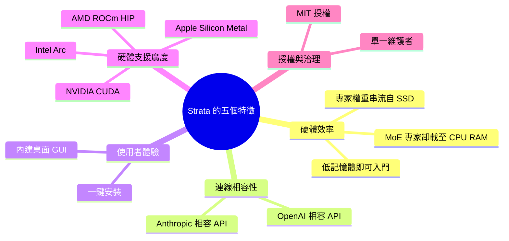
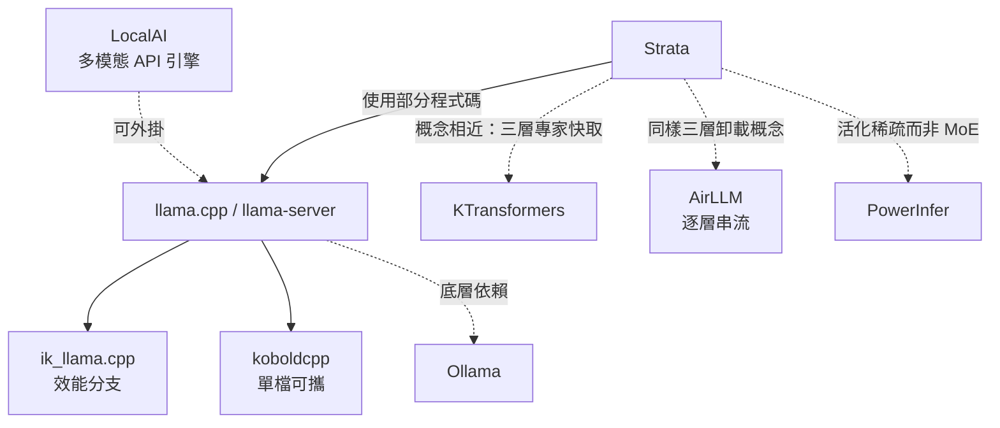
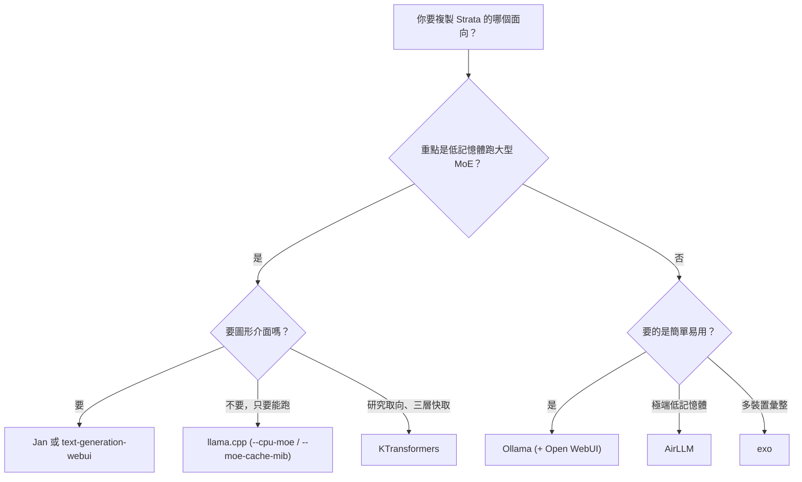

# Strata 的自由開源軟體（FOSS）替代方案

## 摘要

本報告探討 [Niko1221/Strata](https://github.com/Niko1221/Strata) 這個專案的自由開源軟體（Free and Open Source Software，FOSS）替代方案。Strata 是一套能在消費級電腦（遊戲 PC、筆電）上執行 1250 億參數混合專家（Mixture of Experts，MoE）模型的推論引擎，並同時提供桌上型圖形介面與 OpenAI／Anthropic 相容的本機 API[^strata]。本報告先釐清 Strata 的功能定位與值得比較的技術面向，再依「推論引擎」與「桌面應用」兩大類別，逐項整理已驗證授權條款與開發活躍度的替代專案，最後提出選擇建議。所有星數與授權資料均於 2026-10-23 透過 GitHub API 查核。

---

## 一、研究對象：Strata 是什麼

Strata 的定位是「在自家遊戲 PC 上執行頂尖模型」的推論引擎。其關鍵特徵包括[^strata]：

- **硬體門檻**：只要 32 GB 的記憶體（RAM）與顯示記憶體（VRAM）合計即可入門，透過將模型的專家層分散到 GPU、RAM 與 SSD 三層來運作。
- **API 相容性**：同時提供 OpenAI 相容端點（`http://127.0.0.1:8080/v1`）與 Anthropic API 相容端點（`http://127.0.0.1:8080`），可讓 Claude Code、Codex CLI、OpenCode 等代理工具連線。
- **圖形介面**：內建 Electron 桌面應用，含 Chat、Monitor、Models、Settings 四個頁面。
- **授權**：MIT 授權，並使用 llama.cpp／ggml 的部分程式碼。
- **技術核心**：混合專家（MoE）架構下的三層卸載（GPU 為「書桌」、RAM 為「書架」、SSD 為「檔案庫」），外加投機解碼（speculative decoding）加速。

截至 2026-10-23，Strata 在 GitHub 上約有 31,315 顆星、3,360 個分支，程式語言以 C++ 為主，授權為 MIT[^strata-api]。

### 1.1 評估替代方案時應比較的面向

為避免僅以「同樣能跑本機 LLM」粗略比較，本報告以 Strata 的五個差異化特徵作為評估軸線：

---

## 二、類別一：推論引擎（Inference Engine）

這一類專案與 Strata 的「引擎」部分直接對應，重點在於 MoE 卸載能力與 API 相容性。

### 2.1 llama.cpp（含 llama-server）

llama.cpp 是 Strata 技術上的「上游」基礎，Strata 本身即使用了 llama.cpp／ggml 的部分程式碼[^strata]。它是 C／C++ 撰寫的 LLM 推論引擎，截至 2026-10-23 約有 132,176 顆星、24,749 個分支，授權為 MIT，預設分支為 `master`[^llamacpp-api]。

在與 Strata 最相關的 MoE 卸載能力上，llama.cpp 的 HTTP 伺服器 (`llama-server`) 提供以下參數[^llamacpp-server]：

- `--cpu-moe`（`-cmoe`）：將所有 MoE 權重保留在 CPU。
- `--n-cpu-moe N`（`-ncmoe`）：僅將前 N 層的 MoE 權重保留在 CPU。
- `--override-tensor`（`-ot`）：覆寫張量緩衝區型別，可精細控制哪些張量放在哪。
- `--moe-cache-mib N`：為保留在 CPU 的 MoE 專家設定 GPU 端快取大小（以 MiB 計）。

在 API 相容性上，`llama-server` 同時支援 OpenAI 相容路由與 **Anthropic Messages API 相容**的聊天完成，並提供 `POST /v1/messages` 與 `POST /v1/messages/count_tokens` 端點；其中工具呼叫（tool use）需加上 `--jinja` 參數[^llamacpp-server]。這代表 llama.cpp 在「OpenAI＋Anthropic 雙相容」這點上與 Strata 並駕齊驅。

**與 Strata 的差異**：llama.cpp 沒有內建的桌面圖形應用（僅有網頁式介面），安裝與模型選擇需自行處理，缺乏 Strata 那種「一鍵安裝＋自動推薦模型」的體驗；但它擁有遠為龐大的社群、更廣的模型格式支援與更透明的治理。

### 2.2 ik_llama.cpp

ik_llama.cpp 是 llama.cpp 的分支，主打額外的 SOTA 量化類型與更佳的效能，約有 3,328 顆星、496 個分支，授權為 MIT[^ikllama-api]。它同樣聚焦於 MoE 的 CPU／GPU 混合卸載，並加入「智慧專家縮減」（Smart Expert Reduction）等針對 MoE 的優化。

**與 Strata 的差異**：屬於進階使用者向的分支，社群規模小得多（星數約為 Strata 的十分之一），沒有 GUI，且與上游 llama.cpp 已明顯分歧，較適合追效能的使用者而非一般使用者。

### 2.3 KTransformers

KTransformers 由清華大學 MADSys 實驗室開發，是一個「異質 LLM 推論／微調優化框架」，專注於 CPU-GPU 異質 MoE 推論。截至 2026-10-23 約有 19,627 顆星、1,601 個分支，授權為 Apache-2.0，以 Python 撰寫[^ktransformers-api]。

**與 Strata 的差異**：這是概念上最貼近 Strata「熱門專家放 GPU、冷門專家放 CPU／磁碟」三層快取思路的專案。差別在於它更偏研究框架與命令列使用，缺乏桌面 GUI 與一鍵安裝，且以 Python 實作，部署門檻較高。

### 2.4 Ollama

Ollama 主打「拉取即執行」的簡易體驗，提供本機 REST API（預設埠 11434）。截至 2026-10-23 約有 184,509 顆星、18,512 個分支，授權為 MIT，以 Go 撰寫[^ollama-api]。其底層依賴 llama.cpp 的推論能力，因此也能繼承部分 GPU 分層卸載能力。

**與 Strata 的差異**：Ollama 擁有最大的社群與最簡單的模型管理體驗，但它本身不內建圖形介面（需搭配 Open WebUI 等前端），且其 Anthropic 相容性並非官方主打，需另行確認。它不像 Strata 那樣針對「單一大 MoE 模型在低記憶體消費級硬體」做特化。

### 2.5 LocalAI

LocalAI 自我定位為「開源 AI 引擎」，可在任何硬體上執行 LLM、視覺、語音、圖像與影片模型，號稱無須 GPU。截至 2026-10-23 約有 49,900 顆星、4,539 個分支，授權為 MIT，以 Go 撰寫，並涵蓋 MCP、分散式（libp2p）等主題[^localai-api]。

**與 Strata 的差異**：功能廣度遠超 Strata（不限於文字 LLM），並提供內建 WebUI 與多種後端外掛架構；但它不是專為 MoE 專家卸載特化的引擎，較偏向「多模型 API 閘道」。

### 2.6 koboldcpp

koboldcpp 是 llama.cpp 的分支，主打「單一檔案、零安裝」的可攜式執行檔，並內建 KoboldAI Lite 網頁介面。截至 2026-10-23 約有 12,053 顆星、796 個分支，授權為 AGPL-3.0（注意：這與 Strata 的 MIT 不同，對商業再散布者限制較嚴）[^kobold-api]。

**與 Strata 的差異**：安裝簡便度與 Strata 相近，且支援 CPU／GPU 混合卸載與 OpenAI 相容 API；但主打創意寫作／角色扮演，缺乏 Strata 的系統監控與模型推薦體驗，且授權條款更嚴格。

### 2.7 AirLLM（極端低記憶體取向）

AirLLM 採「逐層串流」策略，一次僅將一層載入 GPU，其餘放在 CPU 記憶體或磁碟，主打以單張 4 GB 顯示卡執行超大型模型。截至 2026-10-23 約有 40,497 顆星、4,134 個分支，授權為 Apache-2.0[^airllm-api]。

**與 Strata 的差異**：這是最極端的卸載方案，記憶體需求極低，但並非專門針對 MoE 專家路由設計，速度與易用性不如 Strata，且屬研究／實驗性質。

### 2.8 PowerInfer

PowerInfer 利用神經元活化的冪律分布，將「熱」神經元預載至 GPU、「冷」神經元在 CPU 計算。截至 2026-10-23 約有 9,847 顆星、610 個分支，授權為 MIT[^powerinfer-api]。

**與 Strata 的差異**：其核心限制是僅支援 ReLU 系列稀疏活化模型，並非通用 MoE，因此適用範圍比 Strata 窄，不能視為直接替代品。

### 2.9 引擎類替代方案關係圖

---

## 三、類別二：桌面應用（含本機引擎）

這一類專案與 Strata 的「桌面應用＋本機推論＋API 曝光」整套體驗對應。

### 3.1 Jan

Jan 自我描述為「可 100% 離線執行的開源 ChatGPT 替代品」。截至 2026-10-23 約有 45,052 顆星、3,110 個分支，以 Rust（Tauri）撰寫，使用 llama.cpp 作為本機引擎，主題標籤包含 `tauri`、`llamacpp`[^jan-api]。其授權檔案內容為 Apache License 2.0 條文，並附有 Menlo Research 的產品聲明[^jan-license]。

**與 Strata 的差異**：同為「桌面應用＋本機引擎」，但 Jan 的定位是通用型 ChatGPT 替代品，可同時連接雲端供應商；相較 Strata 專注於單一超大 MoE 模型與三層卸載，Jan 對「在低記憶體消費級硬體上跑 125B MoE」並無同等特化。

### 3.2 GPT4All

GPT4All 由 nomic-ai 開發，主打「在任何裝置上執行本機 LLM」，並明言開源且可商業使用。截至 2026-10-23 約有 77,354 顆星、8,254 個分支，授權為 MIT，以 C++ 撰寫[^gpt4all-api]。

**與 Strata 的差異**：擁有成熟的「下載即用」體驗與內建模型庫（LocalDocs／RAG），並提供 OpenAI 相容的 API 伺服器；但其桌面應用偏向本機聊天客戶端，並非以 MoE 專家卸載至 RAM／SSD 為核心賣點。

### 3.3 text-generation-webui（oobabooga/textgen）

此專案自我描述為「本機 LLM 的開源桌面應用」，支援文字、視覺、工具呼叫與 OpenAI／Anthropic 相容 API。截至 2026-10-23 約有 47,722 顆星、5,988 個分支，授權為 AGPL-3.0，以 Python 撰寫[^textgen-api]。

**與 Strata 的差異**：其「OpenAI／Anthropic 雙 API 相容＋桌面應用」的組合與 Strata 最為接近，且可切換多種後端（llama.cpp、ExLlama 等）；但為 Python 部署、授權為 AGPL-3.0，且不若 Strata 針對硬體自動推薦模型。

### 3.4 AnythingLLM

AnythingLLM 由 Mintplex-Labs 開發，主打「本機優先的代理體驗」。截至 2026-10-23 約有 67,497 顆星、7,562 個分支，授權為 MIT，以 JavaScript 撰寫，涵蓋 RAG、向量資料庫、代理協作等主題[^anythingllm-api]。其技術棧中亦包含基於 llama.cpp 的本機推論引擎。

**與 Strata 的差異**：偏向「本機 AI 工作區＋檢索增強生成（RAG）＋多使用者」，功能廣但不專注於單一大 MoE 模型的低記憶體執行；桌面版與 Docker 自架並行。

### 3.5 非 FOSS 對照：LM Studio

值得一提的是常見的 LM Studio：其桌面應用本身**並非開源**，只有命令列工具 `lms` 與部分 SDK 為開放原始碼。`lms` 的儲存庫約有 5,377 顆星、授權為 MIT，以 TypeScript 撰寫[^lms-api]。因此 LM Studio 不符合本報告的 FOSS 標準，僅列為對照，說明「有漂亮 GUI 但非自由軟體」的選項確實存在。

---

## 四、類別三：跨裝置與其他架構

### 4.1 exo

exo 由 exo-explore 開發，主打「在本機執行前沿 AI」，其特色是把多台裝置（如多台 Apple Silicon 機器）組成一個 AI 叢集，以匯集記憶體執行單機無法承載的大型模型。截至 2026-10-23 約有 48,017 顆星、3,577 個分支，授權為 Apache-2.0，以 Python 撰寫[^exo-api]。

**與 Strata 的差異**：Strata 是在「單一台 PC」內做 GPU／RAM／SSD 三層卸載；exo 則是在「多台裝置」間做張量平行。兩者解決的是不同尺度的資源瓶頸，但在「以有限硬體執行超大模型」的目標上高度重疊。

### 4.2 其他相關專案

- **llamafile**（mozilla-ai／mozilla-ai）：將模型與推論引擎打包成單一可執行檔。截至 2026-10-23 約有 26,473 顆星、1,659 個分支，授權標示為「Other」（非標準 SPDX 條款）[^llamafile-api]。
- **Open WebUI**：最受歡迎的本機 LLM 前端介面，可連接 Ollama 或 OpenAI 相容後端。截至 2026-10-23 約有 156,607 顆星、22,793 個分支，授權標示為「Other」[^openwebui-api]。它並非推論引擎，而是介面層。

---

## 五、綜合比較與建議

### 5.1 依需求選擇的決策流程

### 5.2 最貼近的整體替代方案

若以「同時具備推論引擎＋桌面 GUI＋OpenAI／Anthropic 雙 API 相容＋FOSS」四項條件衡量，最接近 Strata 整體體驗的替代方案是 **llama.cpp（`llama-server`）搭配一個前端**，理由如下：

- llama.cpp 提供 MoE 卸載（`--cpu-moe`、`--n-cpu-moe`、`--moe-cache-mib`）與 OpenAI＋Anthropic 雙 API 相容[^llamacpp-server]，且星數與社群規模遠大於 Strata。
- 需要 GUI 時，可搭配 **Jan**（Apache 2.0 條文＋附加聲明）[^jan-license] 或 **text-generation-webui**（AGPL-3.0）[^textgen-api]；需要簡易模型管理時搭配 **Ollama**[^ollama-api]。

### 5.3 若只針對「在低記憶體消費級硬體跑超大 MoE 模型」

- **llama.cpp**：最成熟的通用選擇，具備專家快取機制[^llamacpp-server]。
- **KTransformers**：概念上與 Strata 的三層專家快取最相似，但偏研究與命令列[^ktransformers-api]。
- **ik_llama.cpp**：追求極致效能與新量化的進階選擇，社群較小[^ikllama-api]。
- **AirLLM**：記憶體需求最極端，但非 MoE 特化、速度較慢[^airllm-api]。

### 5.4 選擇時須注意的授權差異

Strata 為 MIT 授權，寬鬆且利於商用[^strata-api]。替代方案中，**llama.cpp、Ollama、GPT4All、LocalAI、AnythingLLM、ik_llama.cpp 為 MIT**[^llamacpp-api][^ollama-api][^gpt4all-api][^localai-api][^anythingllm-api][^ikllama-api]；**KTransformers 與 exo 為 Apache-2.0**[^ktransformers-api][^exo-api]；**koboldcpp 與 text-generation-webui 為 AGPL-3.0**[^kobold-api][^textgen-api]。若有商業再散布需求，AGPL-3.0 專案需特別留意其傳染性條款。

### 5.5 對來源的批判性反思

- Strata 專案建立於 2026-09-24，截至查核日僅約一個月，卻已累積 31,315 顆星，成長極快；此類爆紅專案的可持續性、長期維護與治理透明度仍有待觀察[^strata-api]。相較之下，llama.cpp（建於 2023-03-10）與 Ollama（建於 2023-06-26）已有數年累積，社群韌性更高[^llamacpp-api][^ollama-api]。
- Strata 自述使用「llama.cpp／ggml 的部分程式碼」[^strata]，顯示其引擎創新多在於上層的卸載排程與產品化包裝，而非從零打造核心張量運算；因此上遊生態的演進會直接影響 Strata 的長期優勢。
- 各專案的星數會隨時間變動，本報告之數值為 2026-10-23 的瞬間快照[^strata-api][^llamacpp-api][^ollama-api]。
- GitHub 上「授權」欄位標示為「Other」者（如 llamafile、Open WebUI），代表其授權非標準 SPDX 條款，實際條款須逐一閱讀原始授權檔，不宜直接視為典型 OSI 認證的開源授權[^llamafile-api][^openwebui-api]。

---

## 參考文獻

[^strata]: Niko1221. (2026). *Strata* [電腦軟體]. GitHub. Retrieved 2026-10-23, from https://github.com/Niko1221/Strata

[^strata-api]: Niko1221. (2026). *Strata* [Repository metadata, GitHub REST API]. GitHub. Retrieved 2026-10-23, from https://api.github.com/repos/Niko1221/Strata

[^llamacpp-api]: ggml-org. (2026). *llama.cpp* [Repository metadata, GitHub REST API]. GitHub. Retrieved 2026-10-23, from https://api.github.com/repos/ggml-org/llama.cpp

[^llamacpp-server]: ggml-org. (2026). *llama.cpp HTTP server README*. GitHub. Retrieved 2026-10-23, from https://github.com/ggml-org/llama.cpp/blob/master/tools/server/README.md

[^ikllama-api]: ikawrakow. (2026). *ik_llama.cpp* [Repository metadata, GitHub REST API]. GitHub. Retrieved 2026-10-23, from https://api.github.com/repos/ikawrakow/ik_llama.cpp

[^ktransformers-api]: kvcache-ai. (2026). *ktransformers* [Repository metadata, GitHub REST API]. GitHub. Retrieved 2026-10-23, from https://api.github.com/repos/kvcache-ai/ktransformers

[^ollama-api]: ollama. (2026). *ollama* [Repository metadata, GitHub REST API]. GitHub. Retrieved 2026-10-23, from https://api.github.com/repos/ollama/ollama

[^localai-api]: mudler. (2026). *LocalAI* [Repository metadata, GitHub REST API]. GitHub. Retrieved 2026-10-23, from https://api.github.com/repos/mudler/LocalAI

[^kobold-api]: LostRuins. (2026). *koboldcpp* [Repository metadata, GitHub REST API]. GitHub. Retrieved 2026-10-23, from https://api.github.com/repos/LostRuins/koboldcpp

[^airllm-api]: lyogavin. (2026). *airllm* [Repository metadata, GitHub REST API]. GitHub. Retrieved 2026-10-23, from https://api.github.com/repos/lyogavin/airllm

[^powerinfer-api]: Tiiny-AI. (2026). *PowerInfer* [Repository metadata, GitHub REST API]. GitHub. Retrieved 2026-10-23, from https://api.github.com/repos/Tiiny-AI/PowerInfer

[^jan-api]: janhq. (2026). *jan* [Repository metadata, GitHub REST API]. GitHub. Retrieved 2026-10-23, from https://api.github.com/repos/janhq/jan

[^jan-license]: janhq. (2025). *LICENSE* [Jan repository license file]. GitHub. Retrieved 2026-10-23, from https://github.com/janhq/jan/blob/main/LICENSE

[^gpt4all-api]: nomic-ai. (2026). *gpt4all* [Repository metadata, GitHub REST API]. GitHub. Retrieved 2026-10-23, from https://api.github.com/repos/nomic-ai/gpt4all

[^textgen-api]: oobabooga. (2026). *textgen* [Repository metadata, GitHub REST API]. GitHub. Retrieved 2026-10-23, from https://api.github.com/repos/oobabooga/textgen

[^anythingllm-api]: Mintplex-Labs. (2026). *anything-llm* [Repository metadata, GitHub REST API]. GitHub. Retrieved 2026-10-23, from https://api.github.com/repos/Mintplex-Labs/anything-llm

[^lms-api]: lmstudio-ai. (2026). *lms* [Repository metadata, GitHub REST API]. GitHub. Retrieved 2026-10-23, from https://api.github.com/repos/lmstudio-ai/lms

[^exo-api]: exo-explore. (2026). *exo* [Repository metadata, GitHub REST API]. GitHub. Retrieved 2026-10-23, from https://api.github.com/repos/exo-explore/exo

[^llamafile-api]: mozilla-ai. (2026). *llamafile* [Repository metadata, GitHub REST API]. GitHub. Retrieved 2026-10-23, from https://api.github.com/repos/mozilla-ai/llamafile

[^openwebui-api]: open-webui. (2026). *open-webui* [Repository metadata, GitHub REST API]. GitHub. Retrieved 2026-10-23, from https://api.github.com/repos/open-webui/open-webui
