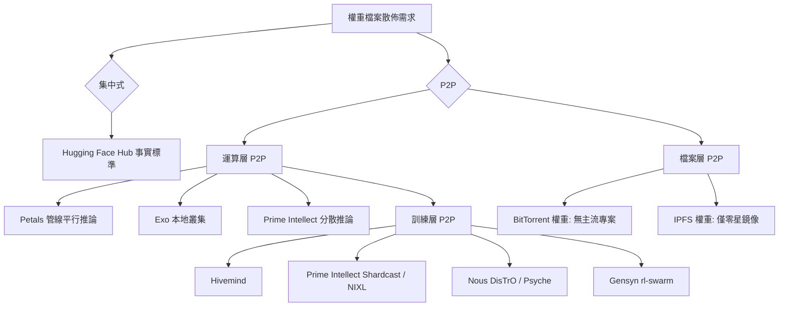

# LLM 權重檔案的 P2P 分散式流通：現況調查

## 摘要

大型語言模型（LLM）的權重檔案動輒數十 GB 至數 TB，目前幾乎都透過集中式平台（最主要是 Hugging Face Hub）散布。本文調查截至 2026 年，是否存在以點對點（P2P）方式流通 LLM 權重的實際方案。核心結論是：**目前並沒有主流、專門用來「P2P 傳輸權重檔案」的專案**；既有專案多把 P2P 用於分散式「運算」（推論或訓練），權重檔案本身仍多半先從 Hugging Face 等下載。真正把 P2P 用在權重／梯度交換上的，是分散式訓練與分散式推論系統，例如 Petals、Exo、Prime Intellect 與 Nous Research 的 Psyche。

---

## 1. 問題背景：為什麼權重檔案難以 P2P 流通

- Hugging Face Hub 是權重散布的事實標準，但其本質是集中式 CDN／HTTP（Git LFS）架構[^hf-arch]。
- 以 BLOOM-176B 為例，其 bf16 權重約 329 GB，含優化器狀態的完整檢查點可達 2.3 TB[^bloom]。
- 權重檔案具備「內容定址」特性（同一份權重可被雜湊唯一識別），理論上非常適合 BitTorrent／IPFS 這類 P2P 傳輸，但實際上並未出現被廣泛採用的方案。

---

## 2. 分散式推論（把模型切開、跨節點運算）

這一類系統把 P2P 用於「運算層」：每個節點只負責模型的一部分層，推論請求在節點間流轉。**權重通常仍需先各自下載**。

### 2.1 Petals

- 定位為「BitTorrent 風格」的大型模型協作推論與微調系統[^petals-gh]。
- 支援 Llama 3.1（最高 405B）、Mixtral 8x22B、Falcon、BLOOM-176B 等模型[^petals-gh]。
- **實際權重來源**：每個自願節點透過標準 HTTP／Git LFS 從 Hugging Face Hub 下載自己負責的那部分權重；P2P 的部分在於以 libp2p DHT（底層為 Hivemind）互相發現節點、做跨網際網路的管線平行運算，而非傳輸權重檔案本身[^petals-paper]。
- 有公開的 swarm 健康監測站，並有對應學術發表（ACL 2023、NeurIPS 2023）[^petals-neurips][^petals-acl]。

### 2.2 Exo

- 將使用者本地的多台裝置（Mac、Linux 等）串成一個 AI 叢集，執行比單機可容納更大的模型[^exo-gh]。
- 支援裝置自動發現、拓樸感知的自動平行化、張量平行，以及透過 Thunderbolt 5 的 RDMA[^exo-gh]。
- **權重來源**：模型先從 Hugging Face 下載到其中一台裝置，再於本地叢集內以 P2P 方式分片；其 P2P 範圍以區域網路為主，而非公網權重共享[^exo-gh]。

### 2.3 Prime Intellect 的推論堆疊

- 針對消費者 GPU 與高延遲公網設計分散式推論，開源了 PRIME-IROH（通訊後端）、PRIME-VLLM（管線平行 vLLM）等元件[^prime-inf]。

---

## 3. 分散式訓練（P2P 交換梯度／權重）

這一類系統把 P2P 用在訓練時的梯度或權重同步，是「真正意義上」跨節點流通模型參數的方向。

### 3.1 Hivemind

- 為 Petals 底層的 PyTorch 去中心化深度學習函式庫，提供無主節點訓練、容錯反向傳播、去中心化參數平均（Moshpit SGD）與去中心化 MoE[^hivemind-gh]。

### 3.2 Prime Intellect：INTELLECT 系列與 Shardcast

- INTELLECT-2（2025-04）為 32B 推理模型的全球分散式 RL 訓練，提出 **Shardcast**：以樹狀拓樸的 HTTP 廣播方式，把更新後的策略權重從訓練節點散佈到分散的推論節點[^ii2]。
- 另有 **NIXL + ModelExpress**（2026-09）以 RDMA 在資料中心內做權重傳輸，宣稱可將 1.6 TB 的權重傳輸時間從約 86 秒降到約 3.9 秒，但依賴高階網卡[^nixl]。
- OpenDiLoCo（2024-07）為其低通訊分布式訓練的開源框架[^opendiloco]。

### 3.3 Nous Research：DisTrO 與 Psyche

- **DisTrO**（Distributed Training Over-The-Internet）是一系列低延遲分散式優化器，透過對梯度做 DCT 與 top-k 稀疏化，將節點間通訊量降低數個數量級[^distro]。
- 其生產實作演進為 **Psyche / nousnet**：以 Rust 撰寫、P2P 網路（Iroh）、並以 Solana 區塊鏈協調，宣稱完成了在網際網路上訓練 40B 模型的實驗[^psyche]。
- 底層研究為 **DeMo**（Decoupled Momentum Optimization）[^demo]。

### 3.4 Gensyn

- 專注於可驗證的分散式 RL 訓練，開源 `rl-swarm`（可在消費者硬體上跑 P2P RL 訓練）與 `axl`（P2P 通訊節點）等[^gensyn-gh]。
- 其「可審計訓練」主張的是「證明權重如何被訓練出來」，而非權重檔案的 P2P 散佈[^gensyn]。

### 3.5 Kalavai

- 以 Kubernetes 為基底，把本地、地端與多雲的閒置 GPU 聚合成私人算力池，再於池中部署 vLLM、SGLang、llama.cpp 等推論引擎[^kalavai]。
- 焦點是「算力聚合」而非權重 P2P 傳輸。

---

## 4. 以檔案為中心的 P2P 傳輸（BitTorrent／IPFS）

這是使用者問題中最直接的訴求，但目前最薄弱：

| 方向 | 現況 |
|---|---|
| BitTorrent 傳權重 | 沒有主流專案。僅有社群零星以 Academic Torrents 等管道散布量化後的 GGUF 權重，屬個案而非制度性方案[^acad] |
| IPFS 傳權重 | 無主要專案以 IPFS 作為 10B+ 模型的**主要**散布機制；少數模型庫有 IPFS 相容 CID 作為次要鏡像[^ipfs] |
| BigScience 資料集 torrent | 使用者常誤傳的「BigScience 資料集 torrent」並不存在，ROOTS 語料是透過 Hugging Face Datasets 散布[^roots] |
| 學術研究 | 學界對 P2P 的關注集中在**運算**（分散式訓練／推論），而非權重**檔案**的 P2P 散佈[^swarm] |

---

## 5. 綜合比較

| 專案 | P2P 用途 | 權重來源 | 狀態 |
|---|---|---|---|
| Petals | 推論運算（DHT 管線平行） | Hugging Face（HTTP） | 活躍[^petals-gh] |
| Exo | 本地叢集推論分片 | Hugging Face 下載後本地 P2P | 活躍[^exo-gh] |
| Hivemind | 去中心化訓練 | 不適用（函式庫） | 活躍[^hivemind-gh] |
| Prime Intellect | 分散 RL（Shardcast 廣播權重） | 訓練節點→推論節點 | 活躍[^ii2] |
| Nous Psyche / DisTrO | 分散訓練（低通訊優化器） | 訓練過程交換梯度 | 研究／實驗[^psyche] |
| Gensyn | 分散 RL＋可審計訓練 | 檔案仍公開散布 | 活躍[^gensyn-gh] |
| Kalavai | 算力聚合 | 池內引擎自行下載 | 活躍[^kalavai] |
| BitTorrent／IPFS 權重 | 檔案層 P2P | — | 無主流專案[^acad] |

---

## 6. 結論與評析

1. **直接回答問題**：目前沒有成熟、主流的「P2P 權重檔案散佈」方案。想擺脫對 Hugging Face 的依賴，實務上仍缺一個像 BitTorrent 之於一般檔案那樣的地位。
2. **P2P 的重心在運算而非檔案**：Petals、Exo、Prime Intellect、Nous、Gensyn 等，都是把 P2P 用於分散式「推論」或「訓練」，權重多半仍先從集中式平台取得。這是本調查最重要的觀察。
3. **最接近「語意上正確」的方向**是分散式訓練：Shardcast、DisTrO／Psyche、Hivemind 等，在訓練過程中確實以 P2P 方式交換參數／梯度，而非事後下載完整權重檔。
4. **來源反思**：本主題的官方第一手資料多為專案 GitHub 與官方部落格，帶有推廣性質；部分專案的 GitHub 星數與活躍度在檢索時變動快速，讀者應以官方儲存庫當下狀態為準。此外，「BigScience 資料集 torrent」與「BloomBee」等說法在查證後並無對應的官方專案，屬常見誤傳[^roots]。
5. **觀察面向**：內容定址（content-addressed）權重理論上非常適合 P2P，若有團隊願意把 BitTorrent／IPFS 與模型註冊表整合，並解決信任（雜湊驗證）與誘因（seeding 獎勵）問題，仍是一塊未被佔據的空間。

---

## 參考文獻

[^hf-arch]: Hugging Face. (n.d.). Hub documentation. Retrieved 2026-10-23, from https://huggingface.co/docs/hub

[^bloom]: BigScience Workshop. (2022). BLOOM: A 176B-parameter open-access multilingual language model. Retrieved 2026-10-23, from https://huggingface.co/bigscience/bloom

[^petals-gh]: BigScience Workshop. (n.d.). petals: Run LLMs at home, BitTorrent-style. GitHub. Retrieved 2026-10-23, from https://github.com/bigscience-workshop/petals

[^petals-paper]: Borzunov, A., et al. (2023). Petals: Collaborative inference and fine-tuning of large models. In Proceedings of ACL 2023. Retrieved 2026-10-23, from https://arxiv.org/abs/2209.01188

[^petals-neurips]: Borzunov, A., et al. (2023). Distributed inference and fine-tuning of large language models over the internet. In Advances in Neural Information Processing Systems 36. Retrieved 2026-10-23, from https://arxiv.org/abs/2312.08361

[^petals-acl]: Association for Computational Linguistics. (2023). Petals: Collaborative inference and fine-tuning of large models. ACL 2023 System Demonstrations. Retrieved 2026-10-23, from https://aclanthology.org/2023.acl-demo.54/

[^exo-gh]: exo-explore. (n.d.). exo: Run frontier AI locally. GitHub. Retrieved 2026-10-23, from https://github.com/exo-explore/exo

[^prime-inf]: Prime Intellect. (2025, April 28). Planetary-scale inference. Retrieved 2026-10-23, from https://www.primeintellect.ai/blog/inference

[^hivemind-gh]: Learning-at-Home. (n.d.). hivemind: Decentralized deep learning in PyTorch. GitHub. Retrieved 2026-10-23, from https://github.com/learning-at-home/hivemind

[^ii2]: Prime Intellect. (2025, April 15). INTELLECT-2: A reasoning model trained through globally decentralized RL. Retrieved 2026-10-23, from https://www.primeintellect.ai/blog/intellect-2

[^nixl]: Prime Intellect. (2026, September 3). NIXL + ModelExpress weight transfer. Retrieved 2026-10-23, from https://www.primeintellect.ai/blog/nixl-modelexpress-weight-transfer

[^opendiloco]: Prime Intellect. (2024, July 11). OpenDiLoCo: An open-source framework for globally distributed, low-communication training. Retrieved 2026-10-23, from https://www.primeintellect.ai/blog/opendiloco

[^distro]: Nous Research. (2024). DisTrO: Distributed training over-the-internet. GitHub. Retrieved 2026-10-23, from https://github.com/NousResearch/DisTrO

[^psyche]: Psyche Foundation. (n.d.). nousnet. GitHub. Retrieved 2026-10-23, from https://github.com/PsycheFoundation/nousnet

[^demo]: blocs. (2024). DeMo: Decoupled momentum optimization. GitHub. Retrieved 2026-10-23, from https://github.com/bloc97/DeMo

[^gensyn-gh]: Gensyn. (n.d.). rl-swarm and axl. GitHub. Retrieved 2026-10-23, from https://github.com/gensyn-ai

[^gensyn]: Gensyn. (2026, September 15). Introducing open-1b: Auditable training. Retrieved 2026-10-23, from https://www.gensyn.ai/news/introducing-open-1b-auditable-training

[^kalavai]: Kalavai. (n.d.). kalavai-client. GitHub. Retrieved 2026-10-23, from https://github.com/kalavai-net/kalavai-client

[^acad]: Academic Torrents. (n.d.). Distributed dataset hosting. Retrieved 2026-10-23, from https://academictorrents.com

[^ipfs]: IPFS. (n.d.). Content addressing and CIDs. Retrieved 2026-10-23, from https://docs.ipfs.tech

[^roots]: BigScience Workshop. (2022). Building a TB-scale multilingual dataset for language modeling. Retrieved 2026-10-23, from https://huggingface.co/datasets/bigscience

[^swarm]: Ryabinin, M., et al. (2023). SWARM parallelism: Training large models can be surprisingly communication-efficient. In Proceedings of ICML 2023. Retrieved 2026-10-23, from https://arxiv.org/abs/2301.11913
