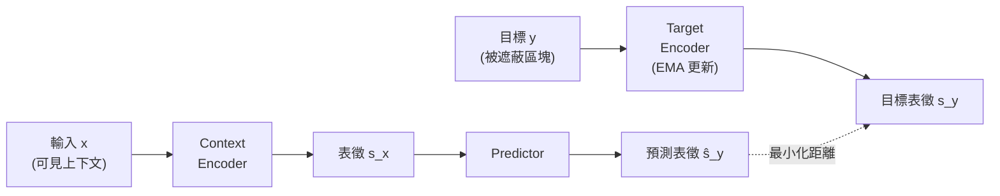
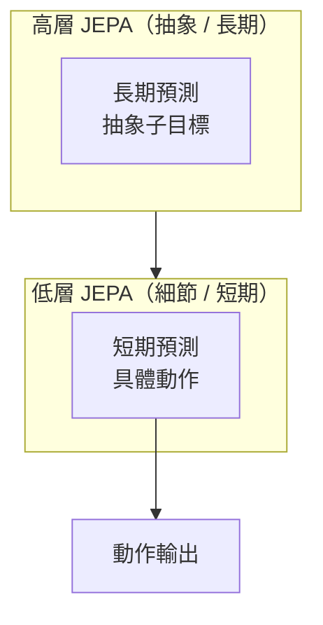

# JEPA（Joint Embedding Predictive Architecture）介紹

## 摘要

JEPA（Joint Embedding Predictive Architecture，聯合嵌入預測架構）是一種「非生成式」（non-generative）的自監督式學習（self-supervised learning, SSL）範式，由 Yann LeCun 於 2022 年 6 月發表的立場論文《A Path Towards Autonomous Machine Intelligence》中正式提出[^lecun2022]。與主流生成式模型（例如 MAE、GPT）試圖重建原始像素或詞元（token）不同，JEPA 只在「潛在表徵空間」（latent embedding space）中預測目標的抽象表徵，因此能丟棄無法預測的細節，專注於語意結構[^lecun2022][^ijepa]。

本報告說明 JEPA 的核心概念、與生成式及對比式方法的差異、能量基礎模型（EBM）的理論形式、階層式 JEPA（H-JEPA），以及其實際落地模型（I-JEPA、V-JEPA、V-JEPA 2、LeJEPA 等）與最新發展。

---

## 一、背景：為什麼需要 JEPA

### 1.1 自監督式學習的兩種主流路線

在電腦視覺與自然語言領域，自監督式學習大致可分為兩類[^ijepa]：

- **生成式方法（generative）**：例如遮蔽自編碼器（MAE）重建被遮蔽的像素、自回歸模型（GPT）預測下一個詞元。這類方法必須重建資料中所有細節，包括無法預測的高頻雜訊，因而浪費模型容量[^lecun2022]。
- **對比式方法（contrastive / invariance-based）**：例如 SimCLR、MoCo、DINO，透過手工設計的資料增強（data augmentation）產生正負樣本對，學習對增強不變的表徵。這類方法依賴人工設計的增強策略，容易引入偏誤[^ijepa]。

Yann LeCun 主張，真正的機器智慧不應在「觀測空間」（像素、詞元）中預測，而應在「表徵空間」中預測，因為未來具備高度的不確定性與多模態性，逐像素預測既不必要也無效率[^lecun2022]。

### 1.2 JEPA 的定位

JEPA 結合了「聯合嵌入架構」（Joint Embedding Architecture）與「潛在變數生成架構」（Latent-Variable Generative Architecture）的特性，但**本身不是生成式的**。它並不顯式產生 y 的預測，而是僅捕捉 x 與 y 之間的依賴關係[^lecun2022]。

> "JEPA is not generative in the sense that it cannot easily be used to predict y from x. It merely captures the dependencies between x and y without explicitly generating predictions of y."[^lecun2022]

---

## 二、JEPA 的核心架構

JEPA 由三個核心元件構成[^ijepa][^lecun2022]：

| 元件 | 功能 |
|------|------|
| **Context Encoder（上下文編碼器）** | 將觀測到的輸入（例如圖像中可見區塊）編碼為抽象表徵 $s_x$ |
| **Target Encoder（目標編碼器）** | 將目標（例如被遮蔽區塊）編碼為抽象表徵 $s_y$；其參數通常以指數移動平均（EMA）方式由上下文編碼器更新 |
| **Predictor（預測器）** | 接收 $s_x$，在表徵空間中預測 $s_y$ |

訓練目標是最小化預測表徵與實際目標表徵之間的距離（例如 L2 距離）[^ijepa]。

### 2.1 避免表徵坍塌（representation collapse）

JEPA 面臨的風險是「坍塌」：若所有輸入都被映射到相同常數表徵，預測誤差可以輕易為零，但表徵毫無資訊[^lecun2022]。處理方式有兩類：

- **架構非對稱 + EMA**：例如 I-JEPA 對目標編碼器施加停止梯度（stop-gradient），並用上下文編碼器的權重之指數移動平均來更新目標編碼器[^ijepa]。
- **正則化（非對比式方法）**：例如 VICReg、Barlow Twins，透過變異數／不變性／共變異數懲罰，或資訊容量約束，防止坍塌[^lecun2022]。

---

## 三、理論形式：能量基礎模型（EBM）

在 LeCun 的原始論文中，JEPA 被置於能量基礎模型（Energy-Based Model, EBM）框架下[^lecun2022]。EBM 以一個純量能量函數 $F(x, y)$ 描述 x 與 y 的相容性：當兩者相容時能量低，不相容時能量高[^lecun2022]。

JEPA 的能量函數定義為預測誤差：

$$E(x, y, z) = D\big(s_y,\; \mathrm{Pred}(s_x, z)\big)$$

其中 $D$ 為距離度量，$z$ 為潛在變數（latent variable）。整體能量為對 $z$ 取最小值：

$$F(x, y) = \min_{z} D\big(s_y,\; \mathrm{Pred}(s_x, z)\big)$$

潛在變數 $z$ 讓模型能表達「多重可能的未來」（multi-modality），即同一觀測下多個合理的預測結果[^lecun2022]。

論文中區分兩種訓練方式[^lecun2022]：

- **對比式方法**：壓低訓練樣本的能量、拉高對比樣本的能量。但在高維空間中，對比式方法會因維度災難而失效。
- **非對比式（正則化）方法**：JEPA 的主要吸引力所在。其四項準則為：(1) 最大化 $s_x$ 對 x 的資訊量；(2) 最大化 $s_y$ 對 y 的資訊量；(3) 使 $s_y$ 易於從 $s_x$ 預測；(4) 最小化潛在變數 $z$ 的資訊量。VICReg 與 Barlow Twins 即屬此類。

---

## 四、階層式 JEPA（H-JEPA）

LeCun 進一步提出將多個 JEPA 模組堆疊成階層，即 H-JEPA（Hierarchical JEPA），以在不同抽象層次與時間尺度上運作[^lecun2022]。

- **低層 JEPA**：抽取低階表徵，進行短期預測。
- **高層 JEPA**：以低層表徵為輸入，抽取高階表徵，進行長期預測。

> "JEPA-1 extracts low-level representations and performs short-term predictions. JEPA-2 takes the representations extracted by JEPA-1 as inputs and extracts higher-level representations with which longer-term predictions can be performed."[^lecun2022]

此階層結構支援「階層式規劃」（hierarchical planning）：高層產生抽象子目標，低層將其轉化為具體動作序列，例如「通勤上班」拆解為「開車到車站」→「走向車子」→「肌肉層級控制」[^lecun2022]。

---

## 五、認知架構中的位置

LeCun 的論文提出一套模組化、可微分的認知架構，所有模組皆可訓練，用以構築自主智慧代理（autonomous intelligent agent）[^lecun2022]。JEPA 在其中扮演「世界模型」（World Model）的核心角色。

| 模組 | 功能 |
|------|------|
| **Configurator（配置器）** | 執行控制；依任務調整其他模組的參數與注意力 |
| **Perception（感知）** | 從感測訊號估計當前世界狀態，並以多層抽象表示 |
| **World Model（世界模型）** | 即 JEPA 模組；填補缺失狀態、預測未來世界狀態，是可微分的「模擬器」 |
| **Cost Module（成本模組）** | 衡量代理的「不適」；分為硬性內在成本（如疼痛、飢餓）與可訓練的批評者（critic） |
| **Short-Term Memory（短期記憶）** | 儲存當前／預測狀態與內在成本，供世界模型查詢 |
| **Actor（行動者）** | 提出動作序列；含反應式政策（System 1）與動作優化器（System 2） |

論文的四項主要貢獻為[^lecun2022]：

1. 一套所有模組可微分的整體認知架構；
2. H-JEPA：非生成式的階層式預測世界模型；
3. 一族非對比式自監督學習範式，產生兼具資訊性與可預測性的表徵；
4. 以 H-JEPA 為基礎、在不確定性下進行階層式規劃的世界模型方法。

---

## 六、實際落地模型

### 6.1 I-JEPA（2023）

I-JEPA（Image-based Joint-Embedding Predictive Architecture）是第一個 JEPA 的實作，由 Meta AI（FAIR）於 2023 年 6 月發表，並收錄於 CVPR 2023[^ijepa][^ijepa_gh]。它是**非生成式**的影像自監督學習方法，核心思想是「從單一上下文區塊，預測同一影像中多個目標區塊的表徵」[^ijepa]。

- **架構**：三個元件皆為 Vision Transformer（ViT）。目標編碼器的權重以 EMA 方式由上下文編碼器更新；預測器為較窄的 ViT[^ijepa]。
- **多區塊遮蔽策略**：遮蔽大區塊（而非隨機小塊），迫使模型學習高階語意特徵而非紋理[^ijepa]。
- **訓練效率**：ViT-Huge/14 在 ImageNet 上以 16 張 A100 GPU、不到 72 小時完成訓練；論文中提到相較於 MAE 快約 10 倍[^ijepa]。
- **表現**：在 ImageNet-1K 線性探測與半監督（1% 標籤）任務上超越 MAE，且在物件計數、深度預測等低階視覺任務上勝過對比式方法[^ijepa]。

官方程式庫 `facebookresearch/ijepa` 截至查詢時約有 **3.5k 顆星**，並已於 2024 年 8 月 1 日被標記為封存（archived）[^ijepa_gh]。

### 6.2 V-JEPA（2024）

V-JEPA 將同一原則延伸至影片：處理三維時空區塊（tubelets），在空間與時間上同時遮蔽，並由可見上下文預測被遮蔽區域的表徵[^vjepa]。其論文《Revisiting Feature Prediction for Learning Visual Representations from Video》於 2024 年 2 月提交[^vjepa]。

- 訓練資料：自公開資料集蒐集的 **200 萬部影片**[^vjepa]。
- 不使用預訓練影像編碼器、文字標籤、負樣本或像素重建，僅以特徵預測為目標[^vjepa]。
- 最大模型 ViT-H/16 在 Kinetics-400 達 81.9%、Something-Something-v2 達 72.2%、ImageNet-1K 達 77.9%[^vjepa]。
- 官方程式庫 `facebookresearch/jepa` 收錄其程式碼[^vjepa_gh]。

### 6.3 V-JEPA 2（2025）

V-JEPA 2 於 2025 年 6 月發表，將規模推向 **超過 100 萬小時**的網路影片，並首次展示自監督世界模型可用於機器人規劃[^vjepa2]。

- **規模與架構**：預訓練資料為 VideoMix22M（逾 1M 小時）；引入三維旋轉位置嵌入（3D-RoPE），模型最大達 **10 億參數（ViT-g/16）**[^vjepa2]。
- **兩階段訓練**：第一階段「無動作預訓練」學習物理與運動軌跡；第二階段「動作條件後訓練」（V-JEPA 2-AC）使用不到 **62 小時**的 Droid 機器人影片[^vjepa2]。
- **表現**：Something-Something v2 達 77.3%、Epic-Kitchens-100 動作預測 Recall@5 達 39.7%、Diving48 達 90.2%；與大型語言模型對齊後於 PerceptionTest 達 84.0、TempCompass 達 76.9[^vjepa2]。
- **機器人零樣本規劃**：V-JEPA 2-AC 在兩個不同實驗室的 Franka 機械手臂上，以影像目標進行零樣本取放，無需在該環境蒐集任何資料或進行任務特定訓練[^vjepa2]。
- 官方程式庫 `facebookresearch/vjepa2` 截至查詢時約有 **4.8k 顆星**[^vjepa2_gh]。

### 6.4 LeJEPA（2025）

LeJEPA（Balestriero & LeCun, 2025）提出 JEPA 的完整理論，主張嵌入向量應遵循「等向高斯分布」（isotropic Gaussian），並設計「Sketched Isotropic Gaussian Regularization（SIGReg）」目標函數，使嵌入趨近該理想分布[^lejepa]。

其優點包括：(1) 僅需單一權衡超參數；(2) 線性時間與記憶體複雜度；(3) 跨超參數、架構（ResNets、ViTs、ConvNets）與領域皆穩定；(4) 無需啟發式技巧——不需要停止梯度、不需要師生（teacher-student）機制、不需要超參數排程器；(5) 分散式訓練友善，僅需約 50 行程式碼[^lejepa]。以 ImageNet-1k 預訓練、凍結骨幹線性評估下，ViT-H/14 可達約 79%[^lejepa]。

### 6.5 其他衍生模型

- **MC-JEPA**（2023）：同時學習光流（運動）與內容特徵[^awesomejepa]。
- **V-JEPA 2.1**（2026）：加入稠密預測損失（所有詞元皆貢獻損失）、深層自監督（在多個中間層施加損失）與多模態 tokenizer[^awesomejepa]。

---

## 七、JEPA 與其他方法比較

| 特性 | 生成式（MAE、GPT） | 對比式（SimCLR、MoCo） | JEPA |
|------|--------------------|------------------------|------|
| 預測目標 | 原始像素／詞元 | 嵌入空間中經增強的正樣本 | 潛在空間中的抽象表徵 |
| 處理不可預測性 | 否，必須重建所有細節 | 不適用 | 是，編碼器丟棄不可預測細節 |
| 手工資料增強 | 通常不需要 | 高度依賴 | 極少，採遮蔽策略 |
| 防止坍塌 | 無坍塌風險 | 使用負樣本 | 架構非對稱 + EMA（或正則化） |
| 語意品質 | 易捕捉低階像素細節 | 表徵良好但受增強偏誤 | 設計上即為高階語意 |

---

## 八、批判性反思與限制

在評估 JEPA 相關資料時，應注意以下幾點：

1. **來源權威性**：本報告主要引用 LeCun 及其團隊的論文與 Meta 官方部落格，這些來源本身即為 JEPA 的倡議者，存在推廣立場。然而，arXiv 論文提供可重現的實驗數字，且程式庫公開，具一定可驗證性。
2. **時間敏感性（recency）**：JEPA 領域發展迅速。V-JEPA 2.1（arXiv:2603.14482）與 LeJEPA（2025-11）為近期成果，其中部分數字（如 V-JEPA 2.1 的論文編號）需以官方管道再次核實，本報告已標示其為衍生成果[^awesomejepa]。
3. **替代方案仍具競爭力**：對比式與生成式方法在諸多任務上仍具優勢；JEPA 的優勢主要體現在語意表徵品質、訓練效率與規劃能力，尚未全面取代既有方法。
4. **星數參考價值有限**：`facebookresearch/ijepa`（3.5k 星，已封存）與 `facebookresearch/vjepa2`（4.8k 星）雖屬 Meta 官方，但學術研究程式庫的星數不完全反映其實際影響力，應併同論文引用與後續研究一併評估[^ijepa_gh][^vjepa2_gh]。
5. **理論與實務的落差**：LeCun 的認知架構為願景性藍圖，其中部分模組（如 Configurator）尚缺乏大規模實作驗證；目前落地的 JEPA 模型主要集中於表徵學習與世界模型，而非完整自主代理[^lecun2022]。

---

## 九、結論

JEPA 重新定義了自監督式學習的預測目標：不再重建觀測本身，而是在抽象表徵空間中預測。這種「非生成式」設計讓模型能丟棄不可預測的細節，專注於語意與可預測的結構。從 2022 年的理論藍圖，到 I-JEPA、V-JEPA、V-JEPA 2、LeJEPA 等實作，JEPA 已逐步從影像延伸至影片、機器人規劃與視覺語言任務，成為 LeCun 追求「具備常識、可推理、可規劃」之自主智慧願景的重要基石[^lecun2022][^ijepa][^vjepa2]。

---

## 參考文獻

[^lecun2022]: LeCun, Y. (2022-06-27). *A Path Towards Autonomous Machine Intelligence* (Version 0.9.2). OpenReview. Retrieved 2026-10-23, from https://openreview.net/forum?id=BZ5a1r-kVsf

[^ijepa]: Assran, M., Duval, Q., Misra, I., Bojanowski, P., Vincent, P., Rabbat, M., LeCun, Y., & Ballas, N. (2023). Self-Supervised Learning from Images with a Joint-Embedding Predictive Architecture. *Proceedings of the IEEE/CVF International Conference on Computer Vision (CVPR)*. Retrieved 2026-10-23, from https://arxiv.org/abs/2301.08243

[^ijepa_gh]: Facebook Research. (2023). Official codebase for I-JEPA (Image-based Joint-Embedding Predictive Architecture) [Computer software]. Retrieved 2026-10-23, from https://github.com/facebookresearch/ijepa

[^vjepa]: Bardes, A., Garrido, Q., Ponce, J., Chen, X., Rabbat, M., LeCun, Y., Assran, M., & Ballas, N. (2024). Revisiting Feature Prediction for Learning Visual Representations from Video. *arXiv*. Retrieved 2026-10-23, from https://arxiv.org/abs/2404.08471

[^vjepa_gh]: Facebook Research. (2024). V-JEPA codebase [Computer software]. Retrieved 2026-10-23, from https://github.com/facebookresearch/jepa

[^vjepa2]: Assran, M., Bardes, A., Fan, D., Garrido, Q., Howes, R., Komeili, M., Muckley, M., Rizvi, A., Roberts, C., Sinha, K., Zholus, A., Arnaud, S., Gejji, A., Martin, A., Hogan, F. R., Dugas, D., Bojanowski, P., Khalidov, V., Labatut, P., Massa, F., Szafraniec, M., Krishnakumar, K., Li, Y., Ma, X., Chandar, S., Meier, F., LeCun, Y., Rabbat, M., & Ballas, N. (2025). V-JEPA 2: Self-Supervised Video Models Enable Understanding, Prediction and Planning. *arXiv*. Retrieved 2026-10-23, from https://arxiv.org/abs/2506.09985

[^vjepa2_gh]: Facebook Research. (2025). PyTorch code and models for VJEPA2 self-supervised learning from video [Computer software]. Retrieved 2026-10-23, from https://github.com/facebookresearch/vjepa2

[^lejepa]: Balestriero, R., & LeCun, Y. (2025). LeJEPA: Provable and Scalable Self-Supervised Learning Without the Heuristics. *arXiv*. Retrieved 2026-10-23, from https://arxiv.org/abs/2511.08544

[^awesomejepa]: Stark, A. (n.d.). Awesome JEPA: A curated list of JEPA resources. GitHub. Retrieved 2026-10-23, from https://github.com/AbdelStark/awesome-jepa
