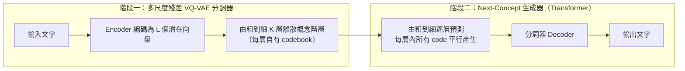

# NCM (Next-Concept Modeling)：快速、平行的由粗到細文字生成

## 摘要

NCM（Next-Concept Modeling，下一個概念建模）是史丹佛大學 Hazy Research 實驗室提出的一種文字生成框架，為擴散語言模型（Diffusion Language Models, DLM）與自迴歸模型之外的另一條路徑[^repo]。其核心主張是：不以「一次生成一個詞元」也不以「反覆對整段序列去雜訊」的方式產生文字，而是學習一組由粗到細（coarse-to-fine）的離散概念階層，逐層平行預測[^paper]。整體上，NCM 在品質與速度上可比或超越最強的擴散基線，同時生成速度提升約 10–31 倍，且訓練所需詞元數減少約 4–5 倍[^blog]。

## 背景與動機

隨著推論（inference）逐漸成為語言模型的主要計算負載，生成速度的重要性日益提升[^paper]。擴散語言模型之所以被看好，是因為它們能平行取樣、比自迴歸模型更快；但論文指出 DLM 有三個明顯限制[^paper]：

1. 當取樣步數（sampling steps）減少時，品質會迅速劣化。
2. 每一步都要處理整段完整序列，成本高昂。
3. 需要多次在資料集上迭代訓練，才能達到良好品質。

NCM 正是為了同時改善這三點而設計：用少量平行步驟達到高品質，並大幅降低訓練與推論成本[^blog]。

## 方法：兩階段框架

NCM 採用兩階段設計，第一階段學出概念階層，第二階段學著逐層生成[^repo]。

### 階段一：多尺度殘差 VQ-VAE 分詞器

此分詞器借鏡影像領域 VAR（Visual Autoregressive Modeling）的「下一尺度預測」概念，並針對文字做調整[^blog]。文字先由編碼器轉為 L 個潛在向量，接著被編碼成一個由粗到細、共 K 層的離散編碼階層；第 k 層的編碼數 ℓ_k 滿足 ℓ₁ < ℓ₂ < … < ℓ_K = L，即越細的層序列越長[^paperhtml]。

每一層的運作方式為[^paperhtml]：

- 將前一層殘差下採樣為 ℓ_k 個向量，並量化（quantize）到第 k 層專屬 codebook 中最接近的項目；
- 該層的重建算子 R_k 再把量化向量映射回長度 L 的貢獻；
- 累加至累積重建：ż^(k) = ż^(k-1) + R_k(...)。

為避免粗層「依賴」細層，訓練時採用**巢狀 dropout（nested dropout）**：隨機選一個截止層 k，只保留前 k 層，迫使較粗的層自身即能承載有意義的資訊[^paperhtml][^blog]。此外，因為單一詞元錯誤就可能改變語意，分詞器加入**詞元層級的重建目標（token-level reconstruction objective）**，以確保文字還原準確[^blog]。

論文報告分詞器品質良好：各資料集的重建準確率約 99.86%–100%（Sudoku 為 100%），codebook 使用率約 62%–90%[^paper]。

### 階段二：Next-Concept 生成器

第二階段凍結分詞器，訓練一個 Transformer 依「先前所有較粗層的累積重建」來預測每一層的編碼[^blog]。關鍵設計包括[^paperhtml][^blog]：

- **單次前向傳播訓練所有層**：以交叉熵損失一次預測全部 K 層。
- **破壞條件編碼（corrupting conditioning codes）**：訓練時將一部分條件編碼替換為同 codebook 中的其他編碼，使生成器對自身誤差具備魯棒性，避免逐層生成時誤差累積。
- **推論時逐層生成、層內平行**：每層所有 code 於一次前向評估中一次產生，故生成只需「每層一次」前向評估（one forward evaluation per level）[^repo]。
- **注意力樣式**：無條件生成使用區塊對角（block-diagonal）注意力；條件生成則採 prefix-LM 注意力樣式[^paperhtml]。

值得一提的是，此處的「概念（concept）」指的是 VQ-VAE 學到的由粗到細離散編碼，而非透過稀疏自編碼器（sparse autoencoder, SAE）找出的概念神經元；NCM 並非可解釋性方法，而是文字生成框架[^paperhtml]。

## 實驗與結果

NCM 在多個任務上與自迴歸及擴散基線比較[^paper]：

### 無條件語言模型

- **LM1B**：生成困惑度（generative perplexity）優於最強 DLM，且快 **21 倍**[^paper]。
- **OpenWebText**：與最強 DLM 具競爭力，且快 **10 倍**[^paper]。
- **TinyStories**：與基線相當，函數評估次數（NFE）少 **11 倍**[^paper]。

### 條件生成

- **極端摘要（XSum）**：在 ROUGE-L 上與最強 DLM 相當，且快 **31 倍**[^paper]。
- **機器翻譯（WMT14 德→英）**：表現相近或更好；搭配分類器無引導（CFG，`--cfg 1.0`）時 BLEU 可進一步提升[^paper][^repo]。

### 推理任務（Sudoku）

NCM 在所有難度層級都勝過自迴歸與擴散基線，且使用更少的函數評估次數[^paper]：

| 難度 | 自迴歸基線 | 最佳 DLM（FMLM+） | NCM |
|------|-----------|-------------------|-----|
| 簡單 | 13.9% | 97.7% | **99.5%** |
| 中等 | 5.1% | 92.8% | **96.5%** |
| 困難 | 1.0% | 81.3% | **86.1%** |

### 訓練效率與擴展性

- 在 LM1B 與 OpenWebText 上，訓練詞元數分別約少 **4.9 倍**與 **4 倍**（已計入分詞器與生成器雙方訓練）[^blog]。
- 模型規模測試涵蓋 **97M、317M、725M** 參數，生成困惑度隨規模穩定改善[^paper]。
- 測試時擴展（test-time scaling）：以最小貝氏風險（MBR）解碼多個候選，可提升 WMT14 的 BLEU 與 XSum 的 ROUGE；因生成速度快，能在相同預算內產生更多候選[^paper]。

## 開源資源

NCM 以 MIT 授權釋出程式碼[^repo]：

- **GitHub**：`https://github.com/HazyResearch/ncm`，約 925 顆星[^repo][^agentfetch]。
- **模型與資料**：權重與分詞後的資料集託管於 Hugging Face 集合 `hazyresearch/ncm`，每個模型由凍結的分詞器與一個生成器組成；涵蓋 XSum、WMT14、Sudoku（easy/medium/hard）、LM1B（small/medium/large，共用分詞器）、TinyStories、OpenWebText[^repo]。
- **環境需求**：Python 3.10 以上與支援 CUDA 的 PyTorch[^repo]。
- **評估**：`python evaluate.py --config config/eval/<task>.yaml ...`，於可見 GPU 上各跑一個生成分片再合併評分[^repo]。

## 批判性反思

- **來源權威性**：主要來源為論文（arXiv）、Hazy Research 官方部落格與官方 GitHub，皆屬第一手且彼此一致；凡數字（如 21 倍、31 倍、4.9 倍）在論文摘要與 README 中可互相印證[^paper][^repo][^blog]。
- **潛在偏誤**：部落格與 README 由作者團隊撰寫，屬自我報告，速度與品質主張應以第三方複現為準；文中亦承認「generative perplexity 未必完整反映生成品質」，顯示評估指標本身存在局限[^blog]。
- **時效性**：論文於 2026-10-09 投稿，屬非常新的工作，社群複現與獨立評測仍少[^paper]。
- **理解澄清**：網路檢索過程中曾出現將 NCM 誤認為使用稀疏自編碼器（SAE）的說法，經核對論文 HTML 與官方說明後確認並非如此，NCM 的核心表示學習元件為多尺度殘差 VQ-VAE[^paperhtml]。

## 參考資料

[^repo]: HazyResearch. (2026). NCM: Next Concept Modeling [GitHub repository]. Retrieved 2026-10-23, from https://github.com/HazyResearch/ncm
[^paper]: Kumbong, H., Khare, I. S., Mlauzi, I., Woen, A., Ding, C., Buchanan, E. K., Arora, S., Mirhoseini, A., & Ré, C. (2026, October 9). Next-Concept Modeling: Fast, Parallel Coarse-to-Fine Text Generation. arXiv:2610.14162 [cs.CL]. Retrieved 2026-10-23, from https://arxiv.org/abs/2610.14162
[^paperhtml]: Kumbong, H., Khare, I. S., Mlauzi, I., Woen, A., Ding, C., Buchanan, E. K., Arora, S., Mirhoseini, A., & Ré, C. (2026). Next-Concept Modeling: Fast, Parallel Coarse-to-Fine Text Generation (HTML version). arXiv:2610.14162v1. Retrieved 2026-10-23, from https://arxiv.org/html/2610.14162v1
[^blog]: Hazy Research. (2026, October 12). Next-Concept Modeling: Fast, Parallel Coarse-to-Fine Text Generation. Retrieved 2026-10-23, from https://hazyresearch.stanford.edu/blog/2026-10-12-ncm
[^agentfetch]: Hazy Research. (n.d.). NCM repository statistics. Retrieved 2026-10-23, from https://github.com/HazyResearch/ncm
