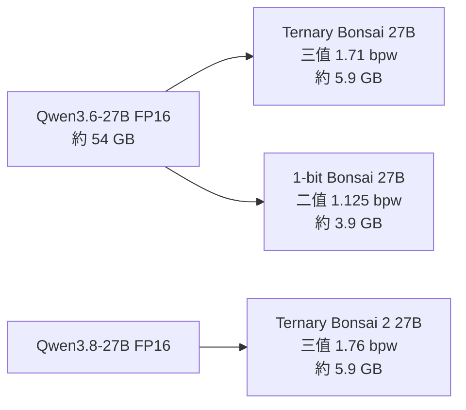

# Bonsai 27B 效能研究報告

## 摘要

Bonsai 27B 是 PrismML（Prism ML）於 2026 年 7 月 14 日發表的 27B 級開源多模態語言模型家族，其核心主張是將 Qwen3.6-27B 的權重壓縮為 1-bit（二值）與 ternary（三值）形式，使 27B 級模型首次能在手機與一般筆電上執行[^p1]。2026 年 9 月 17 日，PrismML 進一步發表基於 Qwen3.8-27B 的「Ternary Bonsai 2 27B」，宣稱在約 9 倍更小的體積下保留 98.2% 的整體基準效能[^p2]。

本報告聚焦「效能」（performance）一詞的兩個面向：其一為**基準測試準確度**（benchmark accuracy），其二為**推論吞吐量與記憶體足跡**（throughput / memory footprint）。報告同時納入兩份獨立第三方評測，以與廠商自報數字對照，並指出兩者差異。

## 1. 模型基本規格

| 版本 | 發表日 | 基礎模型 | 權重格式 | 有效位元寬 | 模型體積 | 最大上下文 |
|---|---|---|---|---|---|---|
| 1-bit Bonsai 27B | 2026-07-14 | Qwen3.6-27B | 二值 {−1,+1}，FP16 群組縮放 | 1.125 bpw | 約 3.9 GB | 262,144 tokens |
| Ternary Bonsai 27B | 2026-07-14 | Qwen3.6-27B | 三值 {−1,0,+1}，FP16 群組縮放 | 1.71 bpw | 約 5.9 GB | 262,144 tokens |
| Ternary Bonsai 2 27B | 2026-09-17 | Qwen3.8-27B | 三值 {−1,0,+1}，FP16 群組縮放 | 1.76 bpw（出貨 PTQ1_0 為 1.75） | 約 5.9 GB | 262,144 tokens |

_資料來源：PrismML 官方發表文與官方文件_[^p1][^p2]。三者皆採 Apache 2.0 授權[^p1]。Ternary Bonsai 2 27B 的參數總量為 27.36B（語言主幹 24.35B、嵌入與 LM head 2.54B、視覺塔 0.46B），架構為混合注意力（約 75% 線性 / 25% 全注意力）、SwiGLU MLP、RoPE 與 RMSNorm[^doc]。

官方說明其低位元表示法「端到端」套用於語言網路、嵌入、注意力、MLP 與 LM head，沒有保留高精度通道（no higher-precision escape hatches）[^p1]。

## 2. 基準測試準確度（廠商自報）

### 2.1 Bonsai 27B（2026 年 7 月版）

PrismML 以 15 項基準、採 thinking 模式評測，宣稱 Ternary 版本保留全精度基線的 95%、1-bit 版本保留 90%[^p1]。分類結果如下：

| 能力分類（基準項目） | Qwen3.6-27B | Ternary Bonsai 27B | 1-bit Bonsai 27B |
|---|---|---|---|
| 數學（GSM8K, MATH-500, AIME25, AIME26） | 95.3 | 93.4 | 91.7 |
| 程式（HumanEval+, MBPP+, LiveCodeBench） | 88.7 | 86.0 | 81.9 |
| 代理與工具呼叫（BFCL v3, TauBench） | 80.0 | 74.0 | 66.0 |
| 指令遵循（IFEval, IFBench） | 78.4 | 71.8 | 65.8 |
| 知識 / STEM（MMLU-Redux, MuSR） | 83.1 | 77.0 | 73.4 |
| 視覺（MMMU Pro, OCRBench） | 72.6 | 65.2 | 59.6 |
| **整體（15 項）** | **85.0** | **80.5** | **76.1** |

_資料來源：PrismML 官方發表文_[^p1]。官方指出數學與程式能力幾乎未受影響，工具呼叫亦僅落後數點；但視覺與指令遵循的相對落幅較大[^p1]。

### 2.2 Ternary Bonsai 2 27B（2026 年 9 月版）

Bonsai 2 27B 宣稱整體 83.9 分，保留 Qwen3.8-27B 全精度版本的 98.2%[^p2]。

| 能力分類（基準項目） | Ternary Bonsai 2 27B | Qwen3.8-27B | Qwen3.6-27B |
|---|---|---|---|
| 代理與工具呼叫（τ²-bench, BFCLv3） | 77.5 | 79.74 | 80.05 |
| 程式（HumanEval+, LiveCodeBench v6, MBPP+, BigCodeBench） | 81.58 | 82.17 | 82.57 |
| 指令遵循（IFBench, IFEval） | 82.66 | 81.25 | 74.53 |
| 知識與推理（MMLU-Redux, GPQA Diamond, AA-LCR） | 83.95 | 86.66 | 84.71 |
| 數學（AIME 2026, AIME 2025, GSM8K, MATH-500） | 96.57 | 97.06 | 94.64 |
| 視覺（CharXiv, A-OKVQA, OmniDocBench v1.6, RealWorldQA, OCRBench v2） | 78.59 | 81.64 | 79.82 |
| **整體** | **83.9** | **85.4** | **83.6** |

_資料來源：PrismML 官方發表文_[^p2]。官方將自 95% 提升至 98.2% 的保留率形容為「近乎無損」（practically lossless）[^p2]。

## 3. 吞吐量與硬體足跡（廠商自報）

官方公布的速度與裝置對應如下[^p1][^p2]：

| 裝置 | 1-bit Bonsai 27B | Ternary Bonsai 27B | Ternary Bonsai 2 27B |
|---|---|---|---|
| NVIDIA GeForce RTX 5090 | 最高 163 tok/s | 最高 134 tok/s | 最高 143 tok/s |
| Apple M5 Max | 最高 87 tok/s | 最高 58 tok/s | 最高 46.8 tok/s |
| iPhone 17 Pro Max | 約 11 tok/s（示範模式） | 過大無法執行 | — |

官方另指出，1-bit 版本於 iPhone 17 Pro 可運行；12 GB iPhone 實際僅約提供 6 GB 給模型使用，需與 KV cache 及活化值共享[^p1]。Ternary Bonsai 2 27B 在 RTX 4090 上每 token 耗能 0.714 mWh，官方稱較全精度 8B 模型節能 40%[^p2]。

## 4. 獨立第三方評測

### 4.1 16 GB 顯示卡獨立基準（Astezelex）

一份獨立評測將 Ternary Bonsai 27B（1.71 bpw、7.17 GB）與 Qwen3.6-27B UD-IQ2_XXS（9.39 GB）在單張 RTX 5060 Ti 16 GB 上對比[^ind1]。該研究批評廠商表格將「不知道」與「未在預算內收斂」兩種失敗混為單一分數，並提出應同時報告準確率與「封頂率」（cap rate）的 `score@budget` 方法[^ind1]。

| 指標 | Bonsai 27B Q2_0（三值） | Qwen3.6-27B UD-IQ2_XXS |
|---|---|---|
| AIME26（60k 預算，n=30） | 0.867（3 題封頂、1 題錯誤） | 0.633（11 題封頂、0 題錯誤） |
| MMLU-Redux（n=342，8k） | 0.871（6 題封頂） | 0.860（18 題封頂） |
| LiveCodeBench（n=50，14k） | 0.520 | 0.300 |
| 解碼速度（tg128，各自最佳引擎） | 44.4 tok/s | 35.8 tok/s |
| 解碼速度 + DSpark Q4_1 drafter | 79.1 tok/s（僅單流） | 不適用 |
| 4k 上下文、f16 KV 之 VRAM | 7,627 MiB | 9,999 MiB |
| 16 GB 內最大上下文 | 262k @ 12.9 GiB（q4 KV） | 約 100k 無法放入 |
| 單次 AIME26 全程 GPU 耗能 | 約 1,177 Wh | 約 2,146 Wh |
| 每題解出耗能（AIME / LCB） | 約 45 / 13.8 Wh | 約 113 / 35.3 Wh |

_資料來源：獨立評測 repo_[^ind1]。該研究強調，知識面上兩者為統計平手（MMLU p=0.737），Bonsai 的優勢主要來自「收斂效率」而非更優知識；同時指出該 repo 之執行由 AI 輔助設計、經人工監督，所有數字可自其腳本重現[^ind1]。

### 4.2 GeoRefine 保真度研究（Tsotchke Corporation）

另一份獨立研究以「GeoRefine」品質閘（quality gates）檢驗 Bonsai-2 PQ2_0 相對其 BF16 父模型的行為保真度，量測窗口為 2026 年 9 月 22–25 日[^ind2]。

效率方面，於 RTX PRO 6000 Blackwell 上、batch-1 控制條件下，Bonsai-2 PQ2_0 解碼為 126.54 tok/s，父模型 F16 為 27.74 tok/s（4.56 倍）；32k 上下文的常駐記憶體由 50.7 GiB 降至 9.4 GiB（少 5.4 倍）[^ind2]。前處理（prefill）速度則幾乎相同（4,014 對 3,854 tok/s）[^ind2]。

品質方面，該研究在關閉推理（reasoning off）的配對評測中測得多項落後[^ind2]：

| 評測（關閉推理） | 父模型 | Bonsai-2 PQ2_0 | 配對差異 95% CI |
|---|---|---|---|
| GSM8K strict（1,319 題） | 97.3% | 95.3% | −2.0 [−3.0, −1.1] |
| IFEval prompt-strict（541 題） | 82.3% | 78.9% | −3.3 [−6.7, 0.0] |
| MMLU（5,700 題） | 84.5% | 79.1% | −5.33 [−6.18, −4.49] |
| MBPP+（378 題） | 77.0% | 74.1% | −2.9 [−5.6, −0.3] |

_資料來源：獨立保真度研究_[^ind2]。在開啟 thinking 模式時，GSM8K、IFEval、HumanEval+、MBPP+ 四項任務的配對差異均未達統計顯著，但該研究明確表示這**不等同於**證明了等價性，區間仍允許例如 MBPP+ 5.3 點的損失[^ind2]。其結論是：Bonsai-2 達到「異常強」的體積與解碼效率點，但未通過其訂定的父模型保真閘檻[^ind2]。

## 5. 來源批判與限制

1. **廠商數字未經獨立稽核**：發表當日的所有基準皆為 PrismML 自行報告；Astezelex 的獨立評測即表明，其存在目的正是因為「當 Bonsai 27B 出貨時，廠商之外沒有任何獨立數字」[^ind1]。
2. **整體平均掩蓋能力落差不均**：官方自身分類表顯示，1-bit 版本在代理工具呼叫（66.0 對 80.0）與視覺（59.6 對 72.6）的落幅遠大於數學與程式[^p1]。因此「約 90% 保留率」的標題會低估這些領域的實際退化。
3. **數字高度依賴 token 預算**：Astezelex 指出，思考型模型在固定預算下可能「未收斂」而非「答錯」；同一組權重會因未言明的預算而呈現「崩潰」或「勝出」的不同故事[^ind1]。
4. **獨立樣本量與硬體差異**：兩份獨立研究的樣本數（n=30 至 5,700）與硬體互不相同，不能與廠商數字直接跨表相加；Tsotchke 亦聲明兩代模型父模型與分詞器不同，絕對分數不應合併[^ind2]。
5. **執行環境差異**：Ternary Q2_0 的 CUDA 執行目前需要 PrismML 的 llama.cpp 分支，mainline 僅支援 CPU/Metal；這使與其他模型的直接對比存在工程摩擦[^ind1]。
6. **來源權威性與人氣**：兩份獨立研究 repo 星數偏低（Astezelex 9 顆星、Tsotchke 2 顆星），惟此議題屬新興且高度技術性，故仍納入並附上脈絡。相對地，官方 `PrismML-Eng/Bonsai-demo` repo 有 3,435 顆星，Hugging Face 上的 Ternary-Bonsai-27B-gguf 頁面約有 1.43k 次按讚[^gh][^hf]。

## 6. 結論

就**準確度**而言，Bonsai 27B 家族在數學與程式任務上接近其全精度父模型：2026 年 7 月版 Ternary 整體約為基線的 95%，9 月版 Bonsai 2 27B 約為 98.2%[^p1][^p2]。然而代理工具呼叫、視覺與指令遵循是退化最明顯的領域，獨立評測亦觀察到較廠商平均值更大的落差[^ind1][^ind2]。

就**吞吐量與足跡**而言，成果相當突出：約 3.9 GB 的 1-bit 版本可在 iPhone 上執行，約 5.9 GB 的三值版本可在筆電 GPU 上達到數十 tok/s；獨立量測在 RTX 5060 Ti 16 GB 上得到 44.4 tok/s、在 RTX PRO 6000 上得到 126.54 tok/s，並證實每題耗能約為同級傳統低位元量化模型的一半以下[^ind1][^ind2]。

綜合而言，Bonsai 27B 是一項真實的壓縮工程成就，但在採信廠商的「約 90% / 95% / 98.2% 保留率」宣稱時，應注意其為廠商自報、經平均、且對 token 預算與評測設定敏感；獨立數字普遍較廠商數字低且變異更大。

## 參考文獻

[^p1]: PrismML. (2026, July 14). _Announcing Bonsai 27B: The first 27B-class model to run on a phone_. Retrieved 2026-10-23, from https://prismml.com/news/bonsai-27b
[^p2]: PrismML. (2026, September 17). _Introducing Bonsai 2 27B: Near-lossless compression in a 9x smaller footprint_. Retrieved 2026-10-23, from https://prismml.com/news/bonsai-2-27b
[^doc]: PrismML. (n.d.). _Ternary Bonsai 2 27B_. Retrieved 2026-10-23, from https://docs.prismml.com/models/bonsai-2-27b
[^ind1]: Astezelex. (2026). _16 GB bench-in-a-box: Independent quality anchors for heavily quantized LLMs_ (bonsai-27b-16gb-bench). Retrieved 2026-10-23, from https://github.com/Astezelex/bonsai-27b-16gb-bench
[^ind2]: Tsotchke Corporation. (2026, September). _What ternary keeps, and what it loses: An independent evaluation of Prism ML's Bonsai 27B models_ (bonsai-fidelity-study). Retrieved 2026-10-23, from https://github.com/Tsotchke-Corporation/bonsai-fidelity-study
[^gh]: PrismML-Eng. (n.d.). _Bonsai-demo_. Retrieved 2026-10-23, from https://github.com/PrismML-Eng/Bonsai-demo
[^hf]: PrismML. (n.d.). _Ternary-Bonsai-27B-gguf_. Retrieved 2026-10-23, from https://huggingface.co/prism-ml/Ternary-Bonsai-27B-gguf
