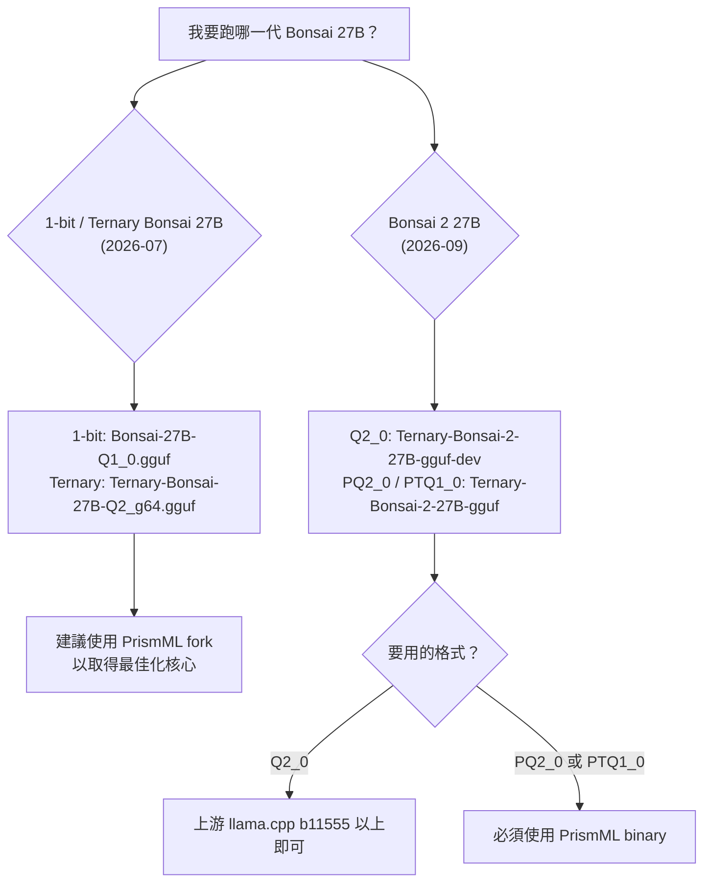

# 如何在 llama.cpp 上執行 Bonsai 27B

## 摘要

Bonsai 是由 Prism ML (PrismML) 發表的超低位元 (1-bit 二元權重與 1.58-bit 三元權重) 開放權重模型家族，其中 27B 版本以 Qwen3.6-27B、Bonsai 2 系列則以 Qwen3.8-27B 為基礎模型[^card]。其設計目標是讓 27B 等級的推理能力可以在一般筆電、單張消費級 GPU，甚至在手機上執行[^card]。本文說明在 llama.cpp 上執行 Bonsai 27B 的完整流程，包含前置準備、取得執行檔、下載 GGUF 權重、命令列與伺服器模式指令、格式與版本對照，以及取樣參數建議。

必須先釐清一件容易混淆的事：**「Bonsai 27B」在不同時間點代表不同的模型世代**，而它們所需的 llama.cpp 版本與 GGUF 格式並不相同。若使用錯誤的組合，模型會載入成功但輸出亂碼[^formats]。

| 世代 | 發表時間 | 基礎模型 | 27B 的 GGUF 格式 | 需要的執行檔 |
| :--- | :--- | :--- | :--- | :--- |
| 1-bit / Ternary Bonsai 27B | 2026-07-14 | Qwen3.6-27B | `Q1_0_g128` (1-bit，約 3.9 GB)、`Q2_0_g64` (三元，約 6.66 GiB) | 官方上游 llama.cpp 可用，但 PrismML fork 提供最佳化核心 |
| Bonsai 2 27B | 2026-09-17 | Qwen3.8-27B | `PQ2_0` (7.21 GB)、`PTQ1_0` (5.95 GB)、`Q2_0` (7.63 GB) | `Q2_0` 用上游 `b11555` 以上；`PQ2_0`/`PTQ1_0` 需 PrismML fork |

## 一、Bonsai 27B 是什麼

Bonsai 家族由 PrismML 開發，該公司由 Caltech 研究者創立，並獲得 Khosla Ventures、Cerberus 與 Google 支持[^prism]。模型的核心特點如下：

- **極低的有效位元寬**：1-bit Bonsai 27B 以真正的 1.125 bits/weight 儲存，權重為單一符號位，每 128 個權重共用一個 FP16 縮放係數[^card]。
- **端到端低位元**：嵌入層、注意力投影、MLP 投影與 LM head 皆為低位元，並非只有部分層低位元[^card]。
- **混合注意力骨幹**：約 75% 線性注意力、約 25% 全注意力，使其在裝置端仍能維持 262K token 的上下文[^card]。
- **多模態**：27B 版本支援文字與圖像輸入、文字輸出；視覺塔以 HQQ 4-bit 量化，模型卡指出其為選用的 mmproj 檔 (約 0.63 GB)，僅在需要圖片輸入時載入[^card]。
- **授權**：Apache 2.0[^card]。

27B 系列的部署足跡與品質取捨如下表所示。1-bit 版本約 3.9 GB，保留約 89.5% 的 FP16 平均表現；三元版本約 5.9 GB，保留約 94.6%[^card]。Bonsai 2 27B 則進一步將保留率提高到 98.2%[^demo]。

### 記憶體需求 (語言模型本體，FP16 KV cache)

Bonsai 27B 的實際記憶體需求會隨上下文長度大幅變化。以 1-bit Bonsai 27B 為例，實測峰值如下[^bonsai1]：

| 格式 | 權重 | 4K 上下文 | 10K 上下文 | 100K 上下文 |
| :--- | ---: | ---: | ---: | ---: |
| 1-bit Bonsai 27B (`Q1_0`) | 3.53 GiB | 4.8 GiB | 5.2 GiB | 10.8 GiB |
| Ternary Bonsai 27B (`Q2_0`) | 6.66 GiB | 7.8 GiB | 8.1 GiB | 13.7 GiB |
| *參考：27B 16-bit (GGUF BF16)* | 47.73 GiB | 49 GiB | 49.6 GiB | 55.2 GiB |
| *參考：27B「4-bit」(UD Q4_K_M)* | 15.73 GiB | 17.2 GiB | 17.6 GiB | 23.2 GiB |

FP16 KV cache 約為每 token 64 KiB，在 100K token 時約 6.3 GiB；啟用選用的 4-bit KV cache 後可降至約每 token 18 KiB、100K 時約 1.8 GiB[^bonsai1]。



## 二、前置準備

在開始之前，請確認以下條件：

1. **llama.cpp 版本**：若使用 Bonsai 2 的 `Q2_0` 格式，上游版本必須為 `b11555` 或更新；早於此版本的 llama.cpp 會認得 `Q2_0` 型別與 Qwen3.5 架構，但缺少必要的 Hadamard 轉換，因此會**載入成功但輸出亂碼，且不會有任何錯誤訊息**[^formats]。`PQ2_0` 與 `PTQ1_0` 在上游版本會被直接拒絕為未知型別，因此不會產生亂碼[^formats]。
2. **執行檔**：`PQ2_0`、`PTQ1_0` 以及 MTP、DFlash2 推測解碼器都需要 PrismML 的 llama.cpp 分支，該分支等同於上游加上這些核心[^formats]。
3. **硬體後端**：PrismML binary 涵蓋 CPU、Metal、CUDA、ROCm/HIP、Vulkan 與 SYCL；在 Vulkan 與 SYCL 上 `PQ2_0`/`PTQ1_0` 核心存在，但核心選擇取決於裝置與驅動程式[^formats]。
4. **下載工具**：Hugging Face 權重可透過 `hf` CLI (huggingface_hub) 取得，公開 checkpoint 不需 token[^demo]。

## 三、方法一：使用官方 Demo 腳本 (最省事)

PrismML 提供 `Bonsai-demo` 倉庫，會自動偵測平台、下載對應的 binary 與權重。倉庫目前有 928 個以上的 like，屬於官方維護的整合入口[^card][^repo]。

### macOS / Linux

```bash
git clone https://github.com/PrismML-Eng/Bonsai-demo.git
cd Bonsai-demo
./setup.sh
```

`setup.sh` 會在執行時下載 Bonsai 2 27B 的 `PQ2_0` 權重與對應的 fork binary，並一併設定 Open WebUI 與程式碼解譯器；後兩者可透過 `BONSAI_OPENWEBUI=0` 與 `BONSAI_CODE_INTERPRETER=0` 跳過以節省時間與空間[^demo]。接著啟動伺服器並開啟 `http://localhost:8080`：

```bash
./scripts/start_llama_server.sh
```

或直接從終端機問一個問題，不需啟動伺服器：

```bash
./scripts/run_llama.sh -p "What is the capital of France?"
```

### 選擇其他世代或尺寸

Demo 預設為 Bonsai 2 27B。若要執行先前的 1-bit 或三元 27B，需在**setup 與後續啟動指令中都**設定環境變數，因為若在新終端機中未設定，腳本會改選 Bonsai 2[^bonsai1]：

```bash
export BONSAI_FAMILY=bonsai   # 1-bit；三元則用 ternary
export BONSAI_MODEL=27B       # 或 8B、4B、1.7B
./setup.sh
./scripts/start_llama_server.sh
```

### Windows (PowerShell)

```powershell
git clone https://github.com/PrismML-Eng/Bonsai-demo.git
cd Bonsai-demo
Set-ExecutionPolicy -Scope Process -ExecutionPolicy Bypass
.\setup.ps1
```

接著：

```powershell
.\scripts\start_llama_server.ps1
```

### 實用環境變數

| 變數 | 預設 | 用途 |
| :--- | :--- | :--- |
| `BONSAI_MODEL` | `27B` | 選擇模型尺寸 |
| `BONSAI_FAMILY` | `bonsai2` | 選擇世代 (`bonsai`、`ternary`、`bonsai2`) |
| `BONSAI_NGL` | 自動偵測 | GPU 層卸載；`0` 表示純 CPU |
| `BONSAI_CTX` | 依 RAM 分級自動 | 上下文長度，最大 `262144` |
| `BONSAI_KV4` | `0` | 設為 `1` 啟用 4-bit KV cache |
| `BONSAI_HOST` | `127.0.0.1` | 伺服器綁定位址 |

這些變數的完整清單見官方 `environment_variables.md`[^demo]。

## 四、方法二：手動以 llama.cpp 執行

### 步驟 1：取得執行檔

**方式 A — 下載預編譯 binary。** 從 PrismML 的 llama.cpp 最新 release 選擇對應平台壓縮檔[^docs]：

```bash
tar -xzf llama-<tag>-bin-<platform>.tar.gz -C bin --strip-components=1
```

`prism-b10777-e3de715` 這個 release 涵蓋 macOS (Apple Silicon Metal / KleidiAI CPU / Intel x64)、Linux x64 (CPU、CUDA 12.4/12.8/13.3、Vulkan、ROCm 7.2、SYCL)、Linux arm64、Windows x64、Windows arm64、Android arm64 與 iOS XCFramework[^formats]。

**方式 B — 從原始碼建置。** 若要使用 `PQ2_0`、`PTQ1_0` 或推測解碼器，使用 PrismML 分支[^docs]：

```bash
git clone https://github.com/PrismML-Eng/llama.cpp
cd llama.cpp
cmake -B build -DCMAKE_BUILD_TYPE=Release   # 依下方加入後端旗標
cmake --build build -j
```

若只需要 `Q2_0`，可使用上游版本[^docs]：

```bash
git clone https://github.com/ggml-org/llama.cpp
cd llama.cpp
cmake -B build -DCMAKE_BUILD_TYPE=Release
cmake --build build -j
```

| 目標後端 | CMake 旗標 |
| :--- | :--- |
| CUDA | `-DGGML_CUDA=ON` |
| Metal | `-DGGML_METAL=ON` (macOS 預設開啟) |
| Vulkan | `-DGGML_VULKAN=ON` |
| ROCm / HIP | `-DGGML_HIP=ON` |

注意：以 CUDA 建置相當耗用記憶體，較低 VRAM 的機器建議降低 `-j` 平行度[^docs]。

### 步驟 2：下載 GGUF 權重

**1-bit Bonsai 27B (Qwen3.6 基礎)**：

```bash
hf download prism-ml/Bonsai-27B-gguf Bonsai-27B-Q1_0.gguf --local-dir .
```

模型卡本身提供的最短路徑是直接使用 `-hf` 旗標，讓 llama.cpp 自動下載並快取：

```bash
llama serve -hf prism-ml/Bonsai-27B-gguf:F16
llama cli   -hf prism-ml/Bonsai-27B-gguf:F16
```

**Ternary Bonsai 27B (Qwen3.6 基礎)**：官方群組 64 的檔案在 27B 上命名為 `Ternary-Bonsai-27B-Q2_g64.gguf`，可在主線 llama.cpp 上執行；`Ternary-Bonsai-27B-PQ2_0.gguf` 則約小 6%，但需 fork 且後端需有對應核心[^modelformats]。

**Bonsai 2 27B (Qwen3.8 基礎)**：

```bash
# PQ2_0 (demo 預設，prompt 處理較快)
hf download prism-ml/Ternary-Bonsai-2-27B-gguf --include "*PQ2_0*"
# PTQ1_0 (檔案最小)
hf download prism-ml/Ternary-Bonsai-2-27B-gguf --include "*PTQ1_0*"
# Q2_0 (可搭配上游 llama.cpp)
hf download prism-ml/Ternary-Bonsai-2-27B-gguf-dev
```

後者 (`-dev` 倉庫) 存放 27B 的 `Q2_0` 檔案[^formats]。

### 步驟 3：命令列推論

**1-bit Bonsai 27B (CUDA)**[^card]：

```bash
./build/bin/llama-cli \
    -m Bonsai-27B-Q1_0.gguf \
    -p "Explain quantum computing in simple terms." \
    -n 256 \
    --temp 0.7 --top-p 0.95 --top-k 20 \
    -ngl 99
```

**1-bit Bonsai 27B (macOS Metal)**：建置方式相同但採 Metal 預設，其餘指令一致[^card]。

**Bonsai 2 27B**[^docs]：

```bash
./llama-cli -m Ternary-Bonsai-2-27B-PQ2_0.gguf -ngl 99 -fa on -c 32768 \
  --temp 1.0 --top-p 0.95 --top-k 20 --min-p 0.05 \
  -p "What is the capital of France?" -n 16384
```

關於參數的幾點提醒：

- **務必明確指定 `-c`**。單獨使用 `-c 0` 會使用模型完整的 262K 訓練上下文，而不考慮可用記憶體，可能耗盡記憶體；demo 腳本改採依 RAM 分級的安全預設值[^docs]。
- `-n 16384` 是為了留給思考 (thinking) 痕跡的空間。上限設得太小會讓生成在思考中途被截斷，導致還沒產出答案就結束[^docs]。
- `-ngl 99` 表示將所有層卸載至 GPU，`0` 則為純 CPU[^docs]。
- `--mmproj` 啟用圖像輸入，`--jinja` 在伺服器上啟用原生 OpenAI 風格 `tool_calls`[^docs]。

### 步驟 4：啟動 OpenAI 相容伺服器

**Bonsai 2 27B**[^docs]：

```bash
./llama-server -m Ternary-Bonsai-2-27B-PQ2_0.gguf \
  -ngl 99 -fa on -c 32768 --jinja \
  --host 0.0.0.0 --port 8080 \
  --temp 1.0 --top-p 0.95 --top-k 20 --min-p 0.05
```

**1-bit Bonsai 27B**[^card]：

```bash
./build/bin/llama-server \
    -m Bonsai-27B-Q1_0.gguf \
    --host 0.0.0.0 --port 8080 -ngl 99
```

啟動後可開啟內建 Web UI `http://127.0.0.1:8080`，或直接以 OpenAI 相容 API 呼叫[^card]。

## 五、取樣參數建議

官方針對 27B 提供的建議設定如下 (思考模式為預設)[^demo]：

| 參數 | 思考模式 (預設) | Instruct / 非思考 |
| :--- | :--- | :--- |
| `temperature` | 1.0 | 0.7 |
| `top_p` | 0.95 | 0.80 |
| `top_k` | 20 | 20 |
| `min_p` | 0.05 | 0.0 |
| `presence_penalty` | 0.0 | 1.5 |
| `repetition_penalty` | 1.0 | 1.0 |

1-bit Bonsai 27B (第一代 27B) 的模型卡則列出 temperature 0.7、top-p 0.95、top-k 20，並說明這是所有報告基準測試 (思考模式) 使用的設定[^card]。兩者差異反映的是不同世代與不同思考模式的取樣策略，使用時應以對應模型頁面的建議為準。

另有兩點值得注意[^demo]：

- 模型預設使用 `xhigh` 推理強度；若要較短的回覆並在速度與準確度之間取得平衡，可使用 `medium`。`low` 推理強度不被支援，選用時模型行為會接近 `xhigh`。
- `min_p` 預設值即為 0.05；在官方測試中，`min_p=0.05` 的表現至少與 `min_p=0.0` 相當，且更可靠地遵循指令。

## 六、推測解碼 (Speculative Decoding)

第一代的 1-bit 與三元 27B 搭配 DSpark drafter 可加速解碼：在 L40S (CUDA) 上實測，三元 27B 約快 1.8-2.4 倍，1-bit 27B 約快 1.4-1.75 倍，視工作負載而定 (程式碼與數學最佳)。但在 Apple Silicon (Metal) 上僅對三元版本的程式碼/數學工作有約 1.2 倍的效益，其餘情況會變慢，因此 Mac 上建議關閉[^bonsai1]。啟用方式為設定 `BONSAI_SPECULATIVE=1`，且需使用 demo 提供的 binary[^bonsai1]。

Bonsai 2 的 9B 與 4B 版本附有兩種選用 drafter (MTP 為推薦選項、DFlash2 適合大量複製的工作如程式碼編輯)，但**Bonsai 2 27B 目前尚未發布官方 drafter**，啟動器會發出警告並在無推測解碼的情況下執行[^bonsai1]。1-bit Bonsai 27B 模型卡則提到它隨附一個針對該目標訓練的 DSpark drafter 層，在 CUDA 服務路徑上可帶來無損的 1.37 倍解碼加速[^card]。

## 七、常見問題

| 現象 | 可能原因 | 處理方式 |
| :--- | :--- | :--- |
| 輸出亂碼、無錯誤訊息 | 使用早於 `b11555` 的 llama.cpp 讀取 Bonsai 2 的 `Q2_0`，缺少 Hadamard 執行期 | 升級至 `b11555` 以上，或改用 PrismML binary[^formats] |
| 出現「legacy Prism Q2_0 layout」錯誤 | 使用了已棄用的舊 `Q2_0` (group size 128 存於型別 id 42) | 改用同倉庫的 `PQ2_0` 或 `_g64` 檔案[^modelformats] |
| 啟動時配置大量記憶體或系統凍結 | 上下文設得過大或 `-c 0` | 明確指定 `-c`，或設定 `BONSAI_CTX`[^docs] |
| `PQ2_0` 在上游版本被拒絕為未知型別 | `PQ2_0` 是 PrismML 自有的 ggml 型別 | 改用 `Q2_0`，或改用 PrismML binary[^formats] |
| 使用 LM Studio / Ollama 等自帶引擎的 App 失敗 | 這些 App 綁定自己的 llama.cpp 或 MLX 執行期 | 需等到 App 更新，或先以 demo 的伺服器執行再讓 App 指向該端點[^formats] |

## 八、結論

若只是想在 llama.cpp 上快速跑起 Bonsai 27B，最有效率的路徑是使用官方 `Bonsai-demo` 倉庫的 `setup.sh` 與啟動腳本，它會自動處理平台偵測、binary 與權重下載。若要自行掌控，最關鍵的判斷是「世代 × 格式 × 執行檔版本」必須相符：第一代 27B 建議使用 PrismML fork 以取得最佳化核心；Bonsai 2 27B 的 `Q2_0` 可用上游 `b11555` 以上，但 `PQ2_0` 與 `PTQ1_0` 必須使用 PrismML binary。由於最低位元的模型對執行期實作高度敏感，出現異常輸出時應優先檢查 llama.cpp 版本，而非取樣參數。

## 參考文獻

[^card]: Prism ML. (2026, July). *1-bit Bonsai 27B — GGUF* [Model card]. Retrieved 2026-10-23, from https://huggingface.co/prism-ml/Bonsai-27B-gguf

[^demo]: Prism ML. (n.d.). *Bonsai demo* [README]. Retrieved 2026-10-23, from https://github.com/PrismML-Eng/Bonsai-demo

[^bonsai1]: Prism ML. (n.d.). *Bonsai 1: binary and ternary models* [README]. Retrieved 2026-10-23, from https://github.com/PrismML-Eng/Bonsai-demo/blob/main/Bonsai1_README.md

[^docs]: Prism ML. (n.d.). *llama.cpp*. Retrieved 2026-10-23, from https://docs.prismml.com/run/llamacpp

[^formats]: Prism ML. (n.d.). *Formats & runtime support*. Retrieved 2026-10-23, from https://docs.prismml.com/download/formats

[^modelformats]: Prism ML. (n.d.). *Ternary model formats and the prism-v7 migration* [README]. Retrieved 2026-10-23, from https://github.com/PrismML-Eng/Bonsai-demo/blob/main/MODEL-FORMATS.md

[^prism]: Prism ML. (n.d.). *PrismML website*. Retrieved 2026-10-23, from https://prismml.com

[^repo]: Prism ML. (n.d.). *PrismML-Eng/llama.cpp* [GitHub repository]. Retrieved 2026-10-23, from https://github.com/PrismML-Eng/llama.cpp
