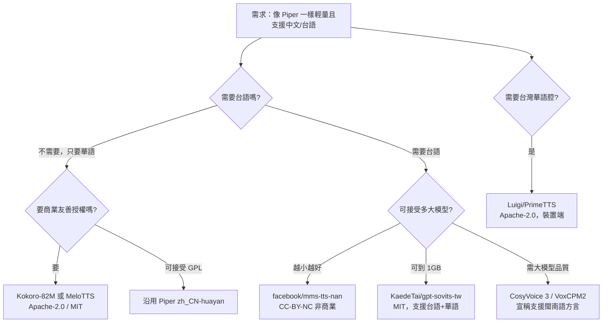

# Piper 之外：支援中文／華語／台語的小型文字轉語音（TTS）方案調查

## 摘要

Piper 是一套主打「快速、可離線、可在單板電腦或一般 CPU 上執行」的神經網路文字轉語音（Text-to-Speech, TTS）引擎[^piper1]。它的原始專案 [`rhasspy/piper`](https://github.com/rhasspy/piper) 已經封存（archived），目前由 [`OHF-Voice/piper1-gpl`](https://github.com/OHF-Voice/piper1-gpl) 接手維護，並改以 GPL-3.0 授權釋出[^piper1][^piper0]。Piper 內建語音清單確實包含「简体中文，中國（Chinese, zh_CN）」[^voices]，也就是華語（普通話），但**不包含任何台灣閩南語（台語／閩南語，ISO 639-3 代碼 `nan`）語音**，也**沒有台灣華語（zh-TW）專用腔調的語音**[^voices]。

本報告針對「想要像 Piper 一樣輕量、可離線，但需要支援中文、華語，尤其是台語」的需求，整理目前可用的替代方案，並以可量化的模型大小、授權條款、社群活躍度（GitHub 星星數、HuggingFace 下載數）進行比較。

> **名詞說明**：本報告所稱「華語」指台灣通行的現代標準漢語（普通話）。「台語」指台灣閩南語（Taiwanese Hokkien），在 ISO 639-3 中的語言代碼為 `nan`（Min Nan Chinese）[^mmsnan]。兩者在語言學上是不同語言，不能互換。

---

## 1. 先確認 Piper 的能力與限制

### 1.1 Piper 是什麼

Piper 使用 VITS（Variational Inference with adversarial learning for end-to-end Text-to-Speech）架構訓練語音模型，再匯出成 ONNX 格式，透過 onnxruntime 執行推論[^voices]。其特色是模型檔極小（單一語音約 20 MB 至 60 MB 不等）、可在 CPU 上即時合成[^voices]。

### 1.2 Piper 的中文支援現況

依據官方語音清單 `docs/VOICES.md`，Piper 支援約 41 種語言／地區，其中中文僅有「简体中文，中國（Chinese, zh_CN）」一項[^voices]。對於中文，可用語音為 `zh_CN-huayan`，分為兩種品質等級[^pipervoices]：

| 語音 | 品質等級 | ONNX 模型大小（約） |
|---|---|---|
| `zh_CN-huayan-x_low` | x_low | 20.6 MB |
| `zh_CN-huayan-medium` | medium | 63.2 MB |

### 1.3 Piper 缺少的部分

- **沒有台語（`nan`）語音**：官方語音清單中不存在任何閩南語／台語項目[^voices]。
- **沒有台灣華語腔調語音**：只有中國大陸的 `zh_CN`，沒有 `zh_TW` 的專屬模型[^voices]。
- **授權從 MIT 變為 GPL-3.0**：`rhasspy/piper` 為 MIT 授權但已封存（約 11,306 顆星）；新一代 `piper1-gpl` 改為 GPL-3.0（約 5,983 顆星）[^piper1][^piper0]。這對想把 TTS 嵌進閉源產品的開發者是一項重大限制。

---

## 2. 候選方案總覽

下表先給出全局比較。星星數為撰寫當日自 GitHub API 取得之數值，會隨時間變動。

| 方案 | 類型 | 中文（華語） | 台語（nan） | 模型大小 | 授權 | GitHub 星星（約） |
|---|---|---|---|---|---|---|
| **piper1-gpl**（基準） | VITS + ONNX 引擎 | ✅ zh_CN | ❌ | 20–63 MB／語音 | GPL-3.0 | 5,983 |
| **Piper 中文語音**（可直接沿用） | 模型 | ✅ zh_CN | ❌ | 20.6–63.2 MB | MIT（原專案） | — |
| **Kokoro-82M** | StyleTTS2 輕量模型 | ✅ 華語（8 語音） | ❌ | 82M 參數（約 330 MB） | Apache-2.0 | 9,634 |
| **Kokoro-82M-v1.1-zh** | 同上（中文特化） | ✅ 100 位華語說話人 | ❌ | 82M 參數 | Apache-2.0 | — |
| **MeloTTS** | VITS 輕量模型 | ✅ 華語＋英語混讀 | ❌ | 208 MB（.pth）／163 MB（ONNX） | MIT | 7,680 |
| **sherpa-onnx**（引擎＋模型庫） | 多架構 ONNX 引擎 | ✅ 多款中文模型 | ⚠️ 需轉換 MMS `nan` | 4.8–163 MB | Apache-2.0 | 15,473 |
| **Matcha-TTS** | 條件流匹配架構 | ✅ 透過 sherpa 模型 | ❌ | 72 MB＋51 MB vocoder | MIT | 1,369 |
| **facebook/mms-tts-nan** | VITS（MMS 計畫） | ❌（純 `nan`） | ✅ | 約 36.3M 參數 | CC-BY-NC 4.0 | — |
| **KaedeTai/gpt-sovits-tw** | GPT-SoVITS 微調 | ✅（可用） | ✅（POJ 拼音） | 156 MB＋952 MB | MIT | — |
| **neurlang/coqui-vits-suisiann-minnan-hokkien** | Coqui VITS | ❌ | ✅ | 約 140 MB | CC-BY-SA-4.0 | — |
| **Luigi/PrimeTTS** | MB-iSTFT-VITS | ✅ 台灣華語 zh-TW | ❌ | 5M–37.9M 參數 | Apache-2.0 | — |
| **PaddleSpeech** | FastSpeech2＋PWGAN | ✅ | ❌ | 4.8–162 MB | Apache-2.0 | 12,697 |
| **ChatTTS** | 對話生成式模型 | ✅ | ❌ | 較大（>1 GB） | AGPL-3.0 | 39,933 |
| **Coqui TTS（XTTS 等）** | 多架構工具箱 | ✅（含部分） | ❌ | 依模型而定 | MPL-2.0 | 46,134（已停更） |
| **GPT-SoVITS** | 語音複製 | ✅ | ⚠️ 可自訓 | 1.1 GB | MIT | 63,524 |
| **CosyVoice 3** | 大型語音生成 | ✅＋18 方言 | ⚠️ 閩南語列為方言 | 0.5B–1.5B | Apache-2.0 | 24,112 |
| **VoxCPM2** | Tokenizer-free 生成 | ✅＋方言 | ⚠️ 閩南語列為方言 | 0.6B–2B | Apache-2.0 | 40,479 |
| **edge-tts**（雲端，非離線） | 呼叫微軟 Edge 雲端 | ✅ zh-CN／zh-TW | ❌ | 無（雲端） | LGPLv3 | 12,368 |

---

## 3. 輕量、離線且支援華語的方案（Piper 最直接的替代）

如果你的需求核心是「像 Piper 一樣小、可離線跑在 CPU」，以下三個是最接近的替代品。

### 3.1 Kokoro-82M

Kokoro 是僅 8,200 萬參數的開源權重 TTS 模型，基於 StyleTTS2 架構，支援 9 種語言、共 54 種預設語音，權重為 Apache-2.0 授權，可部署於生產環境或個人專案[^kokoro]。其 GitHub 儲存庫 `hexgrad/kokoro` 約有 9,634 顆星[^kokorogh]。

中文部分，Kokoro 透過 `misaki[zh]` 的 G2P（grapheme-to-phoneme）前端支援華語，v1.0 內建 8 種華語語音（4 女 4 男）[^kokorovoice]。不過官方對這批華語語音的評級偏低（整體等級 D），訓練資料量也較少[^kokorovoice]。為此作者另外釋出 **Kokoro-82M-v1.1-zh**，加入 100 位專業華語說話人，並以超過 100 小時資料訓練[^kokorozh]；該模型在 HuggingFace 上約有 53,015 次下載、239 個讚[^kokorozhapi]。

**優點**：Apache-2.0 商業友善、82M 極輕、CPU 可跑、生態活躍（大量 HuggingFace Space 採用）。
**缺點**：無台語、無台灣腔；華語語音品質評級普通（但 v1.1-zh 已改善）。

### 3.2 MeloTTS

MeloTTS 由 MyShell.ai 開發，是支援英語、西班牙語、法語、中文、日語、韓語的高品質多語 TTS 函式庫，GitHub 約 7,680 顆星，採 MIT 授權[^melo]。其 VITS 架構可做中英混讀（code-switching），對中文場景相當實用。模型檔案約 208 MB（PyTorch `.pth`），若經 sherpa-onnx 轉為 ONNX 約 163 MB[^sherpavits]。

**優點**：MIT 授權、支援中英混讀、社群大。
**缺點**：比 Piper 語音大一個量級；無台語。

### 3.3 sherpa-onnx（引擎＋中文模型庫）

sherpa-onnx 是新一代 Kaldi 生態的離線語音工具組，涵蓋語音辨識、TTS、語者分離等功能，支援嵌入式系統、Android、iOS、Raspberry Pi、RISC-V 等平台，並提供 12 種程式語言綁定[^sherpa]。它本身是「引擎」，可載入多種架構的 ONNX 模型。採 Apache-2.0，GitHub 約 15,473 顆星[^sherpa]。

對中文而言，sherpa-onnx 提供多款可直接下載的 ONNX 模型，涵蓋 VITS 與 Matcha-TTS 架構，例如 MeloTTS 中文模型（163 MB）、多款社群 VITS 中文模型（約 115–117 MB）、以及 Matcha-icefall-zh-baker（聲學模型 72 MB＋vocoder 51 MB）[^sherpavits][^sherpamatcha]。

**台語部分**：sherpa-onnx **沒有內建台語模型**，但由於它支援 Meta MMS 系列模型（含 `nan`）的轉換（命名慣例為 `vits-mms-*`），實務上可將 `facebook/mms-tts-nan` 轉成 ONNX 後載入[^sherpamms]。

**優點**：Apache-2.0、跨平台極廣、模型選擇多、可整合 ASR＋TTS。
**缺點**：台語需自行轉換 MMS 模型；華語模型多來自社群，授權需逐一檢查。

### 3.4 Matcha-TTS

Matcha-TTS 是 ICASSP 2024 發表的「條件流匹配（conditional flow matching）」快速 TTS 架構，MIT 授權，GitHub 約 1,369 顆星[^matcha]。透過 sherpa-onnx 生態，有 `matcha-icefall-zh-baker` 中文模型可用（聲學 72 MB＋vocoder 51 MB）[^sherpamatcha]。不過須注意 Baker 資料集為非商業用途限制[^sherpamatcha]。

### 3.5 PaddleSpeech

PaddleSpeech 是百度 PaddlePaddle 生態的完整語音工具箱，涵蓋 ASR、TTS、語者驗證等，曾獲 NAACL2022 最佳展示獎，Apache-2.0 授權，GitHub 約 12,697 顆星[^paddle]。中文 TTS 採 FastSpeech2＋Parallel WaveGAN 的兩段式架構，ONNX 模型約 84–157 MB，vocoder 僅 4.8 MB[^sherpavits]。

**優點**：Apache-2.0、中文支援成熟、功能完整。
**缺點**：整套依賴較重；無台語。

---

## 4. 台語（Taiwanese Hokkien, `nan`）專屬方案

這是本調查的關鍵缺口：**Piper 完全沒有台語**，而台語的開源 TTS 生態相當小眾，多為研究專案或少數社群模型。以下逐一說明。

### 4.1 facebook/mms-tts-nan（Meta MMS，最易取得）

Meta 的 Massively Multilingual Speech（MMS）計畫為 1,100 多種語言各訓練一個 VITS 模型，其中 `nan`（閩南語，即台語）對應 `facebook/mms-tts-nan`[^mmsnan]。該模型為 3,630 萬參數的 VITS，HuggingFace 上約每月 729 次下載，授權為 **CC-BY-NC 4.0（非商業）**[^mmsnan]。

**特點**：可直接用 `transformers` 載入、可經 sherpa-onnx 轉換成離線 ONNX[^mmsnan][^sherpamms]。
**限制**：非商業授權；單一說話人；品質屬研究等級。

### 4.2 意傳科技（i3thuan5）與「媠聲 SuiSiann」語料

意傳科技（`i3thuan5`）是台灣閩南語 NLP 的核心社群，其「臺灣言語工具」`tai5-uan5_gian5-gi2_kang1-ku7` 涵蓋語音合成流程，GitHub 約 154 顆星，主題標籤包含 `tts`[^i3thuan5]。其釋出的「台灣媠聲 SuiSiann」語料為台語語音合成的重要基礎資料集（單一說話人、約 4 至 7 小時音檔），音檔採 CC BY-SA 4.0[^suisiann]。後續多個台語 TTS 模型皆以此語料訓練。

### 4.3 KaedeTai/gpt-sovits-tw

以 GPT-SoVITS 為基礎微調的台語模型，支援台語（POJ 白話字輸入）、華語與英語三語，MIT 授權，HuggingFace 模型 ID 為 `KaedeTai/gpt-sovits-tw`，檔案為 `s1_trilingual.ckpt`（156 MB）與 `s2_r4_e15.pth`（952 MB）[^kaede]。此模型需以 POJ（Pe̍h-ōe-jī）拼音輸入，並附有變調預處理器[^kaede]。

**特色**：少數同時支援台語＋華語的模型；MIT 授權。
**限制**：總大小約 1.1 GB，不符「小型」定義；需處理拼音輸入。

### 4.4 neurlang/coqui-vits-suisiann-minnan-hokkien

以 Coqui TTS 框架訓練、使用 SuiSiann 語料的台語 VITS 模型，HuggingFace 約每月 75 次下載，授權 CC-BY-SA-4.0，權重檔 `best_model.pth` 約 140 MB[^neurlang]。需搭配 Coqui TTS 與 `pygoruut` 前端使用[^neurlang]。另有分支 `chen778560489/coqui-vits-suisiann-minnan-hokkien`[^chenfork]。

### 4.5 ga642381/Taiwanese-Speech-Synthesis（Tacotron2）

以 Tacotron2＋WaveRNN 實作的台語語音合成，輸入為臺羅拼音，MIT 授權，GitHub 約 26 顆星[^ga642381]。屬於早期研究型專案，最後推送時間為 2022 年[^ga642381]。

### 4.6 大型生成式模型的「閩南語方言」支援

部分大型開源 TTS 宣稱支援「閩南語」為中文方言之一，例如 CosyVoice 3（Apache-2.0，約 24,112 星）與 VoxCPM2（Apache-2.0，約 40,479 星）[^cosyvoice][^voxcpm]。這些模型將閩南語視為眾多中文方言之一，並非台語專用微調，實際腔調與用字是否符合台灣台語習慣需實測驗證。其模型規模多在 0.5B 至 2B 參數，遠大於 Piper 等級，不符合「小型」需求，但若可接受運算成本，是台語合成的一條替代路線。

### 4.7 媒體科技（MediaTek）BreezyVoice 與 Breeze Taigi

MediaTek Research 的 `BreezyVoice` 儲存庫（Apache-2.0，約 355 星）為台灣華語＋台語的語音複製 TTS，架構基於 CosyVoice 2[^breezy]。相關研究提出台語 TTS 基準與模型（Breeze Taigi），但其 HuggingFace 上僅見 ASR 模型公開發布，台語 TTS 模型未見公開釋出[^breezy]。

### 4.8 FormoSpeech（台灣本土語音組織）

HuggingFace 組織 `formospeech` 專注於台灣本土語言語音，但其公開模型目前以**台灣客語**為主，並**沒有公開的台語 TTS 模型**，且多數模型採 CC-BY-NC（非商業）授權[^formo]。

---

## 5. 台灣華語（zh-TW）腔調方案：Luigi/PrimeTTS

若需求是「台灣華語腔調」而非台語，`Luigi/PrimeTTS` 值得注意。它是以 MB-iSTFT-VITS 為架構的裝置端 TTS，支援台灣華語（zh-TW）＋英語＋中英夾雜，Apache-2.0 授權，主打 Jetson Nano 與一般 CPU 等裝置端場景[^primetts]。其模型有一系列尺寸：v3 約 4.6M 參數、v1 約 5M 參數、v2.1 約 37.9M 參數，並提供 ONNX 與 GGUF 格式[^primetts]。這在「輕量＋台灣腔」的交集上，是相當罕見的選項。

---

## 6. 雲端方案：edge-tts（非離線，但免費）

若可接受連網，`rany2/edge-tts`（約 12,368 星，LGPLv3）可免費呼叫微軟 Edge 的線上 TTS 服務[^edgetts]。其台灣相關語音為台灣華語（**非台語**）：

| 語音 | 性別 | 語言 |
|---|---|---|
| `zh-TW-HsiaoChenNeural` | 女 | 台灣華語 |
| `zh-TW-HsiaoYuNeural` | 女 | 台灣華語 |
| `zh-TW-YunJheNeural` | 男 | 台灣華語 |

需注意 edge-tts **沒有 `nan-TW`（台語）語音**[^edgetts]。台語語音僅存在於付費的微軟 Azure AI Speech 服務中，不在免費的 Edge 端點內。

---

## 7. 建議與決策指引

以下以「需求情境」給出建議：

**核心結論**：

1. **只想換掉 Piper 但仍要華語** → 首選 **Kokoro-82M**（Apache-2.0、82M、CPU 可跑）；若需中英混讀則選 **MeloTTS**（MIT）。若可接受 GPL，也可直接沿用 Piper 的 `zh_CN-huayan` 語音[^voices]。
2. **需要離線且跨平台整合** → **sherpa-onnx** 生態提供最多中文模型選擇，並可透過 MMS 轉換取得台語[^sherpa][^sherpamms]。
3. **需要台語** → 目前沒有「小型」且「商業友善」的成熟台語 TTS。最易取得的是 **`facebook/mms-tts-nan`**（CC-BY-NC，非商業）[^mmsnan]；若要 MIT 且兼顧華語，則 **`KaedeTai/gpt-sovits-tw`** 是少數選擇，但模型約 1.1 GB[^kaede]。
4. **需要台灣華語腔調** → **`Luigi/PrimeTTS`** 是罕見的輕量＋台灣腔＋Apache-2.0 組合[^primetts]。

**值得留意的風險**：多數台語模型為小眾研究或社群專案，星星數與下載數偏低，維護活躍度不一；引用前務必逐一確認模型的授權條款（尤其 CC-BY-NC 系列不可商用）。此外，`coqui-ai/TTS` 主儲存庫雖有約 46,134 顆星，但最後推送為 2024 年，實質上已停止維護[^coqui]，不建議作為新專案的長期依賴。

---

## 參考文獻

[^piper1]: OHF-Voice. (n.d.). *piper1-gpl: Fast and local neural text-to-speech engine*. GitHub. Retrieved 2026-10-23, from https://github.com/OHF-Voice/piper1-gpl

[^piper0]: rhasspy. (n.d.). *piper: A fast, local neural text to speech system*. GitHub. Retrieved 2026-10-23, from https://github.com/rhasspy/piper

[^voices]: OHF-Voice. (n.d.). *docs/VOICES.md*. GitHub. Retrieved 2026-10-23, from https://github.com/OHF-Voice/piper1-gpl/blob/main/docs/VOICES.md

[^pipervoices]: rhasspy. (n.d.). *Piper voices (zh_CN-huayan)*. Hugging Face. Retrieved 2026-10-23, from https://huggingface.co/rhasspy/piper-voices/tree/v1.0.0/zh/zh_CN/huayan

[^kokoro]: hexgrad. (n.d.). *Kokoro-82M*. Hugging Face. Retrieved 2026-10-23, from https://huggingface.co/hexgrad/Kokoro-82M

[^kokorogh]: hexgrad. (n.d.). *kokoro*. GitHub. Retrieved 2026-10-23, from https://github.com/hexgrad/kokoro

[^kokorovoice]: hexgrad. (n.d.). *Kokoro-82M VOICES.md*. Hugging Face. Retrieved 2026-10-23, from https://huggingface.co/hexgrad/Kokoro-82M/blob/main/VOICES.md

[^kokorozh]: hexgrad. (n.d.). *Kokoro-82M-v1.1-zh*. Hugging Face. Retrieved 2026-10-23, from https://huggingface.co/hexgrad/Kokoro-82M-v1.1-zh

[^kokorozhapi]: hexgrad. (2025). *hexgrad/Kokoro-82M-v1.1-zh (model card metadata)*. Hugging Face API. Retrieved 2026-10-23, from https://huggingface.co/api/models/hexgrad/Kokoro-82M-v1.1-zh

[^melo]: MyShell.ai. (n.d.). *MeloTTS: High-quality multi-lingual text-to-speech library*. GitHub. Retrieved 2026-10-23, from https://github.com/myshell-ai/MeloTTS

[^sherpa]: k2-fsa. (n.d.). *sherpa-onnx: Speech-to-text, text-to-speech... using next-gen Kaldi with onnxruntime*. GitHub. Retrieved 2026-10-23, from https://github.com/k2-fsa/sherpa-onnx

[^sherpavits]: k2-fsa. (n.d.). *VITS pretrained models*. sherpa-onnx documentation. Retrieved 2026-10-23, from https://k2-fsa.github.io/sherpa/onnx/tts/pretrained_models/vits.html

[^sherpamatcha]: k2-fsa. (n.d.). *Matcha-TTS pretrained models*. sherpa-onnx documentation. Retrieved 2026-10-23, from https://k2-fsa.github.io/sherpa/onnx/tts/pretrained_models/matcha.html

[^sherpamms]: k2-fsa. (n.d.). *MMS TTS models*. sherpa-onnx documentation. Retrieved 2026-10-23, from https://k2-fsa.github.io/sherpa/onnx/tts/mms.html

[^matcha]: Mehta, S. (n.d.). *Matcha-TTS: A fast TTS architecture with conditional flow matching*. GitHub. Retrieved 2026-10-23, from https://github.com/shivammehta25/Matcha-TTS

[^paddle]: PaddlePaddle. (n.d.). *PaddleSpeech: Easy-to-use Speech Toolkit*. GitHub. Retrieved 2026-10-23, from https://github.com/PaddlePaddle/PaddleSpeech

[^mmsnan]: AI at Meta. (n.d.). *facebook/mms-tts-nan: Massively Multilingual Speech (MMS): Chinese, Min Nan Text-to-Speech*. Hugging Face. Retrieved 2026-10-23, from https://huggingface.co/facebook/mms-tts-nan

[^i3thuan5]: i3thuan5. (n.d.). *tai5-uan5_gian5-gi2_kang1-ku7: 臺灣言語工具*. GitHub. Retrieved 2026-10-23, from https://github.com/i3thuan5/tai5-uan5_gian5-gi2_kang1-ku7

[^suisiann]: 意傳科技. (n.d.). *台灣媠聲 SuiSiann 語料*. Retrieved 2026-10-23, from https://suisiann-dataset.ithuan.tw/

[^kaede]: KaedeTai. (2026). *KaedeTai/gpt-sovits-tw: GPT-SoVITS Taiwanese (Hokkien) trilingual*. Hugging Face. Retrieved 2026-10-23, from https://huggingface.co/KaedeTai/gpt-sovits-tw

[^neurlang]: neurlang. (2025). *coqui-vits-suisiann-minnan-hokkien*. Hugging Face. Retrieved 2026-10-23, from https://huggingface.co/neurlang/coqui-vits-suisiann-minnan-hokkien

[^chenfork]: chen778560489. (n.d.). *coqui-vits-suisiann-minnan-hokkien*. Hugging Face. Retrieved 2026-10-23, from https://huggingface.co/chen778560489/coqui-vits-suisiann-minnan-hokkien

[^ga642381]: ga642381. (n.d.). *Taiwanese-Speech-Synthesis: Taiwanese Speech Synthesis with Tacotron2*. GitHub. Retrieved 2026-10-23, from https://github.com/ga642381/Taiwanese-Speech-Synthesis

[^cosyvoice]: QwenAudio. (n.d.). *CosyVoice: Multi-lingual large voice generation model*. GitHub. Retrieved 2026-10-23, from https://github.com/QwenAudio/CosyVoice

[^voxcpm]: OpenBMB. (n.d.). *VoxCPM: Tokenizer-Free TTS for Multilingual Speech Generation*. GitHub. Retrieved 2026-10-23, from https://github.com/OpenBMB/VoxCPM

[^breezy]: MediaTek Research. (n.d.). *BreezyVoice*. GitHub. Retrieved 2026-10-23, from https://github.com/mtkresearch/BreezyVoice

[^formo]: FormoSpeech. (n.d.). *formospeech (organization)*. Hugging Face. Retrieved 2026-10-23, from https://huggingface.co/formospeech

[^primetts]: Luigi. (2026). *Luigi/PrimeTTS: On-device zh-TW + English TTS*. Hugging Face. Retrieved 2026-10-23, from https://huggingface.co/Luigi/PrimeTTS

[^edgetts]: rany2. (n.d.). *edge-tts: Use Microsoft Edge's online text-to-speech service from Python*. GitHub. Retrieved 2026-10-23, from https://github.com/rany2/edge-tts

[^coqui]: Coqui. (n.d.). *TTS: A deep learning toolkit for Text-to-Speech*. GitHub. Retrieved 2026-10-23, from https://github.com/coqui-ai/TTS
