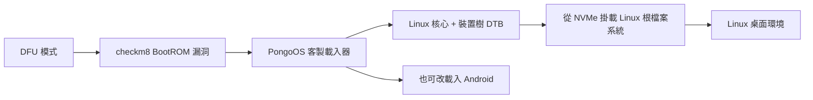

# iPhone 7 Plus 能否更換韌體、變身 Linux 裝置？

## 摘要

技術上「可以」讓 iPhone 7 Plus 執行 Linux 核心，但**無法像一般 PC 那樣把 iOS 韌體永久刷換成 Linux**。iPhone 7 Plus 使用的是 Apple A10 Fusion（代號 T8010）系統單晶片[^d10]，其安全開機鏈（Secure Boot Chain）只信任 Apple 簽章的程式碼，一般情況下不允許載入未簽章的作業系統[^checkm8]。唯一可行的途徑是藉由硬體層級的 BootROM 漏洞 **checkm8** 取得早期程式碼執行權，再透過 **PongoOS** 等客製載入器把 Linux 核心載入到記憶體中執行[^checkm8][^pongoos]。此流程是「暫時性、有線（tethered）」的，每次重新開機都需要連接電腦重新注入，且 iOS 本身仍保留在裝置上，屬於**雙開機（dual-boot）**而非「換掉韌體」。

本報告依序說明：硬體與漏洞基礎、可用的開源專案（Project Sandcastle、Hoolock Linux、postmarketOS/Nura）、功能支援現況、不更動韌體的替代方案，以及法律與實務考量。

---

## 1. 名詞釐清：「換韌體」與「雙開機」的差別

在 PC 或部分 Android 手機上，「刷機」通常指以新韌體覆寫原有系統分區，之後裝置就預設以新系統開機。iPhone 的情況不同：

- **安全開機鏈**：Apple 的 BootROM 會逐級驗證 iBoot 與核心的簽章，任何非 Apple 簽章的程式碼都無法通過驗證，因此無法直接寫入一個「Linux 韌體」並讓它預設開機[^checkm8]。
- **checkm8 的角色**：checkm8 是一個無法修補的 BootROM 漏洞，利用 DFU 模式中的記憶體釋放後使用（Use-After-Free, UAF）弱點，取得載入簽章檢查之前、最高權限的任意程式碼執行能力[^checkm8]。這讓攻擊者（或研究者）能繞過簽章限制，載入自訂載入器。
- **結果**：Linux 是「被載入並執行」的，而非「被刷成預設韌體」。重開機後若不再注入，裝置仍會回到 iOS，因此這是雙開機或半持久性的方案。

---

## 2. 硬體與漏洞基礎

### 2.1 iPhone 7 Plus 硬體

iPhone 7 與 iPhone 7 Plus 代號 `apple-d10`，採用 Apple A10 Fusion（T8010）晶片、aarch64 架構；iPhone 7 記憶體 2 GB、iPhone 7 Plus 記憶體 3 GB，儲存容量 32／128／256 GB，出廠系統為 iOS 10.0.1[^d10]。

### 2.2 checkm8 漏洞

checkm8 於 2019-09-27 由獨立安全研究者 axi0mX 公開，影響 Apple A5 至 A11 晶片（iPhone 4s 至 iPhone X）[^checkm8]。由於漏洞位於唯讀的 BootROM，Apple 無法透過軟體更新修補，該漏洞在受影響裝置上是永久存在的；要到 A12 Bionic 之後的晶片才在硬體上被修補[^checkm8]。此漏洞之後被整合進 checkra1n、palera1n 等越獄工具，並被用於鑑識、安全研究與替代作業系統的實驗[^checkm8]。iPhone 7 Plus 的 A10 屬於受影響範圍，因此具備技術前提。

---

## 3. 可用的開源專案

### 3.1 Project Sandcastle（Corellium）

Project Sandcastle 由行動虛擬化與安全公司 Corellium 於 2020 年 3 月發表，目標是把 Android 與 Linux 移植到 iPhone[^sandcastle]。其官方狀態頁明確表示，**目前建置版本僅支援 iPhone 7 / 7+ 與 iPod touch 第 7 代**；其中只有這三款裝置達到「CPU 可開機」（完整 CPU bring-up）的程度，其餘機型多半只支援部分周邊[^sandcastle-status]。

以 iPhone 7/7+ 而言，官方狀態表列出可用的項目包括：CPU、UART、USB、AIC（中斷控制器）、NAND、Display、Multi-touch、PMU、WLAN、Bluetooth、I2C、SPI、APCIe、DART、Tristar；**不支援**的項目包括：GPU、Audio、Cellular、Camera，且 APFS 檔案系統為安全考量預設為唯讀[^sandcastle-status]。

Sandcastle 的核心是基於 Linux 5.4 的分支（`sandcastle-5.4`）[^sandcastle-kernel]，主專案倉庫約有 2.1k 顆星[^sandcastle]。不過自 2020 年 3 月首次釋出後，主倉庫幾乎沒有後續提交，專案長期處於休眠狀態[^sandcastle]。因此 Sandcastle 可視為「概念驗證」，而非日常可用的移植。

### 3.2 Hoolock Linux（目前最活躍的原生移植）

Hoolock Linux 是針對 Apple A7–A11 與 T2 裝置、以接近主線（mainline）核心為基礎的移植專案，目前**實際在 iPhone 7 Plus（代號 D111）與 iPad 7 上驗證**，是最具功能性的方案[^hoolock-kernel][^hoolock-pauli]。其開機流程為：進入 DFU → 以 palera1n 啟動 PongoOS → 載入修補過的 m1n1 載入器（源自 Asahi Linux）→ 由 m1n1 將執行期硬體資料與校正值發布進裝置樹 → 載入核心、對應的 DTB 與 initramfs → 從內部 NVMe 掛載 Linux 根檔案系統[^hoolock-pauli]。

依專案說明，iPhone 7 Plus 可運行 **Debian 圖形桌面**，並支援：內部 NVMe 儲存（可讀寫並作為根檔案系統）、觸控（含多點觸控）、電池與充電狀態、Wi-Fi（僅站台模式，AP 模式尚不支援）、藍牙（配對與 A2DP 音訊）、自動亮度（環境光感測）；**尚未支援**：內建喇叭、自動旋轉、虛擬 Home 鍵、GPU、相機、行動網路（Cellular）[^hoolock-pauli]。專案同時註明：**標準尺寸的 iPhone 7 尚未獲得與 iPhone 7 Plus 相同的硬體驗證**[^hoolock-pauli]。倉庫活躍度以 Pauli1Go 的說明用分支最高（最後提交約在 2026-10-24），主核心分支 `HoolockLinux/linux` 約 60 顆星[^hoolock-kernel][^hoolock-pauli]。

### 3.3 postmarketOS / Nura（apple-d10）

postmarketOS 的裝置資料庫中，iPhone 7/7+ 代號為 `apple-d10`，類別標記為 `testing`，並標示「可執行（接近）主線核心」、核心版本 7.0.12，屬於通用 `Apple Generic iDevice (apple-idevice)` 移植的一部分[^d10]。其功能狀態為[^d10]：

| 項目 | 狀態 |
|---|---|
| 刷機（pmbootstrap flasher） | 部分 |
| USB 網路 | 可用 |
| 電池 | 可用 |
| 螢幕 | 部分（色彩異常待修） |
| 觸控 | 可用 |
| 3D 加速（GPU） | 故障 |
| 音訊 | 故障 |
| 相機 | 未測試 |
| Wi-Fi／藍牙 | 可用（Wi-Fi 驅動需特殊設定） |
| GPS／行動網路（通話、簡訊、數據） | 未測試 |
| 全碟加密（FDE） | 未測試 |
| 自動旋轉（加速度計） | 未測試 |

該頁也明確指出「**未實作**：不需電腦即可直接開機；仍需 USB 與 PongoOS」[^d10]。換言之，postmarketOS 在此裝置上同樣是有線、需借助 PC 的方案。

### 3.4 主線核心（mainline）進展

Apple A10 的裝置樹（Device Tree）與相關驅動正逐步往 Linux 主線上送。相關移植工作源自 Konrad Dybcio 的早期工作，並由後續開發者（如 Nick Chan）持續提交 A10（`t8010`）的裝置樹與 CPU 快取、PMU、I2C 等節點；這些補丁經過多輪修訂，部分已進入主線週期，部分仍在審查中[^phoronix-dt][^lkml-cache][^lkml-pmu][^lkml-i2c]。postmarketOS 對 apple-d10 標示「mainline：yes」即反映此趨勢[^d10]。不過 GPU、相機、行動網路等關鍵子系統在主線上仍屬早期或未支援階段[^hoolock-pauli][^d10]。

### 3.5 pomme（全開源建置流程）

專案 `pomme` 目標是打造一條涵蓋 A7–A11 checkm8 世代裝置、且不依賴 macOS／Apple SDK 的完整開源 Linux 開機鏈建置流程，優先目標為 iPhone 7（T8010）[^pomme]。需注意其自述為「**Builds, not boots**」，即各階段可成功建置，但尚未在實機上完整驗證[^pomme]。此專案可視為降低建置門檻的輔助工具。

---

## 4. 功能支援總覽（以 iPhone 7 Plus 為例）

| 類別 | Sandcastle[^sandcastle-status] | Hoolock[^hoolock-pauli] | postmarketOS / Nura[^d10] |
|---|---|---|---|
| CPU 開機 | 可 | 可 | 可 |
| 觸控 | 可 | 可 | 可 |
| Wi-Fi | 可 | 可（僅站台） | 可 |
| 藍牙 | 可 | 可 | 可 |
| 內部儲存 | 可（唯讀 APFS） | 可（NVMe 讀寫） | 可（需 APFS 驅動） |
| GPU | 不可 | 不可 | 故障 |
| 音訊 | 不可 | 不可（喇叭） | 故障 |
| 相機 | 不可 | 不可 | 未測試 |
| 行動網路 | 不可 | 不可 | 未測試 |
| 圖形桌面 | 有（Android/Linux 建置） | 有（Debian） | 有（Sxmo 等） |

整體而言，**觸控、Wi-Fi、藍牙、內部儲存與電池**在多數方案已可用；**GPU、相機、行動網路與音訊**仍是共同缺口，因此這些移植目前較適合研究、實驗或作為輕量終端機，而非日常通話手機。

---

## 5. 不更動韌體的替代方案

若使用者目的只是「在 iPhone 上跑 Linux 工具」，其實不必承擔改機風險，App Store 上有數種方式：

- **iSH**：在 App Store 免費提供，透過 x86 使用者模式模擬與系統呼叫轉譯執行 Alpine Linux 使用者空間；可安裝 `apk` 套件、執行 shell 腳本、SSH，但無法背景執行、無 JIT，速度較慢，且不能存取系統層級[^ish]。
- **a-Shell**：原生 iOS 終端機，提供以 iOS 原生編譯的 Unix 指令與 Python，非完整 Linux 發行版，沒有套件管理器，WebAssembly 限制使其無法 fork[^ashell]。
- **UTM**：以 QEMU 為基礎的虛擬機。App Store 的 **UTM SE** 版本無 JIT、速度慢但可安裝；完整版 UTM 需側載並搭配 JIT 方案，且硬體加速（Hypervisor.framework）在 iPhone 7 的 A10 上不可用（該功能要到 A14／iPhone 12 之後的世代才提供）[^utm]。

這些方案與 checkm8 原生移植的差別在於：前者是「在 iOS 沙盒內執行」，後者是「繞過 iOS 直接載入 Linux 核心」。

---

## 6. 法律與實務考量

- **越獄在美國屬合法**：2010 年美國著作權局將越獄列為《數位千禧年著作權法》（DMCA）的例外，並在其後的定期規則制定中延續；不過各國法律不同，需自行確認當地規範[^cfw]。
- **正當用途**：安全研究、鑑識、延長舊裝置壽命、教育與替代作業系統實驗，皆屬常見的正當用途[^checkm8]。
- **不當用途**：利用此漏洞規避他人裝置的啟用鎖、或為盜版繞過 DRM，則可能違法；例如曾有與漏洞作者無關的第三方以 checkra1n 移除 iCloud 啟用鎖而引發爭議[^checkm8]。
- **實務風險**：此類移植屬實驗性質；Sandcastle 官方即提醒電池、效能或其他元件受影響的程度未知，請謹慎使用[^sandcastle-status]。此外流程為有線、需每次重新注入，並非可長期獨立運作的日常系統[^d10][^hoolock-pauli]。

---

## 7. 結論

針對「能否更換 iPhone 7 Plus 韌體、把它變成 Linux 裝置」：

1. **不能**像 PC 一樣把 iOS 永久刷換成 Linux：iPhone 的安全開機鏈拒絕未簽章程式碼，硬體層級的 checkm8 只能提供載入自訂程式碼的入口，而非取代預設韌體[^checkm8]。
2. **能**以 checkm8 → PongoOS → Linux 核心的方式，在 iPhone 7 Plus 上「執行」Linux，並以雙開機形式與 iOS 並存；目前最活躍、功能最完整的是 **Hoolock Linux**，可在 iPhone 7 Plus 上跑起 Debian 圖形桌面、觸控、Wi-Fi、藍牙與內部儲存[^hoolock-pauli]。
3. **功能仍不完整**：GPU、相機、行動網路與音訊普遍尚未支援，因此現階段更適合研究與實驗，而非當作日常手機使用[^sandcastle-status][^hoolock-pauli][^d10]。
4. **若只是想要 Linux 工具環境**，可考慮 iSH、a-Shell 或 UTM 等不需改機的方案[^ish][^ashell][^utm]。

---

## 參考文獻

[^checkm8]: Wikipedia. (2026, October 24). *checkm8*. Retrieved 2026-10-23, from https://en.wikipedia.org/wiki/Checkm8

[^d10]: Nura Wiki (postmarketOS). (2026, October 23). *Apple iPhone 7/7+ (apple-d10)*. Retrieved 2026-10-23, from https://wiki.postmarketos.org/wiki/Apple_iPhone_7/7%2B_(apple-d10)

[^sandcastle]: Corellium. (n.d.). *Project Sandcastle* [GitHub repository]. Retrieved 2026-10-23, from https://github.com/corellium/projectsandcastle

[^sandcastle-status]: Corellium. (n.d.). *Status — Project Sandcastle*. Retrieved 2026-10-23, from https://projectsandcastle.org/status

[^sandcastle-kernel]: Corellium. (n.d.). *linux-sandcastle* [GitHub repository]. Retrieved 2026-10-23, from https://github.com/corellium/linux-sandcastle

[^pongoos]: checkra1n Team. (n.d.). *PongoOS* [GitHub repository]. Retrieved 2026-10-23, from https://github.com/checkra1n/PongoOS

[^hoolock-kernel]: HoolockLinux. (n.d.). *linux* [GitHub repository]. Retrieved 2026-10-23, from https://github.com/HoolockLinux/linux

[^hoolock-pauli]: Pauli1Go. (n.d.). *HoolockLinux* [GitHub repository]. Retrieved 2026-10-23, from https://github.com/Pauli1Go/HoolockLinux

[^phoronix-dt]: Larabel, M. (2024, October). *Linux device tree patches for Apple A7 to A11 SoCs*. Phoronix. Retrieved 2026-10-23, from https://www.phoronix.com/news/Linux-DT-Patches-A7-To-A11

[^lkml-cache]: Chan, N. (2025, February). *[PATCH 6/9] arm64: dts: apple: t8010: Add CPU caches*. Linux Kernel Mailing List. Retrieved 2026-10-23, from https://www.spinics.net/lists/devicetree/msg781352.html

[^lkml-pmu]: Chan, N. (2025, April). *[PATCH v6 18/21] arm64: dts: apple: t8010: Add CPU PMU nodes*. Linux Kernel Mailing List. Retrieved 2026-10-23, from https://lkml.iu.edu/2504.0/07614.html

[^lkml-i2c]: Chan, N. (2025, June). *[PATCH v2 7/9] arm64: dts: apple: t8010: Add I2C nodes*. Linux Kernel Mailing List. Retrieved 2026-10-23, from https://lkml.org/lkml/2025/6/10/1100

[^pomme]: xenoaitham. (n.d.). *pomme* [GitHub repository]. Retrieved 2026-10-23, from https://github.com/xenoaitham/pomme

[^tuxphones]: TuxPhones. (2020, January 30). *Developer gets Linux kernel booting on iPhone 7 and A10-equipped iPads*. Retrieved 2026-10-23, from https://tuxphones.com/linux-kernel-boots-on-t8010-a10-iphone-7-via-pongoos/

[^ish]: iSH. (n.d.). *iSH — Linux shell for iOS* [GitHub repository]. Retrieved 2026-10-23, from https://github.com/ish-app/ish

[^ashell]: Holzschu. (n.d.). *a-Shell* [GitHub repository]. Retrieved 2026-10-23, from https://github.com/holzschu/a-shell

[^utm]: UTM. (n.d.). *UTM — Installation on iOS*. Retrieved 2026-10-23, from https://docs.getutm.app/installation/ios/

[^cfw]: iOS CFW Guide. (n.d.). *Get started*. Retrieved 2026-10-23, from https://ios.cfw.guide/get-started/
