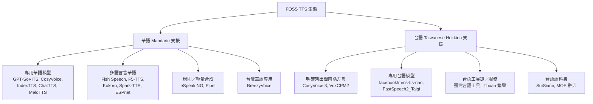
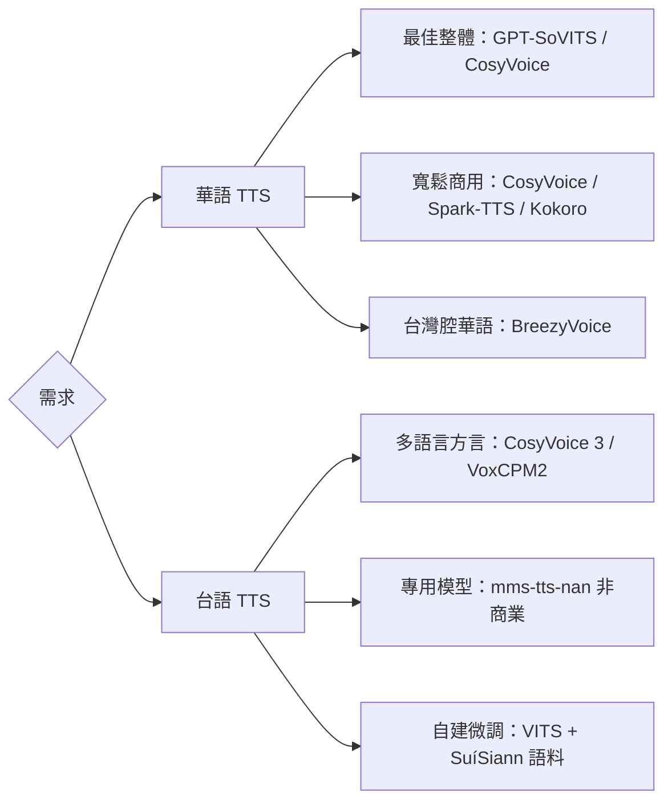

# FOSS 文字轉語音（TTS）方案：中文／華語（Mandarin）與台語（Taiwanese Hokkien）支援調查

## 摘要

本報告調查自由及開放原始碼軟體（FOSS, Free and Open Source Software）的文字轉語音（TTS, Text-to-Speech）引擎與模型，重點在於對**中文華語（Mandarin，含台灣華語）**以及**台語／台灣閩南語（Taiwanese Hokkien，又稱 Tâi-gí／閩南語／Minnan）**的支援程度。

主要發現：

- **華語（Mandarin）**：開源生態成熟，選擇眾多，涵蓋輕量到大型模型。
- **台語（台灣閩南語）**：支援明顯稀少。目前沒有任何「專門、持續維護、授權寬鬆」的台語神經網路 TTS 模型。可行的替代路線為：(1) 使用明確列出「閩南話」方言支援的多語言模型（CosyVoice 3、VoxCPM2）；(2) 使用 Meta MMS 的 `nan` 預訓練模型（非商業授權）；(3) 以台語語料自行微調。

本報告所有事實皆以 Web 搜尋／擷取為依據並附註腳引用。

---

## 一、分類總覽

---

## 二、華語（Mandarin）支援的 FOSS TTS

### 2.1 大型／高品質模型

| 專案 | GitHub 星數 | 授權 | 華語支援 | 台語支援 |
|---|---|---|---|---|
| GPT-SoVITS | ~63.5k | MIT | 佳（主要語言） | 無（有粵語） |
| CosyVoice | ~24.1k | Apache-2.0 | 佳 | **有（閩南話方言）** |
| IndexTTS | ~24.7k | bilibili 模型授權 | 主要語言 | 無 |
| Fish Speech | ~33.4k | Fish Audio 授權 | SOTA | 未明列（~100 語言） |
| F5-TTS | ~15.4k | MIT（程式碼）／CC-BY-NC（權重） | 中英雙語 | 無 |
| ChatTTS | ~39.9k | AGPL-3.0／CC BY-NC 4.0 | 佳（對話導向） | 無 |
| Spark-TTS | ~11.0k | Apache-2.0 | 中英雙語 | 無 |
| Kokoro-82M | ~9.6k | Apache-2.0 | 有（misaki[zh]） | 無 |
| MeloTTS | ~7.7k | MIT | 有 | 無 |
| Bark | ~39.3k | MIT | 有（簡體中文） | 無 |

- **GPT-SoVITS** 支援中英日韓與粵語，適合少量語音的聲線複製（few-shot voice cloning），以 MIT 授權釋出，非常活躍[^gptsovits]。
- **CosyVoice**（原 FunAudioLLM／現 QwenAudio）為 Apache-2.0，CosyVoice 3.0 明確列出支援 9 種主要語言與 18 種以上中文方言，其中包含 **Minnan（閩南）**[^cosyvoice]。
- **IndexTTS**（Bilibili）以華語為主要語言，支援情感、語速與拼音發音控制，但模型授權為 bilibili 專有授權（商用有 MAU／營收門檻）[^indextts]。
- **F5-TTS** 程式碼為 MIT，但預訓練權重因訓練資料（Emilia）限制為 CC-BY-NC（非商業）[^f5tts]。
- **ChatTTS** 針對對話場景最佳化，程式碼 AGPL-3.0、模型 CC BY-NC 4.0[^chattts]。

### 2.2 輕量／邊緣裝置方案

- **Piper**：原 `rhasspy/piper` 已於 2025-10-06 封存（read-only），發展轉移至 Open Home Foundation 的 `piper1-gpl`（GPL-3.0，活躍）[^piper]。Piper 的語音庫（Hugging Face `rhasspy/piper-voices`）含有三個華語（`zh_CN`）語音：`chaowen`、`huayan`、`xiao_ya`[^pipervoices]。
- **eSpeak NG**：共振峰（formant）合成，支援官話（語音代碼 `cmn`），體積小但音質機械化，適合嵌入式與離線情境[^espeakng]。
- **Kokoro-82M**：僅 8,200 萬參數，Apache-2.0，透過 `misaki[zh]` 前端支援華語[^kokoro]。

### 2.3 台灣華語專用

- **BreezyVoice**（MediaTek Research，`mtkresearch/BreezyVoice`，~355 星，Apache-2.0）改編自 CosyVoice，**專為台灣華語（Taiwanese Mandarin）**調校，支援注音（bopomofo）發音矯正與中英夾雜（code-switching）。**不支援台語**[^breezyvoice]。

### 2.4 研究框架

- **ESPnet**（Apache-2.0）與 **PaddleSpeech**（Apache-2.0）：提供華語 TTS 訓練與推論範例，適合自行訓練模型[^espnet][^paddlespeech]。
- **VITS**（`jaywalnut310/vits`，MIT）：僅框架，需自備資料訓練[^vits]。

---

## 三、台語（Taiwanese Hokkien / 閩南語）支援

這是本調查中資源最稀少的類別。以下為各可行路線。

### 3.1 多語言模型中的「閩南話」方言支援

- **CosyVoice 3.0**：官方 README 的語言覆蓋段落明確列出「**Minnan (Hokkien/Taiwanese)**」為 18 種以上中文方言之一；阿里雲模型語音列表中亦有 `longanmin_v3`，語言標示為「Chinese (Minnan dialect), English」。授權 Apache-2.0，持續維護[^cosyvoice]。
  - 注意：「閩南話（Minnan）」是涵蓋台灣閩南語、福建廈門／泉州／漳州腔與東南亞福建話的**方言群**，並非專指台灣腔。實際效果需以台灣腔語音樣本驗證。
- **VoxCPM2**（OpenBMB，`OpenBMB/VoxCPM`，~40.5k 星，Apache-2.0）：支援 30 種語言與 9 種中文方言，README 明確列出「**闽南话**」[^voxcpm]。

### 3.2 專用台語（Min Nan）神經網路模型

- **`facebook/mms-tts-nan`**（Meta MMS）：以 VITS 架構訓練的閩南語（ISO 639-3 代碼 `nan`）TTS 模型，36.3M 參數，透過 Hugging Face Transformers（v4.33 以上）取用。**授權為 CC-BY-NC 4.0（僅限非商業）**。已知評測指出其對台語音韻掌握有限[^mmsnan][^mms].
- **`Unilight/FastSpeech2_Taigi`**（Hugging Face）：以 FastSpeech2 架構訓練的台語 TTS 模型[^hf-resources]。
- **`NTUT-NTUT/NTUT-TTS-MinNan`**（Hugging Face，臺北科技大學）：以 FastSpeech2 為基礎、於台語語料上訓練的閩南語 TTS 模型[^hf-resources]。

> 注意：Meta MMS／Fairseq 專案本身已封存，惟模型檔仍可下載使用[^mms]。

### 3.3 台語工具鏈與服務

- **臺灣言語工具**（`i3thuan5/tai5-uan5_gian5-gi2_kang1-ku7`，~154 星，CPAL-1.0，活躍）：台灣最完整的台語語言處理 Python 工具庫，涵蓋文字處理、斷詞、**語音合成（TTS）**、語音辨識、翻譯與羅馬字轉換。TTS 採 HTS（HMM-based Speech Synthesis，統計式參數合成）路線，主要支援台語，亦涵蓋客語與原住民族語[^kangku7]。
- **臺灣言語服務**（`i3thuan5/tai5-uan5_gian5-gi2_hok8-bu7`，~48 星，CPAL-1.0）：上述工具的網路服務層，提供 TTS／翻譯，惟已於 2024-05-14 封存（read-only）[^hokbu7]。
- **意傳科技（Ìthuân Khoki）「媠聲 SuíSiann」**：台灣公司意傳科技營運的台語 TTS 服務（`hapsing.ithuan.tw`），提供免費示範 API（有限流），商業使用需洽該公司授權[^ithuan]。
- **`SinLiongToo/taigi-tts`**：單頁網頁應用，非神經網路合成，而是拼接教育部辭典的人類真人錄音（約 20,600 筆），並進行變調（tone sandhi）計算，支援漢字↔白話字（POJ）↔數字聲調同步。星數極低（~1 星），適合教育用途[^sinliongtoo]。

### 3.4 台語語料集（訓練 TTS 所需）

- **SuíSiann 媠聲語料集**（`gavingg50/suisiann`）：台語語音資料集，約 4.2 小時、單一女性語者、含漢字與台羅（Tâi-lô）轉寫，音訊授權 CC BY-SA 4.0[^suisiann][^ithuan]。
- **教育部台語辭典機器可讀版**（`g0v/moedict-data-twblg`，~88 星）：約 20,600 筆詞目，含漢字、台羅、華語釋義與真人錄音連結，是台語 NLP／TTS 最重要的詞彙資料集。文字授權 CC BY-ND 3.0 TW、格式轉換授權 CC0[^moedict]。
- **`formosa-speech/Taiwanese-TTS-Taioaan`**、**`M24325/Taiwanese-tts-en-nan-dataset`**：其他台語／英台雙語 TTS 語料集[^hf-resources]。

---

## 四、關鍵結論與建議

| 使用情境 | 建議方案 |
|---|---|
| 華語 TTS（整體最佳、聲線複製） | GPT-SoVITS（MIT） |
| 華語 TTS（寬鬆商用授權） | CosyVoice（Apache-2.0）、Spark-TTS、Kokoro-82M |
| 台灣華語（含中英夾雜） | BreezyVoice（Apache-2.0） |
| 輕量／邊緣裝置華語 | Piper（`zh_CN` 語音）、eSpeak NG |
| 台語（現成可用、持續維護） | **CosyVoice 3.0（閩南話方言）** 或 **VoxCPM2（闽南话）** |
| 台語（專用模型、非商業） | `facebook/mms-tts-nan`、`FastSpeech2_Taigi` |
| 台語（自建微調） | VITS 框架 + SuíSiann 語料集 + 教育部辭典 |

**核心提醒**：

1. 台語 TTS 目前**沒有**一個同時滿足「專用、活躍維護、商業友善授權」的開源方案。
2. 多語言模型所列的「閩南話／Minnan」是方言群概念，是否等同台灣腔需實測驗證。
3. 引用授權時務必注意：MMS 模型為 CC-BY-NC（非商業）、F5-TTS 權重為 CC-BY-NC、IndexTTS 為 Bilibili 專有授權。

---

## 參考文獻

[^gptsovits]: RVC-Boss. (n.d.). *GPT-SoVITS* [Computer software]. GitHub. Retrieved 2026-10-23, from https://github.com/RVC-Boss/GPT-SoVITS

[^cosyvoice]: FunAudioLLM. (n.d.). *CosyVoice* [Computer software]. GitHub. Retrieved 2026-10-23, from https://github.com/FunAudioLLM/CosyVoice

[^indextts]: index-tts. (n.d.). *IndexTTS* [Computer software]. GitHub. Retrieved 2026-10-23, from https://github.com/index-tts/index-tts

[^f5tts]: SWivid. (n.d.). *F5-TTS* [Computer software]. GitHub. Retrieved 2026-10-23, from https://github.com/SWivid/F5-TTS

[^chattts]: 2noise. (n.d.). *ChatTTS* [Computer software]. GitHub. Retrieved 2026-10-23, from https://github.com/2noise/ChatTTS

[^piper]: Rhasspy. (n.d.). *Piper* [Computer software]. GitHub. Retrieved 2026-10-23, from https://github.com/rhasspy/piper

[^pipervoices]: Rhasspy. (n.d.). *piper-voices* [Voice models]. Hugging Face. Retrieved 2026-10-23, from https://huggingface.co/rhasspy/piper-voices/tree/main/zh/zh_CN

[^espeakng]: eSpeak NG. (n.d.). *eSpeak NG* [Computer software]. GitHub. Retrieved 2026-10-23, from https://github.com/espeak-ng/espeak-ng

[^kokoro]: hexgrad. (n.d.). *Kokoro-82M* [Computer software]. GitHub. Retrieved 2026-10-23, from https://github.com/hexgrad/kokoro

[^breezyvoice]: MediaTek Research. (n.d.). *BreezyVoice* [Computer software]. GitHub. Retrieved 2026-10-23, from https://github.com/mtkresearch/BreezyVoice

[^espnet]: ESPnet. (n.d.). *ESPnet* [Computer software]. GitHub. Retrieved 2026-10-23, from https://github.com/espnet/espnet

[^paddlespeech]: PaddlePaddle. (n.d.). *PaddleSpeech* [Computer software]. GitHub. Retrieved 2026-10-23, from https://github.com/PaddlePaddle/PaddleSpeech

[^vits]: Kim, J. (n.d.). *VITS* [Computer software]. GitHub. Retrieved 2026-10-23, from https://github.com/jaywalnut310/vits

[^voxcpm]: OpenBMB. (n.d.). *VoxCPM* [Computer software]. GitHub. Retrieved 2026-10-23, from https://github.com/OpenBMB/VoxCPM

[^mmsnan]: Meta AI. (n.d.). *facebook/mms-tts-nan* [Model]. Hugging Face. Retrieved 2026-10-23, from https://huggingface.co/facebook/mms-tts-nan

[^mms]: Pratap, V., et al. (2023). *MMS: Scaling Speech Technology to 1,000+ Languages*. arXiv. Retrieved 2026-10-23, from https://arxiv.org/abs/2305.13516

[^hf-resources]: Various authors. (n.d.). *NTUT-TTS-MinNan, FastSpeech2_Taigi, suisiann, Taiwanese-TTS-Taioaan* [Models and datasets]. Hugging Face. Retrieved 2026-10-23, from https://huggingface.co/NTUT-NTUT/NTUT-TTS-MinNan

[^kangku7]: i3thuan5. (n.d.). *臺灣言語工具 (tai5-uan5_gian5-gi2_kang1-ku7)* [Computer software]. GitHub. Retrieved 2026-10-23, from https://github.com/i3thuan5/tai5-uan5_gian5-gi2_kang1-ku7

[^hokbu7]: i3thuan5. (n.d.). *臺灣言語服務 (tai5-uan5_gian5-gi2_hok8-bu7)* [Computer software]. GitHub. Retrieved 2026-10-23, from https://github.com/i3thuan5/tai5-uan5_gian5-gi2_hok8-bu7

[^ithuan]: 意傳科技. (n.d.). *媠聲 SuíSiann 台語語音合成*. Retrieved 2026-10-23, from https://suisiann-dataset.ithuan.tw/

[^sinliongtoo]: SinLiongToo. (n.d.). *taigi-tts* [Computer software]. GitHub. Retrieved 2026-10-23, from https://github.com/SinLiongToo/taigi-tts

[^suisiann]: gavingg50. (n.d.). *suisiann* [Dataset]. Hugging Face. Retrieved 2026-10-23, from https://huggingface.co/datasets/gavingg50/suisiann

[^moedict]: g0v. (n.d.). *moedict-data-twblg* [Dataset]. GitHub. Retrieved 2026-10-23, from https://github.com/g0v/moedict-data-twblg

---

## 來源批判性反思

- **星數（stars）為擷取當下之近似值**，會隨時間變動；同一專案在不同擷取來源可能出現差異（例如 CosyVoice 亦可能顯示為 `QwenAudio/CosyVoice`，為同一倉庫改名）。
- **專案自述（README）具行銷性質**：如 BreezyVoice 自稱「自然度優於商業服務」屬自我宣稱，應保留態度；CosyVoice／VoxCPM2 所列「閩南話」是否等於台灣腔，缺乏獨立第三方評測佐證。
- **部分擷取結果來自第三方摘要**（例如搜尋引擎聚合頁），其對星數與封存狀態的描述已與 GitHub 原始頁面交叉比對；仍建議重大決策前以官方倉庫確認。
- **模型品質與授權是兩回事**：高品質模型（如 F5-TTS、MMS）可能為非商業授權，商用前務必確認授權條款。
