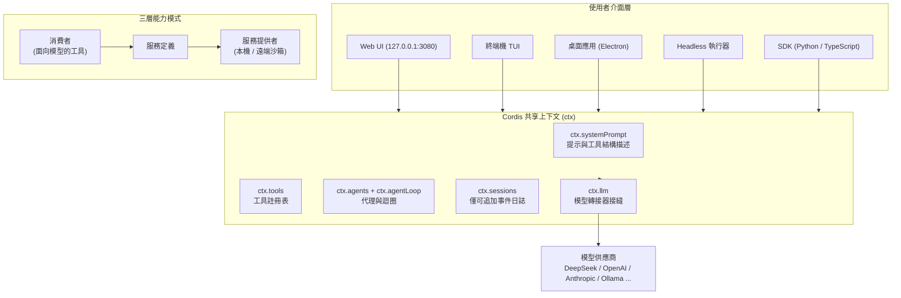

# DeepSeek Harness：開源的 Agent 執行框架

## 摘要

DeepSeek Harness（命令列工具名稱為 `dsh`）是中國 AI 公司 DeepSeek 於 2026 年 8 月 13 日以 MIT 授權開源發布的「代理執行框架（agent harness / agent runtime）」[^repo][^created]。其核心理念為「萬物皆外掛（Everything is a Plugin）」——從模型轉接器、工具註冊表、沙箱、會話日誌，到代理迴圈（agent loop）本身，全部都是可替換的外掛，系統中不存在特權核心[^bytebell][^readme]。DeepSeek 將「代理（Agent）＝ 模型（Model）＋ 框架（Harness）」視為一個整體，本次開源刻意把「框架」與「模型」拆開釋出，並保持模型插槽開放，可搭配任何相容 OpenAI 介面的模型供應商[^bytebell][^modellix]。

專案發布後竄紅極快，截至 2026 年 10 月下旬已累積約 26 萬顆星、3.1 萬次 fork[^api]。目前仍屬開發者預覽（developer preview）階段，官方明言預期會有破壞相容性的變更[^readme]。

---

## 一、專案基本資料

| 項目 | 內容 |
|---|---|
| 名稱 | DeepSeek Harness（`dsh`） |
| 開發者 | DeepSeek（DeepSeek-AI）[^api] |
| 開源授權 | MIT License（Copyright (c) 2026 DeepSeek）[^api][^readme] |
| 首次發布 | 2026-08-13（repository `created_at` 為 2026-08-13T11:56:32Z）[^created] |
| 主要語言 | TypeScript[^api] |
| 星數／Fork 數 | 約 260,066 stars／31,405 forks（2026-10-24 查詢）[^api] |
| 最新版本 | v0.2.1-rc.3（2026-10-23 發布，屬預覽版）[^release] |
| 官方網站 | https://deepseek.com/harness[^api] |
| 文件網站 | https://deepseek-harness.github.io/deepseek-harness/[^readme] |
| 預設分支 | `master`[^api] |

值得一提的成長速度：專案在公開後約 12 小時內達 5 萬星、約 28 小時達 9.2 萬星，10 天內突破 18.6 萬星[^bytebell][^kdnuggets]。GitHub 官方描述僅一句：「DeepSeek Harness: Everything is a Plugin.」[^api]

---

## 二、問題意識：為什麼要做「框架」

一個能實際動手的 AI 代理，等於「模型」加上一層「框架」——框架負責組裝上下文、解析與執行工具呼叫、存取檔案、記錄會話、驅動控制迴圈，並在模型想動手時真正去執行[^bytebell]。DeepSeek 認為，市面上多數代理產品（如 Claude Code、Codex、Cursor）把這一層框架當成黑箱對待，使用者只能「租用」而無法擁有與審視[^bytebell]。

DeepSeek Harness 的定位即是把這層框架開源出來：

- **開源可擁有**：以 MIT 授權釋出，使用者完全掌握執行環境[^repo]。
- **模型無關（model-agnostic）**：可接 DeepSeek、Anthropic、OpenAI、Amazon Bedrock、Vertex、Azure、Ollama 本地模型，或任何相容 OpenAI 介面的端點[^readme][^bytebell]。
- **外掛優先**：每一項能力都是可替換的外掛[^readme]。

---

## 三、架構

### 3.1 建構於 Cordis 之上

DeepSeek Harness 的底層是一個名為 **Cordis** 的「元框架（meta-framework）」，其設計源自論文《A Programming Paradigm for Spatiotemporal Composability》（時空可組合性的程式設計範式）[^cordis][^readme]。該論文由石一凡（Yifan Shi，北京大學與 DeepSeek-AI）、張偉（Wei Zhang，北京大學）、崔天逸（Tianyi Cui，DeepSeek-AI）撰寫，於 2026-08-26 投稿至 arXiv，共 92 頁[^cordis]。

論文提出兩個正交維度[^cordis]：

- **時間可組合性（temporal composability）**：元件被移除時，其副作用能被完整還原。為此論文形式化「可還原副作用（revertible effects）」——每個上下文變換都攜帶一個由執行時持有的反運算。
- **空間可組合性（spatial composability）**：元件之間能以宣告方式管理相依關係。為此論文形式化「反應式共效（reactive coeffects）」——每個上下文變更都會依元件的共效規格被分類，藉此驅動其啟用與停用。

兩者統一於單一「上下文型別（context type）」，論文稱之為「上下文範式（context paradigm）」，並據此給出一套動態組合的計算法（calculus），其元理論保證整套交錯元件系統仍具時空可組合性[^cordis]。

### 3.2 微核心與外掛系統

在實作上，整個系統採微核心（micro-kernel）架構，包含 230 多個套件（packages）[^bytebell][^readme]。系統中沒有特權核心：模型轉接器、工具註冊表、沙箱、會話日誌、代理迴圈，甚至使用者介面本身，全都是掛載到共享 Cordis 上下文（`ctx`）的外掛[^bytebell][^arch]。

主要外掛以 `ctx` 鍵對應如下[^arch]：

| 套件 | 上下文鍵 | 職責 |
|---|---|---|
| `core/session` | `ctx.sessions` | 僅可追加（append-only）的會話事件日誌 |
| `core/system-prompt` | `ctx.systemPrompt` | 系統提示與工具結構描述組裝 |
| `core/tools` | `ctx.tools` | 具作用域的工具註冊表與受控執行 |
| `core/agent` | `ctx.agents` | Agent 介面與註冊表 |
| `core/agent-loop` | `ctx.agentLoop` | 預設的 Agent 驅動器 |
| `core/scope` | — | 每個代理各自的作用域註冊 |
| `llm/llm` | `ctx.llm` | 訊息／串流詞彙與轉接器接縫 |

擴充 `dsh` 的方式不是改核心，而是「在現有外掛旁再掛一個外掛」；外掛卸載時，它註冊的內容會隨著「可還原副作用」一併自動拆解[^readme][^arch]。

### 3.3 三層能力模式（Seam 模式）

系統中每一項能力都拆成三層[^bytebell][^arch]：

1. **服務定義（Service Definition）**：抽象的介面，定義能力的輸入輸出，不含實作。
2. **服務提供者（Service Provider）**：實際執行的實作，例如在本機啟動行程，或在遠端容器執行。
3. **消費者（Consumer）**：面向模型的外掛，把能力描述成一個有名稱、描述與參數的工具。

因為三層分離，只要替換「提供者」（例如把本機 shell 換成遠端沙箱），上下兩層完全不必更動，模型也不會察覺[^bytebell]。

### 3.4 事件與擴充點

系統以事件作為擴充點，分為三類[^arch]：

- **會話事件（session events）**：持久化的事件（durable）。
- **代理事件（agent events）**：即時攔截（live interception）。
- **能力事件（capability events）**：用於附加政策或轉接器。

回合／步驟（turn/step）的細粒度事件生命週期包含 `turn/start`、`step/start`、`agent/request`、`llm/stream`、`tool/call` 等[^arch]。

### 3.5 架構示意圖



---

## 四、執行模式（Profiles）

`dsh` 以「設定檔（profile）」在啟動時決定要組裝哪些外掛。外掛來自有序的「捆綁包（bundles）」加上 `cordis.patch.yml`、使用者修補與 `--patch` 覆蓋層[^readme][^arch]。

官方隨附的設定檔版本與常見說法略有出入，依官方文件所列如下[^arch]：

| Profile | 說明 |
|---|---|
| `web` | 完整的瀏覽器應用（Web UI），預設開啟 `http://127.0.0.1:3080` |
| `headless` | 一次性執行的 runner，不起伺服器，適合 CI／腳本 |
| `sdk` | SDK JSON-RPC 伺服器 |
| `sdk-minimal` | 不含 `dsh-base` 的獨立 SDK 樹 |
| `acp` | 僅供自動化使用的 ACP 伺服器 |
| `desktop` | Electron 桌面應用（保留的 profile） |
| `plugin` | 外掛管理命令 |

共享的第一層是 `dsh-base` 捆綁包，`web`、`headless`、`sdk`、`acp` 皆以其為基礎，內容涵蓋模型轉接器、工具、持久化、沙箱、審批政策、設定、憑證與遙測[^arch]。

另有第三方技術分析將執行模式歸納為四種，作為理解上的另一種視角[^bytebell]：

- **Standard**：通用型編碼代理，含檔案編輯、shell、網頁搜尋、子代理與工作流程。
- **PTC（Code Mode）**：在 Standard 之上加入 Code Mode SDK，模型可撰寫 TypeScript，把多步驟操作合併成單次 `run_code` 呼叫，以減少往返次數與 token 用量。
- **Minimal**：只保留兩個工具——持久化 shell 與字串取代編輯器，用於可重現的基準測試。
- **Creation / Creator**：代理可在執行時檢視並修改自身的外掛樹（「開車時換引擎」），屬研究性質。

---

## 五、會話日誌與可稽核性

每次執行都會寫入一份**僅可追加（append-only）的事件日誌**，內容包含系統提示、推理軌跡、工具呼叫與結果、上下文注入、子代理排程等[^bytebell][^readme]。其設計準則為：「凡是模型看得見的，都必須被記錄（model-visible means logged）」——任何進入模型請求的內容，都必須能從日誌重建[^bytebell][^readme]。

日誌支援版本化的 JSONL 格式（v0、v1+）、zstd 壓縮與遷移機制[^arch]。這使審計軌跡成為系統的內建屬性，而非外加功能[^bytebell]。

---

## 六、安裝與使用

需求：Node.js >= 24.9.0；原始碼開發使用 pnpm（monorepo）[^readme]。

最快啟動方式（透過 npm）[^readme]：

```bash
npx @deepseek-ai/dsh web
```

從原始碼建置[^readme]：

```bash
git clone https://github.com/deepseek-ai/deepseek-harness.git
cd deepseek-harness
pnpm install
pnpm run build
pnpm dsh web
```

常見命令列用法[^arch]：

- `dsh web`：啟動 Web UI，預設開啟瀏覽器。
- `dsh --profile <name>` 或 `dsh <name>`：選擇 profile。
- `dsh --profile web --dump-config`：印出解析後的外掛樹。
- `dsh --no-open`：啟動伺服器但不開啟瀏覽器。
- `dsh plugin`／`dsh --profile plugin`：外掛管理。
- `dsh --patch <file>`：在 profile 設定上套用 YAML 修補覆蓋層。

模型插槽本身也是外掛，設定可填入任何相容 OpenAI 介面的端點；官方預先設定好的供應商包含 DeepSeek、Anthropic、OpenAI、Bedrock、Vertex、Azure 與 Codex[^bytebell][^readme]。

---

## 七、安全預設

- **審批政策**：預設為 `workspace-write`——允許在起始目錄內執行命令與修改檔案，任何超出此範圍的操作都會要求確認[^bytebell]。
- **沙箱**：採「失敗即關閉（fail-closed）」策略——若執行時無法確認邊界有效，寧可拒絕操作，也不在無保護狀態下繼續[^bytebell]。

---

## 八、基準測試

DeepSeek 曾公布以 **V4-Pro** 模型搭配 DeepSeek Harness 的 **Minimal** 模式所測得的成績[^bytebell]：

| 基準測試 | 分數 |
|---|---|
| Terminal-Bench 2.1 | 87.9 |
| Toolathlon-Verified | 74.1 |
| DSBench-FullStack | 71.1 |

關鍵在於：這些分數衡量的是「模型＋這套框架」的組合，而非模型單獨的表現；換一套框架，數字就會改變[^bytebell]。DeepSeek 之所以特地提供 Minimal 模式，正是為了讓軟體層盡量薄且可重現，使基準測試具備可比性[^bytebell]。

repo 內並提供測試指令 `test:bench`、`test:bench:built`、`test:bench:memory`（基於 vitest），以及 Web 效能測試 `test:web:perf`、`test:web:stress`[^readme][^bench]。

---

## 九、生態與相關模型

- **外掛生態**：GitHub 上以 `dsh-plugin` 為主題標籤，社群外掛快速湧現；官方 repo 的 topics 亦標記了 `ai-agents`、`cordis`、`dsh`、`dsh-plugin`[^api][^bytebell]。
- **相關模型**：框架與 DeepSeek 自家模型釋出關係密切。例如 **DeepSeek-V4.1-Flash-1017** 在訓練時特別針對 DeepSeek Harness 進行最佳化，自 v0.2.1 起支援[^readme]；另如 V4-Pro／V4-Flash 被用於上述基準測試[^bytebell]。v0.2.1-rc.2 起加入 DeepSeek Search 與 Fetch API[^readme]。
- **實驗性功能**：Agent Teams、Claude Code Mods 相容層、browser use、computer use、CUA 等[^arch]。

---

## 十、限制與批判性觀察

多方來源指出若干粗糙處，閱讀時應留意[^bytebell]：

1. **仍屬開發者預覽**：官方明確表示預期會有破壞相容性的變更，所有釋出至今皆為 rc／alpha 預覽版[^readme][^release]。
2. **npm 標籤混淆**：`latest` 標籤仍指向公開發布前的預覽版本，目前的建置放在 `next`；若安裝時未指定標籤，可能靜默取到舊版[^bytebell]。
3. **外掛安裝體驗**：第三方外掛需透過啟動器（`dsh plugin --profile <name>`）安裝，而非獨立套件管理器，且文件未在使用者最先查找的位置說明[^bytebell]。
4. **未經審查的外掛生態**：發布一天內即有數百個 `dsh-plugin` repo 出現，皆未經審查；由於外掛可變更允許的工具、系統提示並掛載進介面，爆炸半徑（blast radius）很大，使用前應詳讀原始碼[^bytebell]。
5. **長期一致性未證**：無特權核心的外掛樹架構確實少見且真正可重組，但其長期能否維持一致性尚待驗證[^bytebell]。

### 來源批判性反思

- 本報告主要事實分為三類來源：（a）GitHub 官方 repo 與 REST API（一手、可驗證的客觀數據，如星數、授權、建立時間、釋出資訊）；（b）DeepSeek 官方 README 與文件網站（一手但屬自我陳述，基準測試等效能數字由廠商自行公布，缺乏第三方複現，宜保留態度）；（c）第三方技術媒體與部落格（如 ByteBell、InfoQ、MarkTechPost、KDnuggets）。其中 ByteBell 的文章開宗明義推廣自家「可驗證上下文層」產品，與 DeepSeek Harness 存在潛在競爭關係，其對框架的限制描述雖具體，仍可能帶有立場，故本報告僅將其觀察作為「待留意的疑點」呈現，並與官方資訊互相對照。
- 星數與版本號屬高度時效性資料，本報告數值擷取於 2026-10-24，讀者日後查閱時應以 GitHub 現況為準。
- 部分第三方文章對「模式數量」的敘述（例如「四種模式」）與官方文件所列「七種設定檔」並不一致，本報告同時列出兩種視角並註明各自來源，避免以單一說法定論。

---

## 十一、結論

DeepSeek Harness 的意義，不只是又一個開源編碼代理，而是把「代理框架」這一層從黑箱變成可擁有、可拆解、可重組的基礎設施[^bytebell]。其技術骨幹 Cordis 以「可還原副作用」與「反應式共效」達成時間與空間兩種可組合性，並以微核心＋外掛樹落實[^cordis]。對一家主要販售模型的公司而言，把框架以 MIT 開源、模型插槽保持開放，是一項刻意的策略選擇[^bytebell]。專案仍處預覽階段、外掛生態未受審查，是最需謹慎之處；但其架構取向與採用速度，使其成為理解「代理框架」設計的重要案例。

---

## 參考資料

[^repo]: DeepSeek-AI. (n.d.). *DeepSeek Harness: Everything is a Plugin* [GitHub repository]. Retrieved 2026-10-24, from https://github.com/deepseek-ai/deepseek-harness

[^api]: GitHub REST API. (2026). *Repository: deepseek-ai/deepseek-harness* [Data file]. Retrieved 2026-10-24, from https://api.github.com/repos/deepseek-ai/deepseek-harness

[^created]: GitHub REST API. (2026). *Repository metadata (created_at, updated_at, pushed_at, language, license)* [Data file]. Retrieved 2026-10-24, from https://api.github.com/repos/deepseek-ai/deepseek-harness

[^readme]: DeepSeek-AI. (n.d.). *DeepSeek Harness README and documentation*. Retrieved 2026-10-24, from https://github.com/deepseek-ai/deepseek-harness/blob/master/README.md and https://deepseek-harness.github.io/deepseek-harness/

[^arch]: DeepSeek-AI. (n.d.). *Architecture documentation*. Retrieved 2026-10-24, from https://github.com/deepseek-ai/deepseek-harness/blob/master/docs/architecture.md

[^release]: DeepSeek-AI. (2026, October 23). *Releases: v0.2.1-rc.3*. Retrieved 2026-10-24, from https://github.com/deepseek-ai/deepseek-harness/releases

[^bench]: DeepSeek-AI. (n.d.). *BENCHMARK.md*. Retrieved 2026-10-24, from https://github.com/deepseek-ai/deepseek-harness/blob/master/BENCHMARK.md

[^cordis]: Shi, Y., Zhang, W., & Cui, T. (2026, August 26). *A Programming Paradigm for Spatiotemporal Composability* (arXiv:2608.25512) [cs.PL]. arXiv. Retrieved 2026-10-24, from https://arxiv.org/abs/2608.25512

[^bytebell]: ByteBell. (2026, August). *DeepSeek Harness explained: What dsh is, how it works, and what is still rough*. Retrieved 2026-10-24, from https://bytebell.dev/blog/deepseek-harness-explained/

[^kdnuggets]: KDnuggets. (2026, August). *What I've learned about DeepSeek Harness*. Retrieved 2026-10-24, from https://www.kdnuggets.com/what-ive-learned-about-deepseek-harness

[^modellix]: Modellix.ai. (2026, August). *DeepSeek Harness: What it is, how to run it*. Retrieved 2026-10-24, from https://www.modellix.ai/blog/deepseek-harness
