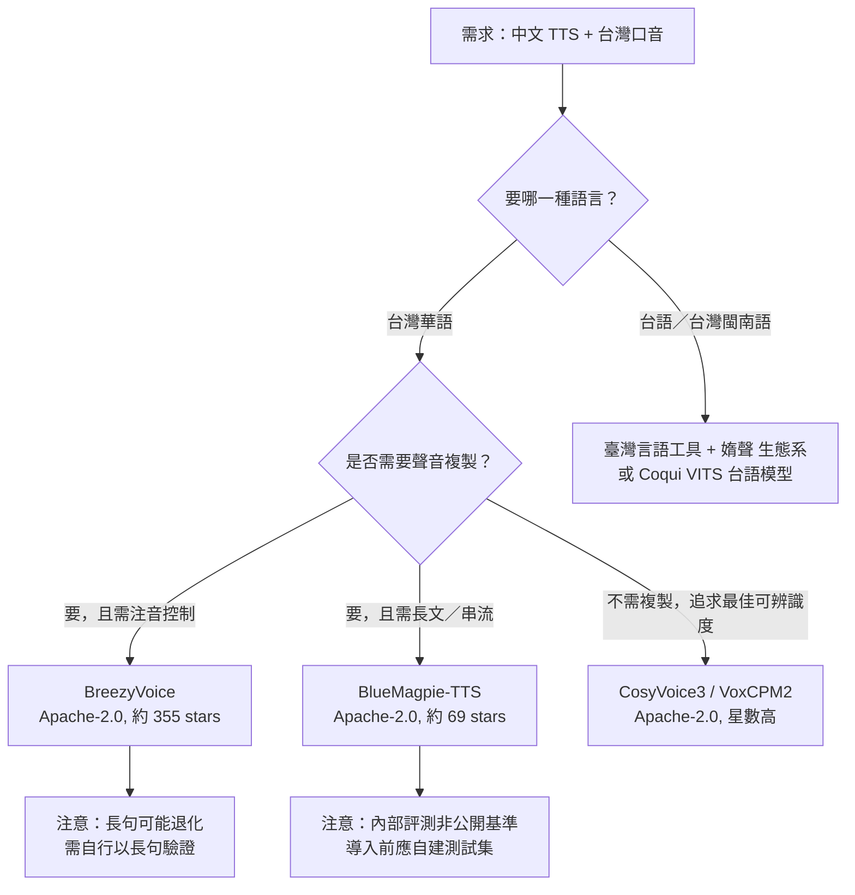

# 支援中文／華語與台灣口音的開源文字轉語音（FOSS TTS）方案調查

本報告調查「自由與開源軟體（Free and Open Source Software, FOSS）之文字轉語音（Text-to-Speech, TTS）系統」，重點在於是否支援**中文／華語（Mandarin Chinese）**，以及是否具備**台灣口音（台灣華語，Taiwanese Mandarin）**或**台語／台灣閩南語（Taiwanese Hokkien, Taigi）**的合成能力。報告為獨立文件，所有背景、術語與脈絡均收錄於本文內。

---

## 1. 背景與名詞界定

在討論之前，需先釐清幾個容易混淆的名詞：

- **華語／中文（Mandarin）**：本文指以漢字書寫、以官話發音的語音，亦包含「中英夾雜（code-switching）」情境，例如台灣日常語句「這個 feature 明天上線」[^bluemagpie]。
- **台灣口音華語（Taiwanese Mandarin）**：指台灣地區使用的華語腔調，與中國大陸普通話在聲調、用詞與語速上有差異。多數中國模型（如 CosyVoice）在台灣腔自然度上並非專門調校。
- **台語／台灣閩南語（Taiwanese Hokkien / Taigi / Minnan）**：與華語不同的一種語言，在台灣及東南亞華人圈使用，屬「資源稀缺語言（under-resourced language）」，多數中文 TTS 即使餵入台語漢字，仍會產出華語發音[^meralion]。
- **TTS 關鍵詞**：**零樣本聲音複製（zero-shot voice cloning）**指僅需數秒參考音檔即可模仿音色；**注音控制（bopomofo / 拼音控制）**指允許使用者以注音符號標注發音，用以修正破音字（polyphone disambiguation）[^breezyvoice]。

以下將方案分為三大類：（A）**台灣專用華語／台語模型**、（B）**通用多語模型但其台灣表現已被測試**、（C）**傳統工具鏈與框架**。

---

## 2. 台灣專用華語 TTS 方案

### 2.1 BreezyVoice（聯發科技 MediaTek Research）

- **來源**：`mtkresearch/BreezyVoice`，GitHub 星數約 355[^breezyvoice-gh]。
- **授權**：Apache-2.0[^breezyvoice-gh]。
- **語言定位**：專為**台灣華語**調校的聲音複製 TTS，衍生自 CosyVoice，並隸屬 Breeze2 模型家族[^breezyvoice]。
- **特色**：支援自動**注音**標注與手動注音修正，例如 `"今天天氣真好[:ㄏㄠ3]"`，藉此改善破音字問題；在中英夾雜（code-switching）情境下表現具競爭力[^breezyvoice]。
- **部署**：提供單筆推論 `single_inference.py`、批次推論 `batch_inference.py`，以及 Docker 與 OpenAI 相容 API[^breezyvoice]。
- **限制**：第三方比較顯示，BreezyVoice 在長句上會出現重複與退化（repetition/degeneration），長句的 MER（中文字元錯誤率＋英文詞錯誤率）由短句 0.139 升至 0.411[^zhtw-compare]。此為獨立第三方評測，並非官方數據，讀者宜留意其測試集僅 25 句。

### 2.2 BlueMagpie-TTS（OpenFormosa 社群）

- **來源**：`OpenFormosa/BlueMagpie-TTS`，GitHub 星數約 69[^bluemagpie-gh]。
- **授權**：Apache-2.0[^bluemagpie-gh]。
- **語言定位**：針對**台灣華語**與**中英混合（code-switching）**打造的開源 TTS，輸出 48 kHz 語音；聲學模組取自 VoxCPM（Apache-2.0）[^bluemagpie]。
- **特色功能**：一般合成、**免逐字稿聲音複製**（僅需 3 秒以上參考音檔）、以語者向量控制音色、語音接續、串流輸出、批次推論引擎，以及 Apple Silicon 的 MLX 加速[^bluemagpie]。
- **效能數據**：官方內部測試中，使用語者向量條件時 CER 為 7.44%、WER 8.57%，相對基準系統（CER 11.45%）降低約 35%[^bluemagpie]。官方明言此為「內部模型選擇用的評測、並非公開基準」，換用不同 ASR 或測試集絕對數字會不同[^bluemagpie]。
- **模型取得**：模型於 Hugging Face 公開（`OpenFormosa/BlueMagpie-TTS`），不需 token 或申請，下載約 8 GB[^bluemagpie]。線上試玩空間為 `voidful/BlueMagpie-TTS-Demo`[^bluemagpie]。
- **延伸方向**：專案正尋找台語、客語方向的語者授權與資料合作[^bluemagpie]。

### 2.3 其他台灣專案（規模較小）

- **`ga642381/TaiwaneseTTS`**：以 Python 撰寫，描述為「Chinese-to-Taiwanese TTS system trained with ESPnet」，約 10 顆星[^taiwanesetts-gh]。README 內容極少，可運行性未在文件中說明。
- **`radiorz/TTS-Taiwanese`**：描述為「A Chinese-to-Taiwanese TTS system trained with ESPnet」，0 顆星[^radiorz-gh]。
- **`o3943266-ollie/Taiwanese-TTS-Tacotron2`**：Tacotron2 架構的台語 TTS，0 顆星，無描述[^tacotron2-gh]。
- **`cutedogspark/bluemagpie-tts-portal`**：為 BlueMagpie-TTS 打造的 Web 示範入口＋FastAPI 推論服務，MIT 授權[^bmportal-gh]。
- **`endman100/ComfyUI-BlueMagpie-TTS`**：BlueMagpie-TTS 的 ComfyUI 節點，MIT 授權[^comfybm-gh]。

此類專案星數極低，多半為個人實驗或課程專案。由於台灣華語＋台語 TTS 本身為小眾題目，該領域可用專案本來就稀少，故仍列出以供辨識，但建議以成熟度較高的 BreezyVoice 與 BlueMagpie-TTS 為主。

---

## 3. 通用多語 TTS 的台灣表現（第三方測試）

一份名為 `zh-tw-tts-comparison` 的第三方開源比較專案，以 **25 句台灣中文／code-switch 句子**、共用台灣參考語音、在 A100-80GB 上以一致條件測試 7 個開源 TTS 系統[^zhtw-compare]。該專案以兩個 ASR（Qwen3-ASR-1.7B 與 MediaTek Breeze-ASR-25）計算 median MER（中文字元錯誤率 CER ＋ 英文詞錯誤率 WER），並強調「前段模型在 MER 上已難分高下，最終要靠人耳偏好」[^zhtw-compare]。

### 3.1 可辨識度排名（依測試者整理的 median MER，越低越好）

以下為第三方比較中以 **Qwen3 ASR 於各模型最佳條件** 的排名[^zhtw-compare]：

| 名次 | 模型 | median MER | 條件 |
| --- | --- | ---: | --- |
| 1 | CosyVoice3 | 0.035 | raw |
| 2 | VoxCPM2 | 0.043 | controlled |
| 3 | MOSS | 0.044 | raw |
| 4 | OmniVoice | 0.045 | raw |
| 5 | Qwen3-TTS | 0.051 | raw |
| 6 | Chatterbox | 0.091 | raw |
| 7 | BreezyVoice | 0.106 | controlled |

> 該比較指出前 5 名在統計上「打平」（paired-bootstrap 信賴區間包含 0），僅 Chatterbox 與 BreezyVoice 顯著較差；且第一名會因使用不同 ASR 而翻轉[^zhtw-compare]。這是重要的批判性觀察：MER 單一指標在 n=25 的小樣本下不足以決定優勝者。

### 3.2 各模型定位

- **CosyVoice / CosyVoice3**：`QwenAudio/CosyVoice`，約 24,112 顆星，Apache-2.0，支援中文、粵語、英日韓等多語，並提供推論、訓練與部署全鏈路能力[^cosyvoice-gh]。在上述台灣測試中可辨識度表現最佳之一[^zhtw-compare]。
- **VoxCPM / VoxCPM2**：`OpenBMB/VoxCPM`，約 40,482 顆星，Apache-2.0，主打多語語音生成、創意音色設計與高保真複製；BlueMagpie-TTS 的聲學模組即取自 VoxCPM[^voxcpm-gh][^bluemagpie]。
- **MOSS-TTSD**：`OpenMOSS/MOSS-TTSD`，約 1,410 顆星，Apache-2.0，針對長篇、多講者對話合成與零樣本聲音複製[^mossttsd-gh]。
- **OmniVoice**：`k2-fsa/OmniVoice`，約 15,761 顆星，Apache-2.0，宣稱支援 600+ 語言的高品質聲音複製[^omnivoice-gh]。值得注意的是，MERaLiON 的台語（新加坡閩南語）TTS 正是以 OmniVoice 為基礎模型微調而成[^meralion]。
- **Qwen3-TTS**：在上述測試中被納入比較，但該比較指出此模型未提供注音／拼音控制路徑（僅 raw 條件）[^zhtw-compare]。
- **Chatterbox**：`resemble-ai/chatterbox`，約 27,177 顆星，MIT 授權，自稱 SoTA 開源 TTS[^chatterbox-gh]；在台灣測試中表現相對落後，且無注音控制路徑[^zhtw-compare]。

---

## 4. 台語（閩南語／台灣閩南語）TTS 方案

台語 TTS 屬於資源稀缺領域，所需資料與模型與華語不同。以下為已知的開源方案。

### 4.1 臺灣言語工具（i3thuan5）與媠聲（SuiSiann）生態系

- **`i3thuan5/tai5-uan5_gian5-gi2_kang1-ku7`（臺灣言語工具）**：約 154 顆星，Python，標籤含 `taiwanese` 與 `tts`，提供台語／閩南語與客話的文本處理、語音辨識、合成、斷詞、翻譯等功能[^taigi-tool][^taigi-tool-gh]。授權為 CPAL（Common Public Attribution License）[^taigi-tool]。
- **SuiSiann（臺灣媠聲）系列**：
  - `i3thuan5/SuiSiann-HunLian`（台語語音合成訓練）約 6 顆星，MIT[^suisiann-hunlian-gh]。
  - `SuiSiann-KauTui`（媠聲標記網站）約 15 顆星[^suisiann-kautui-gh]。
  - `i3thuan5/SuiSiann-HapSing-HokBu`（媠聲合成服務）約 1 顆星，MIT[^suisiann-hapsing-gh]。
  - `i3thuan5/SuiSiann-BangTsam`（資料集公開網站），MIT[^suisiann-bangtsam-gh]。
- **可用的現成模型**：社群已將媠聲資料集（`ceciliayl/SuiSiann_raw_tone`）訓練為 Coqui VITS 模型 `neurlang/coqui-vits-suisiann-minnan-hokkien`，授權 CC-BY-SA-4.0，官方示範指令即為台語羅馬字＋漢字混合輸入[^coquisuisiann]。另有一個以 `pygoruut` 處理發音的變體 `chen778560489/coqui-vits-suisiann-minnan-hokkien`[^hfsuisiann-search]。

### 4.2 MERaLiON-OmniVoice-Hokkien-TTS（新加坡閩南語）

- **來源**：Hugging Face `MERaLiON/MERaLiON-OmniVoice-Hokkien-TTS`，7 個 likes，授權為 `meralion-3-public-licence`（非標準開源授權，使用前須確認條款）[^meralion]。
- **基礎模型**：以 `k2-fsa/OmniVoice` 為底座，使用 SFT 與 GRPO 於閩南語會話資料微調[^meralion]。
- **輸入輸出**：漢字輸入（支援馬來語／英語借詞），輸出 24 kHz 單聲道 WAV，支援以參考音檔做聲音複製[^meralion]。
- **口音說明**：此模型為**新加坡閩南語**，並非台灣腔調；但其存在顯示閩南語 TTS 已有可用的現代神經網路方案[^meralion]。

### 4.3 其他台語相關工具與模型

- **FormoSpeech（台灣）**：於 Hugging Face 發布 `formospeech/taiwanese-hakka-tts-sixian-hailu-mix-se`（台灣客語 TTS，CC-BY-NC-4.0，需登入並同意條款後才能存取）[^formospeech]。同組織也發布台語／客語 Whisper ASR 模型，例如 `formospeech/whisper-large-v3-taiwanese-hakka`[^hftaiwanese-search]。**注意**：CC-BY-NC 屬「非商業」授權，不符合嚴格的 FOSS 定義，導入前須留意。
- **SpeechT5 台語微調**：`Curiousfox/speecht5_tailo-hokkien_ver1.0.b`、`Curiousfox/speecht5_tailo_Hokkien_ver1.0.c` 等，以微軟 `microsoft/speecht5_tts` 為底座微調，MIT 授權，屬早期實驗性成果[^hfhokkien-search]。
- **`yazelin/taigi-news-reader`**：非商用 Chrome 台語新聞朗讀器，使用 MMS TTS 作為參考，MIT 授權[^taiginews-gh]。

---

## 5. 傳統工具鏈與框架（可自行訓練）

若需求是「以既有框架自行訓練台灣腔模型」，以下框架值得注意：

- **Coqui TTS（`idiap/coqui-ai-TTS` 為活躍分支）**：原 `coqui-ai/TTS` 約 46,134 顆星、MPL-2.0，已多年未更新；社群接手維護的 `idiap/coqui-ai-TTS` 約 2,340 顆星、MPL-2.0，仍持續提交[^coqui-gh][^coqui-fork-gh]。前述台語 Coqui VITS 模型即為此生態系產物[^coquisuisiann]。
- **Piper（`rhasspy/piper`）**：約 11,306 顆星，MIT，主打「快速、本地端的神經網路 TTS」[^piper-gh]。惟該專案目前 **archived（已封存）**，且有 418 個未解 issue[^piper-gh]。它有中文模型可用於華語，但並非針對台灣腔調專門調校；由於已封存，新專案採用前宜評估維護風險。
- **ESPnet**：前述 `ga642381/TaiwaneseTTS` 與 `radiorz/TTS-Taiwanese` 皆標明以 ESPnet 訓練華語轉台語 TTS[^taiwanesetts-gh][^radiorz-gh]，顯示 ESPnet 是台語 TTS 研究中被使用的框架。

---

## 6. 決策建議

以下整理為幾個實務情境的建議（本節為研究者綜合前述來源之判斷，非單一來源的原始結論）：

**重點觀察**：

1. **若明確要「台灣華語口音」**：BreezyVoice 與 BlueMagpie-TTS 是唯二以台灣華語為原生目標且具規模的 Apache-2.0 專案[^breezyvoice][^bluemagpie]。
2. **若重視可辨識度且可接受非台灣原生**：第三方測試顯示 CosyVoice3、VoxCPM2 等高分模型在台灣中文句子上表現優秀，但它們並非專門為台灣腔調調校[^zhtw-compare]。
3. **若需要台語**：可考慮臺灣言語工具＋媠聲生態系，或直接用社群已訓練好的 Coqui VITS 台語模型；新加坡閩南語的 MERaLiON 模型為非台灣口音且授權非標準，需另行評估[^taigi-tool][^coquisuisiann][^meralion]。
4. **授權陷阱**：FormoSpeech 的台灣客語 TTS 為 CC-BY-NC-4.0（禁商業使用）[^formospeech]；MERaLiON 為自訂公開授權[^meralion]。追求嚴格 FOSS（如 Apache-2.0、MIT、MPL-2.0）者應優先考慮 BreezyVoice、BlueMagpie-TTS、CosyVoice、VoxCPM、OmniVoice、Chatterbox、Piper、Coqui 等。

**批判性反思**：本報告主要依賴各專案自述與一份第三方比較。專案自述的效能數據（如 BlueMagpie 的 CER）多為內部測試，未經同儕審查或公開基準驗證，官方自己也如此聲明[^bluemagpie]；而第三方比較雖方法透明，樣本僅 25 句，且作者自承「第一名會因 ASR 不同而翻轉」[^zhtw-compare]。因此，任何導入決策都應以自身情境的測試集重新驗證，不宜直接採信排名。此外，GitHub 星數僅反映關注度，不等於品質或維護活躍度，例如 Piper 星數高但已封存[^piper-gh]。

---

## 參考文獻

[^bluemagpie]: OpenFormosa. (n.d.). *BlueMagpie-TTS* [README]. GitHub. Retrieved 2026-10-23, from https://github.com/OpenFormosa/BlueMagpie-TTS

[^bluemagpie-gh]: GitHub. (n.d.). *OpenFormosa/BlueMagpie-TTS repository metadata* [Data file]. Retrieved 2026-10-23, from https://api.github.com/repos/OpenFormosa/BlueMagpie-TTS

[^breezyvoice]: mtkresearch. (n.d.). *BreezyVoice* [README]. GitHub. Retrieved 2026-10-23, from https://github.com/mtkresearch/BreezyVoice

[^breezyvoice-gh]: GitHub. (n.d.). *mtkresearch/BreezyVoice repository metadata* [Data file]. Retrieved 2026-10-23, from https://api.github.com/repos/mtkresearch/BreezyVoice

[^zhtw-compare]: JacobLinCool. (n.d.). *zh-tw-tts-comparison — results*. Retrieved 2026-10-23, from https://jacoblincool.github.io/zh-tw-tts-comparison/results.html

[^taiwanesetts-gh]: GitHub. (n.d.). *ga642381/TaiwaneseTTS repository metadata* [Data file]. Retrieved 2026-10-23, from https://api.github.com/repos/ga642381/TaiwaneseTTS

[^radiorz-gh]: GitHub. (n.d.). *radiorz/TTS-Taiwanese repository metadata* [Data file]. Retrieved 2026-10-23, from https://api.github.com/repos/radiorz/TTS-Taiwanese

[^tacotron2-gh]: GitHub. (n.d.). *o3943266-ollie/Taiwanese-TTS-Tacotron2 repository metadata* [Data file]. Retrieved 2026-10-23, from https://api.github.com/repos/o3943266-ollie/Taiwanese-TTS-Tacotron2

[^bmportal-gh]: GitHub. (n.d.). *cutedogspark/bluemagpie-tts-portal repository metadata* [Data file]. Retrieved 2026-10-23, from https://api.github.com/repos/cutedogspark/bluemagpie-tts-portal

[^comfybm-gh]: GitHub. (n.d.). *endman100/ComfyUI-BlueMagpie-TTS repository metadata* [Data file]. Retrieved 2026-10-23, from https://api.github.com/repos/endman100/ComfyUI-BlueMagpie-TTS

[^cosyvoice-gh]: GitHub. (n.d.). *QwenAudio/CosyVoice repository metadata* [Data file]. Retrieved 2026-10-23, from https://api.github.com/repos/QwenAudio/CosyVoice

[^voxcpm-gh]: GitHub. (n.d.). *OpenBMB/VoxCPM repository metadata* [Data file]. Retrieved 2026-10-23, from https://api.github.com/repos/OpenBMB/VoxCPM

[^mossttsd-gh]: GitHub. (n.d.). *OpenMOSS/MOSS-TTSD repository metadata* [Data file]. Retrieved 2026-10-23, from https://api.github.com/repos/OpenMOSS/MOSS-TTSD

[^omnivoice-gh]: GitHub. (n.d.). *k2-fsa/OmniVoice repository metadata* [Data file]. Retrieved 2026-10-23, from https://api.github.com/repos/k2-fsa/OmniVoice

[^chatterbox-gh]: GitHub. (n.d.). *resemble-ai/chatterbox repository metadata* [Data file]. Retrieved 2026-10-23, from https://api.github.com/repos/resemble-ai/chatterbox

[^taigi-tool]: i3thuan5. (n.d.). *臺灣言語工具* [README]. GitHub. Retrieved 2026-10-23, from https://github.com/i3thuan5/tai5-uan5_gian5-gi2_kang1-ku7

[^taigi-tool-gh]: GitHub. (n.d.). *i3thuan5/tai5-uan5_gian5-gi2_kang1-ku7 repository metadata* [Data file]. Retrieved 2026-10-23, from https://api.github.com/search/repositories?q=Taiwanese+TTS

[^suisiann-hunlian-gh]: GitHub. (n.d.). *i3thuan5/SuiSiann-HunLian repository metadata* [Data file]. Retrieved 2026-10-23, from https://api.github.com/search/repositories?q=suisiann

[^suisiann-kautui-gh]: GitHub. (n.d.). *i3thuan5/SuiSiann-KauTui repository metadata* [Data file]. Retrieved 2026-10-23, from https://api.github.com/search/repositories?q=suisiann

[^suisiann-hapsing-gh]: GitHub. (n.d.). *i3thuan5/SuiSiann-HapSing-HokBu repository metadata* [Data file]. Retrieved 2026-10-23, from https://api.github.com/search/repositories?q=suisiann

[^suisiann-bangtsam-gh]: GitHub. (n.d.). *i3thuan5/SuiSiann-BangTsam repository metadata* [Data file]. Retrieved 2026-10-23, from https://api.github.com/search/repositories?q=suisiann

[^coquisuisiann]: neurlang. (n.d.). *coqui-vits-suisiann-minnan-hokkien* [Model card]. Hugging Face. Retrieved 2026-10-23, from https://huggingface.co/neurlang/coqui-vits-suisiann-minnan-hokkien

[^hfsuisiann-search]: Hugging Face. (n.d.). *Model search results for "suisiann"* [Data file]. Retrieved 2026-10-23, from https://huggingface.co/api/models?search=suisiann

[^meralion]: MERaLiON. (n.d.). *MERaLiON-OmniVoice-Hokkien-TTS* [Model card]. Hugging Face. Retrieved 2026-10-23, from https://huggingface.co/MERaLiON/MERaLiON-OmniVoice-Hokkien-TTS

[^formospeech]: formospeech. (n.d.). *taiwanese-hakka-tts-sixian-hailu-mix-se* [Model card]. Hugging Face. Retrieved 2026-10-23, from https://huggingface.co/formospeech/taiwanese-hakka-tts-sixian-hailu-mix-se

[^hftaiwanese-search]: Hugging Face. (n.d.). *Model search results for "taiwanese"* [Data file]. Retrieved 2026-10-23, from https://huggingface.co/api/models?search=taiwanese

[^hfhokkien-search]: Hugging Face. (n.d.). *Model search results for "hokkien"* [Data file]. Retrieved 2026-10-23, from https://huggingface.co/api/models?search=hokkien

[^taiginews-gh]: GitHub. (n.d.). *yazelin/taigi-news-reader repository metadata* [Data file]. Retrieved 2026-10-23, from https://api.github.com/search/repositories?q=taigi+tts

[^coqui-gh]: GitHub. (n.d.). *coqui-ai/TTS repository metadata* [Data file]. Retrieved 2026-10-23, from https://api.github.com/repos/coqui-ai/TTS

[^coqui-fork-gh]: GitHub. (n.d.). *idiap/coqui-ai-TTS repository metadata* [Data file]. Retrieved 2026-10-23, from https://api.github.com/repos/idiap/coqui-ai-TTS

[^piper-gh]: GitHub. (n.d.). *rhasspy/piper repository metadata* [Data file]. Retrieved 2026-10-23, from https://api.github.com/repos/rhasspy/piper
