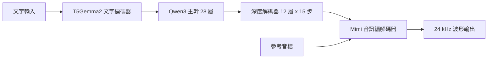
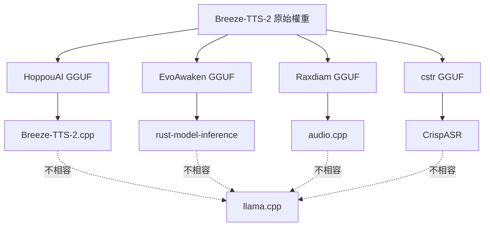

# Breeze-TTS-2 的 ONNX / GGUF 轉換版本調查

## 摘要

本文調查 `BreezeBlue/Breeze-TTS-2`（以下簡稱 Breeze-TTS-2）是否已有 ONNX 或 GGUF 格式的社群轉換版本。結論如下：

- **ONNX 版本：不存在。** 無論是官方模型庫或社群，目前查無任何針對 Breeze-TTS-2 的 ONNX 匯出檔或匯出腳本。
- **GGUF 版本：存在多個**，但分屬三種互不相容的自製執行環境，且**都無法在 llama.cpp 中載入**。
- **MLX 版本：存在多個**（Apple Silicon 專用），可作為替代方案。

## 背景：Breeze-TTS-2 是什麼

Breeze-TTS-2 是 BreezeBlue 於 2026-08-25 發布的雙語（英文、中文）文字轉語音模型，在 Hugging Face 上累積 767 個讚與約 14,108 次下載[^hf-model]。其標籤包含 `text-to-speech`、`voice-clone`、`voice-design`、`voice-direction`，底層為 Transformers + Safetensors + PyTorch 架構，授權為「BreezeBlue Research and Non-Commercial License」[^hf-model]。

模型本體並非單一網路，而是四個階段的堆疊[^evo-card][^cstr-card]：

- **T5Gemma2 文字編碼器**（約 26 層、1B 參數、雙向滑動視窗）
- **Qwen3 主幹**（約 28 層、1.4B 參數）
- **深度解碼器**（depth decoder，約 12 層、0.4B 參數，每格音訊需執行 15 個序列步驟）
- **音訊編解碼器／vocoder**（Mimi 系，約 0.1B 參數）

總參數量約 3.5B，輸出 24 kHz 音訊，支援從文字合成語音、以自然語言描述設計音色、以及用參考音檔複製音色[^evo-card]。

## ONNX 版本：查無結果

多次針對 Hugging Face 模型庫與 GitHub 的搜尋，均未發現 Breeze-TTS-2 的 ONNX 轉換：

- Hugging Face API 查詢 `search=Breeze-TTS-2&filter=onnx` 回傳空陣列[^hf-api-onnx-tts]。
- 查詢 `search=breeze-tts-2-onnx` 亦回傳空陣列[^hf-api-onnx-name]。
- 查詢 `filter=onnx&search=Breeze` 只找到與 Breeze-TTS-2 無關的成果：MediaTek 的 `Breeze2-VITS-onnx`（為舊版 Breeze2 VITS 模型的 ONNX 檔，與 Breeze-TTS-2 並非同一代模型）[^hf-api-onnx-breeze][^hf-mediatek-vits]，以及一系列 Breeze-ASR 語音辨識模型與 Pix2Text OCR 模型。
- GitHub 專案搜尋 `Breeze-TTS-2 onnx` 未回傳任何相關倉庫[^gh-search]。

**架構層面的可能原因：** Breeze-TTS-2 的推論流程包含條件分支（CFG，classifier-free guidance 的 scale 控制）、CUDA Graphs、動態形狀分桶（dynamic bucketing）與串流生成。這些動態行為在 ONNX 的靜態計算圖中不易表達[^evo-card][^smcleod-card]。其中 `smcleod/Breeze-TTS-2-int8` 的社群倉庫即以自製 `models/cudagraph/`、`models/stream_runtime/` 等模組繞過標準匯出路徑[^smcleod-card]。

### 容易混淆的對象

需特別提醒，MediaTek Research 的 `Breeze2-VITS-onnx` 雖然名稱含「Breeze」且為 ONNX 格式，但它是另一個世代、另一種架構（VITS）的模型，僅 121 MB，與 BreezeBlue 的 Breeze-TTS-2 無關[^hf-mediatek-vits]。同樣地，`Breeze-ASR-25-ONNX` 等系列是語音辨識而非語音合成[^hf-api-onnx-breeze]。

## GGUF 版本：存在但各自為政

Hugging Face API 查詢 `search=breeze-tts` 顯示，共有四個 GGUF 相關倉庫掛載 Breeze-TTS-2[^hf-api-breeze-tts]。**關鍵限制是：這些 GGUF 檔都不相容於 llama.cpp，各自需要專屬執行環境**，原因在於它們採用 `breeze` 與 `breeze_audio` 等非標準架構，且音訊編解碼器需要特殊的 mmproj 投影路徑[^evo-card][^hoppou-card][^rax-card]。

| 倉庫 | 量化版本 | 目標執行環境 | 讚數 | 月下載數 |
|------|----------|--------------|------|----------|
| `HoppouAI/Breeze-TTS-2.cpp` | F16、Q8_0、Q6_K、Q4_K 及 `-dd` 實驗變體 | Breeze-TTS-2.cpp（C++／ggml／Vulkan） | 35 | 14,193 |
| `EvoAwaken-Workshop/Breeze-TTS-2-gguf` | BF16、F16、F32、Q8_0、Q4_0、Q4_MIXED | rust-model-inference（Rust） | 1 | 932 |
| `Raxdiam/Breeze-TTS-2-GGUF` | BF16、F16、Q8_0、Q6_K、Q4_K | audio.cpp | 1 | 415 |
| `cstr/breeze-tts-2-GGUF` | F16、Q8_0、Q4_K | CrispASR | 5 | 2,057 |

各版本重點如下：

### 1. HoppouAI/Breeze-TTS-2.cpp（下載量最高）

這是 C++ 重實作版本，跑在 ggml 上並提供 Vulkan 後端，因此可在 NVIDIA、AMD、Intel GPU 上運作，亦可退回 CPU[^hoppou-card]。官方表示在 RTX 3060 上以 Q8_0 約可達 1.2 倍即時速度[^hoppou-card]。

可用檔案包含 `breeze-tts-2-f16.gguf`（5.9 GB）、`breeze-tts-2-q8_0.gguf`（3.3 GB，官方推薦）、`breeze-tts-2-q6_k.gguf`（2.9 GB）、`breeze-tts-2-q4_k.gguf`（2.4 GB），以及三個實驗性的 `-dd` 變體[^hoppou-card]。

作者特別警告 `-dd` 變體將深度解碼器一併量化（深度解碼器每格音訊要跑 15 步，是效能瓶頸），誤差會逐格累積，導致連續生成超過約 45 秒後聲音逐漸「悶掉、變薄」，且劣化是漸進而不明顯的，建議長篇旁白不要使用[^hoppou-card]。

該執行環境額外提供語音轉換（respeak）、內嵌非語音事件標籤（如 `(laugh)`、`[笑]`）與附 Web UI 的 HTTP／WebSocket 串流伺服器[^hoppou-card]。

### 2. EvoAwaken-Workshop/Breeze-TTS-2-gguf（Rust）

為 `Liyulingyue/rust-model-inference` 的原生 Rust 推論實作而轉換[^evo-card]。特色是**附帶一個獨立的音訊編解碼器投影檔** `breeze-tts-2-mmproj-F32.gguf`（651 MB），主模型檔案與編解碼器必須成對使用[^evo-card]。

提供 BF16／F16（各約 6.6 GB）、F32（13 GB，供 CPU 數值穩定性除錯）、Q8_0（3.6 GB，推薦部署）、Q4_0（2.1 GB，官方明言品質會退化）以及 Q4_MIXED[^evo-card]。該倉庫於 2026-09-16 移除了 `breeze-tts-2-codec-F32.gguf` 檔案[^evo-tree]。

### 3. Raxdiam/Breeze-TTS-2-GGUF（audio.cpp）

2026-10-22 新上架的版本，為 `audio.cpp` 而生[^rax-card]。它明確標示轉換基準來自 `audio-cpp/audio.cpp-gguf` 內的 BF16 檔，使用 audio.cpp 0.9.2 版的 `audiocpp_gguf.exe` 工具轉換[^rax-card][^audio-cpp-gguf]。提供 BF16（約 7.34 GB）、F16、Q8_0（約 4.93 GB）、Q6_K、Q4_K 五種版本，並附 SHA256SUMS 校驗檔[^rax-card]。

作者聲明**未進行任何額外訓練或微調**，且「共用 GGUF 容器格式並不代表與其他推論引擎相容」，明列不含 HoppouAI 版本與 llama.cpp[^rax-card]。倉庫未提供正式的品質基準測試[^rax-card]。

### 4. cstr/breeze-tts-2-GGUF（CrispASR）

為 `CrispASR` 專案轉換，提供 F16（約 5.7 GB）、Q8_0（約 3.0 GB）、Q4_K（約 2.2 GB）[^cstr-card]。此版本的音訊編解碼器**不含在模型檔內**，而是沿用 `cstr/qwen3-tts-tokenizer-12hz-GGUF`，因為 Breeze 內附的 tokenizer 與 `Qwen/Qwen3-TTS-Tokenizer-12Hz` 位元相同[^cstr-card]。轉換器另會丟棄約 1.16 GB 在推論時不可達的權重（`embed_text_tokens` 與殘留的 Mimi `codec_model.*`）[^cstr-card]。

### GGUF 相容性比較

## MLX 版本（替代方案）

若使用 Apple Silicon 裝置，社群提供多個 MLX 轉換版本[^hf-api-breeze-tts]：

- `mlx-community/Breeze-TTS-2-mlx`（BF16，3,226 次下載，讚數 9）
- `mlx-community/Breeze-TTS-2-mlx-4bit`（2,042 次下載）
- `mlx-community/Breeze-TTS-2-mlx-8bit`（948 次下載）
- `LunaFox/Breeze-TTS-2-mlx-4bit`、`npario/Breeze-TTS-2-mlx-8bit`、`rishikksh20/Breeze-TTS-2-mlx`
- `aufklarer/Breeze-TTS-2-MLX-8bit`、`aufklarer/Breeze-TTS-2-MLX-bf16`（2026-10-23 新增，為 speech-swift 專案而做）

這些為 Safetensors 格式的 MLX 權重，透過 Apple 的 MLX 框架執行，僅限 macOS。

## 其他量化格式

除 GGUF 與 MLX 外，社群還提供多種 PyTorch 生態的量化版本[^hf-api-breeze-tts]：

| 倉庫 | 量化方式 | 格式 |
|------|----------|------|
| `drbaph/Breeze-TTS-2-comfyui` | int8（convrot／hybrid／text-encoder 三種） | Safetensors（ComfyUI 用） |
| `smcleod/Breeze-TTS-2-int8` | torchao int8 | PyTorch bin |
| `alimpfard/breeze-tts-2-int4` | int4 | Safetensors |
| `mesmertech/Breeze-TTS-2-int4-hqq-g64` | HQQ int4（tinygemm） | Safetensors |
| `WarrenHal/breeze-tts-2-gptq-int4` | GPTQ int4（ROCm／AMD 用） | Safetensors |
| `EdnilsonMonts/Breeze-tts-2-brazillian-lora` | LoRA 微調（巴西葡語） | PEFT adapter |

## 結論與建議

1. **若你需要 ONNX：目前沒有現成方案。** 你必須自行以 PyTorch 匯出，但考量模型的動態形狀、CFG 分支、CUDA Graphs 與多階段串流架構，難度相當高[^evo-card][^smcleod-card]。可行的折衷是僅匯出較靜態的子模組（如文字編碼器、vocoder），主幹生成仍留在 Python。

2. **若你需要 GGUF：有三條互不相通的路徑。** 選擇時應以「你打算用哪個執行環境」為優先，而非檔案大小：
   - 想要 C++／Vulkan、跨 GPU 廠牌、且有現成 HTTP 伺服器 → HoppouAI 版本。
   - 想要 Rust 原生推論 → EvoAwaken 版本。
   - 想要 audio.cpp 生態 → Raxdiam 版本。
   - 想要 CrispASR 生態 → cstr 版本。

3. **務必留意授權。** 原始權重採「BreezeBlue Research and Non-Commercial License」，屬非商業授權；量化版本在官方授權文件中被明列為衍生模型並繼承相同限制，將其上架為服務屬於商業使用[^cstr-card][^rax-card]。Breeze-TTS-2.cpp 的原始碼本身為 Apache 2.0，但授權限制針對的是權重[^hoppou-card][^cstr-card]。

## 參考資料

[^hf-model]: BreezeBlue. (2026). BreezeBlue/Breeze-TTS-2 [Model card]. Hugging Face. Retrieved 2026-10-23, from https://huggingface.co/BreezeBlue/Breeze-TTS-2
[^hf-api-breeze-tts]: Hugging Face. (2026). Models API search results for "breeze-tts". Retrieved 2026-10-23, from https://huggingface.co/api/models?search=breeze-tts&limit=100
[^hf-api-onnx-tts]: Hugging Face. (2026). Models API search results for "Breeze-TTS" filtered by onnx. Retrieved 2026-10-23, from https://huggingface.co/api/models?search=Breeze-TTS&filter=onnx
[^hf-api-onnx-name]: Hugging Face. (2026). Models API search results for "breeze-tts-2-onnx". Retrieved 2026-10-23, from https://huggingface.co/api/models?search=breeze-tts-2-onnx
[^hf-api-onnx-breeze]: Hugging Face. (2026). Models API search results for "Breeze" filtered by onnx. Retrieved 2026-10-23, from https://huggingface.co/api/models?filter=onnx&search=Breeze
[^hf-mediatek-vits]: MediaTek-Research. (2025). MediaTek-Research/Breeze2-VITS-onnx [Model repository]. Hugging Face. Retrieved 2026-10-23, from https://huggingface.co/MediaTek-Research/Breeze2-VITS-onnx
[^gh-search]: GitHub. (2026). Repository search results for "Breeze-TTS-2 onnx". Retrieved 2026-10-23, from https://github.com/search?q=Breeze-TTS-2+onnx&type=repositories
[^hoppou-card]: HoppouAI. (2026). HoppouAI/Breeze-TTS-2.cpp [Model card]. Hugging Face. Retrieved 2026-10-23, from https://huggingface.co/HoppouAI/Breeze-TTS-2.cpp
[^evo-card]: EvoAwaken-Workshop. (2026). EvoAwaken-Workshop/Breeze-TTS-2-gguf [Model card]. Hugging Face. Retrieved 2026-10-23, from https://huggingface.co/EvoAwaken-Workshop/Breeze-TTS-2-gguf
[^evo-tree]: EvoAwaken-Workshop. (2026). Breeze-TTS-2-gguf file tree. Hugging Face. Retrieved 2026-10-23, from https://huggingface.co/EvoAwaken-Workshop/Breeze-TTS-2-gguf/tree/main
[^rax-card]: Raxdiam. (2026). Raxdiam/Breeze-TTS-2-GGUF [Model card]. Hugging Face. Retrieved 2026-10-23, from https://huggingface.co/Raxdiam/Breeze-TTS-2-GGUF
[^cstr-card]: cstr. (2026). cstr/breeze-tts-2-GGUF [Model card]. Hugging Face. Retrieved 2026-10-23, from https://huggingface.co/cstr/breeze-tts-2-GGUF
[^audio-cpp-gguf]: audio-cpp. (2026). audio-cpp/audio.cpp-gguf, Breeze-TTS-2-GGUF directory. Hugging Face. Retrieved 2026-10-23, from https://huggingface.co/audio-cpp/audio.cpp-gguf/tree/main/Breeze-TTS-2-GGUF
[^smcleod-card]: smcleod. (2026). smcleod/Breeze-TTS-2-int8 [Model card]. Hugging Face. Retrieved 2026-10-23, from https://huggingface.co/smcleod/Breeze-TTS-2-int8
