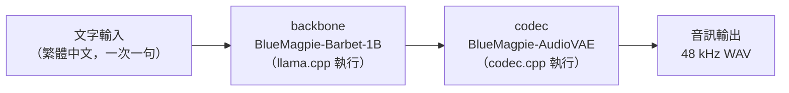

# 如何安裝與執行 BlueMagpie-TTS-GGUF

本報告說明如何設定並執行 BlueMagpie-TTS-GGUF：一套可在本機離線執行的台灣華語（Taiwanese-Mandarin）文字轉語音（Text-to-Speech, TTS）模型。內容涵蓋模型組成、環境需求、三種執行方式（命令列、Python、React Native）與常見注意事項。

## 一、這是什麼

BlueMagpie-TTS 是由 OpenFormosa 釋出的台灣華語 TTS 模型，輸出取樣率為 48 kHz，可用於華語與華語／英語混用的語音合成[^of]。而 `BricksDisplay/BlueMagpie-TTS-GGUF` 是將該模型轉換為 GGUF 格式的量化版本，專門供本機推論使用[^bricks]。

這套模型的一個關鍵設計是「**兩個檔案組成一個模型**」，類似 llama.cpp 的多模態投影器（multimodal projector）架構[^bricks]：

| 角色 | 檔案類型 | 由誰執行 | 用途 |
|---|---|---|---|
| backbone（主幹） | 模型檔（`--backbone`） | [llama.cpp](https://github.com/ggml-org/llama.cpp) | 文字轉語音的語言模型骨幹 |
| codec（編解碼器） | 音訊檔（`--model`） | [codec.cpp](https://github.com/mybigday/codec.cpp) | 音訊端（decoder / vocoder、說話者編碼器與轉接器） |

執行時由執行環境把這兩個計算圖連結起來，可在 CPU 或 GPU（CUDA、Vulkan、Metal）上完全離線運作[^bricks]。



## 二、重要前提：必須使用特製版 llama.cpp

BlueMagpie-TTS 的骨幹採用 **Barbet 架構（Mamba2 混合注意力）**，而上游的 llama.cpp 尚未支援此架構[^bricks]。因此：

- **不能使用原版（stock）llama.cpp**；
- 必須使用 codec.cpp 或 llama.rn 所建置、內含該架構修補（patch）的 llama.cpp[^bricks]。

好消息是，codec.cpp 在遞迴複製（`--recursive`）時會自動一併取得它所需的 llama.cpp，並套用上游缺少的架構修補，因此使用者不需手動處理[^codec]。

## 三、環境需求

- **CMake** 與 **C++ 編譯器**（建置 codec.cpp 時需要）[^bricks]。
- **Python 3**（使用 Python 綁定或 `hf` 下載工具時）。
- 記憶體：最小的建議組合約 1.8 GB，推薦組合約 2.3 GB，最佳品質約 3.3 GB[^bricks]。
- 可選：支援 CUDA / Vulkan / Metal 的 GPU，用以加速[^codec]。

## 四、步驟一：下載模型檔案

每次執行都需要「**一個模型檔 + 一個 codec 檔**」[^bricks]。以下為官方提供的組合[^bricks]：

| 組合 | 模型檔（`--backbone`） | codec 檔（`--model`） | 總大小 |
|---|---|---|---|
| 推薦（recommended） | `BlueMagpie-Barbet-1B-q8_0.gguf` | `BlueMagpie-AudioVAE-q8_0.gguf` | 2.3 GB |
| 最小（smallest） | `BlueMagpie-Barbet-1B-q4_k_m.gguf` | `BlueMagpie-AudioVAE-q8_0.gguf` | 1.8 GB |
| 最佳品質（best quality） | `BlueMagpie-Barbet-1B-f16.gguf` | `BlueMagpie-AudioVAE-q8_0.gguf` | 3.3 GB |

其他可選模型檔：`BlueMagpie-Barbet-1B-q5_k_m.gguf`（793 MB）、`BlueMagpie-Barbet-1B-q6_k.gguf`（899 MB）[^bricks]。

使用 `hf` 命令列工具下載（一次取得推薦組合）[^bricks]：

```bash
hf download BricksDisplay/BlueMagpie-TTS-GGUF BlueMagpie-Barbet-1B-q8_0.gguf BlueMagpie-AudioVAE-q8_0.gguf --local-dir BlueMagpie-TTS
```

## 五、步驟二：建置 codec.cpp 並用命令列合成語音

### 5.1 建置

codec.cpp 是一套以 C/C++ 實作的類神經音訊編解碼器推論引擎，授權為 MIT[^codec]。建置步驟如下[^codec]：

```bash
git clone --recursive https://github.com/mybigday/codec.cpp
cd codec.cpp
cmake -S . -B build -DCMAKE_BUILD_TYPE=Release   # GPU：加上 -DGGML_CUDA=ON / -DGGML_VULKAN=ON / -DGGML_METAL=ON
cmake --build build -j
```

> 注意必須使用 `--recursive`，因為它會一併取得執行文字端模型所需的 llama.cpp[^codec]。

### 5.2 合成語音

建置完成後即可使用 `tts-cli`[^bricks][^codec]：

```bash
./build/tts-cli synthesize --backbone BlueMagpie-TTS/BlueMagpie-Barbet-1B-q8_0.gguf --model BlueMagpie-TTS/BlueMagpie-AudioVAE-q8_0.gguf \
    --text "今天天氣很好，我們一起去散步吧。" --output out.wav
```

### 5.3 常用選項

`tts-cli synthesize` 支援多種選項[^codec]：

| 選項 | 功能 |
|---|---|
| `--voice NAME` | 使用內建語音；以 `tts-cli voices --model CODEC.gguf` 列出所有語音 |
| `--ref-audio FILE.wav` | 以短音訊片段複製聲音（限支援此功能的模型） |
| `--ref-text TEXT` | `--ref-audio` 的逐字稿（部分模型需要） |
| `--save-speaker FILE.gguf` / `--speaker-file FILE.gguf` | 儲存語音後重複使用 |
| `--seed N` | 可重現的輸出 |
| `--temp F`、`--top-k N`、`--top-p F`、`--min-p F`、`--repeat-penalty F` | llama.cpp 的取樣參數 |
| `--max-frames N` | 限制輸出長度 |
| `--gpu` | 使用建置時啟用的 GPU 後端 |
| `--n-threads N` | CPU 執行緒數 |
| `--override-kv KEY=TYPE:VALUE` | 變更 codec 檔案內儲存的設定 |

不帶任何參數執行 `tts-cli` 可顯示完整選項清單[^codec]。

### 5.4 提供 OpenAI 相容伺服器（可選）

`tts-server` 會載入一組模型檔，並提供相容於 OpenAI `POST /v1/audio/speech` 的介面[^codec]：

```bash
tts-server --backbone MODEL.gguf --model CODEC.gguf --port 8080   # 另有 --gpu, --n-threads, --parallel N, --api-key KEY

curl http://127.0.0.1:8080/v1/audio/speech -H 'Content-Type: application/json' \
    -d '{"model": "tts", "input": "Hello there.", "voice": "NAME", "response_format": "wav"}' -o out.wav
```

其中 `response_format` 為必填；`wav` 與 `pcm` 永遠可用，`mp3`、`opus`、`aac`、`flac` 則需在建置時額外啟用對應編碼器[^codec]。

## 六、步驟三：Python 綁定（可選）

`codec_cpp` 套件以相同的執行流程運作，且會一併建置內含修補的 llama.cpp，因此同樣需要 CMake 與 C++ 編譯器[^bricks]。安裝方式[^bricks]：

```bash
pip install "codec-cpp @ git+https://github.com/mybigday/codec.cpp" huggingface_hub soundfile
```

使用範例[^bricks]：

```python
import codec_cpp, soundfile
from huggingface_hub import hf_hub_download

tts = codec_cpp.TTS(hf_hub_download("BricksDisplay/BlueMagpie-TTS-GGUF", "BlueMagpie-Barbet-1B-q8_0.gguf"),
                    hf_hub_download("BricksDisplay/BlueMagpie-TTS-GGUF", "BlueMagpie-AudioVAE-q8_0.gguf"))
audio, sr = tts.synthesize("今天天氣很好，我們一起去散步吧。")
soundfile.write("out.wav", audio, sr)
```

其他 API：`tts.voices()` 列出內建語音；`ref_audio=` 可複製聲音（限支援的模型）；`tts.stream(text)` 會隨生成過程逐步回傳音訊[^bricks]。此外，`codec_cpp.TTS` 目前**僅支援 Linux**[^py]。

## 七、步驟四：React Native（llama.rn，可選）

若要在 iOS 與 Android 上使用，可透過 `mybigday/llama.rn` 載入相同的兩個檔案[^bricks]。llama.rn 是 llama.cpp 的 React Native 綁定，並透過 codec.cpp 提供裝置端 TTS[^rn]。

```ts
const ctx = await initLlama({ model: 'BlueMagpie-Barbet-1B-q8_0.gguf', embedding: true })
await ctx.initVocoder({ path: 'BlueMagpie-AudioVAE-q8_0.gguf' })
const { prompt, grammar, embedding, flow } = await ctx.getFormattedAudioCompletion({
  prompt: 'Hello world',
})
const result = await ctx.completion({ prompt, grammar, embedding })
const pcm = flow === 'continuous_embd'
  ? await ctx.decodeAudioEmbeddings(result.embeddings, result.embedding_dim)
  : await ctx.decodeAudioTokens(result.audio_tokens)
```

BlueMagpie-TTS 在 llama.rn 中屬於 `continuous_embd` 流程（連續潛在向量模型），且必須以 `embedding: true` 初始化[^rn]。llama.rn 官方測試顯示，BlueMagpie-TTS（Barbet-1B）在 Metal 與 macOS CPU 上通過，Android CPU 亦通過，但 Hexagon HTP 在初始化時會發生 cDSP 崩潰[^rn]。

## 八、輸入文字規則

- 輸入為**繁體中文**，建議一次輸入一句或一個短段落[^bricks]。
- 原始 PyTorch 模型支援「華語／英語混用」（code-switching）與兩種互斥的生成模式：centroid-only（僅用說話者質心）與 speaker-reference-audio-only（僅用參考音訊）[^of]。
- 使用參考音訊複製聲音時，參考片段建議至少 3 秒，且**只能使用已獲授權的說話者**音訊[^of]。

## 九、授權與使用限制

- BlueMagpie-TTS-GGUF 沿用原始模型的條款（`license: other`，授權名稱為 `bluemagpie-tts`），釋出目的為**研究與評估**[^bricks]。
- 原始模型明文規定：除非已釐清目的用途的權利與同意，否則不得再散布該檢查點（checkpoint）或生成的語音[^of]。
- codec.cpp 本身為 MIT 授權[^codec]。

## 十、注意事項與限制總覽

1. **務必使用修補版 llama.cpp**：原版 llama.cpp 不支援 Barbet 架構，若誤用將無法載入 backbone[^bricks]。
2. **兩個檔案缺一不可**：缺少 codec 檔就無法產生音訊[^bricks]。
3. **Python 綁定僅限 Linux**（截至目前）[^py]。
4. **TTS 功能在 llama.rn 中標示為實驗性**：API 可能隨時變動，且並非所有模型在所有後端都能正確發聲[^rn]。
5. **GitHub 專案熱度差異大**：`mybigday/codec.cpp` 星數偏低（約 11 stars，2026-02-22 建立），屬於相對新且小眾的專案；`mybigday/llama.rn` 則較成熟（約 1,061 stars）[^api-cpp][^api-rn]。使用 codec.cpp 時宜留意其仍在快速演進。

## 參考資料

[^bricks]: BricksDisplay. (n.d.). *BlueMagpie-TTS-GGUF*. Hugging Face. Retrieved 2026-10-23, from https://huggingface.co/BricksDisplay/BlueMagpie-TTS-GGUF

[^of]: OpenFormosa. (n.d.). *BlueMagpie-TTS*. Hugging Face. Retrieved 2026-10-23, from https://huggingface.co/OpenFormosa/BlueMagpie-TTS

[^codec]: mybigday. (n.d.). *codec.cpp: Neural audio codec inference in C/C++*. GitHub. Retrieved 2026-10-23, from https://github.com/mybigday/codec.cpp

[^rn]: mybigday. (n.d.). *llama.rn: React Native binding of llama.cpp*. GitHub. Retrieved 2026-10-23, from https://github.com/mybigday/llama.rn

[^py]: mybigday. (n.d.). *codec-cpp (Python bindings)*. GitHub. Retrieved 2026-10-23, from https://github.com/mybigday/codec.cpp/blob/main/python/README.md

[^api-cpp]: GitHub REST API. (n.d.). *Repository metadata for mybigday/codec.cpp* [Data file]. Retrieved 2026-10-23, from https://api.github.com/repos/mybigday/codec.cpp

[^api-rn]: GitHub REST API. (n.d.). *Repository metadata for mybigday/llama.rn* [Data file]. Retrieved 2026-10-23, from https://api.github.com/repos/mybigday/llama.rn

[^modelapi]: Hugging Face API. (n.d.). *Model info for BricksDisplay/BlueMagpie-TTS-GGUF* [Data file]. Retrieved 2026-10-23, from https://huggingface.co/api/models/BricksDisplay/BlueMagpie-TTS-GGUF
