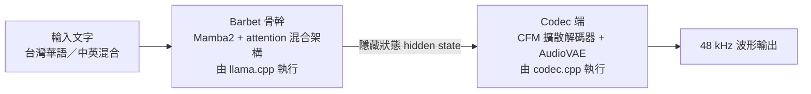
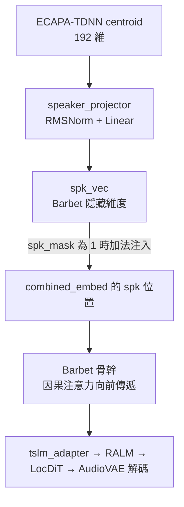

# BlueMagpie-TTS-GGUF 的安裝、執行與語者向量（centroid / embedding）機制

## 摘要

BlueMagpie-TTS 是一套針對台灣華語與中英混合情境設計的開源文字轉語音（TTS）模型，輸出 48 kHz 語音[^bmrepo]。社群後續將其在 Hugging Face 上量化為 GGUF 格式（`BricksDisplay/BlueMagpie-TTS-GGUF`），使其可以在 CPU 或 GPU 上完全離線執行[^hfgguf]。本篇報告說明這套 GGUF 版本的完整安裝與執行流程，並特別聚焦「語者向量（centroid / embedding vector）」這一部分的機制、目前實作狀態，以及它與原始 PyTorch 版本的落差分。

一句話總結關鍵發現：**原始的 PyTorch 版本支援以 `speaker_centroid`（一個 192 維的 ECAPA-TDNN 語者向量）控制音色；但在目前的 GGUF / codec.cpp 執行路徑中，這條語者向量條件路徑尚未接通，模型固定使用內建的「空語者（null speaker）」token，因此無法真正複製參考語者的音色**[^ltspeaker][^cfmspeaker]。

## 一、什麼是 BlueMagpie-TTS

BlueMagpie-TTS 由 OpenFormosa 社群維護，GitHub 倉庫為 `OpenFormosa/BlueMagpie-TTS`，截至撰稿時約有 69 顆星[^bmrepoapi]。它主打：

- 台灣華語與中英混合（code-switching）情境：像「這個 feature 明天上線」這種台灣日常語句不必改寫即可自然唸出[^bmrepo]。
- 輸出 48 kHz 高品質語音[^bmrepo]。
- 在同一份內部測試集上，字元錯誤率（CER）為 7.4%，比參考基準系統的 11.4% 相對降低約 35%[^bmrepo]。

專案名稱取自台灣藍鵲（Taiwan Blue Magpie，學名 *Urocissa caerulea*），象徵「會發聲、辨識度高」與「立足台灣」的定位[^bmrepo]。

## 二、整體架構：兩個檔案組成一個模型

GGUF 版本的核心設計概念，是**用兩個 GGUF 檔案組成一個完整模型**，類似 llama.cpp 的多模態投影器（multimodal projector）切分方式[^hfgguf]：

- **model（backbone）檔**：文字轉語音的語言模型主幹，由 llama.cpp 執行[^hfgguf]。
- **codec 檔**：音訊端（解碼器／聲碼器、語者編碼器，以及兩者之間的轉接器），由 codec.cpp 執行[^hfgguf]。

兩者的分工可用下列示意說明：



其中骨幹 Barbet 是 Mamba2 與注意力（attention）的混合架構，**上游的 llama.cpp 尚未支援此架構**，因此必須使用 codec.cpp 或 llama.rn 自行編譯、內含 patch 的 llama.cpp，而不能用原版 llama.cpp[^hfgguf]。這個 patch 以 `patches/barbet-llamacpp.patch` 形式存在，並由 CMake 在建置時自動套用到 pinned 的 llama.cpp 子模組上[^barbetpatch]。

## 三、檔案與硬體選擇

每一次執行都需要「一個 model 檔 + 一個 codec 檔」[^hfgguf]。可選的組合如下表[^hfgguf]：

| 用途 | `--backbone`（model） | `--model`（codec） | 總大小 |
|---|---|---|---|
| 建議 | `BlueMagpie-Barbet-1B-q8_0.gguf` | `BlueMagpie-AudioVAE-q8_0.gguf` | 2.3 GB |
| 最小 | `BlueMagpie-Barbet-1B-q4_k_m.gguf` | `BlueMagpie-AudioVAE-q8_0.gguf` | 1.8 GB |
| 最佳品質 | `BlueMagpie-Barbet-1B-f16.gguf` | `BlueMagpie-AudioVAE-q8_0.gguf` | 3.3 GB |

其他可選的量化檔還包括 `BlueMagpie-Barbet-1B-q5_k_m.gguf`（793 MB）與 `BlueMagpie-Barbet-1B-q6_k.gguf`（899 MB）[^hfgguf]。

codec 檔（AudioVAE）本身是連續潛在（continuous latent）解碼器架構，其 GGUF 的 `general.architecture` 為 `bluemagpie_audiovae`[^hfapi]。codec.cpp 支援的硬體後端包含 CPU 以及 CUDA、Vulkan、Metal 等 GPU 後端，可完全離線執行[^hfgguf]。

## 四、安裝與執行（三種方式）

### 4.1 命令列：tts-cli（codec.cpp）

這是官方在 GGUF 模型卡上推薦的主要方式。首先下載兩個檔案，接著使用 codec.cpp 的 `tts-cli` 合成[^hfgguf]：

```bash
hf download BricksDisplay/BlueMagpie-TTS-GGUF \
    BlueMagpie-Barbet-1B-q8_0.gguf BlueMagpie-AudioVAE-q8_0.gguf \
    --local-dir BlueMagpie-TTS

./build/tts-cli synthesize \
    --backbone BlueMagpie-TTS/BlueMagpie-Barbet-1B-q8_0.gguf \
    --model    BlueMagpie-TTS/BlueMagpie-AudioVAE-q8_0.gguf \
    --text "今天天氣很好，我們一起去散步吧。" --output out.wav
```

建置 `tts-cli` 需要**遞迴地** clone codec.cpp（因為它會取得負責執行文字端模型的 llama.cpp），且 CMake 會在建置時套用 Barbet 架構的 patch[^codecrepo][^barbetpatch]：

```bash
git clone --recursive https://github.com/mybigday/codec.cpp
cd codec.cpp
cmake -S . -B build -DCMAKE_BUILD_TYPE=Release   # GPU：再加入 -DGGML_CUDA=ON / -DGGML_VULKAN=ON / -DGGML_METAL=ON
cmake --build build -j
```

若要查看模型中可用的語者名稱，可用 `tts-cli voices --model CODEC.gguf`[^codecrepo]。合成時可用的選項包括 `--voice NAME`、`--ref-audio FILE.wav`（克隆短語音中的音色）、`--save-speaker FILE.gguf` / `--speaker-file FILE.gguf`、`--seed N`、取樣參數（`--temp`、`--top-k`、`--top-p`、`--min-p`、`--repeat-penalty` 等）以及 `--gpu`、`--n-threads`[^codecrepo]。

其中與本報告主題最相關的是：`--ref-audio` 是否可用，取決於「codec 是否內含語者編碼器（speaker encoder）」[^codecspeaker]。

### 4.2 Python：codec_cpp 套件

`codec_cpp` 套件執行同一條管線，並以 ctypes 包裝 codec.cpp，其唯一依賴是 numpy；不過因為它會一併建置內含的 llama.cpp，所以需要 CMake 與 C++ 編譯器[^hfgguf][^pyreadme]：

```bash
pip install "codec-cpp @ git+https://github.com/mybigday/codec.cpp" \
    huggingface_hub soundfile
```

```python
import codec_cpp, soundfile
from huggingface_hub import hf_hub_download

tts = codec_cpp.TTS(
    hf_hub_download("BricksDisplay/BlueMagpie-TTS-GGUF", "BlueMagpie-Barbet-1B-q8_0.gguf"),
    hf_hub_download("BricksDisplay/BlueMagpie-TTS-GGUF", "BlueMagpie-AudioVAE-q8_0.gguf"),
)
audio, sr = tts.synthesize("今天天氣很好，我們一起去散步吧。")
soundfile.write("out.wav", audio, sr)
```

`TTS.synthesize` 的 `synthesize` 介面也支援 `voice=`（內建語者名稱或以 `codec_cpp.Speaker` 物件）、`ref_audio=`（克隆，模型支援時）以及 `tts.stream(text)` 逐段產生音訊[^hfgguf][^pyreadme]。

### 4.3 React Native：llama.rn

`llama.rn`（GitHub 約 1061 顆星）將同一組兩個檔案載入 iOS 與 Android 裝置[^llamarn][^llamarnapi]。其 TTS 為實驗性功能，在支援清單中明確列出 **BlueMagpie-TTS（Barbet backbone + AudioVAE）**，其合成 `flow` 為 `continuous_embd`（連續潛在向量流）[^llamarn]。

```ts
const ctx = await initLlama({
  model: 'BlueMagpie-Barbet-1B-q8_0.gguf',
  embedding: true,   // 連續潛在模型必須開啟 embedding
})
await ctx.initVocoder({ path: 'BlueMagpie-AudioVAE-q8_0.gguf' })
const { prompt, grammar, embedding, flow } = await ctx.getFormattedAudioCompletion({
  prompt: '今天天氣很好，我們一起去散步吧。',
})
const result = await ctx.completion({ prompt, grammar, embedding })
const pcm = flow === 'continuous_embd'
  ? await ctx.decodeAudioEmbeddings(result.embeddings, result.embedding_dim)
  : await ctx.decodeAudioTokens(result.audio_tokens)
```

需要注意的是，連續潛在與 codec-LM AR 類模型都必須以 `embedding: true` 初始化[^llamarn]。

## 五、語者向量（centroid / embedding vector）機制

這是本報告的重點。要理解 GGUF 版本的現況，必須先理解原始 PyTorch 版本的設計。

### 5.1 原始 PyTorch 版本：centroid 是怎麼運作的

在原始的 `OpenFormosa/BlueMagpie-TTS` 中，模型支援「指定語者：以語者向量控制音色」。模型自帶一個多語者向量表 `checkpoints/speaker_centroids.pt`，目前內含兩個語者[^bmrepo]：

| 語者 ID | 說明 | 建議 `cfg_value` |
|---|---|---|
| `hung_yi_lee` | 李宏毅（Hung-yi Lee）老師的語者向量（已取得本人授權） | 2.0–2.8 |
| `female_voice` | 一個通用女聲語者向量 | 2.0–2.8 |

向量表的格式為 `{"speaker_ids": [...], "centroids": tensor[N, 192], "dim": 192}`；使用時以 `torch.load` 載入後，依語者 ID 取出該語者的 `[192]` 向量，再透過 `speaker_centroid` 指定音色[^bmrepo]。

以內附語者合成第一句的範例程式如下[^bmrepo]：

```python
import os
import torch
import soundfile as sf
from huggingface_hub import snapshot_download
from transformers import PreTrainedTokenizerFast
from bluemagpie import BlueMagpieModel

model_dir = snapshot_download("OpenFormosa/BlueMagpie-TTS")
tokenizer = PreTrainedTokenizerFast(
    tokenizer_file=os.path.join(model_dir, "tokenizer.json"))

device = "cuda" if torch.cuda.is_available() else (
    "mps" if torch.backends.mps.is_available() else "cpu")
model = BlueMagpieModel.from_local(
    model_dir, tokenizer=tokenizer, training=False, device=device)

table = torch.load(
    os.path.join(model_dir, "checkpoints", "speaker_centroids.pt"),
    map_location="cpu", weights_only=True)
centroid = table["centroids"][table["speaker_ids"].index("hung_yi_lee")]

audio = model.generate(
    target_text="你好，這是 BlueMagpie 合成的第一句話。",
    speaker_centroid=centroid,
    cfg_value=2.0,
)
sf.write("hello.wav", audio.squeeze().cpu().numpy(), model.sample_rate)
```

### 5.2 centroid 的產生方式

語者向量本身是先用 ECAPA-TDNN 從參考音檔抽出的。`scripts/extract_speaker_centroid.py` 提供下列指令，需要額外安裝 `speechbrain`（`pip install -e ".[clone]"`）[^bmrepo]：

```bash
python scripts/extract_speaker_centroid.py --audio reference.wav --out my_voice.pt
# 多段同一語者更穩定：--audio a.wav b.wav c.wav
```

其核心邏輯位於 `src/bluemagpie/centroid.py`：以 `speechbrain/spkrec-ecapa-voxceleb`（ECAPA-TDNN）為預設編碼器，將每個約 6 秒的音訊區塊嵌入為 192 維向量、逐塊做 L2 正規化，全部平均後再 L2 正規化，得到最終的 `[192]` centroid[^bmcentroid]。

值得注意的是，`speaker_centroids.pt` 中的每個 centroid 是**同一語者多句語音嵌入的平均值**，且是訓練前離線計算好的。這樣的設計是刻意的：使用去雜訊後的平均值而非單句嵌入，可避免模型「作弊」，把該片段的韻律或內容當成捷徑；centroid 只捕捉聲音中「恆定」的部分——身分、音色與基礎音高[^bmconditioning]。

### 5.3 centroid 如何注入模型

centroid 透過 `SpeakerProjector` 投影到 Barbet 骨幹的隱藏維度，再以「加法」方式注入到序列的第一個位置（`[spk]` 槽位）。`SpeakerProjector` 的結構是兩步[^bmconditioning]：

1. **`RMSNorm`**：對輸入 centroid 做 RMS 正規化（`in_dim`）。
2. **`nn.Linear(in_dim, out_dim)`**：線性投影，並以極小的權重初始化（常態分布 std=0.02、bias 為零），使「冷啟動」的語者向量在訓練初期不會破壞預訓練好的 Barbet 骨幹。

其注入機制在 `_inject_speaker` 中實作，以殘差方式把投影後的向量加在 `spk_mask` 為 1 的位置上；當 `spk_mask` 為 0 時，該槽位保留 `[spk]` token 自身的學習嵌入，這正是所謂的「學習到的空語者（learned null speaker）」[^bmmodel]。

推論時的三種模式由 `speaker_slot` 決定[^bmmodel]：

| 條件 | `speaker_slot` | 效果 |
|---|---|---|
| 提供 `speaker_centroid` | `"centroid"` | `[spk]` token + 投影後的 centroid 向量 |
| `use_null_speaker=True`（預設） | `"null"` | 僅 `[spk]` token（學習到的空語者） |
| `use_null_speaker=False` | `"none"` | 完全沒有 `[spk]` token |

整個資料流可整理如下：



`reference_wav_path` 這條路徑與 centroid 是分開的：`reference_wav_path` 會被編碼成參考音訊前綴，夾在 `[spk]` 與文字之間，提供韻律與音色的範例；但語者身分本身仍來自外部計算好的 centroid，模型自己不從音訊抽 centroid[^bmmodel]。

## 六、GGUF / codec.cpp 執行路徑的語者向量現況

### 6.1 目前狀態：語者向量未接通，固定使用空語者

在 GGUF 版本所使用的 codec.cpp 執行路徑中，語者向量條件路徑**尚未接通**。具體證據如下：

- codec.cpp 的 BlueMagpie CFM 實作（`src/lm/bluemagpie_cfm.cpp`）中，語者編碼介面被明確設為空：`/*.speaker_encode =*/ nullptr`；且檔案中完全沒有 `lm.speaker`、`speaker_projector`、或任何 `SPEAKER` 相關的權重載入或計算[^cfmspeaker]。
- prefill 圖（`build_prefill`）對每一個前綴位置一律當作文字位置處理，並以零向量填補 speaker 的條件欄位，其註解即寫明「零樣本 / 空語者（zero-shot / "null" speaker）」[^cfmspeaker]。
- `common/audio_lm.cpp` 中，Barbet（BlueMagpie）的提示模板被硬編碼為 `<|bm_spk|>` + 文字 + `<|bm_audio_start|>`，且註解為「control tokens, no BOS」[^audiolm]。

換句話說，GGUF 路徑固定在第 0 個位置放出 `<|bm_spk|>` 這個控制 token，讓模型取用「學習到的空語者」嵌入，而無法注入外部 centroid。

### 6.2 為何是這個控制 token，而非 tokenizer.json 裡的 token

這是一個容易踩雷的細節。BlueMagpie 的 `<|bm_spk|>` 與 `<|bm_audio_start|>` **不是** `tokenizer.json` 中的 `<|speaker|>`（114674）與 `<|audio_start|>`（114666）條目。模型是透過 speaker dropout 訓練，其 `spk` 槽位是在 Megatron 的 *padding region* 中自動配置的（例如 `spk=114826`、`audio_start=114822`），模型正是在**那些**嵌入列上被條件化的[^ltspeaker]。轉換器已把這些 padding region 的 id 烘焙成控制 token `<|bm_spk|>` / `<|bm_audio_start|>`，因此只要以 `parse_special=true` 送出這兩個字串，就會對應到正確的嵌入列[^ltspeaker]。

### 6.3 codec 端沒有內建語者，因此 `--ref-audio` 對 BlueMagpie 無效

在 codec.cpp 的語者框架中，codec GGUF 是否內建語者編碼器，是由 `codec.speaker.has_encoder` 之類的 metadata 決定；`audio_lm_build_prompt` 只在模型具有語者編碼區段時才會執行 `codec_lm_speaker_encode`[^audiolm]。而 BlueMagpie 的轉換器註解明確指出：雖然 SpeakerProjector 的權重有隨 GGUF 出貨（`lm.speaker.*`），但 **ECAPA centroid 前端尚未接入 codec_lm 的語者 API，因此不宣告有語者編碼器**[^bmconv]。

對照 codec.cpp 的模型支援狀態表，BlueMagpie 在 codec 與 TTS 兩張表中都標記為「✅ 完整支援」，但這指的是**端到端可執行**，而非語者複製功能完整[^modelstatus]。llama.rn 的測試表亦指出 BlueMagpie-TTS 在 Metal、macOS CPU、Android CPU 上輸出的語音「與輸入一致」，但在 Hexagon HTP 上 init 會 crash[^llamarn]。

### 6.4 其他相關的生成參數

雖然語者向量未接通，但 GGUF 路徑的其他生成細節仍與原模型相當：

- **CFM 步數與引導強度**：由請求的 `flow_steps` / `flow_guidance` 指定，未指定則取自 codec GGUF 的 `codec.lm.cfm_n_timesteps`（預設 10）與 `codec.lm.cfm_cfg_value`（預設 2.0），對應 VoxCPM 的 `generate` 設定[^continuous]。
- **停止頭（stop head）**：由 `lm_hidden` 經 SiLU + 線性層產生 2 個 logits，當 `logit[1] > logit[0]` 時停止[^cfmspeaker]。
- **`min_len` 護欄**：參考實作採 `if i > min_len and stop == 1: break`，因此 patch 索引 0..min_len 期間會忽略停止訊號；GGUF 預設讀取 `codec.lm.min_len`（預設 2）[^cfmspeaker]。
- **`tslm_adapter`**：將 Barbet 隱藏空間映射到 vox（潛在）空間，結構為 RMSNorm → 線性投影 → 殘差 SwiGLU 區塊；文字位置跳過 FSQ，生成位置在 adapter 之後套用 FSQ[^cfmspeaker]。
- **種子（seed）**：CFM 的初始雜訊屬於「模型自身的隨機性」而非 token 取樣，由 `codec_audio_lm_set_seed` 設定；未設定則為隨機。主機（host）應把使用者給定的種子傳入[^audiocmn]。

### 6.5 若要真正使用 centroid，目前可行的替代路徑

由於 GGUF 路徑的 centroid 尚未接通，若研究或應用上必須用到特定語者向量，可考慮：

1. **改用原始 PyTorch 版本**：直接使用 `OpenFormosa/BlueMagpie-TTS` 的 `speaker_centroid` 參數，這一條路徑目前是唯一「官方支援」的語者向量控制方式[^bmrepo]。
2. **使用托管 Demo**：Hugging Face Space `voidful/BlueMagpie-TTS-Demo` 以相同 checkpoint 權重提供互動式試玩，可先確認音色需求[^bmhf]。
3. **等待上游接通**：codec.cpp 的 BlueMagpie 轉換器已把 `lm.speaker.*` 權重放進 GGUF，只是執行期尚未使用；一旦上游把 ECAPA 前端接入 codec_lm 語者 API，同一條 `--ref-audio` / 語者向量路徑即可通用[^bmconv]。

需要再次強調：使用任何語者複製功能時，都應只使用已取得授權的聲音，並在未經本人同意前不要複製他人聲音[^bmrepo]。

## 七、來源評估與限制

- **時效性**：codec.cpp 與 llama.rn 皆為高速迭代專案，本報告所依據的 `main` 分支內容在 2026-10-23 前後取得[^codecrepoapi][^llamarnapi]。BlueMagpie 語者路徑「尚未接通」的結論可能隨上游更新而改變，建議以實際執行 `tts-cli voices` 與 `--ref-audio` 的結果為準。
- **權威性**：模型卡與官方 README 屬一手資料；本報告關於「未接通」的判斷來自上游原始碼註解與函式簽章（如 `speaker_encode = nullptr`、轉換器註解），可信度較高，但仍屬「讀碼推論」而非官方明確聲明[^cfmspeaker][^bmconv]。
- **星數背景**：`OpenFormosa/BlueMagpie-TTS` 約 69 星、`mybigday/codec.cpp` 約 11 星[^bmrepoapi][^codecrepoapi]；`codec.cpp` 星數偏低，但其為 `llama.rn`（約 1061 星）的底層依賴，且 BlueMagpie GGUF 由同一維護者生態發布，故仍具實際參考價值[^llamarnapi]。本主題相當小眾，僅有這些低星專案可報告，故仍納入並附上背景說明。
- **未涵蓋事項**：本報告未實測任何安裝流程（未實際下載模型或編譯 codec.cpp），所有指令均為官方文件所述步驟的整理[^codecrepo][^hfgguf]。

## 參考文獻

OpenFormosa. (n.d.). *BlueMagpie-TTS* [Computer software]. GitHub. Retrieved 2026-10-23, from https://github.com/OpenFormosa/BlueMagpie-TTS

OpenFormosa. (n.d.). *BlueMagpie-TTS model card*. Hugging Face. Retrieved 2026-10-23, from https://huggingface.co/OpenFormosa/BlueMagpie-TTS

BricksDisplay. (n.d.). *BlueMagpie-TTS-GGUF* [Model]. Hugging Face. Retrieved 2026-10-23, from https://huggingface.co/BricksDisplay/BlueMagpie-TTS-GGUF

mybigday. (n.d.). *codec.cpp: Neural audio codec inference in C/C++* [Computer software]. GitHub. Retrieved 2026-10-23, from https://github.com/mybigday/codec.cpp

mybigday. (n.d.). *llama.rn: React Native binding of llama.cpp* [Computer software]. GitHub. Retrieved 2026-10-23, from https://github.com/mybigday/llama.rn

mybigday. (n.d.). *Model support status*. GitHub. Retrieved 2026-10-23, from https://github.com/mybigday/codec.cpp/blob/main/docs/model_status.md

mybigday. (n.d.). *codec_audio_lm — running audio LMs with a llama.cpp backbone*. GitHub. Retrieved 2026-10-23, from https://github.com/mybigday/codec.cpp/blob/main/docs/codec_common_api.md

mybigday. (n.d.). *codec_lm — LM adaptor design*. GitHub. Retrieved 2026-10-23, from https://github.com/mybigday/codec.cpp/blob/main/docs/codec_lm.md

mybigday. (n.d.). *Codec speakers (codec_speaker)*. GitHub. Retrieved 2026-10-23, from https://github.com/mybigday/codec.cpp/blob/main/docs/codec_speaker.md

mybigday. (n.d.). *Barbet arch for llama.cpp* (barbet-llamacpp-README.md). GitHub. Retrieved 2026-10-23, from https://github.com/mybigday/codec.cpp/blob/main/patches/barbet-llamacpp-README.md

mybigday. (n.d.). *Bluemagpie CFM implementation* (src/lm/bluemagpie_cfm.cpp). GitHub. Retrieved 2026-10-23, from https://github.com/mybigday/codec.cpp/blob/main/src/lm/bluemagpie_cfm.cpp

mybigday. (n.d.). *Continuous-latent families* (common/audio_lm_family_continuous.cpp). GitHub. Retrieved 2026-10-23, from https://github.com/mybigday/codec.cpp/blob/main/common/audio_lm_family_continuous.cpp

mybigday. (n.d.). *audio_lm implementation* (common/audio_lm.cpp). GitHub. Retrieved 2026-10-23, from https://github.com/mybigday/codec.cpp/blob/main/common/audio_lm.cpp

mybigday. (n.d.). *BlueMagpie converter* (scripts/converters/bluemagpie.py). GitHub. Retrieved 2026-10-23, from https://github.com/mybigday/codec.cpp/blob/main/scripts/converters/bluemagpie.py

mybigday. (n.d.). *codec_cpp Python bindings* (python/README.md). GitHub. Retrieved 2026-10-23, from https://github.com/mybigday/codec.cpp/blob/main/python/README.md

[^bmrepo]: OpenFormosa. (n.d.). *BlueMagpie-TTS* [Computer software]. GitHub. Retrieved 2026-10-23, from https://github.com/OpenFormosa/BlueMagpie-TTS

[^bmrepoapi]: OpenFormosa. (n.d.). *BlueMagpie-TTS* [Computer software]. GitHub API. Retrieved 2026-10-23, from https://api.github.com/repos/OpenFormosa/BlueMagpie-TTS

[^bmhf]: OpenFormosa. (n.d.). *BlueMagpie-TTS model card*. Hugging Face. Retrieved 2026-10-23, from https://huggingface.co/OpenFormosa/BlueMagpie-TTS

[^hfgguf]: BricksDisplay. (n.d.). *BlueMagpie-TTS-GGUF* [Model]. Hugging Face. Retrieved 2026-10-23, from https://huggingface.co/BricksDisplay/BlueMagpie-TTS-GGUF

[^hfapi]: BricksDisplay. (n.d.). *BlueMagpie-TTS-GGUF* [Model metadata]. Hugging Face API. Retrieved 2026-10-23, from https://huggingface.co/api/models/BricksDisplay/BlueMagpie-TTS-GGUF

[^codecrepo]: mybigday. (n.d.). *codec.cpp: Neural audio codec inference in C/C++* [Computer software]. GitHub. Retrieved 2026-10-23, from https://github.com/mybigday/codec.cpp

[^codecrepoapi]: mybigday. (n.d.). *codec.cpp* [Computer software metadata]. GitHub API. Retrieved 2026-10-23, from https://api.github.com/repos/mybigday/codec.cpp

[^barbetpatch]: mybigday. (n.d.). *Barbet arch for llama.cpp* (barbet-llamacpp-README.md). GitHub. Retrieved 2026-10-23, from https://github.com/mybigday/codec.cpp/blob/main/patches/barbet-llamacpp-README.md

[^modelstatus]: mybigday. (n.d.). *Model support status*. GitHub. Retrieved 2026-10-23, from https://github.com/mybigday/codec.cpp/blob/main/docs/model_status.md

[^audiocmn]: mybigday. (n.d.). *codec_audio_lm — running audio LMs with a llama.cpp backbone*. GitHub. Retrieved 2026-10-23, from https://github.com/mybigday/codec.cpp/blob/main/docs/codec_common_api.md

[^audiolm]: mybigday. (n.d.). *audio_lm implementation* (common/audio_lm.cpp). GitHub. Retrieved 2026-10-23, from https://github.com/mybigday/codec.cpp/blob/main/common/audio_lm.cpp

[^continuous]: mybigday. (n.d.). *Continuous-latent families* (common/audio_lm_family_continuous.cpp). GitHub. Retrieved 2026-10-23, from https://github.com/mybigday/codec.cpp/blob/main/common/audio_lm_family_continuous.cpp

[^cfmspeaker]: mybigday. (n.d.). *Bluemagpie CFM implementation* (src/lm/bluemagpie_cfm.cpp). GitHub. Retrieved 2026-10-23, from https://github.com/mybigday/codec.cpp/blob/main/src/lm/bluemagpie_cfm.cpp

[^bmconv]: mybigday. (n.d.). *BlueMagpie converter* (scripts/converters/bluemagpie.py). GitHub. Retrieved 2026-10-23, from https://github.com/mybigday/codec.cpp/blob/main/scripts/converters/bluemagpie.py

[^codecspeaker]: mybigday. (n.d.). *Codec speakers (codec_speaker)*. GitHub. Retrieved 2026-10-23, from https://github.com/mybigday/codec.cpp/blob/main/docs/codec_speaker.md

[^pyreadme]: mybigday. (n.d.). *codec_cpp Python bindings* (python/README.md). GitHub. Retrieved 2026-10-23, from https://github.com/mybigday/codec.cpp/blob/main/python/README.md

[^llamarn]: mybigday. (n.d.). *llama.rn: React Native binding of llama.cpp* [Computer software]. GitHub. Retrieved 2026-10-23, from https://github.com/mybigday/llama.rn

[^llamarnapi]: mybigday. (n.d.). *llama.rn* [Computer software metadata]. GitHub API. Retrieved 2026-10-23, from https://api.github.com/repos/mybigday/llama.rn

[^ltspeaker]: mybigday. (n.d.). *BlueMagpie-TTS prompt construction* (cpp/rn-tts.cpp). GitHub. Retrieved 2026-10-23, from https://github.com/mybigday/llama.rn/blob/main/cpp/rn-tts.cpp

[^bmcentroid]: OpenFormosa. (n.d.). *Speaker centroid extraction* (src/bluemagpie/centroid.py). GitHub. Retrieved 2026-10-23, from https://github.com/OpenFormosa/BlueMagpie-TTS/blob/main/src/bluemagpie/centroid.py

[^bmconditioning]: OpenFormosa. (n.d.). *Speaker conditioning* (src/bluemagpie/conditioning.py). GitHub. Retrieved 2026-10-23, from https://github.com/OpenFormosa/BlueMagpie-TTS/blob/main/src/bluemagpie/conditioning.py

[^bmmodel]: OpenFormosa. (n.d.). *Model implementation* (src/bluemagpie/model.py). GitHub. Retrieved 2026-10-23, from https://github.com/OpenFormosa/BlueMagpie-TTS/blob/main/src/bluemagpie/model.py
