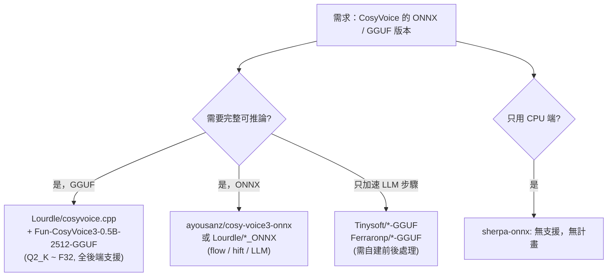

# CosyVoice 的 ONNX / GGUF 版本調查

## 摘要

CosyVoice 是阿里巴巴通義實驗室（QwenAudio / FunAudioLLM）釋出的多語言語音生成模型，提供推理、訓練與部署的完整能力，官方倉庫採 Apache-2.0 授權[^repo]。截至 2026-10-23，官方倉庫已有 24,112 顆星、2,756 個 fork[^repo]。

社群已針對 CosyVoice 系列（CosyVoice 1.x、CosyVoice2、CosyVoice3）產出多種 ONNX 與 GGUF 轉換版本。整體而言：

- **GGUF**：主要由 `Lourdle/cosyvoice.cpp`（配合 `Lourdle/Fun-CosyVoice3-0.5B-2512-GGUF`）提供**完整可推論**的 GGUF 模型；另有數個僅轉換 LLM 骨幹、無法單獨產生語音的實驗性 GGUF。
- **ONNX**：官方 `FunAudioLLM` 倉庫本身即包含部分 ONNX（語音 tokenizer、campplus、flow 等）；社群另有各自的完整 ONNX 匯出管線。
- **sherpa-onnx**：**不支援** CosyVoice 系列，且維護者明確表示「無計畫」支援[^sherpa]。

以下依格式分類整理具體的模型倉庫與專案。

## 一、官方來源

官方模型託管於 Hugging Face 的 `FunAudioLLM` 組織，本身已附帶部分 ONNX 檔案：

| 模型倉庫 | 內容 | 備註 |
|---|---|---|
| `FunAudioLLM/Fun-CosyVoice3-0.5B-2512` | 含 `campplus.onnx`、`speech_tokenizer_v3.onnx`、`flow.decoder.estimator.fp32.onnx`、`speech_tokenizer_v3.batch.onnx` 等 | 最新一代（2025-12），likes 672[^official3] |
| `FunAudioLLM/CosyVoice2-0.5B` | 含 ONNX 前端元件 | likes 95[^hfapi] |
| `FunAudioLLM/CosyVoice-300M` / `-300M-Instruct` / `-300M-SFT` | 含 ONNX | 第一代[^hfapi] |

也就是說，官方模型以 PyTorch（`.pt`）為主權重，但語音 tokenizer、說話人嵌入等前端元件已直接提供 ONNX 格式[^official3]。這些並非「整包可推論的 ONNX TTS」，仍需搭配 LLM 與 flow/hift 模組。

## 二、GGUF 版本

### 2.1 完整可推論：Lourdle 系列（推薦）

- **`Lourdle/cosyvoice.cpp`**（GitHub，56 星，MIT，C++/GGML 移植）是將 CosyVoice3 Python 推論管線改寫為 C++/GGML 的專案，支援零樣本、instruct、跨語言 TTS，並提供 CLI（`cosyvoice-cli`）、OpenAI 語音相容 API 伺服器（`cosyvoice-server`）與量化工具（`quantize`）[^cpp]。
- 對應的預轉換模型 `Lourdle/Fun-CosyVoice3-0.5B-2512-GGUF` 提供從 **Q2_K 到 F16/F32** 的完整量化檔，並附 `frontend-onnx` 目錄[^lourdlegguf]。
- 後端測試狀態：CPU、CUDA、Metal、Vulkan、SYCL、OpenCL 皆已驗證可用[^cpp]。
- 專案強調為非官方社群移植，並提供 `convert_model_to_gguf.py` 自行轉換[^cpp]。

### 2.2 僅 LLM 骨幹（無法單獨產生語音）

- **`Tinysoft/Cosyvoice2-0.5B-GGUF`**：僅轉換 CosyVoice2 的 LLM 步驟，作者明言「tokenizer 完全壞掉」、「CosyVoice 在 LLM 步驟前後有大量前後處理，無法用 llama.cpp 直接做 TTS」，但 LLM 步驟是最慢的部分，改走 llama.cpp 約有 10 倍加速[^tiny2]。含 f16/q8/q6/q4 等量化，4 likes[^hfapi]。
- **`Tinysoft/Cosyvoice3-0.5B-GGUF`**：CosyVoice3 的 LLM 骨幹，提供 BF16 與 q8，採用 bf16 原生精度、含完整語音 token 分詞[^tiny3]。
- **`Ferraronp/CosyVoice3-qwen2.5-0.5b-speech-gguf`**：透過 `Ferraronp/CosyVoice-gguf-converter`（Jupyter Notebook，Apache-2.0）將 CosyVoice3 的 LLM（Qwen2.5-0.5B 擴充詞表）合併文字與語音嵌入後轉為 GGUF，供 llama.cpp / llama-cpp-python 使用；提供 Q2_K 到 F32 各級量化[^ferraronp]。作者同樣強調輸出的是語音 token 而非音訊，必須置於完整 CosyVoice 管線中才有聲音[^ferraronp]。

> 注意：這些「僅 LLM」的 GGUF 無法單獨完成 TTS，僅能作為整條管線中 LLM 步驟的加速替代。

## 三、ONNX 版本

### 3.1 官方 ONNX 元件

同「一、官方來源」，`FunAudioLLM` 各模型倉庫即含 ONNX 前端元件（speech tokenizer、campplus、flow estimator 等）[^official3]。

### 3.2 社群 ONNX 匯出工具

- **`Lourdle/CosyVoiceForOnnx`**（GitHub，17 星）：將 CosyVoice 的 Flow 與 HiFT 模組修改為可匯出 ONNX，明確支援 **CosyVoice2-0.5B 與 Fun-CosyVoice3-0.5B-2512**；內含 `convert_flow_to_onnx.py`、`convert_hift_to_onnx.py`、`compose_flow_hift.py`。已知限制：移除串流支援；組合時需注意 ONNX 版本相容性[^foronnx]。
- **`zhangluoyang/cosyvoice3-onnxruntime`**（GitHub，1 星，Apache-2.0）：提供 CosyVoice3 ONNX Runtime 統一匯出、推論與長期串流狀態管理；採 LLM FP16、Flow/HiFT FP32 的固定精度策略。預轉換模型託管於 ModelScope[^zhangluoyang]。

### 3.3 現成 ONNX 模型倉庫（Hugging Face）

| 倉庫 | 目標版本 | 內容 | 人氣 |
|---|---|---|---|
| `ayousanz/cosy-voice3-onnx` | CosyVoice3 | 完整 ONNX Runtime 管線（LLM/Flow/HiFT 共 14 個檔），9 語言，含 `flow.decoder.estimator.fp16.onnx`、`llm_backbone_*_fp16.onnx`、`hift_*`、`speech_tokenizer_v3.onnx` 等[^ayousanz] | 15 likes |
| `Lourdle/CosyVoice2-0.5B_ONNX` | CosyVoice2 | `flow_fp32/fp16.onnx`、`hift.onnx`、`flow_hift_combined_*`[^lourdle2onnx] | 3 likes |
| `Lourdle/Fun-CosyVoice3-0.5B-2512_ONNX` | CosyVoice3 | `flow_fp16/fp32.onnx`、`flow_hift_fp16/fp32.onnx`、`hift.onnx`[^lourdle3onnx] | 11 likes |
| `razesystems/CosyVoice2-0.5B-FP16-ONNX` | CosyVoice2 | FP16 ONNX[^hfapi] | 6 likes |
| `AXERA-TECH/CosyVoice2` / `CosyVoice3` | CosyVoice2/3 | 針對愛芯 AXERA NPU 的 ONNX，MIT[^hfapi] | 3 / 0 likes |
| `Translsis/fun-cosyvoice3-0.5b-2512-model` | CosyVoice3 | 含 ONNX+safetensors[^hfapi] | 1 like |
| `spensercai/CosyVoice3-0.5B-Candle` | CosyVoice3 | Rust `candle` 框架用，含 ONNX[^hfapi] | 1 like |

### 3.4 社群 ONNX 純推論實作（GitHub）

- **`AINightCoder/cosyvoice3-onnx`**（1 星）：純 ONNX Runtime 的 CosyVoice3 零樣本語音複製，無需 PyTorch，CPU 即可運行；模型來源即 `ayousanz/cosy-voice3-onnx`。實測 CPU 上 2.6 秒音訊約需 30 秒（RTF ≈ 12），適合離線批次生成[^ainight]。
- **`MasterVVK/cosyvoice3-rknn-russian`**（5 星，MIT）：CosyVoice3 俄語 TTS 於 RK3588 RKNN NPU 的混合 CPU/NPU 實作（LLM ONNX FP32 + Flow DiT RKNN + HiFT ONNX）[^ghsearch]。
- **`intellectualmora/cosyvoice2b-0.5b-onnx-inference`**（0 星）：CosyVoice2 ONNX 推論範例[^ghsearch]。

## 四、sherpa-onnx 支援情況

`sherpa-onnx`（k2-fsa）**不支援** CosyVoice / CosyVoice2 / CosyVoice3，官方 TTS 文件未收錄該架構，其模型發布帳號 `csukuangfj` 亦無 CosyVoice 模型。維護者在多個 issue 中明確表示「無計畫」（not planned），理由為 CosyVoice 屬大型自迴歸模型、需 GPU 推論、CPU 上過慢，與 sherpa-onnx 追求的 CPU 端即時推論目標不符[^sherpa]。相關 issue 包括 #1383（2024-09）、#1533（2024-11）、#3568（2026-05）、#3757（2026-07）[^issues]。

## 五、綜合建議

- **想直接跑起來**：GGUF 選 `Lourdle/cosyvoice.cpp` 脈絡（含 CLI 與 API 伺服器）；ONNX 選 `ayousanz/cosy-voice3-onnx` 或 `Lourdle/Fun-CosyVoice3-0.5B-2512_ONNX`。
- **想自己轉換**：GGUF 用 `Lourdle/cosyvoice.cpp` 的 `convert_model_to_gguf.py`；ONNX 用 `Lourdle/CosyVoiceForOnnx`。
- **低星專案提醒**：本主題多數社群專案星數偏低（< 100），但在這個相對小眾的領域中它們是目前唯一可用的選項，故一併列出並標註人氣供參考。品質與維護狀態宜自行驗證。

## 參考文獻

[^repo]: QwenAudio. (n.d.). *CosyVoice* [Computer software]. GitHub. Retrieved 2026-10-23, from https://github.com/QwenAudio/CosyVoice

[^official3]: FunAudioLLM. (2025-12). *Fun-CosyVoice3-0.5B-2512* [Model]. Hugging Face. Retrieved 2026-10-23, from https://huggingface.co/FunAudioLLM/Fun-CosyVoice3-0.5B-2512

[^hfapi]: Hugging Face. (n.d.). *Models search results for "cosyvoice"* [Model index]. Retrieved 2026-10-23, from https://huggingface.co/api/models?search=cosyvoice

[^cpp]: Lourdle. (2026). *cosyvoice.cpp: CosyVoice inference in C/C++* [Computer software]. GitHub. Retrieved 2026-10-23, from https://github.com/Lourdle/cosyvoice.cpp

[^lourdlegguf]: Lourdle. (2025). *Fun-CosyVoice3-0.5B-2512-GGUF* [Model]. Hugging Face. Retrieved 2026-10-23, from https://huggingface.co/Lourdle/Fun-CosyVoice3-0.5B-2512-GGUF

[^tiny2]: Tinysoft. (2025-07-08). *Cosyvoice2-0.5B-GGUF* [Model]. Hugging Face. Retrieved 2026-10-23, from https://huggingface.co/Tinysoft/Cosyvoice2-0.5B-GGUF

[^tiny3]: Tinysoft. (2026-01-16). *Cosyvoice3-0.5B-GGUF* [Model]. Hugging Face. Retrieved 2026-10-23, from https://huggingface.co/Tinysoft/Cosyvoice3-0.5B-GGUF

[^ferraronp]: Ferraronp. (2026). *CosyVoice-gguf-converter: CosyVoice3 -> GGUF converter for llama.cpp* [Computer software]. GitHub. Retrieved 2026-10-23, from https://github.com/Ferraronp/CosyVoice-gguf-converter

[^foronnx]: Lourdle. (2025). *CosyVoiceForOnnx: To convert CosyVoice model to ONNX* [Computer software]. GitHub. Retrieved 2026-10-23, from https://github.com/Lourdle/CosyVoiceForOnnx

[^zhangluoyang]: zhangluoyang. (2026). *cosyvoice3-onnxruntime: CosyVoice3 ONNX Runtime export, inference, and long-running streaming pipeline* [Computer software]. GitHub. Retrieved 2026-10-23, from https://github.com/zhangluoyang/cosyvoice3-onnxruntime

[^ayousanz]: ayousanz. (2026-01-13). *cosy-voice3-onnx* [Model]. Hugging Face. Retrieved 2026-10-23, from https://huggingface.co/ayousanz/cosy-voice3-onnx

[^lourdle2onnx]: Lourdle. (2025). *CosyVoice2-0.5B_ONNX* [Model]. Hugging Face. Retrieved 2026-10-23, from https://huggingface.co/Lourdle/CosyVoice2-0.5B_ONNX

[^lourdle3onnx]: Lourdle. (2025-12-22). *Fun-CosyVoice3-0.5B-2512_ONNX* [Model]. Hugging Face. Retrieved 2026-10-23, from https://huggingface.co/Lourdle/Fun-CosyVoice3-0.5B-2512_ONNX

[^ainight]: AINightCoder. (2026). *cosyvoice3-onnx: CosyVoice3 ONNX inference (pure onnxruntime, no PyTorch)* [Computer software]. GitHub. Retrieved 2026-10-23, from https://github.com/AINightCoder/cosyvoice3-onnx

[^ghsearch]: GitHub. (n.d.). *Repository search results for "cosyvoice"* [Search index]. Retrieved 2026-10-23, from https://api.github.com/search/repositories?q=cosyvoice

[^sherpa]: k2-fsa. (n.d.). *sherpa-onnx TTS documentation* [Documentation]. Retrieved 2026-10-23, from https://k2-fsa.github.io/sherpa/onnx/tts/index.html

[^issues]: k2-fsa. (2024-2026). *CosyVoice support requests: Issues #1383, #1533, #3568, #3757* [Issue tracker]. GitHub. Retrieved 2026-10-23, from https://github.com/k2-fsa/sherpa-onnx/issues
