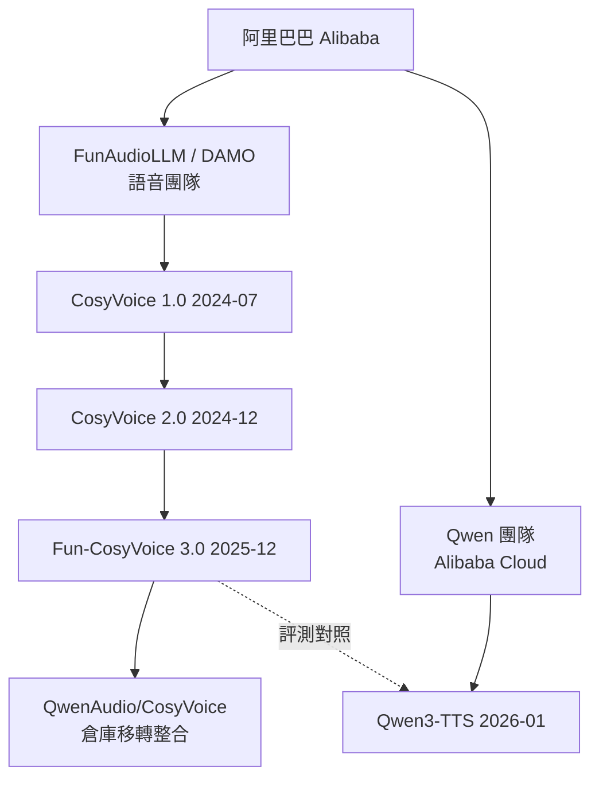

# CosyVoice 與 Qwen3-TTS 的差異分析

## 摘要

`QwenAudio/CosyVoice` 與 `QwenLM/Qwen3-TTS` 是阿里巴巴集團旗下兩個不同的語音合成 (Text-to-Speech, TTS) 開源專案。兩者同屬一個母公司，但由不同團隊開發、採用不同的技術架構、針對不同的使用情境。本文說明兩者的出身、架構、功能與適用場景差異。

## 一、基本資料對照

| 項目 | CosyVoice | Qwen3-TTS |
| :--- | :--- | :--- |
| GitHub 位置 | `QwenAudio/CosyVoice`（原 `FunAudioLLM/CosyVoice`） | `QwenLM/Qwen3-TTS` |
| 開發團隊 | FunAudioLLM 團隊（阿里巴巴 DAMO Academy / ModelScope 體系） | 阿里巴巴雲 Qwen 團隊 |
| 授權 | Apache 2.0 | Apache 2.0 |
| 首次建立 | 2024-07-03 | 2026-01-21 |
| 主要語言 | Python | Python |
| 星數 | 約 24,112 | 約 13,959 |
| 最新版本 | Fun-CosyVoice 3.0 (2025-12) | Qwen3-TTS 系列 (2026-01-22 發布) |

上述倉庫建立時間、星數、授權等中繼資料來自 GitHub API[^cosyapi][^qwenapi]。CosyVoice 的星數較高與其較早發布（2024 年即開源）有關。

## 二、專案出身與關聯

兩者都來自阿里巴巴，但屬於不同團隊：

- **CosyVoice** 最初由 **FunAudioLLM 團隊** 開發，原本託管於 `github.com/FunAudioLLM/CosyVoice`。之後該倉庫被移轉至 **QwenAudio** 組織（`github.com/QwenAudio/CosyVoice`），`FunAudioLLM/CosyVoice` 會重新導向至同一倉庫（倉庫 ID 相同，皆為 823430322）[^cosyapi]。這顯示阿里巴巴的語音相關專案正逐步整合到 Qwen 品牌之下。
- **Qwen3-TTS** 則由 **阿里巴巴雲的 Qwen 團隊** 開發，README 自述為「developed by the Qwen team at Alibaba Cloud」[^qwenreadme]。

兩者在研究血緣上有一個關鍵交集：**Hangrui Hu** 同時列名於 CosyVoice 1.0 論文[^cosyv1]與 Qwen3-TTS 技術報告[^qwentech]的作者名單中。此外，Qwen3-TTS 的評測表格直接以 CosyVoice 3 作為比較基準，將後者視為直接的前代／對照對象[^qwenreadme]。不過，兩者是獨立的程式庫，並不直接共用程式碼。

下圖示意兩者的團隊與技術脈絡：

## 三、技術架構差異

兩者最根本的差別在於「文字轉語音的生成路徑」。

### CosyVoice：LM + 條件流匹配 (Flow Matching / DiT)

CosyVoice 採用**兩階段**架構：先由大型語言模型 (LLM) 從文字產生語音 token 序列，再交由一個獨立的流匹配 (flow matching) / DiT 模型將 token 還原為波形。它使用源自多語言語音辨識模型編碼器的 **S3 Tokenizer**（監督式語意 token，單一 codebook 的 VQ 或 FSQ）[^cosyv1][^cosyv2]。CosyVoice 2.0 進一步加入串流能力與 chunk-aware 流匹配，達成約 150ms 的低延遲[^cosyv2]。

### Qwen3-TTS：端到端離散多 codebook 語言模型

Qwen3-TTS 採用**單一模型、端到端**的離散多 codebook 語言模型架構，直接對語音建模，藉此「完全繞過傳統 LM+DiT 方案固有的資訊瓶頸與串接錯誤 (cascading errors)」[^qwenreadme]。其核心是自研的 **Qwen3-TTS-Tokenizer-12Hz**（16 層、12.5Hz 幀率、2048 codebook 大小），搭配輕量非 DiT 架構（因果卷積網路）做高速重建；另有 25Hz 單 codebook 版本搭配 block-wise DiT[^qwenreadme]。

| 架構面向 | CosyVoice | Qwen3-TTS |
| :--- | :--- | :--- |
| 生成範式 | LLM + 流匹配 / DiT（兩階段） | 離散多 codebook LM（端到端） |
| 語音 tokenizer | S3 Tokenizer（單一 codebook VQ/FSQ） | Qwen3-TTS-Tokenizer（12Hz 多 codebook / 25Hz 單 codebook） |
| 波形重建 | 獨立 flow matching / DiT | 輕量因果卷積網路（12Hz）/ block-wise DiT（25Hz） |
| 串流延遲 | 約 150ms（CosyVoice 2.0 起） | 最低約 97ms（12Hz 架構） |

## 四、功能與語言覆蓋

- **語言**：CosyVoice 3.0 覆蓋 9 種語言（中、英、日、韓、德、西、法、義、俄）與 18 種以上中文方言／口音，並支援多語／跨語零樣本聲音複製，以及中文拼音與英文 CMU 音素的「發音修補 (pronunciation inpainting)」[^cosyreadme]。Qwen3-TTS 覆蓋 10 種語言（中、英、日、韓、德、法、俄、葡、西、義）[^qwenreadme]。
- **聲音設計 (Voice Design)**：Qwen3-TTS 具備以自然語言描述產生全新音色的能力（例如描述一個角色聲線），並可進一步「設計後再複製 (Voice Design then Clone)」[^qwenreadme]。這是 CosyVoice 所沒有的獨特賣點。
- **指令控制**：兩者都支援以指令控制情緒、語速、音量／語言、方言等[^cosyreadme][^qwenreadme]。
- **聲音複製**：兩者皆支援以約 3 秒參考音訊做零樣本複製[^cosyreadme][^qwenreadme]。

## 五、部署與生態

- **CosyVoice** 提供完整的部署工具鏈，包含 Docker 映像、gRPC / FastAPI server、vLLM 支援（CosyVoice 2/3 支援 vLLM 0.9+ 與 0.11+）、以及 NVIDIA TensorRT-LLM / Triton runtime 加速（相較 HuggingFace transformers 約 4 倍加速）[^cosyreadme]。其定位偏向「推論、訓練、部署全棧」。
- **Qwen3-TTS** 提供 `qwen-tts` Python 套件、本地 Web UI (`qwen-tts-demo`)、DashScope 雲端 API、vLLM-Omni day-0 支援以及微調 (fine-tuning) 範例[^qwenreadme]。

## 六、綜合比較與適用場景

| 需求情境 | 建議選擇 | 理由 |
| :--- | :--- | :--- |
| 需要成熟部署工具鏈（gRPC/FastAPI/Docker/TensorRT-LLM） | CosyVoice | 提供完整的服務化部署範例與加速 runtime |
| 需要大量中文方言／口音與跨語複製 | CosyVoice | 支援 18+ 中文方言／口音與發音修補 |
| 需要用自然語言「設計」全新音色 | Qwen3-TTS | 獨有的 Voice Design 能力 |
| 追求極低串流延遲與端到端品質上限 | Qwen3-TTS | 端到端架構，最低約 97ms 首包延遲 |
| 需要豐富的微調範例與最新多語基準 | Qwen3-TTS | 提供微調指引並在 Seed-TTS、InstructTTSEval 等基準領先 |

簡言之：**CosyVoice 是 2024 年起家的成熟 TTS 工程體系**（LM + 流匹配），強項在生產部署、方言覆蓋與發音控制；**Qwen3-TTS 是 2026 年推出的新一代端到端架構**，主打聲音設計、更低延遲與更高的效能上限，並以 CosyVoice 為主要對照基準。兩者同屬阿里巴巴、共享部分研究人員，但程式庫與技術路線各自獨立。

## 參考資料

[^cosyapi]: GitHub. (2026). QwenAudio/CosyVoice repository metadata. Retrieved 2026-10-23, from https://api.github.com/repos/QwenAudio/CosyVoice
[^qwenapi]: GitHub. (2026). QwenLM/Qwen3-TTS repository metadata. Retrieved 2026-10-23, from https://api.github.com/repos/QwenLM/Qwen3-TTS
[^cosyreadme]: QwenAudio. (2026). CosyVoice README. Retrieved 2026-10-23, from https://raw.githubusercontent.com/QwenAudio/CosyVoice/main/README.md
[^qwenreadme]: QwenLM. (2026). Qwen3-TTS README. Retrieved 2026-10-23, from https://raw.githubusercontent.com/QwenLM/Qwen3-TTS/main/README.md
[^cosyv1]: Du, Z., Chen, Q., Zhang, S., Hu, K., Lu, H., Yang, Y., Hu, H., Zheng, S., Gu, Y., Ma, Z., & others. (2024). CosyVoice: A scalable multilingual zero-shot text-to-speech synthesizer based on supervised semantic tokens. arXiv preprint arXiv:2407.05407. Retrieved 2026-10-23, from https://arxiv.org/abs/2407.05407
[^cosyv2]: Du, Z., Wang, Y., Chen, Q., Shi, X., Lv, X., Zhao, T., Gao, Z., Yang, Y., Gao, C., Wang, H., & others. (2024). CosyVoice 2: Scalable streaming speech synthesis with large language models. arXiv preprint arXiv:2412.10117. Retrieved 2026-10-23, from https://arxiv.org/abs/2412.10117
[^qwentech]: Hu, H., Zhu, X., He, T., Guo, D., Zhang, B., Wang, X., Guo, Z., Jiang, Z., Hao, H., Guo, Z., Zhang, X., Zhang, P., Yang, B., Xu, J., Zhou, J., & Lin, J. (2026). Qwen3-TTS Technical Report. arXiv preprint arXiv:2601.15621. Retrieved 2026-10-23, from https://arxiv.org/abs/2601.15621
