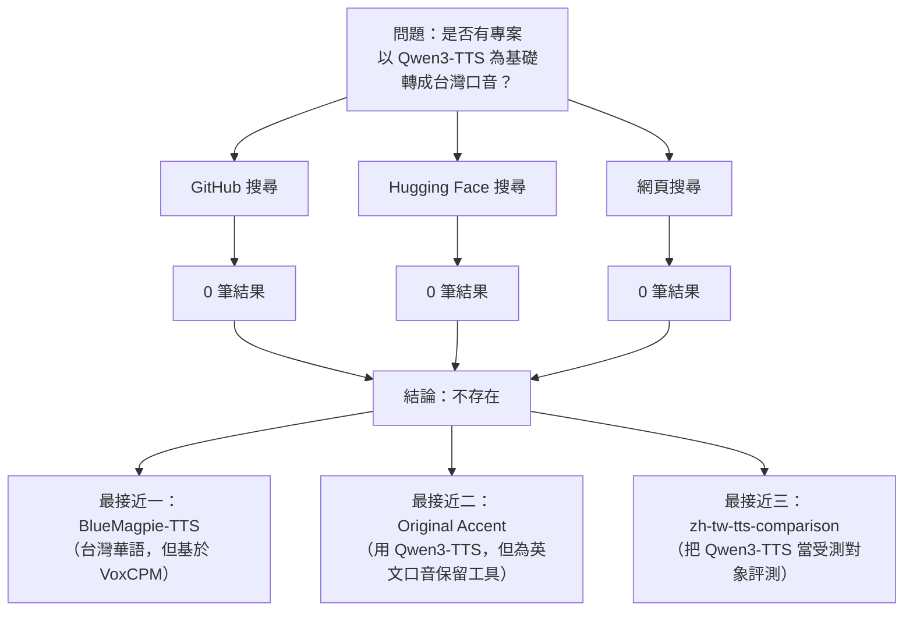

# 以 Qwen3-TTS 為基礎、轉向台灣口音的專案調查

## 摘要

本研究調查「是否有任何專案以 Qwen3-TTS 為基礎模型，改造成台灣口音（台灣華語／zh-TW）」這個問題。結論是：**截至 2026-10-24，公開網路上找不到任何以 Qwen3-TTS 為基礎、針對台灣口音進行微調或改造的專案、模型或服務。** 唯一與「台灣口音 TTS」直接相關、且最接近的開源專案是 **OpenFormosa BlueMagpie-TTS**，但它的聲學骨幹並非 Qwen3-TTS，而是取自 VoxCPM 的模組[^bm-readme]。

本文先定義 Qwen3-TTS 這個基礎模型，再逐一說明搜尋範圍與結果，最後整理最接近的替代方案與可行的改造路徑。

## 背景：Qwen3-TTS 是什麼

Qwen3-TTS 是阿里巴巴雲（Alibaba Cloud）Qwen 團隊開發的開源文字轉語音模型系列，主打穩定、富有表現力的串流語音生成、自由形式的音色設計（voice design）與逼真的聲音複製（voice cloning）[^qwen-repo]。官方 GitHub 儲存庫 `QwenLM/Qwen3-TTS` 於 2026-01-21 建立，約有 13,959 顆星、1,811 個 fork，採 Apache-2.0 授權[^qwen-repo]。

官方在 Hugging Face 上釋出的主要模型包括：

| 模型 | 用途 | 下載量 | likes |
| --- | --- | ---: | ---: |
| `Qwen/Qwen3-TTS-12Hz-1.7B-CustomVoice` | 內建語者、指令控制 | 1,938,305 | 2,166 |
| `Qwen/Qwen3-TTS-12Hz-1.7B-Base` | 基礎模型、可微調、聲音複製 | 2,937,473 | 576 |
| `Qwen/Qwen3-TTS-12Hz-0.6B-Base` | 較小的基礎模型 | 637,969 | 352 |
| `Qwen/Qwen3-TTS-12Hz-1.7B-VoiceDesign` | 以自然語言描述音色 | 435,337 | 451 |
| `Qwen/Qwen3-TTS-12Hz-0.6B-CustomVoice` | 較小的內建語者模型 | 864,648 | 209 |

[^qwen-hf]

其內建中文語者以中國大陸的普通話與方言為主：`Vivian`、`Serena`、`Uncle_Fu` 為普通話，`Dylan` 為北京話，`Eric` 為四川話；**官方並未提供台灣華語語者**[^bm-alt]。

## 搜尋方法

本研究以 Web Search/Fetch 工具為基礎，針對以下來源進行系統性檢索：

- **GitHub 官方 API**：以 `Qwen3-TTS taiwan`、`qwen3-tts 台灣`、`qwen3-tts traditional chinese`、`taiwanese mandarin tts`、`台灣中文 TTS` 等關鍵字搜尋儲存庫與程式碼。
- **Hugging Face 官方 API**：以 `qwen3-tts`、`taiwanese tts`、`zh-TW tts`、`taiwan`、`formosa`、`bluemagpie`、`breezyvoice`、`qwen3_tts` tag 等方式列舉模型。
- **Sourcegraph 公開程式碼搜尋**：搜尋 `Qwen3-TTS` 搭配台灣相關字串。
- **網頁搜尋**：嘗試以中英文關鍵字搜尋部落格與新聞。

## 主要發現

### 1. 沒有任何 Qwen3-TTS 的台灣口音微調專案

在 GitHub 上以 `Qwen3-TTS taiwan`、`qwen3-tts 台灣`、`qwen3-tts traditional chinese` 搜尋，**回傳結果為 0**[^gh-search-tw]。在 Hugging Face 上以 `qwen3-tts taiwan`、`qwen3 tts zh-tw`、`qwen3_tts` tag 搭配 `taiwan` 搜尋，**同樣為空**[^hf-search-tw]。

逐一檢視 Hugging Face 上所有自帶 `qwen3_tts` 標籤的模型後，可以觀察到社群微調的方向涵蓋多種語言：

- 越南語：`g-group-ai-lab/gwen-tts-0.6B`、`beyoru/Qwen3-TTS-12Hz-1.7B-Vi`
- 土耳其語：`erkamk/qwen3-tts-tiny-tr`
- 印尼語：`alkhrzmy/qwen3-tts-0.6b-indonesian`
- 韓語：`daje/Qwen3-TTS-12Hz-0.6B-Korean`
- 阿拉伯語方言：`vadimbelsky/qwen3-TTS-KSA`（沙烏地）、`vadimbelsky/qwen3.5-TTS-Emirati`（阿聯）
- 俄語、波蘭語、法語、印地語、烏茲別克語、哈薩克語、亞塞拜然語、泰語等

[^hf-qwen3tts]

換言之，Qwen3-TTS 的社群微調生態相當活躍，但**沒有任何一項針對台灣華語**。台灣並未出現在這些語言清單中。

### 2. 最接近的台灣口音 TTS 專案不使用 Qwen3-TTS

公開領域中確實存在台灣華語 TTS 專案，但其基礎模型與 Qwen3-TTS 無關：

**OpenFormosa BlueMagpie-TTS** 是一套針對**台灣華語**與**中英混合（code-switching）** 情境打造的開源 TTS 模型，輸出 48 kHz 語音；在同一份內部測試集上，字元錯誤率（CER）為 7.44%（語者向量模式），比參考基準系統的 11.45% 相對降低約 35%[^bm-readme]。其 GitHub 儲存庫約有 69 顆星、6 個 fork，採 Apache-2.0 授權[^bm-repo]；Hugging Face 模型頁面有 23 個 likes、463 次下載[^bm-hf]。

然而，BlueMagpie-TTS 的技術組成**不是** Qwen3-TTS：

- 負責文字語意的語言模型是 `Barbet`（Mamba2 與注意力混合架構），由 OpenFormosa 自行開發[^bm-readme]。
- 聲學模組取自 **VoxCPM**（OpenBMB 專案，Apache-2.0 授權），內含於專案 `bluemagpie/_vendor/`[^bm-readme]。
- 其擴散式解碼器為 LocDiT／CFM，與 Qwen3-TTS 的架構不同，這也是官方說明「無法直接套用 vLLM」的原因[^bm-readme]。

因此，BlueMagpie-TTS 是「台灣口音 TTS」，但**不是「Qwen3-TTS 改成台灣口音」**。

其他台灣相關語音專案也都不是 Qwen3-TTS 的改造：

| 專案 | 說明 | 基礎模型 | 星星 |
| --- | --- | --- | ---: |
| `MediaTek-Research/BreezyVoice` | 聯發科台灣華語 TTS | CosyVoice 系列 | 66（HF likes） |
| `JacobLinCool/zh-tw-tts-comparison` | 開源 TTS 在台灣中文的比較與盲測 | 比較多個模型 | 0 |
| `JasonLn0711/taiwan-speech-benchmark` | 台灣中文 ASR／TTS 供應商評測 | 評測框架 | 0 |
| `formospeech/*` | 台灣客語 ASR／TTS | Whisper、F5-TTS、YourTTS 等 | 低 |

[^breezy][^jacob][^jason][^formo]

其中 `JacobLinCool/zh-tw-tts-comparison` 的評測**確實包含 Qwen3-TTS**，但定位是「把 Qwen3-TTS 當作受測系統之一」而非改造它；在 25 句台灣中文／中英混說句子上，Qwen3-TTS 的 MER 中位數為 0.051（qwen3 ASR）／0.067（breeze ASR），屬於中段班[^jacob-results]。

### 3. 唯一「以 Qwen3-TTS 處理台灣聲音」的專案：Original Accent

`rajindergll0-arch/Original-Accent` 是一個 Windows 桌面應用，主打「保留語者口音的本地聲音複製」，明確以 Qwen3-TTS 為主要引擎（Chatterbox 為選用第二引擎）[^oa]。它的原始動機正是「讓非英語母語者（例如台灣英語）在產品影片中配音，而不被抹平口音」[^oa]。

但必須釐清：

- 它**不是微調後的台灣口音模型**，而是 Qwen3-TTS 的前端與工作流程（安裝器、挑選乾淨片段、產生多個 take、比對試聽）[^oa]。
- 它保留口音的方式是**從參考錄音做聲音複製**，而不是訓練出台灣腔[^oa]。
- 其介面目前**僅支援英文**；README 明言 Qwen3-TTS 支援的其他九種語言「應用程式尚未提供」[^oa]。
- 該專案建立於 2026-10-23，僅 0 顆星，且作者自述「只在單一機器（Windows 11、RTX 4090）測試過」[^oa]。

因此它只能算是「用 Qwen3-TTS 處理台灣語者英文口音」的工具，**與「台灣華語口音 TTS」是不同層次的問題**。

## 綜合判斷

以「是否有專案以 Qwen3-TTS 為基礎、改造成台灣口音」為判準：

1. **直接符合的專案：0 個。**
2. **官方模型本身：無台灣華語語者。**
3. **最接近的台灣華語 TTS（BlueMagpie-TTS）：架構與 Qwen3-TTS 不同。**
4. **最接近的 Qwen3-TTS 台灣相關應用（Original Accent）：處理英文口音，非中文口音。**

## 可行的改造路徑

若要在 Qwen3-TTS 上做出台灣口音，根據現有生態可歸納三條路徑：

1. **微調 Base 模型**：使用 `Qwen/Qwen3-TTS-12Hz-1.7B-Base` 或 `0.6B-Base`，搭配台灣華語語音資料集進行微調。官方儲存庫提供 `finetuning/` 目錄與相關說明[^qwen-repo]；社群已有大量以 Base 模型微調成其他語言的成功案例可參考[^hf-qwen3tts]。
2. **VoiceDesign + 聲音複製**：用 `Qwen3-TTS-12Hz-1.7B-VoiceDesign` 以自然語言描述台灣腔產生參考片段，再以 Base 模型做聲音複製來維持音色一致[^qwen-hf]。這是免訓練的權宜作法。
3. **改用既有台灣華語模型**：直接採用 BlueMagpie-TTS 或 BreezyVoice，避免從零微調[^bm-readme][^breezy]。

## 資料來源的批判與限制

- **時效性**：Qwen3-TTS 於 2026-01 發布，社群微調仍在快速成長。本報告的「不存在」結論僅代表 2026-10-24 的狀態，隨時可能被新專案推翻。
- **語言偏誤**：社群微調多以英文 README 呈現，以英文關鍵字搜尋可能低估以中文命名的專案；本文已嘗試中英文雙語關鍵字，但 GitHub 程式碼搜尋需要登入，可能遺漏未在名稱／描述／README 出現台灣字串的專案。
- **來源權威性**：本報告大量依賴 GitHub 與 Hugging Face 的官方 API 資料，其數字為平台回報值，可能隨時間變動；BlueMagpie-TTS 的效能數字為其專案自述的內部評測，並非公開基準，不同 ASR 或測試集會有不同結果[^bm-readme]。
- **低星專案**：Original Accent（0 星）與多數台灣相關專案星數偏低甚至為 0，但因為本主題本身極為小眾，公開專案稀少，故仍一併收錄並標註其狀態。

## 參考文獻

[^bm-readme]: OpenFormosa. (2026). *BlueMagpie-TTS* [電腦軟體]. GitHub. Retrieved 2026-10-24, from https://github.com/OpenFormosa/BlueMagpie-TTS

[^bm-repo]: GitHub. (2026). *OpenFormosa/BlueMagpie-TTS* [儲存庫]. Retrieved 2026-10-24, from https://github.com/OpenFormosa/BlueMagpie-TTS

[^bm-hf]: OpenFormosa. (2026). *OpenFormosa/BlueMagpie-TTS* [模型]. Hugging Face. Retrieved 2026-10-24, from https://huggingface.co/OpenFormosa/BlueMagpie-TTS

[^bm-alt]: Qwen. (2026). *Qwen3-TTS-12Hz-1.7B-CustomVoice* [模型]. Hugging Face. Retrieved 2026-10-24, from https://huggingface.co/Qwen/Qwen3-TTS-12Hz-1.7B-CustomVoice

[^qwen-repo]: QwenLM. (2026). *Qwen3-TTS* [電腦軟體]. GitHub. Retrieved 2026-10-24, from https://github.com/QwenLM/Qwen3-TTS

[^qwen-hf]: Qwen. (2026). *Qwen3-TTS model family* [模型]. Hugging Face. Retrieved 2026-10-24, from https://huggingface.co/Qwen/Qwen3-TTS-12Hz-1.7B-Base

[^hf-qwen3tts]: Hugging Face. (2026). *Models tagged qwen3_tts* [模型清單]. Retrieved 2026-10-24, from https://huggingface.co/models?filter=qwen3_tts

[^gh-search-tw]: GitHub. (2026). *Repository search: Qwen3-TTS taiwan* [搜尋結果]. Retrieved 2026-10-24, from https://api.github.com/search/repositories?q=Qwen3-TTS+taiwan

[^hf-search-tw]: Hugging Face. (2026). *Model search: qwen3-tts taiwan* [搜尋結果]. Retrieved 2026-10-24, from https://huggingface.co/api/models?search=qwen3-tts%20taiwan

[^breezy]: MediaTek Research. (2025). *BreezyVoice* [模型]. Hugging Face. Retrieved 2026-10-24, from https://huggingface.co/MediaTek-Research/BreezyVoice

[^jacob]: JacobLinCool. (2026). *zh-tw-tts-comparison* [電腦軟體]. GitHub. Retrieved 2026-10-24, from https://github.com/JacobLinCool/zh-tw-tts-comparison

[^jacob-results]: JacobLinCool. (2026). *zh-TW TTS comparison — results* [結果報告]. Retrieved 2026-10-24, from https://jacoblincool.github.io/zh-tw-tts-comparison/results.html

[^jason]: JasonLn0711. (2026). *taiwan-speech-benchmark* [電腦軟體]. GitHub. Retrieved 2026-10-24, from https://github.com/JasonLn0711/taiwan-speech-benchmark

[^formo]: formospeech. (2024). *Formospeech models* [模型]. Hugging Face. Retrieved 2026-10-24, from https://huggingface.co/formospeech

[^oa]: Gill, R. (2026). *Original Accent* [電腦軟體]. GitHub. Retrieved 2026-10-24, from https://github.com/rajindergll0-arch/Original-Accent
