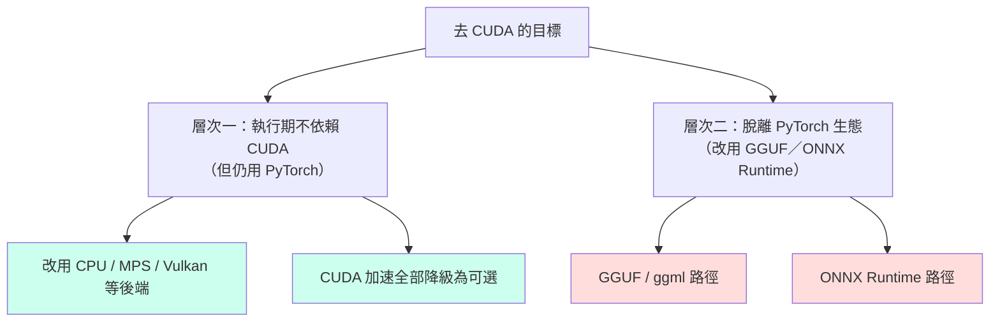
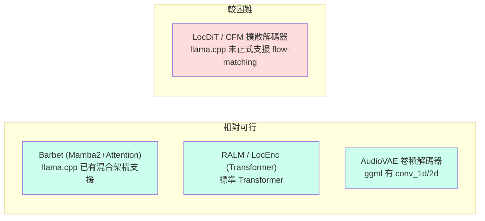
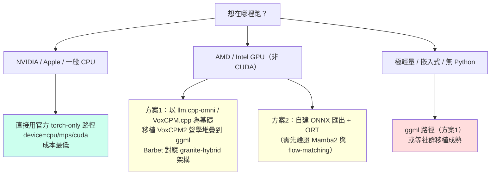

# BlueMagpie-TTS「去 CUDA」可行性評估：GGUF／ONNX 與跨後端推論路徑

## 摘要

本報告評估將 [OpenFormosa/BlueMagpie-TTS](https://github.com/OpenFormosa/BlueMagpie-TTS) 這套針對台灣華語與中英混合情境的開源文字轉語音（TTS）模型，從其預設的 PyTorch／CUDA 執行路徑，遷移到「不依賴 CUDA」的推論方案（以 GGUF／ggml 或 ONNX Runtime 為代表）的可行性。

**核心結論**：去 CUDA 在「執行期」層面大部分已經達成，但在「格式轉換」層面仍有一個關鍵缺口。BlueMagpie-TTS 在設計上已經是 **torch-only、裝置無關（device-agnostic）**，官方支援 `cuda`／`mps`／`cpu` 三種裝置，且 CUDA 專屬加速（CUDA graphs、`mamba_ssm`、`torch.compile`）全部都只是**可選、自動偵測、可降級**的最佳化，並非必要條件[^readme][^caps]。因此「不使用 CUDA 也能跑」已是既有事實。真正的挑戰在於：若目標是**脫離 PyTorch 生態**（改用 GGUF／ggml 或 ONNX Runtime 以取得輕量部署、跨 GPU 廠商支援），則因其架構組合（Mamba2 混合注意力語言模型 + 擴散式聲學解碼器 + 卷積式音訊 VAE），難度顯著提高。

## 研究對象簡介

BlueMagpie-TTS 是 OpenFormosa 社群維護、採 Apache-2.0 授權的 TTS 模型，主打台灣華語與中英 code-switching，輸出 48 kHz 音訊；在其內部測試集上字元錯誤率（CER）為 7.44%（語者向量模式），相對參考基準的 11.45% 約降低 35%[^readme]。

其模型並非單一骨幹，而是多模組串接的管線[^readme][^hfmodel]：

| 模組 | 角色 | 來源 |
| --- | --- | --- |
| **Barbet（TSLM）** | 文字語意語言模型，Mamba2 + 注意力混合架構 | [OpenFormosa/Barbet](https://github.com/OpenFormosa/Barbet) |
| **RALM** | 殘差聲學語言模型（MiniCPM4 骨幹） | VoxCPM（內含） |
| **LocEnc** | 位置編碼器 | VoxCPM（內含） |
| **LocDiT／CFM** | 擴散式解碼器（DiT + 條件流匹配），運算瓶頸 | VoxCPM（內含） |
| **AudioVAE** | 音訊 VAE 解碼器，輸出 48 kHz 波形 | VoxCPM（內含） |

其中聲學模組（RALM、LocEnc、LocDiT、AudioVAE）取自 **VoxCPM2**（OpenBMB，Apache-2.0），以 vendored 形式內含於 `src/bluemagpie/_vendor/voxcpm/`[^readme][^repo]。專案在 GitHub 約 69 顆星[^repo]，規模相對小，但架構完整且文件詳盡。

## 「去 CUDA」的兩層意義

評估前必須區分兩個層次，因為兩者難度天差地遠：

**層次一在 BlueMagpie-TTS 基本上已經完成**（見下節）。**層次二則需要大量移植工作**（見其後各節）。

## 層次一：執行期去 CUDA（已達成）

BlueMagpie-TTS 的官方 README 明確列出四種硬體支援[^readme]：

| 硬體 | 支援 | 用法 | 速度參考（RTF，越小越快） |
| --- | :-: | --- | --- |
| NVIDIA GPU（CUDA） | ✅ | `device="cuda"` | 最快 |
| Apple Silicon（MLX） | ✅ | `pip install -e .[mlx]` | RTF ≈ 0.77 |
| Apple Silicon（MPS） | ✅ | `device="mps"` | RTF ≈ 1.1 |
| CPU | ✅ | `device="cpu"` | RTF ≈ 2.5 |

關鍵設計在於**能力偵測（capability detection）**機制。`src/bluemagpie/serving/_caps.py` 內的每一項加速路徑都是**可選且自動偵測**，不在模組載入時匯入任何 CUDA 專屬套件[^caps]：

- `has_cuda()`：偵測 CUDA 是否可用。
- `mamba_ssm_available()`：偵測可選的 `mamba_ssm` 選擇性掃描核心（CUDA／Triton 限定）；Barbet 本身已內建純 PyTorch 後備路徑，故這只是「更快核心」的開關，永不為必要。
- `cuda_graphs_available()`：CUDA graph 捕捉僅在真實 CUDA 裝置上有意義。

`src/bluemagpie/serving/accel.py` 的 `optimize_for_inference()` 亦**硬性以 CUDA 為閘門**，在 MPS／CPU 上為 no-op，因此匯入與建構引擎永遠不需要 CUDA[^accel]。官方批次推論引擎的設計目標也白紙黑字寫著「在 CUDA、Apple-Silicon／MPS、CPU 上共用同一套程式碼，優雅降級；CUDA 專屬加速自動偵測、永不為必要」[^design]。

**注意**：`_caps.py` 中的 `supports_low_precision()` 指出 MPS 在 bf16／fp16 下仍會讓擴散 AR 迴圈產生異常，因此 MPS 預設維持 float32[^caps]。這是低精度路徑的黑名單，與 CUDA 依賴無關。

**小結**：若「去 CUDA」僅指「不強制使用 CUDA、可在 CPU 或其他 GPU 後端跑」，則 BlueMagpie-TTS **早已支援**，無需任何修改。代價是速度：CPU 上 RTF ≈ 2.5（合成 1 秒語音約需 2.5 秒運算）[^readme]。

## 層次二：脫離 PyTorch 生態

若目標是改成 GGUF／ggml 或 ONNX Runtime 以取得更輕量的部署、跨廠商 GPU 支援（AMD／Intel）、或邊緣裝置執行，則需分別檢視三類模組的可移植性。

### 模組可移植性拆解

### 路徑 A：GGUF／ggml（llama.cpp 生態）

**好消息**：llama.cpp／ggml 生態對 BlueMagpie 的**多數元件已有現成支援**。

1. **Mamba2 與「Mamba2 + 注意力」混合架構已被 llama.cpp 支援**。llama.cpp 有 `LLM_ARCH_MAMBA2` 架構與 `src/models/mamba2.cpp` 執行實作，且 `llm_arch_is_recurrent()` 將 Mamba 與 Mamba2 列為循環架構[^llamacpp_arch]。更重要的是，**混合架構（SSM + 注意力交錯）**已有 first-class 支援，包括 `LLM_ARCH_JAMBA`（PR #7531）、`LLM_ARCH_GRANITE_HYBRID`、`LLM_ARCH_FALCON_H1`、`LLM_ARCH_ZAMBA2`，並有 `llama-memory-hybrid.*` 混合循環狀態管理與 `LLM_KV_ATTENTION_RECURRENT_LAYERS` 等超參數[^llamacpp_arch]。這與 Barbet 的「global attention → sliding attention → sliding attention → mamba2」層排列高度相似[^barbet]，因此 Barbet 在概念上最接近已被支援的 `granite-hybrid` 家族。

2. **Mamba2 可跑在 Vulkan 與 CPU 後端**。Vulkan 的 SSM 運算支援（`SSM_SCAN`、`SSM_CONV`）已於 PR #16463 合併，並以 `granitehybrid` 在 Intel Arc 與 NVIDIA L40S 上實測[^llamacpp_vulkan]。CPU 則經 ggml 參考實作原生支援[^llamacpp_vulkan]。**限制**：Vulkan 的 SSM 核心效能明顯低於 CUDA；另有 AMD RDNA1（Navi 10）GPU ring 卡死、Intel Vulkan 遞迴狀態回滾測試不穩等已知問題[^llamacpp_vulkan]。

3. **TTS 管線在 llama.cpp 已有先例**。llama.cpp 已支援 `Qwen3TTS`、`PocketTTS`、`Soprano`、`Talkie`、`WavTokenizer-Dec` 等語音架構，採「backbone GGUF + mmproj GGUF」兩檔式設計[^llamacpp_tts]。其中 **PocketTTS（Kyutai）本身就是 flow-matching TTS 模型**，其 flow-matching 解碼器透過 `VisionProjectorType.POCKETTTS_GEN` 實作[^llamacpp_tts]——這對 BlueMagpie 的 LocDiT／CFM 具有直接參考價值。

4. **最關鍵的既有成果：VoxCPM2 已有現成 GGUF 移植**。BlueMagpie 的聲學模組就是 VoxCPM2，而 VoxCPM2 已有兩個成熟的 ggml/GGUF 移植[^voxcpm.cpp][^llamacpp_omni]：
   - **bluryar/VoxCPM.cpp**（約 97 星）：以 ggml 為底，支援 CPU／CUDA／Vulkan，GGUF 權重，支援 VoxCPM-1.5（主要）與 VoxCPM2（初步），量化支援 F32／F16／Q8_0／Q4_K[^voxcpm.cpp]。
   - **tc-mb/llama.cpp-omni**（約 309 星）：完整支援 VoxCPM-0.5B／1.5／VoxCPM2，支援 CPU／CUDA／Metal／Vulkan，採 BaseLM + Acoustic 兩檔式 GGUF，官方 VoxCPM README 亦有連結[^llamacpp_omni]。

**壞消息**：llama.cpp 對「通用擴散／flow-matching 影像或音訊模型」**尚未正式支援**。`llm_arch_is_diffusion()` 目前只涵蓋 Dream／LLaDA／LLaDA-MoE／RND1 四個**語言**擴散架構；DiffusionGemma 仍是 draft PR（未合併），LTX-2 影像／音訊生成 PR 被關閉（維護者認為應歸 stable-diffusion.cpp）[^llamacpp_arch][^llamacpp_diffusion]。此外，ggml 的 `ggml_conv_1d` 曾在 batch > 1 且輸出通道 > 1 時有佈局錯誤、CUDA pad kernel 有 gridDim.y 上限等問題[^llamacpp_diffusion]。因此，把 LocDiT／CFM 完整搬進 llama.cpp 的通用路徑仍屬研究性工作，較可行的做法是參照 VoxCPM.cpp 或 llama.cpp-omni 把**整套 VoxCPM2 聲學堆疊**自行以 ggml 實作——而這兩個專案已經在做這件事。

### 路徑 B：ONNX Runtime

ONNX Runtime 提供多種執行提供者（execution providers），涵蓋 CPU、CUDA、ROCm（AMD）、DirectML（Windows）、OpenVINO（Intel）等，天然能滿足「去 CUDA、跨廠商」的需求。已有專案做過 VoxCPM 的 ONNX 匯出（bluryar/VoxCPM-ONNX，約 55 星，已封存並轉向 VoxCPM.cpp）[^voxcpm_onnx]。然而本報告未能取得足夠來源，逐一驗證 Mamba2 選擇性掃描與 flow-matching／卷積 VAE 在 ONNX Runtime 上的匯出與數值穩定性，因此對 ONNX 路徑僅能標示為「需進一步實測」，不宜下確定結論。

### 關鍵互通性觀察：MLX 移植已證明「路徑可拆解可移植」

BlueMagpie 官方**已經完成一套完整的非 PyTorch 推論路徑**：`src/bluemagpie/mlx/` 是將整條推論管線以 Apple MLX 重新實作的原生移植[^mlx_design]。其設計與經驗對 GGUF／ONNX 移植極具參考價值：

- 每個模組（Barbet、RALM、LocEnc、LocDiT／CFM、AudioVAE 解碼器、AR 迴圈）都在 MLX 中重寫 forward，並與 PyTorch 參考逐模組做數值 parity 驗證（9 個測試，容差約 6e-3）[^mlx_design]。
- 權重**直接沿用訓練好的 torch 權重**，轉為 `mx.array` 後以 `{named_parameters() 名稱: 陣列}` 扁平字典存放，無需名稱重映射（`nn.Linear` 與 depthwise `Conv1d` 佈局跨框架一致，可直接搬移）[^mlx_convert]。
- decode 採「快取式單步」（cached step），非 O(T) 重算[^mlx_design]。
- 效能：在真實 7.75 GB 模型上端到端 RTF 0.77（比即時更快），較 torch-MPS 快約 1.45×、較 torch-CPU 快約 3.27×[^mlx_design]。

這證明了**「不靠 CUDA、用另一套張量框架重寫推論路徑」在工程上是可行的**，且 parity 驗證方法（逐模組數值比對 + 小模型測試）可直接複用到 GGUF／ONNX 專案。值得注意的一點：MLX 移植中 **Barbet 的注意力是手工實作**，以保留其 qk-logit-clip／attention-sink／fp32-softmax-upcast 語意，因為融合 SDPA 無法表達這些行為[^mlx_design]。這對 GGUF／ONNX 移植是一大警訊——若目標後端缺乏對應的自訂算子能力，這些非標準語意將難以忠實重現。

## 可行性評估總表

| 評估面向 | 現況 | 去 CUDA 可行性 |
| --- | --- | --- |
| 執行期不依賴 CUDA（保留 PyTorch） | 官方支援 CPU／MPS／MLX，CUDA 加速皆為可選 | **已達成**，無需修改 |
| CPU 推論可用性 | `device="cpu"`，RTF ≈ 2.5 | 完全可行，速度是唯一代價 |
| MLX（Apple Silicon） | 官方原生移植，RTF 0.77 | 已達成 |
| 純 PyTorch 加速（vitesse／Vulkan） | 未見官方路徑 | 需自行實驗 |
| GGUF／ggml 路徑 | 無官方支援，但 VoxCPM2 聲學模組已有現成 ggml 移植 | **中高可行但工作量大**，瓶頸在 LocDiT／CFM |
| ONNX Runtime 路徑 | 無官方支援，VoxCPM-ONNX 已封存 | **需實測**，證據不足以下定論 |
| Barbet 非標準注意力語意 | 手工實作，融合 SDPA 無法表達 | 各後端皆為移植難點 |

## 建議路徑

若目標是在**非 NVIDIA GPU**（如 AMD／Intel 顯示卡）或**邊緣／嵌入式裝置**上執行 BlueMagpie-TTS，依投入成本由低至高建議如下：

1. **低成本（建議首選）**：若接受 PyTorch 依賴，直接使用官方 `device="cpu"` 或 `"mps"`，或批次推論引擎。CUDA 加速會自動略過，無需任何修改。這已滿足多數「不想被 CUDA 綁死」的實務需求。
2. **中高成本**：若要真正脫離 PyTorch 並取得非 CUDA GPU 支援，最務實的做法是**以 tc-mb/llama.cpp-omni 或 bluryar/VoxCPM.cpp 為基礎**——它們已有完整 VoxCPM2 GGUF 支援（含 AudioVAE V2 的 48 kHz 輸出）。由於 BlueMagpie 的聲學模組就是 VoxCPM2，聲學部分幾乎可望直接複用；剩下要補的是 **Barbet TSLM**（可參照 llama.cpp 的 granite-hybrid／jamba 混合架構）與 **LocDiT／CFM** 的整合。
3. **高風險**：ONNX Runtime 路徑雖在跨廠商支援上最具吸引力，但因缺乏對 Mamba2 與 flow-matching 匯出穩定性的來源驗證，建議先做小型技術驗證（PoC）再投入。

## 來源批判與研究限制

- **官方文件為一手來源**：本報告中關於 BlueMagpie-TTS 的架構與裝置支援，主要來自其 GitHub README、原始碼（`_caps.py`、`accel.py`、`convert.py`、`DESIGN.md`）與 Hugging Face 模型卡，屬專案自述，可能與實際行為有落差（例如 MPS 低精度異常即為自述）。速度數據來自開發者自行在 Apple M 系列上的實測，換機器會有差異[^readme]。
- **VoxCPM 移植資訊來自社群專案**：VoxCPM.cpp 與 llama.cpp-omni 皆為社群維護，其中 VoxCPM2 在 VoxCPM.cpp 明確標示為「初步支援、品質與 parity 仍在驗證中」[^voxcpm.cpp]，因此「已有支援」不等於「生產可用」。
- **llama.cpp 支援程度具時效性**：llama.cpp 架構支援變動頻繁，擴散與 flow-matching 支援正處於 draft／RFC 階段，本報告所述狀態可能隨時間改變。
- **ONNX 路徑證據不足**：本報告未能取得足夠的一手來源驗證 Mamba2 與 flow-matching 在 ONNX Runtime 上的匯出可行性，故未下確定結論；此為本報告最主要的知識缺口。
- **星數門檻說明**：BlueMagpie-TTS（約 69 星）與 Barbet（約 3 星）星數偏低，但此為台灣華語 TTS 的利基領域，可選專案有限，故仍予收錄並標註星數。

## 參考文獻

[^readme]: OpenFormosa. (n.d.). *BlueMagpie-TTS — README*. GitHub. Retrieved 2026-10-24, from https://github.com/OpenFormosa/BlueMagpie-TTS/blob/main/README.md

[^repo]: OpenFormosa. (n.d.). *BlueMagpie-TTS repository*. GitHub. Retrieved 2026-10-24, from https://github.com/OpenFormosa/BlueMagpie-TTS

[^hfmodel]: OpenFormosa. (n.d.). *BlueMagpie-TTS model card*. Hugging Face. Retrieved 2026-10-24, from https://huggingface.co/OpenFormosa/BlueMagpie-TTS

[^caps]: OpenFormosa. (n.d.). *bluemagpie/serving/_caps.py (runtime capability detection)*. GitHub. Retrieved 2026-10-24, from https://github.com/OpenFormosa/BlueMagpie-TTS/blob/main/src/bluemagpie/serving/_caps.py

[^accel]: OpenFormosa. (n.d.). *bluemagpie/serving/accel.py (CUDA-gated torch.compile)*. GitHub. Retrieved 2026-10-24, from https://github.com/OpenFormosa/BlueMagpie-TTS/blob/main/src/bluemagpie/serving/accel.py

[^design]: OpenFormosa. (n.d.). *BlueMagpie-TTS serving engine DESIGN.md*. GitHub. Retrieved 2026-10-24, from https://github.com/OpenFormosa/BlueMagpie-TTS/blob/main/src/bluemagpie/serving/DESIGN.md

[^mlx_design]: OpenFormosa. (n.d.). *BlueMagpie-TTS MLX port DESIGN.md*. GitHub. Retrieved 2026-10-24, from https://github.com/OpenFormosa/BlueMagpie-TTS/blob/main/src/bluemagpie/mlx/DESIGN.md

[^mlx_convert]: OpenFormosa. (n.d.). *bluemagpie/mlx/convert.py (torch to MLX weight conversion)*. GitHub. Retrieved 2026-10-24, from https://github.com/OpenFormosa/BlueMagpie-TTS/blob/main/src/bluemagpie/mlx/convert.py

[^barbet]: OpenFormosa. (n.d.). *Barbet — a hybrid Mamba2 + attention language model*. GitHub. Retrieved 2026-10-24, from https://github.com/OpenFormosa/Barbet

[^llamacpp_arch]: ggerganov et al. (n.d.). *llama.cpp — llama-arch.h / llama-model.cpp (architecture enums incl. MAMBA2, JAMBA, GRANITE_HYBRID)*. GitHub. Retrieved 2026-10-24, from https://github.com/ggerganov/llama.cpp/blob/master/src/llama-arch.h

[^llamacpp_vulkan]: ggerganov et al. (2025, October 17). *vulkan: Add State Space Model (SSM) Operations Support (PR #16463)*. GitHub. Retrieved 2026-10-24, from https://github.com/ggerganov/llama.cpp/pull/16463

[^llamacpp_tts]: ggerganov et al. (n.d.). *llama.cpp — tools/tts (TTS model support: Qwen3TTS, PocketTTS, Soprano, WavTokenizer-Dec)*. GitHub. Retrieved 2026-10-24, from https://github.com/ggerganov/llama.cpp/blob/master/tools/tts/README.md

[^llamacpp_diffusion]: ggerganov et al. (n.d.). *llama.cpp — diffusion model support (DiffusionGemma PR #24423, LTX-2 mediagen PR #28540, RFC #28541)*. GitHub. Retrieved 2026-10-24, from https://github.com/ggerganov/llama.cpp/pull/24423

[^voxcpm.cpp]: bluryar. (n.d.). *VoxCPM.cpp — a standalone C++ inference for VoxCPM on ggml*. GitHub. Retrieved 2026-10-24, from https://github.com/bluryar/VoxCPM.cpp

[^llamacpp_omni]: tc-mb. (n.d.). *llama.cpp-omni — omni inference engine with native VoxCPM2 GGUF support*. GitHub. Retrieved 2026-10-24, from https://github.com/tc-mb/llama.cpp-omni

[^voxcpm_onnx]: bluryar. (n.d.). *VoxCPM-ONNX (archived)*. GitHub. Retrieved 2026-10-24, from https://github.com/bluryar/VoxCPM-ONNX
