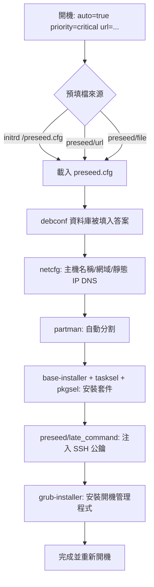

# Debian 全自動（非互動）安裝：以 preseed 預填主機名稱、SSH 公鑰與網路設定

## 1. 前言：什麼是 preseed

Debian 安裝程式（debian-installer）在安裝過程中，會向使用者提出一連串問題，這些問題與答案都儲存在一個名為 **debconf** 的資料庫中。所謂的 **preseed（預先餵答）**，就是在安裝程式還沒問到某個問題之前，先把該問題的答案寫進 debconf 資料庫，安裝程式之後便不再詢問，達成「非互動（unattended / non-interactive）」安裝[^apb-index]。

每一條 preseed 指令的語法固定為四個部分：

```
<owner> <question-name> <question-type> <value>
```

- `owner`：問題的擁有者，安裝程式本身的問題為 `d-i`，目標系統套件的問題則使用套件名稱（例如 `tasksel`）。
- `question-name`：debconf 樣板名稱，例如 `netcfg/get_hostname`。
- `question-type`：型別，例如 `string`、`boolean`、`select`、`password`、`multiselect`。
- `value`：要填入的答案[^apbs02]。

## 2. 預填檔的取得與傳遞方式

### 2.1 取得範例檔

官方提供一份完整的範例預填檔，可作為撰寫起點：

```
https://www.debian.org/releases/trixie/example-preseed.txt
```

該檔第一行為 `#_preseed_V1`，以 `#` 開頭者為註解[^apbs02]。

### 2.2 傳遞預填檔給安裝程式

安裝程式必須在啟動時被「告知」預填檔的位置，方式是在核心開機參數（kernel boot parameter）中加入 `preseed/url`（網路）或 `preseed/file`（本機媒體）。若預填檔放在 initrd 根目錄且命名為 `preseed.cfg`，安裝程式會自動偵測並載入，這是最早可生效的方式[^apbs02]。

| 情境 | 開機參數 |
|---|---|
| 網路（HTTP/HTTPS） | `preseed/url=http://host/path/to/preseed.cfg` |
| 網路（TFTP） | `preseed/url=tftp://host/path/to/preseed.cfg` |
| 重製安裝映像（CD） | `preseed/file=/cdrom/preseed.cfg` |
| USB 隨身碟（置於根目錄） | `preseed/file=/hd-media/preseed.cfg` |

上述參數可縮寫：`preseed/url` → `url`、`preseed/file` → `file`、`preseed/file/checksum` → `preseed-md5`。此外可加上 md5 校驗（`preseed/url/checksum=...`），若校驗不符，安裝程式會拒絕使用該檔[^apbs02]。

### 2.3 auto 模式

要達成完全不需人工按鍵的安裝，還需要 `auto` 模式。可以使用 `auto=true priority=critical`（`auto` 等同 `auto=true priority=critical`）：

- `auto=true` 是 `auto-install/enable=true` 的別名，會延後 locale 與鍵盤問題，讓它們有機會先被 preseed。
- `priority=critical` 是 `debconf/priority=critical` 的別名，會抑制所有優先度低於 critical 的問題[^apbs02]。

因此最精簡的完整開機列為：

```
auto=true priority=critical url=http://192.168.1.100/preseed.cfg
```

若使用 DHCP 且 DNS 可用，可用更簡潔的 `auto url=autoserver`，安裝程式會自動向 `http://autoserver.<domain>/d-i/trixie/./preseed.cfg` 取得預填檔[^apbs02]。

> **注意**：Linux 核心（2.6.9 以後）最多接受 32 個命令列選項與 32 個環境選項，超過會導致核心 panic[^apbs02]。

## 3. 預填主機名稱與網域

### 3.1 基本設定

```cfg
d-i netcfg/get_hostname string myserver
d-i netcfg/get_domain string example.com
```

需注意：**DHCP 配發的主機名稱與網域名稱會優先於此處設定值**。不過，設定這兩個值仍能避免安裝程式顯示對應問題[^apbs04]。

### 3.2 強制指定主機名稱

若要無視 DHCP 與反向 DNS 的結果、強制使用特定主機名稱，改用 `netcfg/hostname`：

```cfg
d-i netcfg/hostname string myserver
```

`netcfg/hostname` 會強制覆蓋 DHCP 與反向 DNS[^apbs02]。

### 3.3 網路開機（PXE）時的特殊處理

若透過網路開機，主機名稱的設定發生在預填檔被下載**之前**，因此必須直接寫在核心命令列上：

```
hostname=myserver domain=example.com
```

其別名對應為 `hostname` → `netcfg/get_hostname`、`domain` → `netcfg/get_domain`[^apbs02]。

## 4. 預填網路設定（靜態 IP）

安裝程式預設以 DHCP 自動設定網路。若要改成靜態設定，先關閉自動設定，再給定下列參數[^apbs04]：

```cfg
# 關閉自動網路設定（改為手動）
d-i netcfg/disable_autoconfig boolean true

# IPv4 靜態設定
d-i netcfg/get_ipaddress string 192.168.1.42
d-i netcfg/get_netmask string 255.255.255.0
d-i netcfg/get_gateway string 192.168.1.1
d-i netcfg/get_nameservers string 192.168.1.1
d-i netcfg/confirm_static boolean true
```

### 4.1 選擇網路介面

```cfg
# 自動偵測有連結的介面（預設）
d-i netcfg/choose_interface select auto

# 指定特定介面
d-i netcfg/choose_interface select eth1
```

### 4.2 其它網路相關參數

- `netcfg/get_netmask` 未設定時，netcfg 會自動判定；但在自動安裝情境下該變數須被標記為 `seen`。
- `netcfg/get_gateway` 未設定時，netcfg 會自動選擇；可設為 `"none"` 表示不使用閘道[^apbs04]。
- 若 DHCP 伺服器回應較慢，可延長等待：`d-i netcfg/dhcp_timeout string 60`、`d-i netcfg/dhcpv6_timeout string 60`。
- 若要同時支援「有／無 DHCP」的環境：`d-i netcfg/dhcp_failed note` 搭配 `d-i netcfg/dhcp_options select Configure network manually`[^apbs04]。

### 4.3 使用網路預填（preseed/url）時設定靜態 IP 的取巧做法

網路預填本身無法預先設定網路，因為必須先有網路才能下載預填檔。變通方式是透過 `preseed/run` 執行一段腳本，重新啟動網路設定：

```cfg
d-i preseed/run string /scripts/netcfg.sh
```

腳本內容：

```sh
kill-all-dhcp; netcfg
```

## 5. 預填 SSH 公鑰

在非互動安裝中，通常會停用 root 密碼並改用 SSH 公鑰登入。要在安裝過程中注入公鑰，使用 `preseed/late_command`（在安裝即將完成、`/target` 仍可用時執行）[^apbs05]。

### 5.1 方法 A：透過 `in-target`（建議）

```cfg
d-i preseed/late_command string \
    in-target mkdir -p /root/.ssh; \
    in-target sh -c "echo 'ssh-ed25519 AAAAC3NzaC1lZDI1NTE5AAAA... your-key-comment' >> /root/.ssh/authorized_keys"; \
    in-target chmod 700 /root/.ssh; \
    in-target chmod 600 /root/.ssh/authorized_keys; \
    in-target chown -R root:root /root/.ssh
```

### 5.2 方法 B：直接寫入 `/target`

```cfg
d-i preseed/late_command string \
    mkdir --mode=700 /target/root/.ssh; \
    echo "ssh-ed25519 AAAAC3NzaC1lZDI1NTE5AAAA... your-key-comment" > /target/root/.ssh/authorized_keys; \
    chmod 600 /target/root/.ssh/authorized_keys
```

### 5.3 配合停用 root 密碼

```cfg
# 以 "!" 表示帳號被鎖定、無密碼，僅允許憑證（金鑰）登入
d-i passwd/root-password-crypted password !
```

### 5.4 搭配安裝 SSH 伺服器

`late_command` 中可使用 `apt-install` 將套件安裝進目標系統：

```cfg
d-i preseed/late_command string \
    apt-install openssh-server; \
    in-target mkdir -p /root/.ssh; \
    in-target sh -c "echo 'ssh-ed25519 AAAAC3NzaC1lZDI1NTE5AAAA... your-key-comment' >> /root/.ssh/authorized_keys"
```

`late_command` 可用到的輔助指令包括：`in-target <cmd>`（在目標系統 chroot 內執行指令）、`apt-install <pkg>`（安裝套件進目標系統）、`anna-install <udeb>`（安裝安裝程式元件）[^apbs05]。

### 5.5 方法 C：安裝期間即遠端 SSH（network-console）

若希望在安裝「過程中」就能透過 SSH 進入安裝程式，可使用 `network-console` 元件，並以 `preseed/early_command` 注入金鑰[^netconsole]：

```cfg
d-i preseed/early_command string \
    anna-install network-console; \
    mkdir -p /.ssh; \
    sh -c "echo 'ssh-ed25519 AAAAC3NzaC1lZDI1NTE5AAAA... your-key' >> /.ssh/authorized_keys"; \
    chmod 700 /.ssh; \
    chmod 600 /.ssh/authorized_keys

d-i network-console/password password r00tme
d-i network-console/password-again password r00tme
```

亦可改由 URL 取得金鑰：`d-i network-console/authorized_keys_url string http://10.0.0.1/openssh-key`[^netconsole]。

## 6. 完整的非互動 preseed 範例

以下整合前述各節，為一份可直接使用的精簡範例：

```cfg
#_preseed_V1
### 在地化與鍵盤
d-i debian-installer/locale string en_US.UTF-8
d-i keyboard-configuration/xkb-keymap select us

### 主機名稱與網域
d-i netcfg/get_hostname string myserver
d-i netcfg/get_domain string example.com
d-i netcfg/hostname string myserver

### 網路（靜態 IP）
d-i netcfg/choose_interface select auto
d-i netcfg/disable_autoconfig boolean true
d-i netcfg/get_ipaddress string 192.168.1.42
d-i netcfg/get_netmask string 255.255.255.0
d-i netcfg/get_gateway string 192.168.1.1
d-i netcfg/get_nameservers string 192.168.1.1 8.8.8.8
d-i netcfg/confirm_static boolean true

### 鏡像站
d-i mirror/country string manual
d-i mirror/http/hostname string deb.debian.org
d-i mirror/http/directory string /debian
d-i mirror/http/proxy string

### 帳號
d-i passwd/root-password-crypted password !
d-i passwd/user-fullname string Admin
d-i passwd/username string admin
d-i passwd/user-password password secretpass
d-i passwd/user-password-again password secretpass

### 時鐘與時區
d-i clock-setup/utc boolean true
d-i time/zone string Asia/Taipei
d-i clock-setup/ntp boolean true

### 磁碟分割（整顆磁碟、LVM、atomic 配置）
d-i partman-auto/method string lvm
d-i partman-auto-lvm/guided_size string max
d-i partman-auto/choose_recipe select atomic
d-i partman-lvm/device_remove_lvm boolean true
d-i partman-md/device_remove_md boolean true
d-i partman-lvm/confirm boolean true
d-i partman-lvm/confirm_nooverwrite boolean true
d-i partman-partitioning/confirm_write_new_label boolean true
d-i partman/choose_partition select finish
d-i partman/confirm boolean true
d-i partman/confirm_nooverwrite boolean true

### 選擇套件
tasksel tasksel/first multiselect standard, ssh-server
d-i pkgsel/include string openssh-server curl wget

### 開機管理程式
d-i grub-installer/only_debian boolean true
d-i grub-installer/bootdev string default

### 注入 SSH 公鑰
d-i preseed/late_command string \
    in-target mkdir -p /root/.ssh; \
    in-target sh -c "echo 'ssh-ed25519 AAAAC3NzaC1lZDI1NTE5AAAA... your-key-comment' >> /root/.ssh/authorized_keys"; \
    in-target chmod 700 /root/.ssh; \
    in-target chmod 600 /root/.ssh/authorized_keys; \
    in-target chown -R root:root /root/.ssh

### 結束
d-i finish-install/reboot_in_progress note
```

## 7. 整體流程示意



## 8. 驗證與除錯

- 語法檢查：`debconf-set-selections -c preseed.cfg`（檢查預填檔語法是否正確）。
- 取得現有安裝程式可用的所有變數：在已安裝系統上執行 `debconf-get-selections --installer > file` 與 `debconf-get-selections >> file`[^devguide]。
- 顯示更多 debconf 細節：在開機參數加入 `DEBCONF_DEBUG=5`。
- 若想保留某些問題被詢問（只改預設值）：對該問題設定 `seen false`，或全域在開機參數加入 `preseed/interactive=true`[^apbs05]。

## 9. 來源批判性反思

- **官方文件為主要依據**：本報告關於 debconf 語法、開機參數、`netcfg`、`preseed/late_command` 的核心事實，均取自 Debian 官方安裝指南附錄 B（`apbs02`、`apbs04`、`apbs05`）與官方範例檔。官方來源權威性最高，且相互印證。
- **版本差異風險**：官方範例檔以 `trixie`（Debian 13）為主，`auto-install/defaultroot` 中的路徑含版本代號。不同 Debian 版本的 debconf 樣板鍵名與可用 tasksel 任務可能略有差異，實際套用時應對照該版本對應的 `example-preseed.txt`。
- **社群來源的定位**：`late_command` 注入金鑰、`network-console` 遠端安裝等做法，除官方文件外亦有社群文章與 GitHub 範例佐證；這些屬「用官方機制組合出的實務技巧」，與官方文件描述一致，可信度中等偏上，但仍應以官方機制為準。
- **安全性提醒**：官方明確指出 preseeding 本質上不安全，安裝程式不會檢查預填值是否被緩衝區溢出等手法濫用，因此**只能使用來自可信任來源的預填檔**[^apbs05]。此外，`debian-installer/allow_unauthenticated` 會關閉套件庫的 GPG 驗證，屬不建議使用的選項[^apbs04]。

## 參考資料

[^apb-index]: Debian Project. (n.d.). *Appendix B. Automating the installation using preseeding*. Debian GNU/Linux Installation Guide. Retrieved 2026-10-24, from https://www.debian.org/releases/stable/amd64/apb.en.html

[^apbs02]: Debian Project. (n.d.). *B.2. Using preseeding*. Debian GNU/Linux Installation Guide. Retrieved 2026-10-24, from https://www.debian.org/releases/stable/amd64/apbs02.en.html

[^apbs04]: Debian Project. (n.d.). *B.4. Contents of the preconfiguration file (for trixie)*. Debian GNU/Linux Installation Guide. Retrieved 2026-10-24, from https://www.debian.org/releases/stable/amd64/apbs04.en.html

[^apbs05]: Debian Project. (n.d.). *B.5. Advanced options*. Debian GNU/Linux Installation Guide. Retrieved 2026-10-24, from https://www.debian.org/releases/stable/amd64/apbs05.en.html

[^netconsole]: Debian Project. (n.d.). *Example preconfiguration file*. Retrieved 2026-10-24, from https://www.debian.org/releases/trixie/example-preseed.txt

[^devguide]: Debian Project. (n.d.). *Debian Installer internals*. Retrieved 2026-10-24, from https://d-i.debian.org/doc/internals/ch02.html
