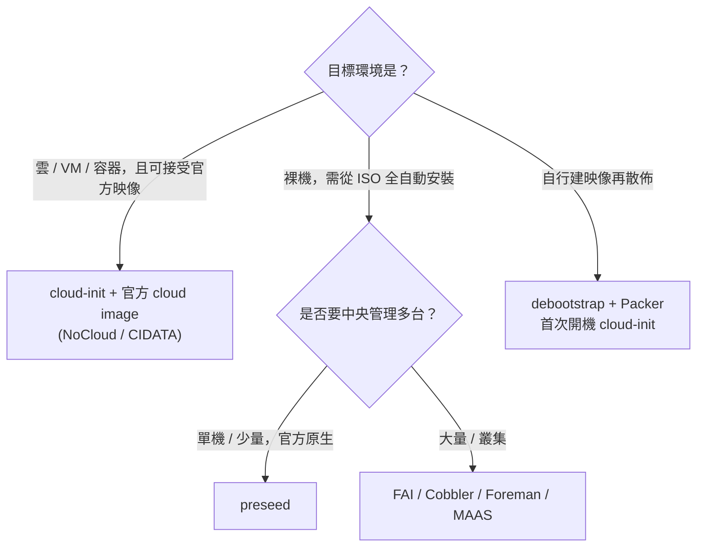

# Debian 非互動式安裝：Preseed 以外的選項（Autoinstall／Cloud-init 等）

## 摘要

在 Debian 上，Ubuntu Server 那種以 `autoinstall.yaml` 驅動的 Subiquity「Autoinstall」機制並不存在；Debian Installer（d-i）的官方自動化方式是 **preseeding**（debconf）。然而，若要「一次預填主機名稱、SSH 公鑰、網路設定」並達成無人值守安裝，Debian 生態提供了多條可行路徑，其中最貼近 Ubuntu autoinstall 使用體驗的是 **cloud-init + 官方 cloud image**（NoCloud datasource），它能在首次開機時依 YAML 設定 hostname、authorized keys 與網路。除此之外，**FAI**、**Cobbler**、**Foreman**、**MAAS**、**debootstrap + Packer + cloud-init** 等組合，也都可做到全自動佈署。

本報告說明各方案的角色、能力與適用場景，並釐清一個關鍵區別：**preseed／FAI 等屬於「安裝階段」工具，cloud-init／Ansible 屬於「安裝後（首次開機或後續）」工具。**

---

## 1. Debian 有沒有 Ubuntu 風格的 Autoinstall 或 cloud-init 安裝？

### 1.1 Autoinstall（Subiquity）在 Debian 不存在

Ubuntu 的 `autoinstall` 是其 Server 安裝器 **Subiquity** 專屬的 YAML 格式（`autoinstall.yaml`），不是通用標準。Debian 不使用 Subiquity，因此 **Debian 沒有官方的 `autoinstall.yaml` 機制**；Debian Installer 的官方自動化對應物是 preseed[^auto-install][^preseed-apb]。

### 1.2 cloud-init 在 Debian 完整支援

`cloud-init` 是跨發行版通用的雲端執行個體初始化框架，Debian 官方倉庫收錄該套件，且在官方 cloud image 中**預先安裝並設定為首次開機的初始化機制**：

- Debian 12（bookworm）套件版本約為 `22.4.2-1+deb12u4`[^cloudinit-bookworm]
- Debian 13（trixie）套件版本約為 `25.1.4-1+deb13u1`[^cloudinit-trixie]

套件描述指出 cloud-init 可「設定預設 locale 與 hostname、產生 SSH 私有 host key、安裝 SSH 公鑰以供登入預設帳號、設定掛載點並執行使用者腳本」[^cloudinit-desc]。

因此可區分兩種情境：

| 情境 | 使用的自動化機制 |
|---|---|
| 傳統裸機／VM，用 d-i 從 ISO 安裝 | **preseed**（非 Subiquity autoinstall） |
| 以 Debian 官方 cloud image 開機 | **cloud-init**（首次開機初始化） |

---

## 2. 官方 Debian Cloud Image 與 cloud-init

### 2.1 官方映像與變體

Debian Cloud Team 於 `cloud.debian.org` 提供官方雲端映像[^debian-cloud-images]：

| 變體 | 說明 | 是否含 cloud-init |
|---|---|---|
| **generic** | 任何支援 cloud-init 的環境（OpenStack、DigitalOcean、裸機） | 是 |
| **genericcloud** | 與 generic 相同，但使用 `linux-image-cloud-amd64` 精簡核心（僅含虛擬化驅動） | 是 |
| **ec2** | 針對 Amazon EC2 最佳化 | 是 |
| **azure** | 針對 Microsoft Azure 最佳化 | 是 |
| **nocloud** | **不執行 cloud-init**，直接開機進 root shell | 否 |

映像命名格式為 `debian-{版本}-{變體}-{架構}-{日期時間}.{格式}`，例如 `debian-13-generic-amd64-20250811-2201.qcow2`，提供 `qcow2`、`raw`、`tar.xz` 等格式[^debian-cloud-images]。


### 2.2 NoCloud datasource：如何預填 hostname／公鑰／網路

**NoCloud** datasource 允許在不依賴網路 metadata 服務的情況下提供設定，特別適合本機 QEMU／libvirt、Proxmox 範本與地端虛擬化[^nocloud]。設定來源可為：

1. 本機檔案系統路徑（`seedfrom: file://...`）
2. 標籤為 `CIDATA` 的 VFAT 或 ISO9660 磁碟
3. 自訂 HTTP(S) 伺服器
4. FTP/FTPS 伺服器

觸發方式可透過核心命令列（`ds=nocloud;s=...`）、SMBIOS serial，或 `/etc/cloud/cloud.cfg.d/` 設定[^nocloud]。

NoCloud 讀取的檔案[^nocloud]：

- `user-data`：cloud-config YAML 或腳本
- `meta-data`：必填 YAML，至少含 `instance-id`
- `network-config`：可選，v1 或 v2 格式
- `vendor-data`：可選

#### 範例：`meta-data`

```yaml
instance-id: iid-debian01
local-hostname: mydebian
hostname: mydebian
```

#### 範例：`network-config`（v2 格式）

```yaml
version: 2
ethernets:
  eth0:
    match:
      macaddress: "52:54:00:12:34:00"
    set-name: eth0
    addresses:
      - 192.168.1.100/24
    gateway4: 192.168.1.1
    nameservers:
      addresses:
        - 8.8.8.8
        - 8.8.4.4
    dhcp4: false
```

若省略 `network-config` 或採 DHCP，cloud-init 會預設對第一個介面使用 DHCP[^netconfig-v2]。

#### 範例：`user-data`（cloud-config）

```yaml
#cloud-config
hostname: mydebian
fqdn: mydebian.example.com
create_hostname_file: true
manage_etc_hosts: true

ssh_authorized_keys:
  - ssh-ed25519 AAAAC3NzaC1lZDI1NTE5AAAAI... your-key-here...

ssh_deletekeys: true
ssh_genkeytypes: [rsa, ecdsa, ed25519]
disable_root: true
ssh_pwauth: false

packages:
  - qemu-guest-agent

runcmd:
  - systemctl enable --now qemu-guest-agent

resize_rootfs: true
package_update: true
timezone: UTC
```

其中 `hostname`／`fqdn` 由 `cc_set_hostname` 模組處理，`ssh_authorized_keys` 用於佈署公鑰，`disable_root` 與 `ssh_pwauth` 控制登入策略[^cloudinit-hostname][^cloudinit-ssh]。

#### 製作 CIDATA seed 磁碟

```bash
# ISO9660 方式
genisoimage -output seed.iso -volid cidata -joliet -rock user-data meta-data network-config

# VFAT 方式（QEMU 偏好）
truncate --size 2M seed.iso
mkfs.vfat -n cidata seed.iso
mcopy -oi seed.iso user-data meta-data network-config ::
```

#### 以 QEMU 開機

```bash
qemu-img create -f qcow2 -b debian-13-genericcloud-amd64.qcow2 -F qcow2 boot-disk.img

kvm -m 2048 \
    -net nic -net user,hostfwd=tcp::2222-:22 \
    -drive file=boot-disk.img,if=virtio \
    -drive file=seed.iso,if=virtio,format=raw
```

### 2.3 常見陷阱

- **Debian 預設帳號為 `debian`**（不是 `ubuntu`）；cloud-config 中 `users: [default]` 會對應到發行版預設使用者。
- **`instance-id` 很重要**：若首次開機後修改 user-data，必須同時更改 `instance-id`，否則 cloud-init 會視為「已初始化」而略過。
- **`nocloud` 變體不含 cloud-init**：需要 cloud-init 時須選 `generic` 或 `genericcloud`。
- **`meta-data` 的 `local-hostname` 會被 user-data 的 `hostname`/`fqdn` 覆寫**。
- **`manage_etc_hosts: true`** 會在每次開機依範本重新產生 `/etc/hosts`。

---

## 3. Preseed（官方 d-i 自動化）

preseed 是 Debian Installer 官方的自動化機制，透過 **debconf** 預先填入安裝問題的答案，格式為 `d-i <owner>/<key> <type> <value>`，涵蓋本地化、鍵盤、網路、鏡像站、帳號、分割（含 LVM／RAID／加密）、套件選擇、開機載入器與 post-install hook[^preseed-apb]。

- 載入方式：initrd 內嵌、USB、網路（HTTP/FTP）、核心開機參數、DHCP option。
- 支援 `preseed/early_command` 與 `preseed/late_command` hook 執行任意 shell 指令。
- 官方範例檔：bookworm 與 trixie 皆有 `example-preseed.txt`[^preseed-example-trixie][^preseed-example-bookworm]。
- 官方文件：安裝指南 Appendix B（含自動安裝章節，同時提及 FAI 與 preseeding）[^auto-install]。

官方文件提醒 preseed「本質上不安全」，沒有緩衝區溢位檢查，僅應使用可信任來源的 preseed 檔[^preseed-apb]。

**注意**：preseed 主要處理「安裝階段」；若要在安裝後才注入 hostname、SSH 公鑰與網路設定，通常搭配 `preseed/late_command`，或改用 cloud-init／Ansible 於開機後處理。

---

## 4. 其他自動化路徑總覽

| 工具 | 角色 | 能全自動安裝 Debian？ | GitHub ⭐ |
|---|---|---|---|
| **Preseed** | d-i 安裝階段自動化 | 是（官方 Appendix B） | 不適用 |
| **FAI** | 獨立全自動安裝系統（裸機／VM／雲） | 是（主要用途） | 416[^fai-gh] |
| **FAIme** | 網頁服務，代建無人值守 ISO | 是 | 不適用 |
| **Cobbler** | PXE/DHCP/DNS/TFTP 網路安裝伺服器 | 是（經 preseed） | 2.8k[^cobbler-gh] |
| **Foreman** | 全生命週期佈署與組態管理 | 是（preseed + PXE） | 3.0k[^foreman-gh] |
| **MAAS** | 裸機雲（探索→佈署→下線） | 是（映像式） | 509[^maas-gh] |
| **netboot.xyz** | iPXE 網路開機選單 | 僅傳遞（半自動） | 12.6k[^netboot-gh] |
| **debootstrap** | 建立 Debian 基底檔案系統 | 部分（僅 rootfs） | 不適用[^debootstrap-man] |
| **Packer** | 機器映像建置 | 間接（建映像） | 15.8k[^packer-gh] |
| **Ansible** | 安裝後組態管理 | 否（僅安裝後） | 71.1k[^ansible-gh] |
| **cloud-init** | 首次開機初始化 | 否（僅安裝後） | 3.8k[^cloudinit-gh] |

### 4.1 FAI（Fully Automatic Installation）

FAI 是成熟（逾 25 年）的獨立全自動 Linux 佈署系統，原始為 Debian 而設計，支援 Debian、Ubuntu、Rocky、AlmaLinux、RHEL、SUSE、Linux Mint。支援 PXE 網路安裝、以 class 為基礎的集中設定、軟體 RAID/LVM、安裝期間 SSH 遠端控制，並能產生自訂 live ISO 與雲端映像。其網頁服務 **FAIme** 可免安裝 FAI，直接在網頁上選擇發行版、桌面、套件、密碼、SSH 金鑰與分割方案，數分鐘內產出全自動 ISO[^fai][^faime]。

### 4.2 Cobbler／Foreman／MAAS

- **Cobbler**：整合 PXE、DHCP、DNS、TFTP 與套件庫，以樣板化的 preseed/kickstart 佈署，支援 Debian（preseed）[^cobbler]。
- **Foreman**：完整生命週期管理平台，含網頁 UI、CLI（Hammer）與 REST API，以 preseed 樣板佈署 Debian[^foreman]。
- **MAAS**：Canonical 的「裸機即雲」方案，具 BMC 電源控制、IPAM/DHCP/DNS、RBAC，支援 Debian 映像，適合大規模資料中心[^maas]。

### 4.3 debootstrap／Packer／Ansible

- **debootstrap**：Debian 安裝器本身使用的低階工具，官方安裝指南認可其為「安裝 Debian 基底系統的官方方式」，不設定開機載入器與網路，需後續手動處理[^debootstrap-man][^debootstrap-official]。
- **Packer**：以 HCL 樣板從單一來源產生多平台映像，常與 preseeded ISO 搭配建置黃金 VM 映像[^packer]。
- **Ansible**：無代理、SSH 驅動的組態管理，**非安裝器**，適合在 OS 佈署完成後進行組態[^ansible]。

### 4.4 netboot.xyz

iPXE 開機載入器，提供各發行版網路安裝器的互動選單；它本身是**開機交付機制**，可鏈結到已 preseed 的 Debian 安裝器，但非全自動佈署系統[^netboot]。

---

## 5. 決策建議



**若你要的情境是「預填 hostname、public key、network 並全自動」**：

1. **虛擬機／雲、可接受官方映像** → 使用 `generic` 或 `genericcloud` cloud image + NoCloud CIDATA seed，以 cloud-config 預填 `hostname`、`ssh_authorized_keys`、`network-config`。這是最接近 Ubuntu autoinstall 體驗的路徑。
2. **裸機、需完整安裝** → 使用 preseed（`d-i netcfg/...`、`d-i passwd/...`、`d-i preseed/late_command` 注入公鑰），或改用 FAI。
3. **大規模集中佈署** → FAI、Cobbler、Foreman 或 MAAS。

---

## 參考文獻

[^auto-install]: Debian. (n.d.). *Automatic Installation*. Debian Installation Guide, Section 4.6. Retrieved 2026-10-24, from https://www.debian.org/releases/stable/amd64/ch04s06.en.html

[^preseed-apb]: Debian. (n.d.). *Automating the installation using preseeding*. Debian Installation Guide, Appendix B. Retrieved 2026-10-24, from https://www.debian.org/releases/stable/amd64/apb.en.html

[^preseed-example-trixie]: Debian. (n.d.). *example-preseed.txt (trixie)*. Retrieved 2026-10-24, from https://www.debian.org/releases/trixie/example-preseed.txt

[^preseed-example-bookworm]: Debian. (n.d.). *example-preseed.txt (bookworm)*. Retrieved 2026-10-24, from https://www.debian.org/releases/bookworm/example-preseed.txt

[^cloudinit-bookworm]: Debian. (n.d.). *Package cloud-init (bookworm)*. Retrieved 2026-10-24, from https://packages.debian.org/bookworm/cloud-init

[^cloudinit-trixie]: Debian. (n.d.). *Package cloud-init (trixie)*. Retrieved 2026-10-24, from https://packages.debian.org/trixie/cloud-init

[^cloudinit-desc]: Debian. (n.d.). *cloud-init package description*. Retrieved 2026-10-24, from https://packages.debian.org/trixie/cloud-init

[^debian-cloud-images]: Debian Cloud Team. (n.d.). *Debian Official Cloud Images*. Retrieved 2026-10-24, from https://cloud.debian.org/images/cloud/

[^nocloud]: Canonical. (n.d.). *NoCloud datasource*. Cloud-init documentation. Retrieved 2026-10-24, from https://cloudinit.readthedocs.io/en/latest/reference/datasources/nocloud.html

[^netconfig-v2]: Canonical. (n.d.). *Networking config Version 2*. Cloud-init documentation. Retrieved 2026-10-24, from https://cloudinit.readthedocs.io/en/latest/reference/network-config-format-v2.html

[^cloudinit-hostname]: Canonical. (n.d.). *Set Hostname module (cc_set_hostname)*. Cloud-init documentation. Retrieved 2026-10-24, from https://cloudinit.readthedocs.io/en/latest/reference/modules.html

[^cloudinit-ssh]: Canonical. (n.d.). *SSH and SSH keys configuration*. Cloud-init documentation. Retrieved 2026-10-24, from https://docs.cloud-init.io/en/latest/reference/yaml_examples/ssh.html

[^fai]: FAI Project. (n.d.). *FAI - Fully Automatic Installation*. Retrieved 2026-10-24, from https://fai-project.org/

[^fai-gh]: FAI Project. (n.d.). *faiproject/fai*. GitHub. Retrieved 2026-10-24, from https://github.com/faiproject/fai

[^faime]: FAI Project. (n.d.). *FAIme web service*. Retrieved 2026-10-24, from https://fai-project.org/FAIme

[^cobbler]: Cobbler Project. (n.d.). *Cobbler*. Retrieved 2026-10-24, from https://cobbler.github.io/

[^cobbler-gh]: Cobbler Project. (n.d.). *cobbler/cobbler*. GitHub. Retrieved 2026-10-24, from https://github.com/cobbler/cobbler

[^foreman]: Foreman Project. (n.d.). *Foreman*. Retrieved 2026-10-24, from https://theforeman.org/

[^foreman-gh]: Foreman Project. (n.d.). *theforeman/foreman*. GitHub. Retrieved 2026-10-24, from https://github.com/theforeman/foreman

[^maas]: Canonical. (n.d.). *MAAS - Metal as a Service*. Retrieved 2026-10-24, from https://maas.io/

[^maas-gh]: Canonical. (n.d.). *canonical/maas*. GitHub. Retrieved 2026-10-24, from https://github.com/canonical/maas

[^netboot]: netboot.xyz. (n.d.). *netboot.xyz*. Retrieved 2026-10-24, from https://netboot.xyz/

[^netboot-gh]: netboot.xyz. (n.d.). *netbootxyz/netboot.xyz*. GitHub. Retrieved 2026-10-24, from https://github.com/netbootxyz/netboot.xyz

[^debootstrap-man]: Debian. (n.d.). *debootstrap(8) manual page*. Retrieved 2026-10-24, from https://manpages.debian.org/bookworm/debootstrap/debootstrap.8.en.html

[^debootstrap-official]: Debian. (n.d.). *Installing Debian GNU/Linux from a Unix/Linux System*. Debian Installation Guide, Appendix D.3. Retrieved 2026-10-24, from https://www.debian.org/releases/stable/amd64/apds03.en.html

[^packer]: HashiCorp. (n.d.). *Packer*. Retrieved 2026-10-24, from https://www.packer.io/

[^packer-gh]: HashiCorp. (n.d.). *hashicorp/packer*. GitHub. Retrieved 2026-10-24, from https://github.com/hashicorp/packer

[^ansible]: Red Hat. (n.d.). *Ansible*. Retrieved 2026-10-24, from https://www.ansible.com/

[^ansible-gh]: Red Hat. (n.d.). *ansible/ansible*. GitHub. Retrieved 2026-10-24, from https://github.com/ansible/ansible

[^cloudinit-gh]: Canonical. (n.d.). *canonical/cloud-init*. GitHub. Retrieved 2026-10-24, from https://github.com/canonical/cloud-init

[^cloudinit-site]: Canonical. (n.d.). *cloud-init*. Retrieved 2026-10-24, from https://cloud-init.io/
