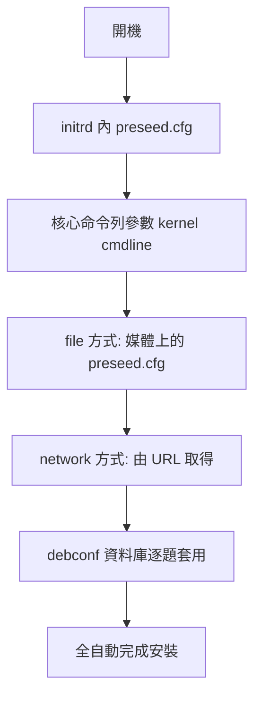
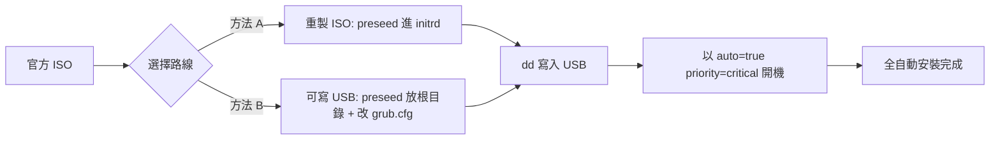

# Debian 使用 preseed 全自動安裝：從製作 ISO 到開機 USB 的完整步驟

## 摘要

本報告說明如何在 Debian GNU/Linux 上使用 `preseed`（預先餵答，preseeding）機制進行全自動、免互動的系統安裝。內容涵蓋 preseed 的原理、檔案格式、三種餵入方式（initrd、file、network），並以「重製（remaster）安裝 ISO」與「可寫入 USB 隨身碟」兩條主線，提供從零開始的逐步操作指令，最後說明如何寫入 USB、以 `auto=true priority=critical` 參數啟動，以及除錯與驗證方式。

所有操作皆以 Debian 官方安裝手冊與 Debian Wiki 為依據，版本以 `stable`（撰寫時為 trixie，Debian 13）為準。

---

## 1. preseed 是什麼

`preseeding` 提供一種預先設定安裝問題答案的方法，讓使用者不必在安裝過程中手動輸入答案，因此可以將大部分安裝流程自動化，甚至啟用一般互動式安裝沒有提供的功能[^dguide]。多數 Debian 安裝程式（`debian-installer`，簡稱 d-i）提出的問題，都可以透過在 `debconf` 資料庫中設定答案來預先餵答[^wiki-preseed]。

一個空的 preseed 檔會讓安裝程式行為與一般手動安裝相同；每一條被 preseed 的設定，就是把該次安裝從「基準線」改掉一項[^dguide]。

preseed 通常與「無人值守安裝」畫上等號，但它同時是 `auto=true`、`priority=critical` 這類開機參數的搭配對象，理解其載入順序是除錯的關鍵。

---

## 2. preseed 檔案格式

preseed 檔採用 `debconf-set-selections` 的格式，每行格式為[^dguide]：

```
<owner> <question name> <question type> <value>
```

規則如下[^dguide]：

- 檔案**必須**以魔術標記 `#_preseed_V1` 開頭。
- `type` 與 `value` 之間**只能有一個**空白或 Tab；多餘空白會變成值的一部分。
- 可用反斜線 `\` 做行接續。
- 行首 `#` 為註解。
- 安裝程式內部變數的 owner 為 `d-i`；目標系統套件變數的 owner 為套件名稱。
- 值必須使用英文，不得使用翻譯（部分 `partman` 問題例外）。

**驗證語法**（把 `owner key/subkey value` 中 subkey 與 value 之間只留一個空格）[^wiki-preseed]：

```bash
debconf-set-selections -c preseed.cfg
```

**從已安裝系統匯出答案**，作為撰寫 preseed 的素材[^dguide][^wiki-preseed]：

```bash
echo "#_preseed_V1" > file
debconf-get-selections --installer >> file
debconf-get-selections >> file
```

安裝程式的資料庫會保存在已安裝系統的 `/var/log/installer/cdebconf`（僅 root 可讀）[^dguide]。

> 重要：preseed 檔**不是** shell 腳本。語法看似相似（`#` 註解、`\` 續行），但其中不能包含 `if` 判斷、變數等[^wiki-preseed]。

建議一律以官方維護的範例檔為起點，而非自行從零撰寫[^wiki-preseed]：

- 範例檔：`https://www.debian.org/releases/trixie/example-preseed.txt`[^example]

---

## 3. 三種餵入方式與載入順序

官方手冊指出有三種 preseed 方式[^dguide]：

| 方式 | 說明 | 支援的安裝媒體 |
| --- | --- | --- |
| **initrd** | 把名為 `preseed.cfg` 的檔案放在 initrd 根目錄，開機一開始即載入 | 所有方式 |
| **file** | preseed 檔位於安裝媒體上 | CD/DVD/USB、hd-media（USB 隨身碟） |
| **network** | 網路起來後以 URL 取得 preseed 檔 | CD/DVD/USB（含網路）、netboot、hd-media（含網路） |

**載入順序**為：initrd → kernel command line → file → network[^dguide]。也就是 initrd 的 preseed 最早生效，任何問題都還沒問就先套用；kernel command line 次之；file 在映像載入後；network 則要等網路設定完成。



---

## 4. 開機參數（boot parameters）

安裝程式透過開機參數得知 preseed 位置。常用參數與別名如下[^dguide]：

| 參數 | 別名 | 用途 |
| --- | --- | --- |
| `preseed/url=http://host/path/preseed.cfg` | `url` | 由網路（HTTP）取得 preseed |
| `preseed/url=tftp://host/path/preseed.cfg` | 同上 | 由 TFTP 取得 preseed |
| `preseed/file=/cdrom/preseed.cfg` | `file` | 重製光碟內的 preseed |
| `preseed/file=/hd-media/preseed.cfg` | `file` | USB 隨身碟最上層目錄的 preseed |
| `preseed/url/checksum=5da...` | `preseed-md5` | 檢查碼驗證 |
| `preseed/file/checksum=5da...` | `preseed-md5` | 檢查碼驗證 |

### auto 模式：`auto=true priority=critical`

`auto` 開機選項（等同 `auto=true priority=critical`）做兩件事[^dguide]：

1. `auto=true`（別名 `auto-install/enable=true`）：延後 locale／鍵盤問題，直到網路起來後才問，使這些問題也能被任一方式的 preseed 餵答。
2. `priority=critical`（別名 `debconf/priority=critical`）：抑制所有低於 critical 等級的問題。

常用別名對照[^dguide]：

| 別名 | 完整變數 |
| --- | --- |
| `priority` | `debconf/priority` |
| `auto` | `auto-install/enable` |
| `classes` | `auto-install/classes` |
| `file` | `preseed/file` |
| `url` | `preseed/url` |
| `language` | `debian-installer/language` |
| `country` | `debian-installer/country` |
| `locale` | `debian-installer/locale` |
| `keymap` | `keyboard-configuration/xkb-keymap` |
| `interface` | `netcfg/choose_interface` |
| `hostname` | `netcfg/get_hostname` |
| `domain` | `netcfg/get_domain` |
| `tasks` | `tasksel:tasksel/first` |
| `desktop` | `tasksel:tasksel/desktop` |
| `preseed-md5` | `preseed/file/checksum` |

開機提示字元範例[^dguide]：

```text
/install.amd/vmlinuz vga=788 initrd=/install.amd/gtk/initrd.gz language=en country=DE locale=en_US.UTF-8 keymap=de --- quiet
```

`---` 之後的內容可能會被複製到已安裝系統的開機設定中[^dguide]。

---

## 5. 範例 preseed 檔（節錄）

以下為官方範例檔常見段落，實務上請以完整範例為底稿再修改[^example]。

```text
#_preseed_V1

### 本地化
d-i debian-installer/locale string en_US.UTF-8
d-i keyboard-configuration/xkb-keymap select us

### 網路
d-i netcfg/choose_interface select auto
d-i netcfg/get_hostname string unassigned-hostname
d-i netcfg/get_domain string unassigned-domain

### 鏡像站
d-i mirror/country string manual
d-i mirror/http/hostname string http.us.debian.org
d-i mirror/http/directory string /debian
d-i mirror/http/proxy string

### 帳號
d-i passwd/root-password password r00tme
d-i passwd/root-password-again password r00tme
d-i passwd/user-fullname string Debian User
d-i passwd/username string debian
d-i passwd/user-password password insecure
d-i passwd/user-password-again password insecure

### 時鐘與時區
d-i clock-setup/utc boolean true
d-i time/zone string Asia/Taipei
d-i clock-setup/ntp boolean true

### 分割（LVM，全部在一個分割區）
d-i partman-auto/method string lvm
d-i partman-auto-lvm/guided_size string max
d-i partman-lvm/device_remove_lvm boolean true
d-i partman-md/device_remove_md boolean true
d-i partman-lvm/confirm boolean true
d-i partman-lvm/confirm_nooverwrite boolean true
d-i partman-auto/choose_recipe select atomic
d-i partman-partitioning/confirm_write_new_label boolean true
d-i partman/choose_partition select finish
d-i partman/confirm boolean true
d-i partman/confirm_nooverwrite boolean true

### 套件選擇
tasksel tasksel/first multiselect standard, web-server
d-i pkgsel/include string openssh-server build-essential

### 開機程式
d-i grub-installer/only_debian boolean true
d-i grub-installer/bootdev string /dev/sda

### 收尾
d-i finish-install/reboot_in_progress note
```

**產生 SHA-512 crypt(3) 密碼雜湊**（用於 `-crypted` 欄位）[^dguide]：

```bash
mkpasswd -m sha-512
```

**自訂指令掛勾**（`preseed/early_command`、`partman/early_command`、`preseed/late_command`）[^dguide][^example]：

```text
d-i preseed/early_command string anna-install some-udeb
d-i partman/early_command string debconf-set partman-auto/disk "$(list-devices disk | head -n1)"
d-i preseed/late_command string apt-install zsh; in-target chsh -s /bin/zsh
```

> 注意：preseed 本質上不安全，安裝程式不會檢查緩衝區溢位等攻擊，因此只應使用來自可信任來源的 preseed 檔[^example]。

---

## 6. 方法 A：重製（remaster）安裝 ISO，把 preseed.cfg 放進 initrd

此法為 Debian Wiki 的 EditIso 流程，適合 legacy BIOS 開機，**必須以文字版安裝程式**（GRUB 選單中的 `Install` 或 `Expert install`）啟動，圖形版安裝選項**不會**找到 initrd 中的 `preseed.cfg`[^editiso]。除寫入裝置外，以下步驟一般使用者權限即可執行[^editiso]。

### 步驟 1：解出 ISO 內容

先取得 netinst 或 DVD-1 映像，並以其中一種方式解出全部檔案[^editiso][^manipulating]：

```bash
# 方法一：bsdtar（免 root）
bsdtar -C isofiles -xf debian-13.x.x-amd64-netinst.iso

# 方法二：xorriso
xorriso -osirrox on -indev debian-13.x.x-amd64-netinst.iso -extract / isofiles

# 方法三：7z
7z x -oisofiles debian-13.x.x-amd64-netinst.iso
```

或先 loop 掛載再複製[^editiso]：

```bash
mkdir -p /mnt/iso isofiles
mount -o loop debian-13.x.x-amd64-netinst.iso /mnt/iso
cp -rT /mnt/iso/ isofiles/
umount /mnt/iso
```

### 步驟 2：把 preseed.cfg 附加進 initrd.gz

先將 `preseed.cfg` 放到 `isofiles/` 之後，使其可寫、解壓、附加、再壓縮[^editiso]：

```bash
chmod +w -R isofiles/install.amd/
gunzip isofiles/install.amd/initrd.gz
echo preseed.cfg | cpio -H newc -o -A -F isofiles/install.amd/initrd
gzip isofiles/install.amd/initrd
chmod -w -R isofiles/install.amd/
```

> 安裝程式開機時會尋找名為 `preseed.cfg` 的檔案[^editiso]。`install.amd/` 為 amd64 架構目錄；i386 對應 `install.386/`[^editiso]。

### 步驟 3：重新產生 md5sum.txt

```bash
cd isofiles
chmod +w md5sum.txt
find -follow -type f ! -name md5sum.txt -print0 | xargs -0 md5sum > md5sum.txt
chmod -w md5sum.txt
cd ..
```

`find` 會對 `./debian`（指向 `.` 的符號連結）發出檔案系統迴圈警告，但不影響結果[^editiso]。

### 步驟 4：重新打包成可開機 ISO

**單一指令的現代作法（建議，需 `xorriso` 與 `isolinux`）**[^editiso]：

```bash
xorriso -as mkisofs -o preseed-debian-amd64-netinst.iso \
   -isohybrid-mbr /usr/lib/ISOLINUX/isohdpfx.bin \
   -c isolinux/boot.cat -b isolinux/isolinux.bin -no-emul-boot \
   -boot-load-size 4 -boot-info-table isofiles
```

**或使用 genisoimage + isohybrid**（需 `genisoimage`、`syslinux-utils`）[^editiso]：

```bash
genisoimage -r -J -b isolinux/isolinux.bin -c isolinux/boot.cat \
   -no-emul-boot -boot-load-size 4 -boot-info-table \
   -o preseed-debian-amd64-netinst.iso isofiles
isohybrid preseed-debian-amd64-netinst.iso
```

> 上述指令足以處理 i386 與 amd64 的 legacy BIOS 模式。若要為 EFI、arm64 等架構製作可開機 ISO，需依 `RepackBootableISO` 的方式額外處理 `boot/grub/efi.img` 與 MBR/GPT 等開機設備[^editiso][^repack]。完整保存原 ISO 開機設備的方法，是讀取 ISO 內 `/.disk/mkisofs`（記錄原始打包指令），移除 jigdo 相關選項後，抽取 MBR 樣板（`dd if=原始ISO bs=1 count=432 of=isohdpfx.bin`）再重跑 `xorriso -as mkisofs`[^repack]。

若要改用「file」方式（把 preseed 放在映像檔系統上，而非 initrd），可在解出的樹中放置 `preseed.cfg`，並把開機參數加到 `isolinux/txt.cfg` 的 `append` 行結尾[^manipulating]：

```text
priority=high locale=en_GB.UTF-8 keymap=gb file=/cdrom/preseed.cfg
```

### 步驟 5：測試與寫入 USB

可在燒錄前用 QEMU 快速測試[^editiso]：

```bash
qemu-system-x86_64 -net user -cdrom preseed-debian-amd64-netinst.iso
```

寫入 USB 見第 8 節。

---

## 7. 方法 B：把 ISO 內容放進可寫入 USB 隨身碟（適合 EFI）

此法出自 DebianInstaller/WritableUSBStick，適合想從 USB 隨身碟在 EFI 系統安裝的常見情境。因為檔案系統可寫，可直接編輯開機選單與放置 preseed 檔[^writable]。

### 步驟 1：格式化 USB 為 FAT32 並掛載

（`/dev/sdX` 為隨身碟裝置，務必確認，勿誤指硬碟）[^writable]

```bash
parted --script /dev/sdX mklabel msdos
parted --script /dev/sdX mkpart primary fat32 0% 100%
mkfs.vfat /dev/sdX1
mount /dev/sdX1 /mnt/data/
```

### 步驟 2：複製 ISO 內容到隨身碟

```bash
mount -o loop debian-13.x.x-amd64-netinst.iso /mnt/cdrom/
rsync -av /mnt/cdrom/ /mnt/data/
umount /mnt/cdrom
```

若為非 Debian ISO 可能需要改用 `kpartx` 掛載其分割區[^writable]：

```bash
kpartx -v -a debian-13.x.x-amd64-netinst.iso
mount /dev/mapper/loop0p1 /mnt/cdrom/
rsync -av /mnt/cdrom/ /mnt/data/
umount /mnt/cdrom
```

### 步驟 3：放置 preseed.cfg 並修改 grub.cfg

把 `preseed.cfg` 複製到隨身碟根目錄，並編輯 `/mnt/data/boot/grub/grub.cfg` 的 `linux` 行[^writable]：

```text
linux    /install.amd/vmlinuz vga=788 --- quiet preseed/file=/cdrom/preseed.cfg
```

建議加上自動化參數，形成完整一行：

```text
linux    /install.amd/vmlinuz vga=788 --- quiet auto=true priority=critical preseed/file=/cdrom/preseed.cfg
```

### 步驟 4：卸載並開機

```bash
umount /mnt/data
```

之後即可從該 USB 開機安裝[^writable]。

---

## 8. 製作開機 USB：把 ISO 寫入隨身碟

所有 i386、amd64、arm64 的 Debian 映像都是 isohybrid 格式，同一個 ISO 可直接寫入 USB 並開機，無需特殊轉換[^cd-faq]。

### Linux 下

```bash
# 以 cp（簡單）
cp preseed-debian-amd64-netinst.iso /dev/sdX

# 以 dd（建議，可顯示進度並確保寫入完成）
dd if=preseed-debian-amd64-netinst.iso of=/dev/sdX bs=16M status=progress oflag=sync
```

- `status=progress` 顯示即時進度，`oflag=sync` 會在結束後同步寫入，使 USB 可安全移除[^cd-faq]。
- **務必確認 `of=` 裝置為隨身碟**，避免覆蓋硬碟[^cd-faq]。

### Windows 下

官方建議依序為 **balenaEtcher**（有免安裝 portable 版）與 **USBImager**（無廣告、無隱私疑慮）[^cd-faq]。

### 重要提醒

- ISO 必須以**原始映像**方式寫入（`dd`／`cp`／Etcher），**不可**像解壓縮 zip 一樣把內容攤開。若把 ISO 內容解開複製到 USB，會遺失 El Torito／UEFI 開機資訊，導致無法開機[^cd-faq]。
- Debian 明確建議**不要**使用 unetbootin，因其可能造成難以診斷的開機與安裝問題[^cd-faq]。
- 多片光碟組中，只有第一片是可開機的[^cd-faq]。



---

## 9. 由網路載入 preseed（補充）

除離線媒體外，也可讓安裝程式由網路取得 preseed，適合批次部署[^wiki-preseed]：

- 在圖形開機選單選「Help」，於 `boot:` 提示字元輸入：`auto url=http://webserver/path/preseed.cfg`[^wiki-preseed]。
- 若 URL 無協定，預設為 `http`；主機名無句點時會附加 DHCP 網域；無路徑時預設嘗試 `d-i/<codename>/preseed.cfg`（例如 `d-i/trixie/preseed.cfg`）[^dguide][^wiki-preseed]。
- **注意**：`netcfg/*` 網路設定無法由「網路載入的 preseed」生效，因為網路必須先設定好才能取得 preseed；這類設定必須以核心參數傳入（例如 `netcfg/choose_interface=eth0`）[^wiki-preseed]。
- 若 preseed 透過 https 且憑證不受信任，可加 `debian-installer/allow_unauthenticated_ssl=true` 略過憑證檢查[^wiki-preseed]。
- 若控制 DHCP 伺服器，可在 `dhcpd.conf` 中僅對識別為 `d-i` 的客戶端回傳 preseed 位置，達成全自動安裝[^dguide][^wiki-preseed]：

```text
if substring (option vendor-class-identifier, 0, 3) = "d-i" {
    filename "http://host/preseed.cfg";
}
```

---

## 10. 除錯與注意事項

- 以 `DEBCONF_DEBUG=5` 開機參數可印出詳細的 debconf 進度[^dguide]。
- 讓所有被 preseed 的問題仍顯示為互動式：`preseed/interactive=true`[^dguide]。
- 若某 preseed 值被忽略，且在 `DEBCONF_DEBUG=5` 輸出中看到 `FSET blah false`，代表某段程式碼堅持要顯示該問題，這類問題通常無法被 preseed，唯一解法是避免觸發該問題的情境[^wiki-preseed]。
- 不要在 `base-config/late_command` 中重新開機，否則安裝會從第二階段重新開始[^wiki-preseed]。
- preseed 檔中 `owner key/subkey value` 行，subkey 與 value 之間**只有一個空格**[^wiki-preseed]。
- vim 的 preseed 語法高亮可安裝 `preseed` 外掛[^wiki-preseed]。

---

## 11. 批判性來源反思

- **權威性**：本報告主要依據 Debian 官方安裝手冊（`debian.org`）與 Debian Wiki（`wiki.debian.org`）。官方手冊由 Debian 專案維護，屬最高權威；Wiki 為社群編輯，權威性略低但通常與官方同步，且其 `last modified` 標記顯示近期（2025 年）仍在維護[^wiki-preseed][^manipulating][^repack]。
- **時效性**：手冊中之範例與 ISO 路徑（`isolinux/`、`boot/grub/efi.img`）隨 Debian 版本演進可能變動；本報告以 trixie 為準，並提醒讀者以實際 ISO 內容為準。官方安裝指南本身即建議，不同版本應使用對應版本的範例 preseed 檔，否則「即使你自認已自動化一切，某個時點仍很可能被要求回答問題」[^wiki-preseed]。
- **偏誤**：Debian CD FAQ 對第三方寫入工具（unetbootin）有負面評語，可能帶有專案自身偏好，屬需讀者自行斟酌的立場陳述[^cd-faq]。此處如實呈現，並未視為絕對事實。
- **佐證**：無論是 initrd 附加、md5sum 重算、ISO 重打包或 USB 寫入流程，官方手冊、Wiki 與 CD FAQ 三來源敘述一致且互相佐證，可信度高[^editiso][^manipulating][^repack][^cd-faq]。
- **未涵蓋**：本報告未深入 QEMU／PXE netboot 的完整 preseed 部署，亦未逐項列出所有 partman 進階分割配方；這些屬進階主題，建議另立專題。

---

## 參考文獻

[^dguide]: Debian. (n.d.). *Automating the installation using preseeding* (Appendix B, Debian GNU/Linux Installation Guide, amd64). Retrieved 2026-10-24, from https://www.debian.org/releases/stable/amd64/apb.en.html

[^example]: Debian. (n.d.). *Example preseed file* (trixie). Retrieved 2026-10-24, from https://www.debian.org/releases/trixie/example-preseed.txt

[^wiki-preseed]: Debian Wiki. (2025, August 17). *DebianInstaller/Preseed*. Retrieved 2026-10-24, from https://wiki.debian.org/DebianInstaller/Preseed

[^editiso]: Debian Wiki. (2025, July 17). *DebianInstaller/Preseed/EditIso*. Retrieved 2026-10-24, from https://wiki.debian.org/DebianInstaller/Preseed/EditIso

[^writable]: Debian Wiki. (2025, July 17). *DebianInstaller/WritableUSBStick*. Retrieved 2026-10-24, from https://wiki.debian.org/DebianInstaller/WritableUSBStick

[^manipulating]: Debian Wiki. (2025, August 17). *ManipulatingISOs*. Retrieved 2026-10-24, from https://wiki.debian.org/ManipulatingISOs

[^repack]: Debian Wiki. (n.d.). *RepackBootableISO*. Retrieved 2026-10-24, from https://wiki.debian.org/RepackBootableISO

[^cd-faq]: Debian. (n.d.). *Debian CD/DVD/BD FAQ*. Retrieved 2026-10-24, from https://www.debian.org/CD/faq/index.en.html
