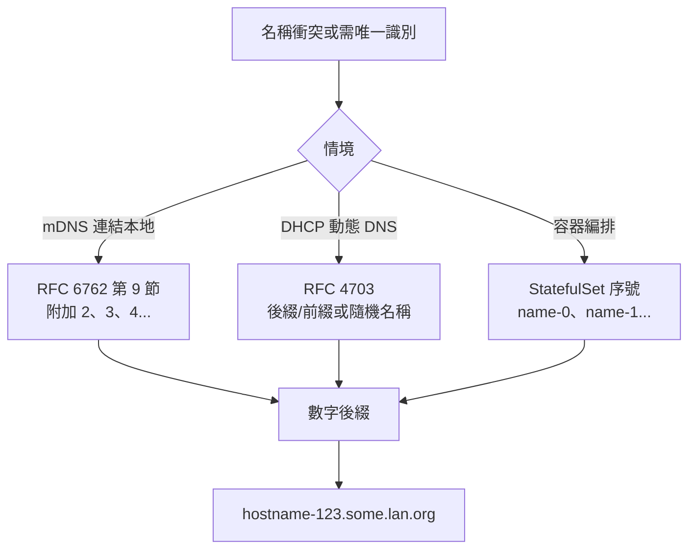
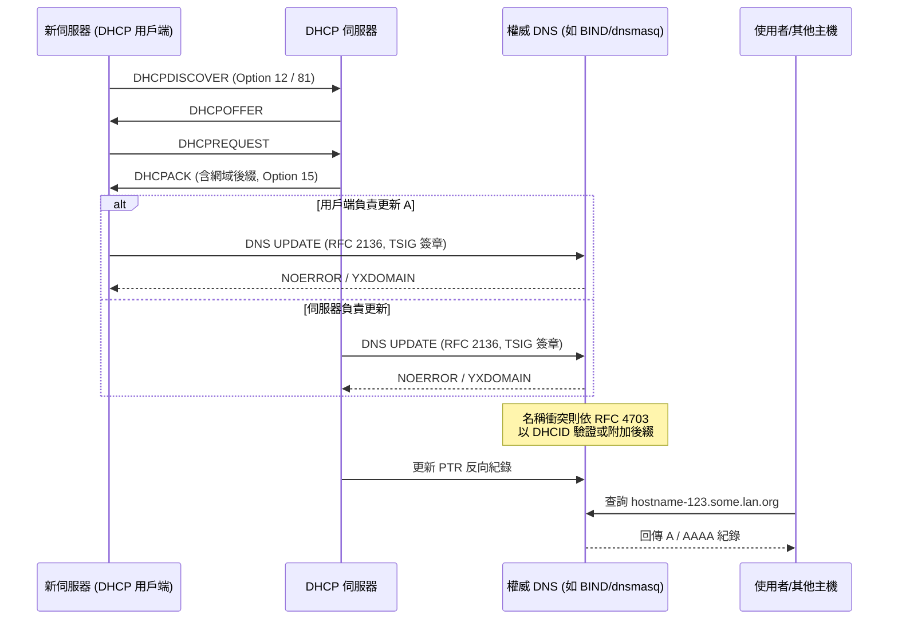

# LAN 中主機名稱自動掛載到網域的實作原理

## 摘要

在許多區域網路（LAN）環境中，當管理者在網域內架設一台伺服器時，該伺服器的主機名稱會自動被掛到某個統一網域之下，例如主機名為 `hostname` 的機器，在網路上會以 `hostname-123.some.lan.org` 這樣的形式被解析。這種「主機名稱自動附掛網域」的行為並非單一技術，而是由一組互相搭配的機制所構成，主要包括：

1. **DHCP 動態 DNS 更新**（DHCP + DNS UPDATE）：由 DHCP 伺服器或用戶端在配發 IP 時，一併將主機名稱寫入區域 DNS。
2. **DNS 動態更新協定**（RFC 2136）：允許透過網路以程式化方式新增或刪除 DNS 資源紀錄。
3. **多播 DNS／mDNS**（RFC 6762）：在無集中式 DNS 伺服器的情況下，讓 `xxx.local` 形式的名稱可被解析。
4. **萬用字元 DNS 紀錄**（Wildcard DNS，RFC 4592）：讓任意子網域都能被同一個紀錄回答。
5. **名稱衝突自動編號**：當名稱重複時，自動在尾端附加數字（如 `-2`、`-123`）以避免衝突。

本報告將逐一說明這些機制的運作原理、彼此關係，以及在不同實作（dnsmasq、BIND、Kea、Windows Server 等）中的差異。

---

## 一、問題定義：名稱如何「自動」獲得網域後綴

當使用者觀察到「在該網域下建立的伺服器 hostname 都會被掛到某個域名下」時，實際上涉及兩個獨立的問題：

- **問題 A：主機名稱如何被寫進 DNS？** 這是「註冊」（registration）問題。
- **問題 B：網域後綴從何而來？** 這是「網域擴展」（domain expansion / 後綴附加）問題。

此外，`hostname-123` 這種帶有數字的命名方式，暗示了第三個問題：

- **問題 C：為什麼會有 `-123` 這類數字後綴？** 這通常是名稱衝突自動編號或協調器序號（ordinal）的結果。

---

## 二、核心機制一：DHCP 與 DNS 的整合

### 2.1 DHCP 如何得知主機名稱

DHCP 用戶端在請求 IP 位址時，會在 DHCP 封包中攜帶主機名稱資訊，主要有兩種欄位：

- **DHCP Option 12（Host Name）**：較舊、簡單的主機名稱欄位。
- **DHCP Option 81（Client FQDN）**：由 RFC 4702 定義，允許用戶端與伺服器協商完整網域名稱（FQDN），以及「由誰負責更新 DNS」[^rfc4702]。

Option 81 的旗標位元中，**S bit** 決定由用戶端或伺服器更新 A 紀錄，**N bit** 則控制伺服器是否完全不得更新 DNS[^rfc4702]。

### 2.2 兩種主要運作模型

RFC 4702 定義了兩種主要模型[^rfc4702]：

- **模型一**：DHCP 用戶端負責更新自己的 A 紀錄；DHCP 伺服器負責更新反向的 PTR 紀錄。
- **模型二**：DHCP 伺服器同時負責更新 A 與 PTR 兩種紀錄。

之所以由伺服器負責 PTR，是因為「反向紀錄的權威來源只能是配發該位址的 DHCP 伺服器」[^rfc4702]。

### 2.3 網域後綴的附加

DHCP 伺服器在把主機名稱寫入 DNS 時，會附加一個設定的網域後綴。以 dnsmasq 為例：

- `--domain=lan` 選項有兩個作用：一是透過 DHCP Option 15 把網域傳給用戶端；二是定義「附加到裸主機名稱的後綴」[^dnsmasq]。
- 因此用戶端回報 `mybox` 時，會同時可以 `mybox` 與 `mybox.lan` 被解析[^dnsmasq]。
- `--expand-hosts` 則讓 `/etc/hosts` 中的簡單名稱也套用同樣的網域附加邏輯[^dnsmasq]。

dnsmasq 是單一製程同時提供 DHCP 與 DNS 服務，因此 DHCP 租約（lease）建立後可直接寫入自身的 DNS 快取，沒有傳播延遲[^dnsmasq]。其內部流程為：收到 DHCP 封包 → 擷取主機名稱 → 驗證網域 → `lease_set_hostname()` → 標記 `dns_dirty` → `lease_update_dns()` → `cache_add_dhcp_entry()` 寫入 DNS 快取[^dnsmasq]。

### 2.4 安全性考量：防止主機名稱偽造

若未設定網域後綴，任何帶有句點的主機名稱都會被拒絕，目的是防止不受信任的 LAN 主機透過 DHCP 宣稱自己是 `microsoft.com` 之類的名稱並攔截流量[^dnsmasq]。設定 `--domain=lan` 後，用戶端只能宣稱 `.lan` 結尾的名稱，不符者會被拒絕[^dnsmasq]。

---

## 三、核心機制二：DNS 動態更新（RFC 2136）

DHCP 伺服器或授權用戶端要實際把名稱寫入一個權威 DNS 伺服器（如 BIND），靠的是 RFC 2136 定義的 **DNS UPDATE** 協定[^rfc2136]。

### 3.1 訊息結構

UPDATE 訊息沿用 DNS 訊息格式，但四個區段被重新定義[^rfc2136]：

| 區段 | 用途 |
|------|------|
| Zone | 指定要更新的區域（zone），只能有一筆，且 ZTYPE 必須為 SOA |
| Prerequisite | 更新前必須成立的前置條件 |
| Update | 要新增或刪除的紀錄 |
| Additional | 附加資料（如 TSIG 簽章） |

Opcode 為 5，並新增了數個回應碼，例如 `YXDOMAIN`（名稱已存在）、`NXRRSET`（紀錄集不存在）等[^rfc2136]。

### 3.2 前置條件的五種語意

RFC 2136 定義了五種前置條件[^rfc2136]：

1. RRset 存在（與值無關）
2. RRset 存在（與值有關）
3. RRset 不存在
4. 名稱被使用中
5. 名稱未被使用

### 3.3 原子性

> UPDATE 是原子性的，即所有前置條件都必須滿足，否則不會進行任何更新操作。[^rfc2136]

### 3.4 BIND 的整合方式

BIND 透過 `zone` 陳述式中的 `allow-update` 或 `update-policy` 授權更新[^bind9]。例如：

```bind
zone "example.lan" {
    type primary;
    file "/var/named/zones/example.lan.zone";
    update-policy {
        grant dhcp-key subdomain example.lan A AAAA DHCID;
    };
};
```

動態更新會先寫入 `.jnl` 日誌檔，區域檔則非同步更新[^bind9]。

### 3.5 TSIG 認證（RFC 2845 / RFC 8945）

由於 RFC 2136 明文警告「若不搭配安全機制，任何能觸及權威伺服器的人都能修改區域內容」，因此實務上幾乎都會以 **TSIG**（Transaction Signature）進行共享金鑰認證[^rfc2136][^rfc2845]。TSIG 以 HMAC 為基礎，定義了 BADSIG、BADKEY、BADTIME 等錯誤碼，並以時間戳與 Fudge 值（預設 300 秒）防止重播攻擊[^rfc2845]。RFC 8945 為其現行更新版本[^rfc8945]。

---

## 四、核心機制三：名稱衝突與 `-123` 數字後綴的來源

`hostname-123` 這種命名方式，是理解本題的關鍵。數字的來源有以下幾種可能：

### 4.1 DHCP 動態 DNS 的衝突解決（RFC 4701／4703）

當兩個用戶端都想使用同一名稱（例如都叫 `foo`）時，若無機制處理，後者會覆蓋前者。RFC 4703 用 **DHCID 紀錄**（RFC 4701 定義，型別 49）解決此問題[^rfc4701][^rfc4703]。

DHCID 紀錄儲存用戶端身分（DUID、Client Identifier 或 MAC）與 FQDN 的 SHA-256 雜湊[^rfc4701]。衝突解決演算法分三步[^rfc4703]：

1. **初次嘗試**：前置條件為「名稱不存在」，成功即取得該名稱。
2. **驗證擁有權**：名稱已存在時，要求 DHCID 與用戶端身分相符，相符則可更新。
3. **衝突**：DHCID 不符，代表名稱被其他用戶端占用。此時 RFC 明確建議：

> 更新者應該選擇另一個 FQDN 並重新開始更新流程，或終止更新並回報失敗。[^rfc4703]

RFC 4703 進一步建議「可透過在 FQDN 的主機名稱部分加上後綴或前綴，或隨機產生主機名稱來消歧義」[^rfc4703]。**RFC 並未強制規定編號格式**，但實務上各大實作獨立收斂到 `-N` 的數字後綴模式。

### 4.2 mDNS 的衝突解決（RFC 6762 第 9 節）

在 mDNS 環境中，主機在使用名稱前必須先「探測」（probe）該名稱是否已被占用：送出三次探測查詢（間隔 250 毫秒），並以查詢型別 ANY 檢查所有紀錄型別[^rfc6762]。若收到衝突回應，必須讓步並重新命名。

RFC 6762 第 9 節明確建議的重新命名方式為[^rfc6762]：

> 以程式化方式更改資源紀錄名稱，嘗試找到唯一的新名稱。作法可以是加入更多識別資訊（例如硬體型號），或**在名稱尾端附加數字「2」**，或**將名稱尾端已有的數字加一**。[^rfc6762]

RFC 甚至給出了使用者可見的訊息範例：「名稱『Bob's Music』已被網路上的另一台音樂伺服器使用。你的音樂庫已被改名為『Bob's Music (2)』」[^rfc6762]。

### 4.3 為什麼會出現「-123」這樣的三位數

`-123` 這類三位數後綴，通常不是單純的「第一次衝突」造成的（那會是 `-2`），而更可能來自：

- **長期累積的名稱碰撞**：同一名稱反覆被不同機器使用，編號持續遞增。
- **協調器／編排系統的序號**：例如 Kubernetes StatefulSet 的 Pod 名稱格式為 `$(statefulset name)-$(ordinal)`，序號從 0 開始遞增[^k8s-statefulset]。
- **隨機或雜湊產生**：部分系統會在主機名稱後附加隨機數字或雜湊片段以提高唯一性。

下圖整理不同機制產生數字後綴的差異：



---

## 五、核心機制四：mDNS 與 `.local` 的另一條路徑

若該 LAN 使用的是 `some.lan.org` 這種**自訂網域**（而非 `.local`），則走的是集中式 DNS 路線；但若觀察到的名稱結尾是 `.local`，則屬於 mDNS 路線。

### 5.1 mDNS 的基本原理（RFC 6762）

- 多播位址為 **224.0.0.251**（IPv4）或 **ff02::fb**（IPv6），UDP 埠號 **5353**[^rfc6762]。
- 所有 mDNS 封包的 IP TTL 設為 255，確保不離開本地子網[^rfc6762]。
- `.local` 頂級網域被保留給 mDNS 專用[^rfc6762]。

### 5.2 Linux 上的解析鏈

| 實作 | 類型 | 特點 |
|------|------|------|
| systemd-resolved | 完整解析器 + 回應器守護程式 | 內建 mDNS 回應器，透過 AF_UNIX socket 與 NSS 溝通[^systemd-resolved] |
| nss-mdns | 純 NSS 用戶端外掛 | 需搭配 Avahi 守護程式，透過 D-Bus 溝通[^nss-mdns] |

systemd-resolved 的路由規則明確指出：帶有 `.local` 後綴的名稱會透過所有啟用 MulticastDNS 的介面解析，且預設**不會**路由到單播 DNS 伺服器[^systemd-resolved]。

### 5.3 nss-mdns 的「minimal」啟發式規則

`nss-mdns` 的 `_minimal` 變體有兩項安全檢查[^nss-mdns]：

1. **兩層標籤限制**：只解析 `.local` 前恰有一個標籤的名稱（如 `foo.local`），拒絕 `foo.bar.local`。
2. **單播 SOA 檢查**：在透過 mDNS 解析前，先向單播 DNS 查詢 `local.` 的 SOA 紀錄；若本機 DNS 伺服器表示自己管理 `.local`，nss-mdns 會自動停用自己[^nss-mdns]。

---

## 六、核心機制五：萬用字元 DNS 與「任意子網域」

如果該網域下「任何」主機名稱都能被解析（例如 `anything.some.lan.org` 都能通），這通常是**萬用字元 DNS 紀錄**造成的。

萬用字元紀錄以 `*` 作為最左側標籤[^rfc4592]：

```
*.example.com.  3600  IN  A  192.0.2.1
```

其關鍵規則為[^rfc4592]：

- `*` 必須是最左側標籤。
- **只匹配完全不存在的名稱**。若 `host1.example.com` 存在但沒有 MX 紀錄，查詢其 MX 不會觸發萬用字元。
- 萬用字元「會阻擋自己」：`*.example.com` 不匹配 `foo.*.example.com`。
- 萬用字元不跨越區域切分（zone cut）。

實務用途包括多租戶 SaaS、動態 DNS 服務、開發／測試環境的每個分支專屬子網域等[^rfc4592]。

---

## 七、完整流程整合

以下以一個典型的「DHCP + 內建 DNS + 動態註冊」LAN 為例，說明一台新伺服器被掛上網域的完整流程：



具體步驟為：

1. **DHCP 探索**：用戶端送出 DHCPDISCOVER／REQUEST，攜帶 Option 12 或 Option 81。
2. **DHCP 確認**：伺服器回覆 DHCPACK，附帶協商後的 FQDN 與網域後綴。
3. **DNS 更新**：依協商結果，由用戶端或伺服器送出 RFC 2136 UPDATE，以 TSIG 簽章。
4. **衝突處理**：若名稱已被占用，依 RFC 4703 以 DHCID 驗證；不符則附加後綴或換名。
5. **反向紀錄**：伺服器更新 PTR 紀錄。
6. **租約到期**：租約到期或釋放時，負責方刪除 A/AAAA 與 PTR 紀錄，並以 DHCID 確保只刪除自己的紀錄[^rfc4703]。

---

## 八、不同實作的比較

| 實作 | 網域附加方式 | 名稱衝突處理 | 動態 DNS |
|------|-------------|-------------|----------|
| dnsmasq | `--domain` + `--expand-hosts` | 名稱轉移（後到者贏），**不**自動加數字後綴[^dnsmasq] | 內建，單一製程 |
| BIND | 區域設定 + 用戶端提供 FQDN | 需搭配 DHCP 伺服器處理 | RFC 2136 + TSIG[^bind9] |
| Kea DHCP | 設定網域後綴 | 可附加數字後綴（可設定） | D2 模組 + RFC 2136 |
| Windows Server | AD 整合網域 | 用戶端自行註冊，衝突時加數字 | 安全動態更新 |
| systemd-resolved | `.local` 專用 | RFC 6762 衝突解決[^rfc6762] | mDNS 廣播 |
| Kubernetes | `svc.cluster.local` 等 | StatefulSet 序號 `name-0`[^k8s-statefulset] | CoreDNS 自動產生紀錄 |

特別值得注意的是：**dnsmasq 預設不會**附加數字後綴，而是採用「名稱轉移」策略，即同名的新租約會取得該名稱，舊租約則完全失去名稱[^dnsmasq]。若啟用 `--dhcp-fqdn`，衝突檢查改以 FQDN 為準，不同網域的同名主機可並存[^dnsmasq]。

---

## 九、關鍵洞察與批判性反思

### 9.1 `-123` 後綴是「去中心化收斂」的產物

本報告的一個核心發現是：`hostname-N` 這種命名慣例**並非由單一標準強制規定**。RFC 6762 明確建議附加「2」或遞增尾端數字[^rfc6762]；RFC 4703 則只建議「加後綴或前綴」而不指定格式[^rfc4703]。然而各大實作卻獨立收斂到相似的 `-N` 模式，原因在於它簡單、可預測、且對人類可讀。

因此，看到 `hostname-123` 時，**無法僅憑命名推斷**背後一定是哪一種機制；必須檢視該網路的實際設定。

### 9.2 兩種世界觀的對立

| 面向 | 集中式（DHCP + DNS） | 去中心化（mDNS） |
|------|---------------------|------------------|
| 網域 | 自訂網域（如 `some.lan.org`） | `.local` |
| 權威來源 | 中央 DNS 伺服器 | 各主機自我宣告 |
| 衝突檢測 | DHCID 紀錄（RFC 4703） | 探測 + 字串比較（RFC 6762） |
| 適用規模 | 企業／可管理網路 | 家庭／臨時網路 |

題目描述的 `some.lan.org` 屬於**集中式**世界；若涉及的是家庭網路常見的 `xxx.local`，則屬**去中心化**世界。

### 9.3 來源品質評估

- RFC 文件（IETF Standards Track）為最高權威來源，且已標準化多年，內容穩定可靠[^rfc2136][^rfc6762][^rfc4702]。
- dnsmasq 官方手冊由專案維護者 Thekelleys 提供，為該軟體的權威文件[^dnsmasq]。
- Kubernetes、systemd、nss-mdns 官方文件為各專案權威來源，但屬實作細節，會隨版本變動[^k8s-statefulset][^systemd-resolved][^nss-mdns]。
- 需注意：RFC 4703 對編號格式「未強制規定」，因此在引用時不應將其描述為「規定必須加數字後綴」。

---

## 十、結論

`hostname-123.some.lan.org` 這類「主機名稱自動掛上網域」的現象，是由下列技術交織而成：

1. **DHCP Option 12／81** 讓伺服器得知主機名稱與 FQDN 協商結果[^rfc4702]。
2. **DHCP 伺服器的網域後綴設定**（如 dnsmasq 的 `--domain`）自動為裸名稱附加網域[^dnsmasq]。
3. **RFC 2136 DNS UPDATE** 提供程式化的紀錄新增／刪除能力[^rfc2136]。
4. **RFC 4701／4703 的 DHCID 機制**處理名稱衝突，並在衝突時建議換名或附加後綴[^rfc4701][^rfc4703]。
5. **RFC 6762 mDNS 的衝突解決**在去中心化環境中明確建議附加數字[^rfc6762]。
6. **萬用字元 DNS** 讓任意子網域都能被回答[^rfc4592]。

其中 `-123` 數字後綴最可能的來源是名稱衝突自動編號或編排系統序號。若要確認特定 LAN 的實作方式，須實際檢視其 DHCP／DNS 伺服器設定（例如是否使用 dnsmasq、BIND + Kea、Windows AD，或是否為 Kubernetes／容器平台）。

---

## 參考文獻

[^rfc1035]: Mockapetris, P. (1987). *Domain names - implementation and specification* (RFC 1035). Internet Engineering Task Force. Retrieved 2026-10-24, from https://www.rfc-editor.org/rfc/rfc1035

[^rfc2136]: Vixie, P., Thomson, S., Rekhter, Y., & Bound, J. (1997). *Dynamic updates in the domain name system (DNS UPDATE)* (RFC 2136). Internet Engineering Task Force. Retrieved 2026-10-24, from https://www.rfc-editor.org/rfc/rfc2136

[^rfc2845]: Vixie, P., Gudmundsson, O., Eastlake 3rd, D., & Wellington, B. (2000). *Secret key transaction authentication for DNS (TSIG)* (RFC 2845). Internet Engineering Task Force. Retrieved 2026-10-24, from https://www.rfc-editor.org/rfc/rfc2845

[^rfc4592]: Lewis, E. (2006). *The role of wildcards in the domain name system* (RFC 4592). Internet Engineering Task Force. Retrieved 2026-10-24, from https://www.rfc-editor.org/rfc/rfc4592

[^rfc4701]: Stapp, M., & Lemon, T. (2006). *The DHCP client FQDN option* (RFC 4701). Internet Engineering Task Force. Retrieved 2026-10-24, from https://www.rfc-editor.org/rfc/rfc4701

[^rfc4702]: Volz, B. (2006). *The DHCP client FQDN option* (RFC 4702). Internet Engineering Task Force. Retrieved 2026-10-24, from https://www.rfc-editor.org/rfc/rfc4702

[^rfc4703]: Stapp, M., & Lemon, T. (2006). *Resolution of FQDN conflicts among DHCP clients* (RFC 4703). Internet Engineering Task Force. Retrieved 2026-10-24, from https://www.rfc-editor.org/rfc/rfc4703

[^rfc4704]: Volz, B. (2006). *The DHCPv6 client FQDN option* (RFC 4704). Internet Engineering Task Force. Retrieved 2026-10-24, from https://www.rfc-editor.org/rfc/rfc4704

[^rfc6762]: Cheshire, S., & Krochmal, M. (2013). *Multicast DNS* (RFC 6762). Internet Engineering Task Force. Retrieved 2026-10-24, from https://www.rfc-editor.org/rfc/rfc6762

[^rfc6763]: Cheshire, S., & Krochmal, M. (2013). *DNS-based service discovery* (RFC 6763). Internet Engineering Task Force. Retrieved 2026-10-24, from https://www.rfc-editor.org/rfc/rfc6763

[^rfc8945]: Dupont, F., Morris, S., Vixie, P., Eastlake 3rd, D., Gudmundsson, O., & Wellington, B. (2020). *Secret key transaction authentication for DNS (TSIG)* (RFC 8945). Internet Engineering Task Force. Retrieved 2026-10-24, from https://www.rfc-editor.org/rfc/rfc8945

[^dnsmasq]: Thekelleys. (n.d.). *Dnsmasq - network services for small networks: Man page*. Retrieved 2026-10-24, from https://thekelleys.org.uk/dnsmasq/docs/dnsmasq-man.html

[^bind9]: Internet Systems Consortium. (n.d.). *Dynamic update*. In BIND 9 documentation. Retrieved 2026-10-24, from https://bind9.readthedocs.io/en/stable/chapter6.html

[^systemd-resolved]: systemd project. (n.d.). *systemd-resolved.service* (man page). Retrieved 2026-10-24, from https://www.freedesktop.org/software/systemd/man/systemd-resolved.service.html

[^nss-mdns]: Avahi project. (n.d.). *nss-mdns*. GitHub. Retrieved 2026-10-24, from https://github.com/avahi/nss-mdns

[^k8s-statefulset]: Kubernetes Authors. (n.d.). *StatefulSets*. Kubernetes documentation. Retrieved 2026-10-24, from https://kubernetes.io/docs/concepts/workloads/controllers/statefulset/

[^microsoft]: Microsoft. (n.d.). *Dynamic update*. Microsoft Learn. Retrieved 2026-10-24, from https://learn.microsoft.com/en-us/windows-server/networking/dns/dynamic-update
