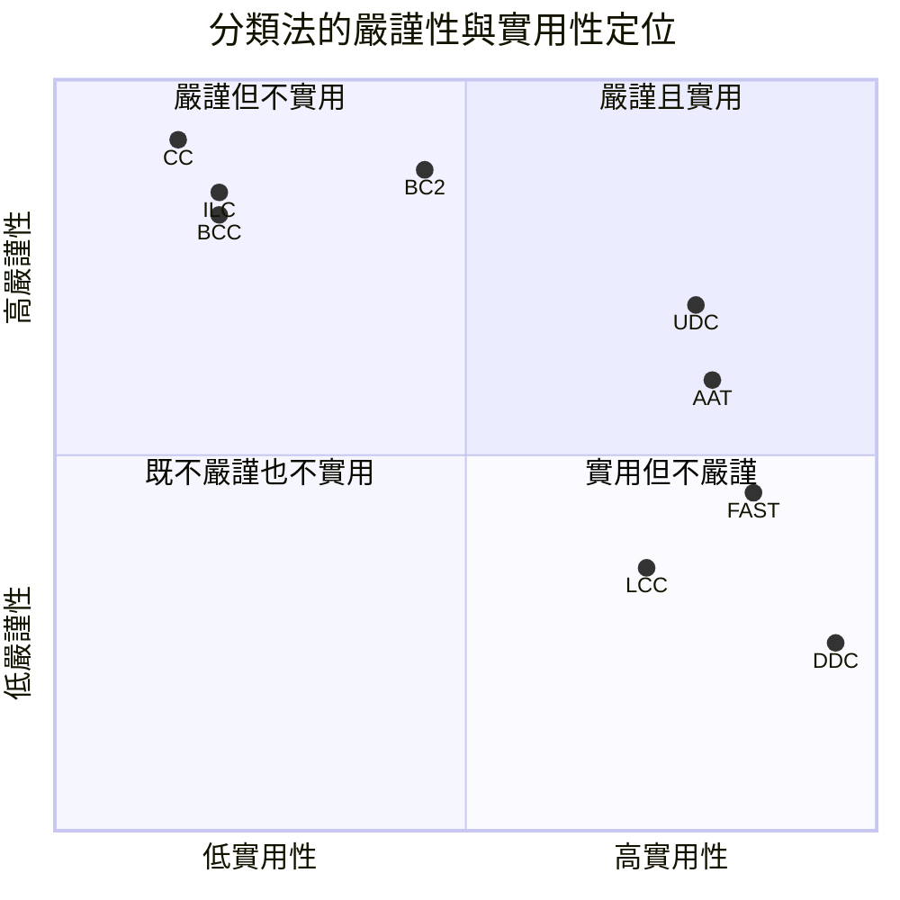
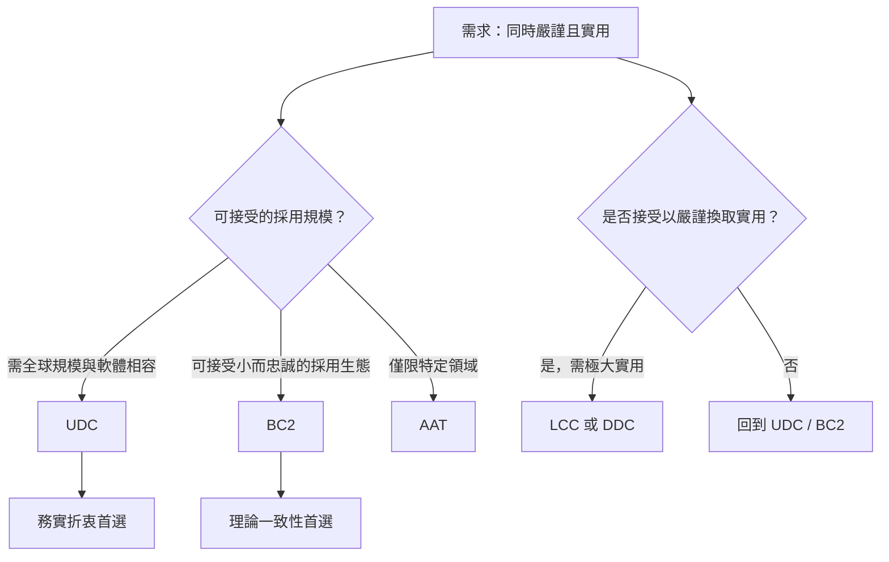

# 冒號分類法 (Colon Classification) 的替代方案：兼顧嚴謹與實用的知識組織系統

## 摘要

S. R. Ranganathan (1892–1972) 所發展的冒號分類法 (Colon Classification, CC) 是圖書分類史上最具理論野心的體系之一，它以「面 (facet)」分析為核心，提供了一組可依文件內容「即時合成」類號的機制，其嚴謹程度遠超過傳統的列舉式分類法[^cc]。然而，CC 的實用性長期受到質疑：其類號冗長難解、缺乏機構維護、在教育與圖書館實務中的採用率極低[^cc]。相對地，Dewey Decimal Classification (DDC) 因易學、易用與強大的機構支持而成為全球最普及的分類法，卻缺乏明確的理論基礎，被批評為「有記號、無理論」的體系[^cc]。

本文針對「同時滿足嚴謹與實用」此一雙重條件的需求，調查並比較 CC 的主要替代方案，包括：Universal Decimal Classification (UDC)、Bliss Bibliographic Classification 第二版 (BC2)、Library of Congress Classification (LCC)、Basic Concepts Classification (BCC)、Integrative Levels Classification (ILC)、FAST，以及 Art & Architecture Thesaurus (AAT)。結論指出：若必須在單一體系中同時取得嚴謹與實用，**UDC 是最務實的折衷**；若以嚴謹性與理論一致性為優先、且可接受較小規模的採用生態，**BC2 是最佳的「全分面 (fully faceted)」選擇**。

## 一、問題背景：嚴謹與實用的張力

圖書分類法的設計長期存在一組內在張力：**理論嚴謹性**要求體系具備明確的建構原則、一致的引用次序 (citation order)、對複合主題的忠實表達，以及對新主題的「待納性 (hospitality)」；**實用性**則要求易學、類號簡短、可瀏覽、具備穩定的機構維護與軟體相容性。

CC 站在嚴謹的一端。它以「理念面、語詞面、記號面」三個層面設計分類，並以 55 條法則、22 條原則、13 條假設 (postulates) 與 10 種裝置構築其理論[^cc]。其核心創新為 PMEST 面公式 (Personality 人格、Matter 物質、Energy 能量、Space 空間、Time 時間)，以及「分析–合成 (analytico-synthetic)」的類號建構方式，允許對複合與跨領域主題給出「外延相稱 (coextensive)」的類號[^cc]。

然而 CC 的實用缺陷同樣鮮明：

- **記號基礎過寬而複雜**：CC 第七版使用了 74 個符號 (含 14 個標點)，是圖書分類體系中「史上最寬」的記號基礎，被形容為「嚇人地複雜 (frighteningly complex)」[^cc]。
- **類號冗長**：例如莎士比亞《威尼斯商人》的二十世紀書目類號為 `O,111,2J64,M+V"aN`；「高地老人的心臟病順勢療法」為 `L-L-9Un4-9E,32;4:6`[^cc]。
- **缺乏機構維護**：無國家委員會或實質機構負責其修訂與出版，1987 年第七版本身即被評為結構混亂，並已被印度圖書館界棄用[^cc]。
- **採用率極低**：即使在印度，DDC 的普及度也高於 CC；1960 年代 CC 在印度圖書館的使用率估計約 24%，今日已無新圖書館採用[^cc]。
- **分類判定非唯一**：Parrochia 與 Neuville 指出，CC 的判定並非單義，「同一主題可能被以多種不同方式分類」[^cc]。

另一方面，DDC 站在實用的一端，卻缺乏理論：Ranganathan 視其為沒有宣稱理論的「標記與停放系統 (mark and park system)」，並批評其列舉本質無法為多數複合主題給出相稱類號[^cc]。DDC 亦有明顯的西方／美國文化偏見 (WASPish bias) 與學科割裂問題[^cc][^ddc]。

## 二、候選替代方案逐一評估

### 2.1 Universal Decimal Classification (UDC)：最務實的折衷

UDC 由 Paul Otlet 與 Henri La Fontaine 於 1895 年構想、1904–1907 年首度出版，現由 1991 年成立的 UDC Consortium (UDCC) 維護[^udc]。它被明確認定為「分析–合成且／或分面 (analytico-synthetic and/or faceted)」分類法，「允許對主題的屬性與主題之間的關係進行無限組合」[^udc]。

UDC 的嚴謹性來自：

- **繼承 DDC 的十進位主類**，但加上可在任何類號使用的**共同輔助表 (common auxiliaries)**：語言 `=`、形式 `(0...)`、地點 `(1/9)`、族群 `(=...)`、時間 `"..."`、性質 `-02`、材料 `-03`、關係／過程 `-04`、人物 `-05`[^udc]。
- **連結符號**：`+`（加）、`/`（延伸）、`:`（關係）、`[]`（分組）[^udc]。
- **各類專屬輔助表**，處理領域特有的面[^udc]。

其**實用性**則來自：約 150,000 所圖書館、130 個國家使用；約 30 個國家書目採用；UDC Summary 提供 50 多種語言版本；2011 年主參考檔 (Master Reference File) 超過 70,000 個類目；且有專責國際機構持續修訂[^udc]。UDC 相對 DDC 更嚴謹、相對 CC 更實用，是「接近分面 (almost faceted)」的中間地帶[^udc]。

限制在於：類號可極長且複雜（例如 `338.48(734.211.4)"197"(084.3)(0.034.2PDF)`）[^udc]，且部分語彙「冗長 (verbose)」，文化視角仍偏西方[^udc]。

### 2.2 Bliss Bibliographic Classification 第二版 (BC2)：最嚴謹的可維護方案

BC2 是 H. E. Bliss (1870–1955) 原版《書目分類法》(BC1, 1940–1953) 的徹底修訂版，自 1977 年開始出版，由 Jack Mills 與 Vanda Broughton 主導，並由 1967 年成立的 Bliss Classification Association (BCA) 維護[^bc2]。它被 IEKO 描述為「全分面分類法的主導範例」，且與 CC 並列為「世上僅有的兩個廣為人知的分面總類分類法」[^bc2]。

BC2 的嚴謹性體現在：

- **以英國分類研究小組 (Classification Research Group, CRG) 的分面分析為基礎**，將 Ranganathan 的五大基本範疇擴充為十三個 (Vickery 版本)，BC2 採用其中九大範疇：最終產物 (事物／實體)、其類型、其部分、其材料、其性質、其過程、對其之操作、行動者、地點、時間[^bc2]。
- **明確的引用次序**：CRG 標準引用次序為「事物—種類—部分—材料—性質—過程—操作—行動者—空間—時間」，遵循「具體性遞減」原則並兼顧「依賴性」[^bc2]。
- **嚴格的排序原則**：通用先於特殊 (general-before-special)、專門性漸變 (gradation in speciality)、具體性遞增 (increasing concreteness)；面的歸檔次序為引用次序之逆序 (principle of inversion)[^bc2]。
- **純字母記號**，刻意避開十進位記號，追求簡短經濟的類號[^bc2]。

其**實用性**來自：BCA 的存在（有機構支持，不同於 CC）；已被英國約 100 所學術、專門、政府與法律圖書館採用[^bc2]；主類次序被公認為所有總類分類法中最佳者[^bc2]；且可作為免費取用的術語來源，並已用於本體工程與索引典生成[^bc2]。

限制在於：自 1977 年以來，約 28 冊中僅出版 15 冊，部分類表仍未完成；維護完全依賴志工，無正式維護編制；且其記號「不表達層級或建構結構」，在數位環境中不利於機器判讀[^bc2]。

### 2.3 Library of Congress Classification (LCC)：實用優先的大體系

LCC 是 1899 年後發展、專為美國國會圖書館藏書量身打造的分類法，有 21 個主類，類號較短，更新頻繁，廣泛用於大型學術與研究圖書館[^cmp]。然而它在本文的判準中屬於「實用但不嚴謹」：它缺乏明確的理論基礎，其安排是為特定館藏服務而非基於先驗的分類原則，且有美國中心偏見[^cmp]。因此 LCC 不符合「嚴謹」這一條件，僅在必須極大化實用性時作為參考。

### 2.4 Basic Concepts Classification (BCC)：嚴謹的現象式體系

BCC 由加拿大亞伯達大學經濟學教授 Rick Szostak 於 2004 年提出、2013 年上線[^bcc]。它以「現象 (phenomena)」而非學科為第一層劃分，包含三大表：

1. **現象 (事物)**：依整合層級 (integrative levels) 組織的 17 個大類，從波／粒子、原子／分子、岩石、天體、生物實體、文化、藝術、政治、經濟、社會結構、科技、健康、數學概念等[^bcc]。
2. **關係詞 (動詞)**：以箭頭 `→` 表示因果關係，並有非因果關係符號（`\` 表「為」、`-` 表「之」、`!` 表「關於」）[^bcc]。
3. **性質 (形容詞／副詞)**：17 種類型，均以 `Q` 開頭[^bcc]。

BCC 的關鍵創新是**類號如句子般書寫**，模仿語法結構，因而不需要面指示符 (facet indicators)[^bcc]。理論上極為嚴謹且擺脫學科本位，但**採用僅限於實驗與研究**，應用於小型文件與博物館藏品集合，尚未有大型圖書館採用[^bcc]。故 BCC 符合嚴謹、不符合實用。

### 2.5 Integrative Levels Classification (ILC)：最先進的自由分面體系

ILC 由 Claudio Gnoli 等人自 2004 年起發展，ILC1 於 2011 年凍結 (7,052 類)，ILC2 於 2019 年出版 (10,845 類)，ILC3 尚在開發中[^ilc]。它是一種**自由分面、現象本位**的分類法，具有 10 個可自由跨類組合的面 (0–9)：視角、時間、地點、行動者、失序、轉化、性質、部分、形式、種類，以及依整合層級排序的 25 個主類 (a–y)[^ilc]。

ILC 被分類理論學者 (Broughton、Beghtol、Bianchini & Dousa) 譽為「最先進的自由分面體系」，理論嚴謹度極高[^ilc]。但其設計目的是作為**後組合索引的元資料來源**，而非物理館藏的組織工具，僅應用於小型資料庫 (如生物聲學、地方文化、環境教育)[^bc2][^ilc]。因此 ILC 嚴謹而不實用。

### 2.6 FAST：實用優先的列舉式分面

FAST (Faceted Application of Subject Terminology) 由 OCLC Research 與美國國會圖書館自 1998 年底開始發展，權威檔約有 180 萬筆紀錄[^fast]。它有九個模組化的列舉式面：個人名稱、團體名稱、會議名稱、地理名稱、事件、題名、時間、主題、形式／體裁[^fast]。其設計目標是**簡單易用**、與分面瀏覽相容，並向上相容於 LCSH (Library of Congress Subject Headings)[^fast]。

FAST 屬「列舉式分面 (fully enumerative faceted)」——每個標目都是預先建立的權威紀錄，無需合成[^fast]。這使它非常實用，但缺乏 CC 或 BC2 那種由分析–合成而來的理論深度，因此在「嚴謹」面向較弱。

### 2.7 Art & Architecture Thesaurus (AAT)：領域性的嚴謹實用範例

AAT 由 Getty Research Institute 於 1990 年首度出版，持續更新[^aat]。它有七個模仿 Ranganathan PMEST 的面：聯合概念、物理屬性、風格與時期、行動者、活動、材料、物件[^aat]。AAT 在博物館、藝術圖書館、視覺資源與文化遺產機構中被廣泛採用，是領域性分面詞彙的黃金標準[^aat]。它是「嚴謹且實用」的典範，但**僅限於藝術與建築領域**，無法作為總類分類法的替代。

## 三、綜合比較

| 體系 | 發展者 | 起始年份 | 類型 | 嚴謹度 | 實用度 | 機構維護 | 主要採用場域 |
|---|---|---|---|---|---|---|---|
| CC | S. R. Ranganathan | 1933 | 全分面 | 極高 | 極低 | 無 | 印度（教學為主） |
| UDC | Otlet & La Fontaine | 1895 | 混合（分析–合成） | 高 | 高 | UDCC | 全球 15 萬館 |
| BC2 | Mills & Broughton | 1977 | 全分面 | 極高 | 中 | BCA | 英國約 100 館 |
| LCC | 美國國會圖書館 | 1899 | 列舉 | 低 | 高 | LC | 大型學術圖書館 |
| BCC | Rick Szostak | 2004 | 現象式分面 | 高 | 極低 | 無 | 研究／實驗 |
| ILC | Claudio Gnoli 等 | 2004 | 自由分面 | 極高 | 極低 | 無 | 小型資料庫 |
| FAST | OCLC & LC | 1998 | 列舉式分面 | 中 | 高 | OCLC | 數位館藏、連結資料 |
| AAT | Getty Research Institute | 1990 | 領域分面 | 高 | 高 | Getty | 博物館、文化遺產 |

## 四、結論與建議

1. **若要在單一體系中同時取得嚴謹與實用，UDC 是最務實的折衷**。它繼承了 DDC 的熟悉結構使學習門檻適中，又具備分析–合成的分面能力以忠實表達複合主題，並且有活躍的國際機構維護、全球規模的採用與多語支援[^udc]。其代價是類號可能冗長與文化視角偏西方。

2. **若以理論嚴謹性與內部一致性為第一優先，且可接受較小的採用生態，BC2 是最佳的全分面方案**。它以 CRG 改良後的分面分析為基礎，具備明確引用次序與排序原則，並有 Bliss Classification Association 的機構支持——這是 CC 最欠缺的條件[^bc2]。其代價是類表尚未完成、維護依賴志工，且記號不表達結構、不利機器判讀。

3. **BCC 與 ILC 在理論上最為先進**（現象本位、自由分面），但在本文的「實用」判準下不合格——它們是研究與後組合索引的工具，而非可立即部署於實體館藏或大規模編目的體系[^bcc][^ilc]。

4. **FAST 與 AAT 展示了「實用」的另一條路徑**：以領域或標目為單位、以權威紀錄取代合成。它們在各自範圍內兼顧了嚴謹與實用，但不構成 CC 的總類替代品[^fast][^aat]。

5. **值得注意的是方法論的傳承**：CC 與 BC2 真正持久的遺產並非其記號，而是**分面分析方法本身**。當代的分面搜尋介面、索引典、元資料架構與語意網本體，都可視為 Ranganathan 邏輯的現代體現[^cc][^bc2]。因此，對「嚴謹且實用」的追尋，實務上往往不是選擇單一分類法，而是將分面分析應用於數位檢索與知識組織架構之中。

[^cc]: Satija, M. P. (2017). Colon Classification (CC). In B. Hjørland & C. Gnoli (Eds.), *ISKO Encyclopedia of Knowledge Organization*. Retrieved 2026-10-24, from https://www.isko.org/cyclo/colon_classification
[^ddc]: LIS Edu Network. (n.d.). Advantages and disadvantages of Dewey Decimal Classification (DDC) scheme. Retrieved 2026-10-24, from https://www.lisedunetwork.com/advantages-disadvantages-ddc-dewey-decimal-classification-scheme/
[^udc]: Wikipedia. (n.d.). Universal Decimal Classification. Retrieved 2026-10-24, from https://en.wikipedia.org/wiki/Universal_Decimal_Classification
[^bc2]: Broughton, V. (n.d.). Bliss Bibliographic Classification second edition (BC2). In B. Hjørland & C. Gnoli (Eds.), *ISKO Encyclopedia of Knowledge Organization*. Retrieved 2026-10-24, from https://www.isko.org/cyclo/bc2
[^cmp]: A comparative analysis of library classification systems. (n.d.). Retrieved 2026-10-24, from https://www.slideshare.net/slideshow/a-comparative-analysis-of-library-classification-systems/153118457
[^bcc]: Szostak, R. (n.d.). Basic Concepts Classification. In B. Hjørland & C. Gnoli (Eds.), *ISKO Encyclopedia of Knowledge Organization*. Retrieved 2026-10-24, from https://www.isko.org/cyclo/bcc
[^ilc]: Gnoli, C. (n.d.). Integrative Levels Classification. In B. Hjørland & C. Gnoli (Eds.), *ISKO Encyclopedia of Knowledge Organization*. Retrieved 2026-10-24, from https://www.isko.org/cyclo/ilc
[^fast]: OCLC. (n.d.). FAST (Faceted Application of Subject Terminology). Retrieved 2026-10-24, from https://www.oclc.org/research/areas/data-science/fast.html
[^aat]: Faceted classification. (n.d.). Wikipedia. Retrieved 2026-10-24, from https://en.wikipedia.org/wiki/Faceted_classification
