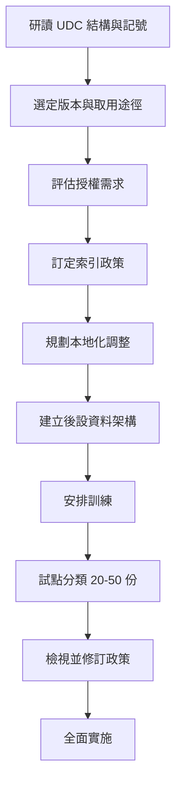

# 對自己的文獻進行 Universal Decimal Classification (UDC) 分類：需要哪些準備工作？

Universal Decimal Classification（國際十進分類法，簡稱 UDC）是一套「分析－合成式」（analytico-synthetic，亦稱分面式 faceted）的分類法，由比利時的 Paul Otlet 與 Henri La Fontaine 在 Dewey Decimal Classification（DDC）基礎上發展而成，可涵蓋所有知識領域，且以語言無關的數字與標點符號構成類號。本文探討：若要把自己蒐集的文獻套用 UDC 分類，事前需要做哪些準備工作。以下依「認識版本與取用途徑」、「授權」、「工具」、「訓練」、「理解分面與記號」、「分類流程」、「索引政策」、「本地化調整」、「後設資料欄位」與「準備步驟清單」逐項說明。

## 一、先認識 UDC 的版本與取用途徑

準備工作的第一步，是弄清楚要採用哪一個版本的 UDC。這是整個專案最關鍵的決定，因為版本決定了你手上的類表規模、細緻程度與可用語言。

### Master Reference File（MRF）

UDC 的權威版本是 **UDC Master Reference File（MRF）**，自 1992 年起成為經授權的正式版本。它是一個關聯式資料庫，收錄約 **72,000 筆記錄**（含行政與維護記錄），以英文為主要語言；最新已發布版本為 **UDC MRF12（2018 年 12 月）**，下一版 **MRF13 預計 2026 年發布**。1992 至 2014 年間幾乎每年發布新版，近年因需配合 UDC Hub 上的各語言翻譯，發布間隔改為數年一次；提案與公告的變更會刊載於 *Extensions and Corrections to the UDC*[^mrf][^factsheet]。

### 印刷版本

最後一部完整的英文印刷版由 **British Standards Institution（BSI）** 於 2005 年出版，分兩冊：第 1 冊為系統表（Systematic tables，ISBN 0 580 45469 X），第 2 冊為字順索引（Alphabetical Index，ISBN 0 580 45470 3）[^editions]。UDC 亦曾以 **逾 40 種語言**出版，完整印刷版包括法文（C.E.F.A.L., 2004）、西班牙文（AENOR, 2015）、葡萄牙文（IBICT, 2007）等[^editions]。

### UDC Summary（免費縮編版）

**UDC Summary** 是從完整類表中精選約 **2,600 個類目**的縮編版，線上免費提供，共 **57 種語言**，並以 Creative Commons 授權發布（自 2026 年起為 CC BY-NC 4.0）。對小型收藏、或想在正式投入完整版前先學習這套系統的人而言，縮編版已相當夠用[^summary][^factsheet][^about_summary]。

### 小結：取用途徑比較

| 工具 | 涵蓋範圍 | 費用 | 語言 |
|---|---|---|---|
| UDC Summary | 約 2,600 類 | 免費 | 57 種 |
| UDC Online Hub | 完整 UDC（70,000+ 類） | 付費訂閱（部分語言免費） | 英、西、荷、法、克、捷、波、塞爾維亞、斯洛伐克、斯洛維尼亞、葡 |
| udcdata.info（Linked Data） | UDC Summary 資料 | 免費（修訂中） | 英文 |
| UDC MRF 匯出檔 | 完整資料庫 | 需授權 | 英文（基礎） |

## 二、確認授權需求

許多人誤以為使用 UDC 必須付費授權，其實不然。依 UDC Consortium 的說明，**下列情形不需要授權**：從印刷或 CD-ROM 出版物、或經授權的線上服務取得 UDC 內容，用於資訊與知識組織；以人工方式套用 UDC 於資源的索引與排架、資訊入口網站組織與圖書館目錄；以及以任何方式發布或使用 UDC Summary 中的 2,600 個類目[^licences]。

相對地，**需要授權的情形**包括：以任何語言或媒介**發布、散布** UDC 系統（任何部分）；以及**直接使用 UDC MRF 資料**。授權類型分為三種：UDC Publishing Licence（發布與散布類表）、UDC MRF Use Licence（將 MRF 資料用於內部參考、研究或載入系統）、以及針對特殊情況的非標準授權[^licences]。

這對個人文獻分類的實務意義是：只要你是「用 UDC 來替自己的文件分類」，而非「重製或轉散布 UDC 類表」，通常不必付費；真正的成本會落在取得完整類表（訂閱或購買）與訓練上。

## 三、備妥工具

準備工作的第三步，是選定輔助工具。

- **UDC Summary（udcsummary.info）**：免費、可瀏覽約 2,600 類，支援 57 種語言，並提供匯出檔，適合小量收藏或入門[^summary]。
- **UDC Online Hub（udc-hub.com）**：完整 UDC（72,000+ 類），可搜尋、瀏覽、解析、驗證並建構 UDC 號；英文、西班牙文、荷蘭文、法文為付費服務（有免費試用），克羅埃西亞文、捷克文、波蘭文、塞爾維亞文、斯洛伐克文則提供免費訂閱[^hub]。
- **udcdata.info**：以 Linked Data（RDF/SKOS）形式提供 UDC Summary 內容，免費使用，但因應 MRF12 發布正進行修訂[^linkeddata]。
- **UDC MRF 匯出檔**（授權使用者）：提供三種匯出型別，含 tagged text（供印刷出版）、extended tagged text 與 XML（跨平台），字元編碼支援 UTF8 與 CP850；MRF11 以前亦提供 CDS/ISIS（ISO2709）格式[^mrf]。
- **資料服務**（授權使用者）：可要求客製化資料匯出、UDC Data Alignment（將既有語言版本與 MRF 比對，完整比對費用約 €1,000–2,000）、以及翻譯資料庫支援（最多 10 位譯者同時使用，設定費約 €600，之後每月 €300–400）[^data_services][^mrf]。

## 四、安排訓練

即使是個人收藏，理解 UDC 的建構規則也需要一定的學習。UDC Consortium 提供**訓練服務**：由 UDC 編輯團隊成員（具數十年教學與實務經驗的講師與從業者）授課，可到府或於海牙的 UDC 總部舉行。形式包含：1 日的一般工作坊（入門或複習）、2 日課程（含實作練習）、以及針對類表內容更新與變更的進階課程；語言涵蓋英文、荷蘭文、德文、西班牙文、瑞典文、克羅埃西亞文、捷克文。須**至少提前 5 個月**規劃，費用包含教材、講師日費與差旅費[^training]。

替代途徑包括：UDC Seminars（<http://seminar.udcc.org>）的學術論文與簡報、UDC Blog（<http://universaldecimalclassification.blogspot.co.uk>）的動態與討論，以及最關鍵的教科書 McIlwaine 所著 *Universal Decimal Classification: a guide to its use*（修訂版，2007，UDC Consortium，The Hague），該書已被譯為法、日、西、羅馬尼亞、克羅埃西亞等語言，是分類人員的標準教材[^bib][^mcilwaine]。UDCC 亦提供**顧問服務**，可提供 1–2 天的專家協助，用於導入、重新分類或規劃[^consultancy]。

## 五、理解記號、分面與輔助表

準備工作的核心知識，是掌握 UDC 的記號與分面結構。

### 十大主類

UDC 分為十個主類（0–9，其中類號 4 目前留空，保留給未來擴充）：

| 類號 | 涵蓋領域 |
|---|---|
| 0 | 科學與知識、電腦科學、資訊科學、文獻學、圖書館學 |
| 1 | 哲學、心理學 |
| 2 | 宗教、神學 |
| 3 | 社會科學 |
| 4 | （留空，保留未來擴充） |
| 5 | 數學、自然科學 |
| 6 | 應用科學、醫學、技術（最大的類，逾 44,000 個細分） |
| 7 | 藝術、娛樂、運動 |
| 8 | 語言學、文學 |
| 9 | 地理、歷史 |

### 記號特性

UDC 使用十進記號：以阿拉伯數字依十進方式排列，每個類號都是省略了小數點的小數；類號愈長代表愈專指（刪去末位數字即擴大類目）；標點符號則表達兩個類目的組合關係。每三位數字後加一小數點以便閱讀（如 `539.120.8`）[^notation][^wikipedia]。

### 連接符號

| 符號 | 名稱 | 意義 | 範例 |
|---|---|---|---|
| `+` | Plus | 協調（並列相加） | `59+636` 動物學與動物飼養 |
| `/` | Stroke | 連續延伸（範圍） | `592/599` 系統動物學（592 至 599） |
| `:` | Colon | 簡單關係 | `17:7` 倫理學與藝術的關係 |
| `::` | Double colon | 排序固定關係 | `311:[622+669](485)` |
| `[ ]` | 方括號 | 子群組 | `311:[622+669](485)` 瑞典礦業與冶金的統計 |
| `*` | 星號 | 引入非 UDC 記號 | `523.4*433` 小行星 Eros |
| `A/Z` | 字母延伸 | 直接以字母標示 | `821.133.1MOL` 莫里哀作品 |

### 共同輔助表（分面）

共同輔助表是不限定於某一主類、可跨類通用的一般性分面，各自以特定的分面指示符號開頭：

| 指示符 | 表號 | 涵蓋概念 |
|---|---|---|
| `=...` | 1c | 語言（如 `=111` 英語） |
| `(0...)` | 1d | 形式（如 `(075)` 教科書、`(084.3)` 地圖） |
| `(1/9)` | 1e | 地域（如 `(410)` 英國、`(73)` 美國） |
| `(=...)` | 1f | 種族／人類血統（如 `(=111)` 英語系民族） |
| `"..."` | 1g | 時間（如 `"19"` 二十世紀） |
| `-02` | 1k | 性質 |
| `-03` | 1k | 材料 |
| `-04` | 1k | 關係、過程、操作 |
| `-05` | 1k | 人物與個人特徵 |

其中 1k 表把「一般特徵」底下的四個分面（性質、材料、關係／過程、人物）歸為一組[^structure][^wikipedia]。

### 特別輔助號

相對於跨類通用的共同輔助號，**特別輔助號（special auxiliaries）**只在特定主類（或類群）內反覆使用，記號型態包含：短橫號 `-1/-9`（如宗教類的 `2-5` 崇拜）、「點零」`.0...`（如文學類的 `82.02` 文學流派、`82.09` 文學批評）、以及撇號 `'...'` 等。套用時直接接在主類號之後，不需額外符號；切記特別輔助號**只在其所屬類別內有效**，例如 `-5` 在類 2 代表「崇拜」，在其他類則別有意義或不存在[^structure][^wikipedia]。

## 六、分類流程（逐步操作）

準備好上述知識後，實際替一份文獻分類的流程如下：

1. **主題分析**：判讀文件內容，決定主要主題與次要／相關主題。
2. **找出主類**：從主類表（0–9）選出適當類目。
3. **套用層級**：沿著層級細分往下走到最專指的可用類號。
4. **加入特別輔助號**（若適用）：接上該類專屬的特別輔助號，例如動物學代謝的 `.017.7`。
5. **加入共同輔助號**：依序附加語言、形式、地域、時間、種族、性質／材料／人物等分面。
6. **表達關係**：以連接符號（`+`、`/`、`:`、`[ ]`）串接多個主題。
7. **驗證**：將建構出的類號與類表核對，必要時用 UDC Online Hub 的驗證功能檢查。

以「1970 年代 Grafton County 的旅遊地圖，以 PDF 發布」為例：先取 `338.48`（旅遊），加地域 `(734.211.4)`（Grafton County），加時間 `"197"`（1970 年代），加形式 `(084.3)`（地圖），再加數位形式 `(0.034.2)`，得 `338.48(734.211.4)"197"(084.3)(0.034.2PDF)`[^structure]。

### 引用順序（分面公式）

建構複合類號時，標準的**引用順序（citation order／分面公式）**為：**主類號 → 特別輔助號 → 共同輔助號**，而共同輔助號內部再依序為 **地域 → 種族 → 時間 → 形式 → 語言 → 性質／材料／人物**。判準是「事物先於其屬性」、且「主要主題先於輔助分面」：例如「二十世紀英國歷史教科書」為 `94(410)"19"(075)`，先歷史再地域再時間再形式。當兩個主題同等重要而成關係時，以冒號 `:` 連接（如 `37:2` 教育與宗教的關係），此時沒有絕對順序，取決於以哪個角度為主[^structure][^wikipedia]。

## 七、先訂好索引政策

在正式動手分類前，應先把**索引政策**寫成文件，內容涵蓋：

- **範圍與深度**：要用完整 UDC（70,000+ 類）還是縮編版（2,600 類）？每份文件給一個類號還是多個？分到多深（例如只到三位數）？
- **合成規則**：哪些共同輔助號適用於自己的收藏？何時用 `+`、`/`、`:`，何時改為給多個主題款目？
- **引用順序**：明訂複雜類號的標準分面順序（如主類 → 地域 → 時間 → 形式）。
- **一致性規則**：同類文件的記號處理要統一（例如外語著作一律加語言輔助號）；跨領域文件的處理規則；以及如何維護一套已用類號的權威檔。

這些決策大多依據 McIlwaine 的指南，該書即為 UDC 索引政策的主要依據文件，涵蓋主題分析、號碼建構、合成規則、排序規則與一致性原則[^mcilwaine][^bib]。

## 八、規劃本地化調整

UDC 具彈性，可依個人收藏需求做本地化調整，常見做法有三：

- **截取／縮編**：從類表中挑出與自己收藏主題相關的子集，並記錄哪些類在範圍內、哪些排除。例如醫學專門收藏可能只用類 57、61、615、616、618 與相關輔助號。
- **自訂擴充**：對高度專門的收藏，可在既有 UDC 號下再細分，並以 `*`（星號）引入非 UDC 記號或本地延伸，且務必清楚記錄所有本地擴充。
- **本地修訂**：為常用組合建立本地對照表，明訂偏好的引用順序，並記錄所有對標準規則的例外。

若做了本地調整，宜定期與新的 MRF 版本比對；UDC Consortium 提供的 **Data Alignment** 服務（完整類表約 €1,000–2,000）可回報新增、取消與變更的類目[^consultancy][^data_services]。

## 九、設計後設資料欄位

要把 UDC 類號存進文件管理或圖書館系統，應先規劃後設資料欄位。

**必備欄位**：

| 欄位 | 說明 | 範例 |
|---|---|---|
| UDC 主類號 | 主要分類號 | `338.48` |
| UDC 完整類號 | 含所有分面的複合類號 | `338.48(734.211.4)"197"(084.3)(0.034.2PDF)` |
| 分類日期 | 指派類號的日期 | `2026-10-25` |
| 所用版本 | 使用的 MRF 或版本 | `UDC MRF12 (2018)` |
| 分類者 | 執行分類的人 | （姓名或縮寫） |

**建議選用欄位**：UDC 次要類號、主題標目／關鍵詞、本地擴充碼、文件語言、文件形式、重新分類歷程、驗證狀態。

此外應維護一份 **UDC 權威檔**，記錄收藏中每個使用過的 UDC 號、其文字標目、本地使用規則、相關類號的交互參照，以及已取消或取代類號的轉引。

## 十、建議的準備步驟清單

綜合上述，替自己的文獻做 UDC 分類前，建議依序完成：

| 步驟 | 行動 | 所需資源 |
|---|---|---|
| 1 | 研讀 UDC 的結構、記號與分面 | UDCC 網站、維基百科、McIlwaine 指南 |
| 2 | 選定版本／取用途徑 | UDC Summary（免費）或 UDC Online Hub（付費） |
| 3 | 評估授權需求 | UDCC 授權頁（內部使用通常免授權） |
| 4 | 訂定索引政策 | 寫下範圍、深度、合成規則 |
| 5 | 規劃本地化調整 | 決定截取、自訂擴充 |
| 6 | 建立後設資料架構 | 定義 UDC 號與相關資料欄位 |
| 7 | 安排訓練 | UDCC 訓練服務或自學 |
| 8 | 進行試點分類 | 對 20–50 份樣本文件分類 |
| 9 | 檢視並修訂政策 | 依試點經驗調整 |
| 10 | 全面實施 | 套用至整個收藏 |

以下以流程圖示意：

## 結語

替自己的文獻套用 UDC，並非只是「查表貼號碼」，而是一套需要事前規劃的知識組織工程。關鍵準備工作依賴性排序為：**先確定版本與取用途徑**（免費縮編版或付費完整版），**釐清授權邊界**（內部索引免費、發布類表才需授權），**備妥工具**（UDC Summary／UDC Online Hub／udcdata.info），**建立記號與分面的理解**（主類、共同與特別輔助號、連接符號、引用順序），**訂定索引政策與本地化調整**，最後**設計後設資料欄位**並以試點分類驗證。完成這些準備後，再進入全面分類，方能兼顧一致性與可維護性。

## 參考資料

[^factsheet]: UDC Consortium. (n.d.). *UDC fact sheet*. Retrieved 2026-10-25, from https://udcc.org/index.php/site/page?view=factsheet

[^mrf]: UDC Consortium. (n.d.). *About UDC Master Reference File (MRF)*. Retrieved 2026-10-25, from https://udcc.org/index.php/site/page?view=mrf

[^editions]: UDC Consortium. (n.d.). *UDC editions*. Retrieved 2026-10-25, from https://udcc.org/index.php/site/page?view=editions

[^licences]: UDC Consortium. (n.d.). *UDC licences*. Retrieved 2026-10-25, from https://udcc.org/index.php/site/page?view=licences

[^structure]: UDC Consortium. (n.d.). *UDC structure and tables*. Retrieved 2026-10-25, from https://udcc.org/index.php/site/page?view=about_structure

[^notation]: UDC Consortium. (n.d.). *UDC notation*. Retrieved 2026-10-25, from https://udcc.org/index.php/site/page?view=about_notation

[^training]: UDC Consortium. (n.d.). *UDC training service*. Retrieved 2026-10-25, from https://udcc.org/index.php/site/page?view=training_service

[^consultancy]: UDC Consortium. (n.d.). *UDC consultancy service*. Retrieved 2026-10-25, from https://udcc.org/index.php/site/page?view=consultancy_service

[^data_services]: UDC Consortium. (n.d.). *UDC data services*. Retrieved 2026-10-25, from https://udcc.org/index.php/site/page?view=data_services

[^bib]: UDC Consortium. (n.d.). *Publications about UDC*. Retrieved 2026-10-25, from https://udcc.org/index.php/site/page?view=bib

[^mcilwaine]: McIlwaine, I. C. (2007). *Universal Decimal Classification: A guide to its use* (Rev. ed.). The Hague: UDC Consortium.

[^summary]: UDC Summary. (n.d.). *UDC Summary*. Retrieved 2026-10-25, from https://udcsummary.info/php/index.php

[^about_summary]: UDC Summary. (n.d.). *About UDC Summary*. Retrieved 2026-10-25, from https://udcsummary.info/about.htm

[^hub]: UDC Online Hub. (n.d.). *UDC Online overview*. Retrieved 2026-10-25, from https://udc-hub.com/overview.php

[^linkeddata]: UDC Consortium. (n.d.). *UDC linked data*. Retrieved 2026-10-25, from https://udcdata.info/

[^wikipedia]: Wikipedia. (n.d.). *Universal Decimal Classification*. Retrieved 2026-10-25, from https://en.wikipedia.org/wiki/Universal_Decimal_Classification
