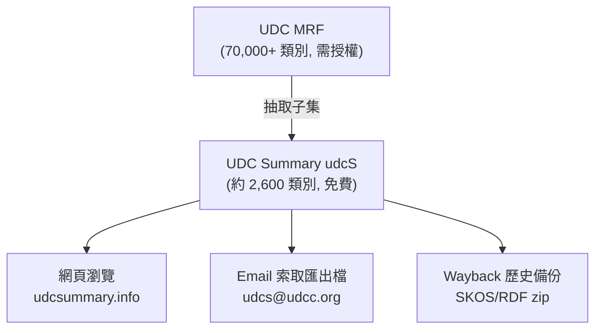
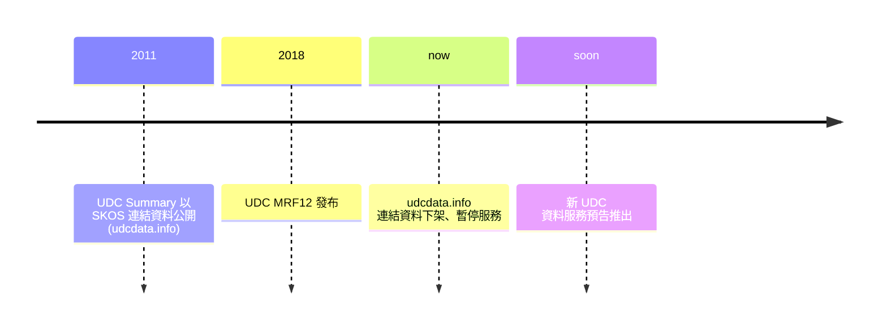
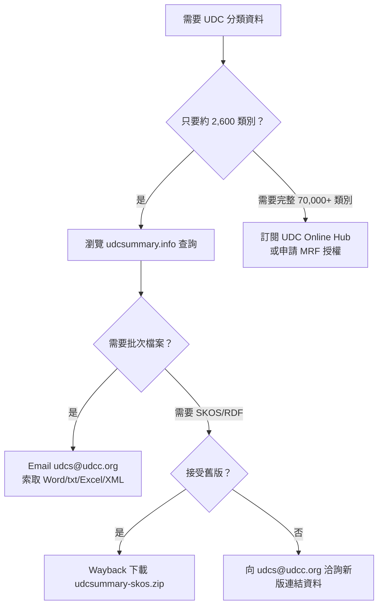

# 如何下載 UDC Summary（通用十進分類法摘要）？

## 摘要

**UDC Summary（Universal Decimal Classification Summary，簡稱 udcS）** 是國際通用十進分類法（Universal Decimal Classification，UDC）的一個約 2,600 個類別的子集，抽取自含 70,000 多筆條目的 UDC Master Reference File（UDC MRF）[^about]。

目前最重要的結論是：**UDC Summary 沒有提供任何人人都能直接點擊下載的公開檔案連結**。官方網站的匯出（Export）檔案必須以電子郵件向 UDC Consortium 索取[^exports]。過去曾公開提供、可直接下載的 SKOS/RDF 連結資料（linked data）套件，自 UDC MRF12 發布後已被下架、暫停服務[^udcdata]。因此「下載」這件事目前主要透過三條途徑完成：官方瀏覽網站、官方電子郵件索取匯出檔、以及網際網路檔案館（Wayback Machine）的歷史備份。

本報告說明 UDC Summary 是什麼、授權條件、各種取得途徑的實際操作方式，並整理替代方案（完整 UDC、第三方工具）。

---

## 一、UDC Summary 是什麼

UDC Summary 是一份多語言的分類法摘要，由 UDC Consortium（UDCC）於 2009 年 10 月首次發布[^about]。其特性如下：

- **規模**：約 2,600 個類別，抽取自 UDC MRF 2011 版（該版含 70,000 多個類別）[^about]。
- **內容**：包含主類號（main numbers）、通用輔助號（common auxiliary numbers）與特殊輔助號（special auxiliary numbers），涵蓋所有知識領域，力求平均分布[^about]。
- **語言**：資料庫支援 57 種語言的翻譯；不過許多語言的翻譯仍在進行中，並非全部都已完成校訂[^summarysite]。
- **定位**：UDC Summary 是「最新版 UDC」的代表，可用於訓練、研究、資訊組織與檢索；但它是**摘要**，不是完整的 UDC 分類表[^about]。



---

## 二、授權條件（可不可以下載與散布）

UDC Summary 的著作權屬於 UDC Consortium[^about]。授權狀態：

- **現行授權（2026 年起）**：Creative Commons Attribution-NonCommercial 4.0 International（CC BY-NC 4.0）[^summarysite]。
- **可做的事**：在「非商業」目的下複製、再利用、翻譯、散布 UDC Summary，條件是必須註明來源為 UDC Consortium，且任何再散布須採用相同授權[^about][^ccbync]。
- **附註**：官方要求散布或發表時，須引用以下聲明：「Multilingual Universal Decimal Classification Summary (UDCC Publication No. 088) © UDC Consortium, 2013」[^exports]。

- **歷史授權差異**：較早的連結資料頁面仍標示 CC BY-SA 3.0；而主要網站已改為 CC BY-NC 4.0，兩處敘述並不一致[^about][^udcdata]。

- **不需授權**：使用這約 2,600 個類別來組織／索引資源，或散布 UDC Summary 內容，都不需要另外取得授權[^factsheet]。
- **需要授權**：若要發表或散布「完整」UDC 分類表（MRF 的 70,000+ 條目），或將 UDC 用於商業軟體產品，則須向 UDCC 取得出版授權（Publishing Licence）或 MRF 使用授權[^factsheet][^licences]。

---

## 三、取得途徑（依實用性排序）

### 途徑 1：直接在官方網站瀏覽（最快、免費、無須註冊）

UDC Summary 的官方網站可即時線上瀏覽，涵蓋 57 種語言[^summarysite][^about]。

- 瀏覽入口：`https://udcsummary.info/php/index.php`[^summarysite]
- 左側樹狀結構可展開 TOP（頂層類別）、AUXILIARIES（輔助表）、0 至 9（十大主類）等節點。
- 此方式適合查閱個別類號，但**不提供批次下載檔案**；資料僅能在瀏覽器中查看[^summarysite]。

### 途徑 2：以電子郵件索取匯出檔（官方正式管道）

官方匯出（Export）頁面明確寫道：「UDC Summary export files are available **on demand**」——匯出檔採**隨選提供**，不提供自助下載[^exports]。

申請方式：

1. 寄送電子郵件至 `udcs AT udcc.org`（即 `udcs@udcc.org`）[^exports]。
2. 說明你需要的檔案類型。對方可能詢問你的**預期用途**（教育、研究、應用等）[^exports]。
3. 對方會告知你所請求語言翻譯的校訂狀態，因為許多翻譯尚未校對完成[^exports]。

可索取（隨選提供）的檔案格式如下[^exports]：

| 類別 | 格式 | 內容 |
|---|---|---|
| 單語言匯出 | MS Word 或 txt（UTF-8） | 僅頂層標目（約 110 個） |
| 單語言匯出 | MS Word 或 txt（UTF-8） | 全部標目（超過 2,600 個） |
| 單語言匯出 | 純文字 | 完整分類表內文，含所有附註與範例（約 150 頁） |
| 單語言匯出 | 標記文字（tagged text） | 機器可讀的標記式文字匯出 |
| 多語言匯出 | MS Excel 試算表 | 雙語並列（兩種語言） |
| 多語言匯出 | MS Excel 試算表 | 多語（兩種以上，製作需較長時間） |
| 機器可讀／連結資料 | XML | 單語言或雙語（隨選提供） |

> 提示：翻譯完成度可在官方統計頁查詢，確認你要的語言是否已達可用程度[^transstats]。

### 途徑 3：UDC 連結資料 / SKOS（目前已下架）

UDC Summary 自 2011 年起曾以**連結資料（linked data）**形式、採用 SKOS（Simple Knowledge Organization System）標準公開，網址為 `https://udcdata.info/`[^about]。

**目前狀態：無法使用。** 該網站現行公告指出，隨著 UDC MRF12 發布，UDC Summary 內容正在修訂，且連結資料的存取方式、呈現與結構都將改變，因此「現行的 UDC Summary 連結資料在本工作完成前無法使用」，並稱新的 UDC 資料服務（data service）即將推出[^udcdata]。



因此，目前若需要 SKOS/RDF 格式，只能：
- 向 `udcs@udcc.org` 洽詢（官方建議的聯絡方式）[^udcdata]；或
- 使用歷史備份（見途徑 4）。

### 途徑 4：Wayback Machine 歷史備份（可取得舊版 SKOS zip）

過去 `udcdata.info` 曾提供一個名為 `udcsummary-skos.zip` 的 SKOS 連結資料壓縮檔，且已被 Internet Archive 的 Wayback Machine 快照保存[^wayback]。

Wayback Machine CDX 索引顯示的 `udcsummary-skos.zip` 快照紀錄[^cdx]：

| 時間戳 | HTTP 狀態 | 大小（bytes） |
|---|---|---|
| 20131208192225 | 200（成功） | 3,159,666 |
| 20150803133916 | 200（成功） | 3,159,896 |
| 20160401164022 | 500（錯誤） | — |
| 20161108172904 | 505（錯誤） | — |
| 20180831144117 | 522（錯誤） | — |

可用的下載網址範例（以 2013 年快照為例）[^cdx][^wayback]：

```
https://web.archive.org/web/20131208192225id_/http://udcdata.info/udcsummary-skos.zip
```

**重要限制與提醒：**
- 這只是 2013／2015 年的**舊版**資料，可能與現行的最新內容不同。
- 官方明確表示舊版連結資料結構將改變、且已下架，因此備份檔不保證與現行 UDC Summary 一致[^udcdata]。
- 使用上仍受 CC 授權與引用規定約束（見第二節）[^about]。

---

## 四、完整 UDC（非摘要）的取得方式

若需求超出約 2,600 個類別，須轉向完整的 UDC 分類表：

- **UDC Online Hub**：訂閱制服務，提供完整且最新的 UDC（70,000+ 條目），網址 `http://www.udc-hub.com/`[^factsheet][^hub]。部分語言版本（英語、荷蘭語、西班牙語、法語）須付費訂閱；另有部分語言版本（捷克語、克羅埃西亞語、波蘭語、塞爾維亞語、斯洛伐克語）為免費存取[^factsheet]。
- **UDC MRF 使用授權**：向 UDCC 申請 MRF Use Licence 或 Publishing Licence 後，可取得標記文字、XML 等格式的完整匯出[^licences][^factsheet]。
- **資料服務（Data Services）**：UDCC 提供隨選資料匯出、資料對齊（alignment）、翻譯資料庫支援等客製服務，價格依個案與工時而定[^dataservices]。

---

## 五、第三方與社群資源現況

UDC Consortium 本身**並未維護公開的 GitHub 儲存庫**；GitHub 上與 UDC Summary 相關的專案多為「工具」而非「資料鏡像」，且星數極低[^ghsearch]：

| 專案 | 星數 | 類型 | 是否直接托管 UDC SKOS 資料 |
|---|---|---|---|
| `riuri/heron` | 3 | C 語言 UDC Summary 閱讀器 | 否（讀取官方 SKOS 資料） |
| `artisgrit/UDCSummary` | 0 | PHP 網頁瀏覽入口 | 否（連結至官方匯出） |

**結論**：截至本報告撰寫時，並無獨立的 GitHub 儲存庫公開鏡像或重新打包 UDC Summary 的 SKOS/RDF/CSV/JSON 資料；既有專案僅「消費」官方資料，而非重新散布[^ghsearch]。

---

## 六、建議流程



1. 先確認需求規模：只要約 2,600 個類別 → 用 UDC Summary；需要完整 70,000+ 類別 → 走 UDC Online Hub 或 MRF 授權。
2. 瀏覽需求 → 用官方網站 `udcsummary.info/php/index.php`。
3. 檔案需求 → 電郵 `udcs@udcc.org` 說明格式與用途。
4. SKOS/RDF 需求 → 洽詢官方新版連結資料；否則使用 Wayback 備份（注意為舊版）。
5. 遵守 CC 授權與引用聲明。

---

## 七、對來源的批判性反思

- **官方網站內容不一致**：`about.htm` 稱「last updated in August 2012」並標示 CC BY-NC 4.0；`udcdata.info` 仍標示「CC BY-SA 3.0」且稱類別數約 2,400、MRF 條目「more than 69,000」；主站則稱約 2,600 類別、70,000+ 條目。這些數字與授權說法在不同頁面間存在落差，反映網站更新不同步[^about][^udcdata][^summarysite]。
- **「下載」的定義需澄清**：官方對「取得檔案」採隨選（on demand）而非自助下載，因此常見的「下載連結」期待在此並不成立——這是本主題最容易被誤解之處[^exports]。
- **連結資料的暫時性**：`udcdata.info` 的下架屬官方主動的過渡狀態，並預告新服務；但公告未給明確時程，且無公開 API 可供程式化存取[^udcdata]。
- **Wayback 備份的權威性有限**：備份為 2013／2015 年舊版，與現行 UDC Summary 可能有內容差異，僅適合研究或對舊資料有明確需求者[^cdx][^udcdata]。
- **第三方專案權威性低**：GitHub 上的 UDC Summary 相關專案星數極低（0–3 星），且非官方來源，不宜作為主要資料來源[^ghsearch]。

---

## 參考資料

[^about]: UDC Consortium. (2013). *What is the UDC Summary?* UDC Summary. Retrieved 2026-10-24, from https://udcsummary.info/about.htm

[^summarysite]: UDC Consortium. (n.d.). *UDC Summary (UDCS) — online browser and language list*. UDC Summary. Retrieved 2026-10-24, from https://udcsummary.info/php/index.php

[^exports]: UDC Consortium. (n.d.). *Exports — UDC Summary*. UDC Summary. Retrieved 2026-10-24, from https://udcsummary.info/exports.htm

[^udcdata]: UDC Consortium. (n.d.). *Universal Decimal Classification — UDC Summary linked data*. UDC Linked Data. Retrieved 2026-10-24, from http://udcdata.info/

[^transstats]: UDC Consortium. (n.d.). *Translation completion statistics — UDC Summary*. UDC Summary. Retrieved 2026-10-24, from https://udcsummary.info/stats/php/trans_stats.php

[^factsheet]: UDC Consortium. (n.d.). *UDC Fact Sheet*. Retrieved 2026-10-24, from https://udcc.org/index.php/site/page?view=factsheet

[^licences]: UDC Consortium. (n.d.). *UDC Licences*. Retrieved 2026-10-24, from https://udcc.org/index.php/site/page?view=licences

[^dataservices]: UDC Consortium. (n.d.). *UDC Data Services*. Retrieved 2026-10-24, from https://udcc.org/index.php/site/page?view=data_services

[^hub]: UDC Consortium. (n.d.). *UDC Online Hub*. Retrieved 2026-10-24, from http://www.udc-hub.com/

[^ccbync]: Creative Commons. (n.d.). *Attribution-NonCommercial 4.0 International (CC BY-NC 4.0)*. Retrieved 2026-10-24, from https://creativecommons.org/licenses/by-nc/4.0/

[^wayback]: Internet Archive. (2015). *Wayback Machine snapshot of http://udcdata.info/udcsummary-skos.zip*. Retrieved 2026-10-24, from https://web.archive.org/web/20150803133916/http://udcdata.info/udcsummary-skos.zip

[^cdx]: Internet Archive. (n.d.). *Wayback Machine CDX index for udcdata.info/udcsummary-skos.zip*. Retrieved 2026-10-24, from http://web.archive.org/cdx/search/cdx?url=udcdata.info/udcsummary-skos.zip&output=text&fl=timestamp,statuscode,length

[^ghsearch]: GitHub. (n.d.). *Repository search results for UDC Summary and Universal Decimal Classification SKOS*. Retrieved 2026-10-24, from https://github.com/search?q=udc+summary+skos&type=repositories
