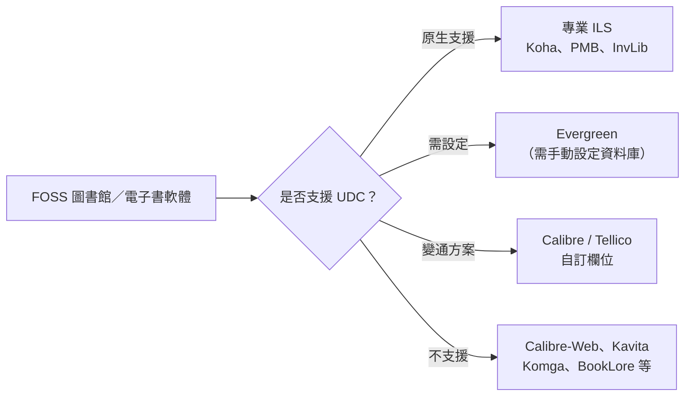

# 支援「通用十進分類法」(UDC) 的 FOSS 電子書／館藏管理軟體調查

## 摘要

若需求是「免費開源 (FOSS) 的電子書管理器／館藏管理／儲存系統，且支援通用十進分類法 (Universal Decimal Classification, UDC)」，目前**沒有任何主流的自架式電子書伺服器**（如 Calibre-Web、Kavita、Komga）原生支援 UDC。真正具備 UDC 原生支援的，是**專業級整合圖書館系統 (ILS)** —— 其中 **Koha** 是最成熟、最推薦的選擇，其次為法國系的 **PMB**。個人電子書收藏若堅持要用 UDC，只能透過 **Calibre 的自訂欄位 (custom columns)** 或 **Tellico 的自訂欄位** 手動儲存分類號，屬於變通方案。

本報告為獨立文件，所有事實均附註腳與參考來源。

---

## 背景：什麼是 UDC？

通用十進分類法 (UDC) 是 1895 年起由杜威十進分類法 (DDC) 發展而來的圖書分類體系。兩者在後續演進中已在排列與哲學上產生很大差異；UDC 的特點在於第 5、6 類（科學與技術）的大量擴充，以及除了阿拉伯數字與小數點之外，還使用多種符號（如括號、冒號、引號等）來標示面向 (facet)[^marc080]。

在機讀編目格式 MARC 21 中，UDC 分類號對應的是 **080 欄位**（Universal Decimal Classification Number），該欄位可重複以記錄一筆資料的多個 UDC 號，子欄位包含 `$a`（UDC 號）、`$b`（item number）、`$x`（共同輔助細分）、`$2`（版本識別）等[^marc080]。

---

## 一、原生支援 UDC 的軟體

### 1. Koha（最推薦）

Koha 是社群維護、GPL 授權的整合圖書館系統 (ILS)，全球廣泛部署[^kohagh]。

- **UDC 為內建分類來源之一**。Koha 手冊的「分類來源 (Classification sources)」章節列出 UDC 為安裝時可選的分類體系之一，與 ANSCR、SuDOC、Other/Generic 並列[^kohamanual-adm]。
- **`DefaultClassificationSource` 系統偏好**可將預設分類來源設為 UDC。該偏好的選項明確包含 "Universal Decimal Classification"[^kohamanual-cat]。
- **MARC 080 欄位**用於儲存 UDC 號；`942$2` 子欄位記錄分類來源識別碼，切換時需以批次編輯工具或 SQL 更新既有館藏，並執行 `touch_all_items.pl` 重新計算排序形式 (`cn_sort`)[^kohamail]。
- 支援 **UNIMARC**，歐洲（含葡語系）圖書館實務上以 UNIMARC + UDC 運作[^kohamail]。
- GitHub 鏡像：`Koha-Community/Koha`，約 595 顆星[^kohagh]。

> 註：Koha 官方開發於 Koha Community 自架 GitLab，GitHub 僅為同步鏡像，不接受 PR[^kohagh]。

### 2. PMB (PhpMyBibli)

法國 PMB Services 開發的 PHP/MySQL 開源 ILS，同樣**明確支援 UDC**。其文件指其可整合不同的分類排架體系：DEWEY、**UDC**、PCDM 或任何自訂排架計畫，並支援 UNIMARC、權威控制、FRBR 模型與多語系[^pmbwiki]。

### 3. InvLib（前身為 Инвентар / Inventar）

保加利亞社群圖書館導向的新興 GPL-3.0 開源系統，功能表列中明確包含 "**UDC classification**"、作者與書名權威控制、以 ISBN 匯入（Google Books 與 Open Library）、Cutter 表等[^invlib]。其 GitHub 專案為 `plam4o4o-source/yavorec-katalog`，**僅 1 顆星**[^invlibgh]，屬極早期且小眾的專案，引用時需注意其成熟度極低。

### 4. Evergreen ILS（需手動設定）

Evergreen 預設只提供 Dewey 與 LC 分類法，並內建 Dewey、LC 與 Generic 三種預設分類體系。若要加入 UDC，必須自行在資料庫的 `asset.call_number_class` 資料表中新增一列，並指定對應的 MARC 欄位與正規化函式[^egmail]。因此 UDC 在 Evergreen 屬「可行但需技術設定」，非開箱即用。

---

## 二、僅能以「自訂欄位」變通支援 UDC 的軟體

### Calibre（桌面）

Calibre 是功能最完整的桌面電子書管理器（Python、GPL-3.0），約 26,200 顆星，可檢視、轉換、編輯並編目各種電子書格式[^calibregh]。它**沒有內建的 UDC/DDC 欄位**，但可透過**自訂欄位 (custom columns)** 建立如 `#udc` 的文字欄位，手動或以範本填入 UDC 分類號，並利用 Calibre 強大的搜尋與篩選功能加以運用[^calibregui]。社群亦有以樣板語言 (template language) 將 DDC 號轉為可讀分類標題的作法[^calibretmpl]。

### Calibre-Web（自架網頁版）

Calibre-Web 是 Calibre 資料庫的網頁前端（Python、GPL-3.0），約 18,500 顆星，支援瀏覽、閱讀、下載、多使用者、OPDS 與 Kobo 同步[^calwebgh]。它**本身不提供分類號欄位**，但完整支援 Calibre 的自訂欄位，因此若在 Calibre 中建立了 UDC 欄位，該欄位會一併呈現[^calwebgh]。

### Tellico（個人收藏管理）

Tellico 是 KDE 的個人收藏管理軟體（約 66 顆星）[^tellicogh]。其預設書目欄位包含 Title、Author、Publisher、ISBN、LCCN，但**沒有內建 UDC 欄位**[^tellicodef]。不過它支援通用自訂欄位，文件亦指出「可使用通用欄位功能指派分類號或排架位置，以協助在收藏中尋書」[^tellicofsf]。

---

## 三、確認不支援 UDC 的軟體

以下自架式電子書伺服器以 **metadata（書名、作者、類型、系列、標籤）** 組織書籍，不含圖書館分類號概念，均無原生 UDC 支援：

| 軟體 | GitHub 星數 | 語言／授權 | 說明 |
|---|---|---|---|
| Calibre-Web | 約 18,500 | Python / GPL-3.0 | 無分類號介面，僅繼承 Calibre 自訂欄位[^calwebgh] |
| Kavita | 約 11,900 | C# / GPL-3.0 | 以標籤、收藏、書庫組織，無分類號欄位[^kavitagh] |
| Komga | 約 6,800 | Kotlin / MIT | 中繼資料來自 ComicInfo.xml，無分類號欄位[^komgagh] |
| BookLore | 約 1,314 | Java / AGPL-3.0 | 中繼資料取自 Google Books、Open Library，無分類號欄位；專案已進入維護模式，後繼者為 BookOrbit[^bookloregh] |
| Audiobookshelf | 約 14,800 | Node / GPL-3.0 | 有聲書為主，電子書支援基礎[^audiogh] |
| KOReader | 約 30,600 | Lua / AGPL-3.0 | 電子書閱讀器，非館藏管理器[^koreaderg] |

---

## 四、建議選擇（依使用情境）

| 使用情境 | 建議軟體 | 理由 |
|---|---|---|
| 小型／機構圖書館、認真編目 UDC | **Koha** | 原生 UDC、MARC 080、活躍社群、實務驗證 |
| 歐洲／法語系圖書館 | **PMB** | 原生 UDC、UNIMARC、權威控制 |
| 保加利亞社群圖書館（Windows 離線） | **InvLib** | 內建 UDC，但專案極小、成熟度存疑 |
| 個人電子書收藏，堅持 UDC | **Calibre** + 自訂欄位 `#udc`（可搭配 Calibre-Web） | 唯一能在電子書管理器體系中裝下 UDC 的變通方案 |
| 個人實體／混合收藏（Linux） | **Tellico** + 自訂 UDC 欄位 | 輕量、可用自訂欄位 |

**結論**：真正的答案是 **Koha**（其次 PMB）。市面上所有「自架電子書伺服器」類型（Calibre-Web、Kavita、Komga、BookLore 等）都不支援 UDC；若限定「電子書管理器」且要 UDC，只能靠 Calibre 的自訂欄位變通。

---

## 參考文獻

[^marc080]: Library of Congress. (2017, December). *080 - Universal Decimal Classification Number*. MARC 21 Format for Bibliographic Data. Retrieved 2026-10-24, from https://www.loc.gov/marc/bibliographic/bd080.html

[^kohagh]: Koha Community. (n.d.). *Koha-Community/Koha* [Source code]. GitHub. Retrieved 2026-10-24, from https://github.com/Koha-Community/Koha

[^kohamanual-adm]: Koha Community. (2026). *Administration*. Koha Manual. Retrieved 2026-10-24, from https://koha-community.org/manual/latest/en/html/administration.html

[^kohamanual-cat]: Koha Community. (2026). *Cataloging — DefaultClassificationSource*. Koha Manual. Retrieved 2026-10-24, from https://koha-community.org/manual/latest/en/html/catalogingpreferences.html

[^kohamail]: Ferreira, I. M. (2021, January 18). Re: [Koha] Help with shelf browser and classification source [Mailing list message]. Retrieved 2026-10-24, from https://www.mail-archive.com/koha@lists.katipo.co.nz/msg26579.html

[^pmbwiki]: Wikipedia. (n.d.). *PMB (software)*. Retrieved 2026-10-24, from https://en.wikipedia.org/wiki/PMB_(software)

[^invlib]: InvLib. (n.d.). *InvLib — Library management system*. Retrieved 2026-10-24, from https://invlib.com/en/

[^invlibgh]: Hristov, P. (n.d.). *plam4o4o-source/yavorec-katalog* [Source code]. GitHub. Retrieved 2026-10-24, from https://github.com/plam4o4o-source/yavorec-katalog

[^egmail]: Evergreen General mailing list. (n.d.). *Adding a new classification scheme (UDC)* [Mailing list message]. Retrieved 2026-10-24, from https://www.mail-archive.com/evergreen-general@list.evergreen-ils.org/msg00595.html

[^calibregh]: Goyal, K. (n.d.). *kovidgoyal/calibre* [Source code]. GitHub. Retrieved 2026-10-24, from https://github.com/kovidgoyal/calibre

[^calibregui]: Calibre. (n.d.). *Custom columns*. Calibre User Manual. Retrieved 2026-10-24, from https://manual.calibre-ebook.com/gui.html#custom-columns

[^calibretmpl]: Calibre. (n.d.). *Template language*. Calibre User Manual. Retrieved 2026-10-24, from https://manual.calibre-ebook.com/template_lang.html

[^calwebgh]: Janeczku. (n.d.). *janeczku/calibre-web* [Source code]. GitHub. Retrieved 2026-10-24, from https://github.com/janeczku/calibre-web

[^tellicogh]: KDE. (n.d.). *KDE/tellico* [Source code]. GitHub. Retrieved 2026-10-24, from https://github.com/KDE/tellico

[^tellicodef]: KDE. (n.d.). *Collection types*. Tellico Documentation. Retrieved 2026-10-24, from https://docs.kde.org/trunk_kf6/en/tellico/tellico/collection-types.html

[^tellicofsf]: Free Software Magazine. (n.d.). *Easy library catalog with Tellico*. Retrieved 2026-10-24, from https://freesoftwaremagazine.com/articles/easy_library_catalog_tellico/

[^kavitagh]: Kareadita. (n.d.). *Kareadita/Kavita* [Source code]. GitHub. Retrieved 2026-10-24, from https://github.com/Kareadita/Kavita

[^komgagh]: Gotson. (n.d.). *gotson/komga* [Source code]. GitHub. Retrieved 2026-10-24, from https://github.com/gotson/komga

[^bookloregh]: BookLore. (n.d.). *booklore-app/booklore* [Source code]. GitHub. Retrieved 2026-10-24, from https://github.com/booklore-app/booklore

[^audiogh]: Advplyr. (n.d.). *advplyr/audiobookshelf* [Source code]. GitHub. Retrieved 2026-10-24, from https://github.com/advplyr/audiobookshelf

[^koreaderg]: KOReader. (n.d.). *koreader/koreader* [Source code]. GitHub. Retrieved 2026-10-24, from https://github.com/koreader/koreader
