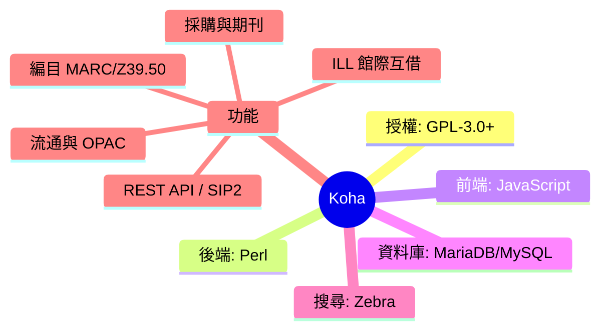
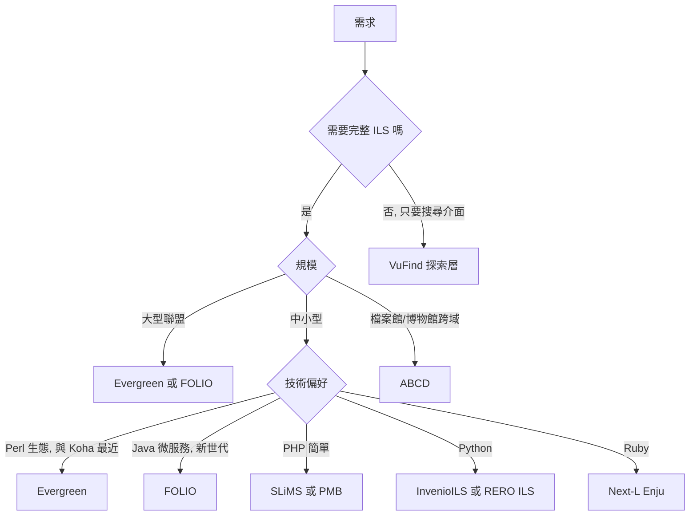

# Koha 的 FOSS 替代方案調查

## 摘要

Koha 是現今最廣泛被採用的自由暨開放原始碼 (FOSS) 整合式圖書館系統 (Integrated Library System, ILS)[^koha-wiki]。此報告調查與 Koha 功能層級相當、授權條款同屬自由軟體的其他替代方案，涵蓋完整 ILS、圖書館服務平台 (Library Services Platform, LSP) 與探索層 (discovery layer)。所有資料均來自 2026-10-24 當時公開的網路來源。

## 什麼是 Koha

Koha 是一套網頁式整合圖書館系統，協助圖書館管理館藏、讀者、流通、編目等業務，名稱源自毛利語，意指「禮物」或「捐贈」[^koha-wiki]。它由 Koha 社群共同開發，原始作者為紐西蘭的 Katipo Communications，1999 年為 Horowhenua Library Trust 打造、2000 年 1 月上線[^koha-history]。

- **授權條款**：GNU General Public License v3 或更新版本 (GPL-3.0-or-later)[^koha-license]
- **原始碼倉庫**：GitHub 鏡像 `Koha-Community/Koha` 約 595 顆星；官方主倉庫位於 `git.koha-community.org`，且不接受 GitHub pull request，貢獻須經由 `bugs.koha-community.org`[^koha-github]
- **技術堆疊**：後端 Perl、前端 JavaScript/CSS、資料庫 MariaDB/MySQL、搜尋引擎 Zebra、作業系統以 Linux 為主[^koha-github]
- **主要功能**：編目 (支援 MARC、Z39.50/SRU)、流通 (含離線流通)、OPAC、讀者管理、採購、期刊、電子資源管理、ILL 館際互借、SIP2、POS、REST API、多語系等[^koha-github]

## 替代方案總覽

下表整理與 Koha 定位相近的 FOSS 系統。星號數為 GitHub 星星數，僅供社群關注度的粗略指標。

| 系統 | 類型 | 授權條款 | GitHub 星星 | 最近狀態 | 技術堆疊 |
|---|---|---|---|---|---|
| Evergreen | 完整 ILS | GPL-2.0+ | 157 | 活躍 | Perl / C / PostgreSQL |
| FOLIO | 圖書館服務平台 (LSP) | Apache-2.0 | Okapi 約 134 | 非常活躍 | Java / JS / TS |
| SLiMS | 完整 ILS | GPL-3.0 | 250 | 非常活躍 | PHP / MySQL |
| PMB | 完整 ILS | CeCILL-2.0 | 未託管於 GitHub | 非常活躍 | PHP / MySQL |
| RERO ILS | 完整 ILS (Invenio 基礎) | AGPL-3.0 | 87 | 活躍 | Python / Angular / Elasticsearch |
| Invenio / InvenioILS | 框架 / ILS | MIT | 666 | 活躍 | Python / JS |
| Next-L Enju | 完整 ILS | MIT | 131 | 活躍 | Ruby on Rails / Solr |
| VuFind | 探索層 | GPL-2.0 | 306 | 非常活躍 | PHP / Java (Solr) |
| ABCD | 圖書館服務平台 (LSP) | LGPL-3.0 | 11 | 非常活躍 | PHP / CISIS / JS |
| OpenBiblio | 輕量 ILS | GPL-2.0+ | 13 | 上游停滯 | PHP |
| NewGenLib | 完整 ILS | GPL | 未公開於 GitHub | 由廠商維護 | Java |
| BiblioteQ | 編目／管理工具 | GPL-2.0+ | 未託管於 GitHub | 低度活動 | C++ |
| Emilda | 完整 ILS | GPL | 無 | 已停止 (2005) | PHP / MySQL / Zebra |

## 各方案細節

### Evergreen ILS

Evergreen 由美國喬治亞州公共圖書館服務處 (Georgia Public Library Service) 開發，是最成熟的 FOSS 完整 ILS 之一，以支援大型圖書館聯盟 (consortium) 聞名，PINES、NC Cardinal 等聯盟皆有採用，全球逾 1,800 間圖書館使用[^evergreen-wiki]。倉庫位於 `evergreen-library-system/Evergreen`，授權 GPL-2.0+，約 157 顆星，官方釋出檔由 `evergreen-ils.org` 下載頁提供而非 GitHub Releases[^evergreen-github]。其定位與 Koha 最為接近，同樣支援聯盟層級的大量館藏與跨館流通。

### FOLIO

FOLIO (Future of Libraries is Open) 是 2015 年起由國際社群與 EBSCO 資助、以微服務及「應用商店」架構設計的圖書館服務平台[^folio-wiki]。核心閘道 Okapi (約 134 顆星) 位於 `folio-org/okapi`，整體則分散於約 470 個倉庫，授權 Apache-2.0[^folio-github][^folio-license]。相較 Koha 的單體式 Perl 架構，FOLIO 屬於較新世代的模組化平台。

### SLiMS (Senayan Library Management System)

SLiMS 原名 Senayan，為 PHP/MySQL 打造的完整 ILS，在印尼與東南亞地區廣泛使用，支援編目、流通、會員、盤點、OPAC 等[^slims-github]。倉庫 `slims/slims9_bulian` 約 250 顆星，授權 GPL-3.0，最新版本 v9.8.0 (2026-06-24)，開發非常活躍[^slims-github]。

### PMB (PhpMyBibli)

PMB 源自法國，在法語系國家相當普及，提供流通、編目、OPAC、CMS 與採購等功能[^pmb-wiki]。專案託管於官方 Forge (`forge.sigb.net`) 而非 GitHub，授權為法國 CeCILL-2.0 (與 GPL 相容)[^pmb-wiki]。由於自架 Forge，無法取得 GitHub 星星數。

### RERO ILS

RERO ILS 由瑞士 RERO+ 與 UCLouvain 合作開發，建構於 Invenio 框架之上，採用 BiBFrame 資料模型，以聯盟模式服務瑞士的公共與學校圖書館，2021 年 6 月起進入正式運作[^rero-github]。倉庫 `rero/rero-ils` 約 87 顆星，授權 AGPL-3.0[^rero-github]。

### Invenio / InvenioILS / InvenioRDM

Invenio 是 CERN 原始開發的數位圖書館框架，授權 MIT，`inveniosoftware/invenio` 約 666 顆星，是清單中星星數最高者[^invenio-github]。目前主力產品為研究資料管理平台 InvenioRDM，另有以框架打造的現代 ILS「InvenioILS」[^invenio-github]。

### Next-L Enju

Next-L Enju 是日本志工專案 Project Next-L 以 Ruby on Rails 開發的 ILS，支援編目、流通、OPAC、期刊與 ILL，主要用於日本圖書館，倉庫 `next-l/enju_leaf` 約 131 顆星，授權 MIT[^enju-github]。

### VuFind

VuFind 並非完整 ILS，而是最受歡迎的 FOSS「探索層」，由 Villanova University 設計，可在既有 ILS 之上提供現代化搜尋介面，倉庫 `vufind-org/vufind` 約 306 顆星，授權 GPL-2.0[^vufind-github]。它常與 Koha 搭配部署，而非取代 Koha。

### ABCD

ABCD 原由 WHO 的 BIREME 以 UNESCO 的 ISIS 技術開發，於 2026-10 推出 v4.0.0，轉型為支援 MARC 21、Dublin Core、SPECTRUM (博物館)、RiC-CM (檔案館) 的圖書館服務平台[^abcd-github]。倉庫 `ABCD-DEVCOM/ABCD` 僅約 11 顆星，授權 LGPL-3.0，但版本更新非常頻繁 (v4.0.2 於 2026-10-24 發布)[^abcd-github]。星星數偏低，惟其定位為檔案／博物館／圖書館跨域整合，屬較小眾領域。

### OpenBiblio

OpenBiblio 是 2002 年由 Dave Stevens 建立的輕量 PHP/MySQL ILS，適合小型與鄉村圖書館[^openbiblio-wiki]。官方倉庫 `openbiblio/openbiblio-1.0` 約 13 顆星、GPL-2.0+，但上游自 2020 年起幾近停滯；社群另有 PHP 8.3 相容的活躍分支，如 `dtr-kalfer/burauenbiblio`[^openbiblio-github]。

### NewGenLib

NewGenLib 是印度 Verus Solutions 以 Java 開發的 ILS，約 2005 年開源，支援 MARC 編目、流通、採購、期刊與 OPAC，授權 GPL，主要由廠商維護，未公開原始碼於 GitHub[^newgenlib-wiki]。

### BiblioteQ

BiblioteQ 以 C++ 撰寫，提供圖書館管理與編目功能，託管於 SourceForge，授權 GPL-2.0+，近期活動偏低[^biblioteq-sf]。

### Emilda

Emilda 曾是 PHP/MySQL 並具 Z39.50、MARC 相容性的 ILS (採 Indexdata 的 Zebra 後端)，然而最後版本 v1.2.3 發布於 2005-06-29，官方網站亦停留在 2005 年，專案實際上已廢止[^emilda-wiki]。

## 分析與建議

- **最接近 Koha 的整體替代品**：Evergreen 與 FOLIO 為兩大主力。Evergreen 同樣成熟、支援大型聯盟，適合需要穩定與聯盟流通的公共圖書館；FOLIO 架構較新、採微服務與模組化，社群與 EBSCO 投入大量資源[^evergreen-github][^folio-github]。
- **地區性與技術偏好**：東南亞可考慮 SLiMS；法語系可考慮 PMB；偏好 Python 生態可考慮 InvenioILS 或 RERO ILS；偏好 Ruby 可考慮 Next-L Enju。
- **小型圖書館**：OpenBiblio 簡單易用但功能有限且上游停滯，若要長期使用宜評估活躍分支。
- **僅需搜尋層**：VuFind 可疊加於 Koha 等既有 ILS，並非取代品。
- **不建議採用**：Emilda 已於 2005 年停止維護；NewGenLib 與 OPALS 依賴廠商，可取得性與透明度不如純社群專案。

## 來源批判反思

本報告多數資料取自各專案的 GitHub 頁面與維基百科，其優點為可直接觀察提交活動與授權檔，但存在以下限制：其一，維基百科內容可能過時或由專案支持者編輯，故已儘量以專案倉庫與官方網站交叉印證；其二，GitHub 星星數會隨時間變動，且部分專案 (PMB、NewGenLib) 不以 GitHub 為主要開發平台，星數無法反映其真實社群規模；其三，AI 摘要取得的「最新版本日期」可能有誤差，實際釋出資訊仍應以各專案官方下載頁為準。少數專案 (如 ABCD) 星數極低但更新頻繁，反映其在特定小眾領域的實際使用情況，不宜單以星數論斷價值。

[^koha-wiki]: Wikipedia. (n.d.). Koha (software). Retrieved 2026-10-24, from https://en.wikipedia.org/wiki/Koha_(software)
[^koha-history]: Koha Community. (n.d.). History. Retrieved 2026-10-24, from https://koha-community.org/about/history/
[^koha-license]: Koha Community. (n.d.). Koha Community. Retrieved 2026-10-24, from https://koha-community.org/
[^koha-github]: Koha Community. (n.d.). Koha-Community/Koha [Source code repository]. Retrieved 2026-10-24, from https://github.com/Koha-Community/Koha
[^evergreen-wiki]: Wikipedia. (n.d.). Evergreen (software). Retrieved 2026-10-24, from https://en.wikipedia.org/wiki/Evergreen_(software)
[^evergreen-github]: Evergreen Community. (n.d.). evergreen-library-system/Evergreen [Source code repository]. Retrieved 2026-10-24, from https://github.com/evergreen-library-system/Evergreen
[^folio-wiki]: Wikipedia. (n.d.). FOLIO. Retrieved 2026-10-24, from https://en.wikipedia.org/wiki/FOLIO
[^folio-github]: FOLIO Community. (n.d.). folio-org/okapi [Source code repository]. Retrieved 2026-10-24, from https://github.com/folio-org/okapi
[^folio-license]: FOLIO. (n.d.). About FOLIO: License. Retrieved 2026-10-24, from https://docs.folio.org/docs/about-folio/license/
[^slims-github]: SLiMS. (n.d.). slims/slims9_bulian [Source code repository]. Retrieved 2026-10-24, from https://github.com/slims/slims9_bulian
[^pmb-wiki]: Wikipedia. (n.d.). PMB (software). Retrieved 2026-10-24, from https://en.wikipedia.org/wiki/PMB_(software)
[^rero-github]: RERO+. (n.d.). rero/rero-ils [Source code repository]. Retrieved 2026-10-24, from https://github.com/rero/rero-ils
[^invenio-github]: Invenio. (n.d.). inveniosoftware/invenio [Source code repository]. Retrieved 2026-10-24, from https://github.com/inveniosoftware/invenio
[^enju-github]: Project Next-L. (n.d.). next-l/enju_leaf [Source code repository]. Retrieved 2026-10-24, from https://github.com/next-l/enju_leaf
[^vufind-github]: VuFind. (n.d.). vufind-org/vufind [Source code repository]. Retrieved 2026-10-24, from https://github.com/vufind-org/vufind
[^abcd-github]: ABCD Community. (n.d.). ABCD-DEVCOM/ABCD [Source code repository]. Retrieved 2026-10-24, from https://github.com/ABCD-DEVCOM/ABCD
[^openbiblio-wiki]: Wikipedia. (n.d.). OpenBiblio. Retrieved 2026-10-24, from https://en.wikipedia.org/wiki/OpenBiblio
[^openbiblio-github]: OpenBiblio. (n.d.). openbiblio/openbiblio-1.0 [Source code repository]. Retrieved 2026-10-24, from https://github.com/openbiblio/openbiblio-1.0
[^newgenlib-wiki]: Wikipedia. (n.d.). NewGenLib. Retrieved 2026-10-24, from https://en.wikipedia.org/wiki/NewGenLib
[^biblioteq-sf]: BiblioteQ. (n.d.). BiblioteQ [Computer software]. Retrieved 2026-10-24, from https://sourceforge.net/projects/biblioteq/
[^emilda-wiki]: Emilda. (n.d.). Emilda. Retrieved 2026-10-24, from https://www.emilda.org/
