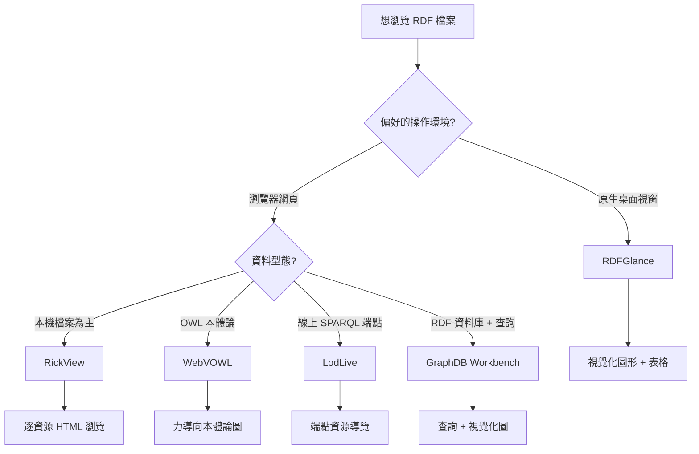
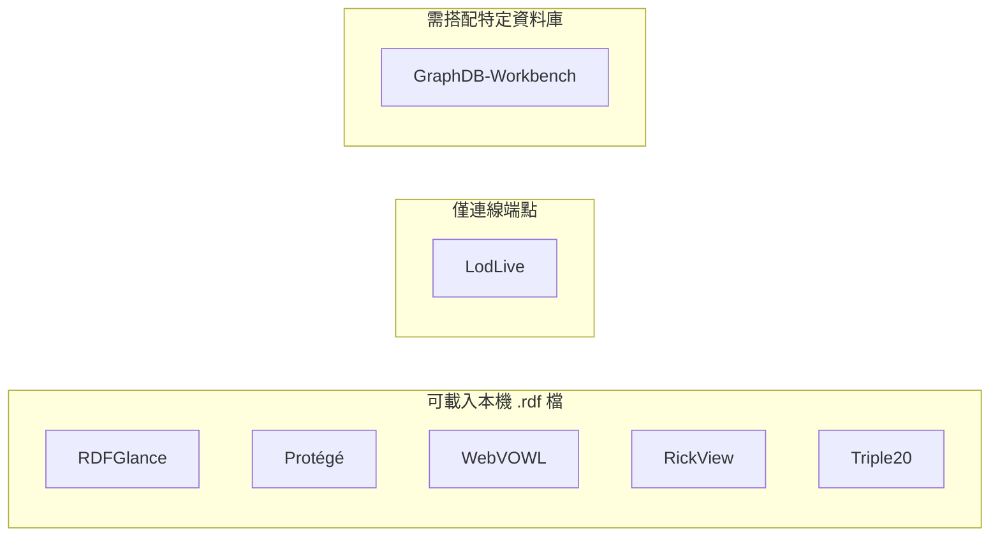

# 以人類可讀方式瀏覽 RDF 檔案的 FOSS 圖形介面工具

## 摘要

RDF（Resource Description Framework，資源描述框架）是一種以三元組（subject-predicate-object）表達資料的資料模型，常見的序列化格式包含 RDF/XML（副檔名 `.rdf`）、Turtle（`.ttl`）、N-Triples（`.nt`）、JSON-LD 等[^rdf-w3c]。由於原始序列化文字對人類閱讀極不友善，社群發展出多種**圖形使用者介面（GUI）**工具，讓使用者能以視覺化圖形、可點擊網頁或樹狀結構瀏覽 RDF 內容。本報告區分「**桌面原生 GUI**」與「**瀏覽器型（本機伺服器）GUI**」兩類，整理目前仍可取得、以自由開源軟體（FOSS, Free and Open Source Software）授權釋出的工具，並附上授權、平台、維護狀態與 GitHub 星數。[^foss-def]

## 需求界定

本報告聚焦於「**給人看的 GUI**」，因此排除純函式庫（如 rdflib、Apache Jena API、RDF4J）與命令列工具。判斷標準如下：

- 具備圖形化操作介面（原生視窗或瀏覽器網頁），可載入本機端 RDF 檔案（特別是 `.rdf` / RDF/XML）。
- 以 FOSS 授權釋出（例如 MIT、Apache-2.0、GPL、BSD）。
- 若為瀏覽器型工具，必須能在**本機**執行、而非僅能連線特定線上服務。

## 桌機原生 GUI

### RDFGlance

RDFGlance 是以 Rust 撰寫、採用 `egui` 原生繪圖框架的桌面工具，單一自帶執行檔僅約 17 MB，無須安裝額外相依套件[^rdfglance]。它可直接載入 RDF/XML（需求：`.rdf` 副檔名）、Turtle、TriG、N-Triples、N-Quads、JSON-LD，並額外支援把 JSON、XML、CSV 轉為 RDF[^rdfglance]。功能包含互動式圖形（力導向、環狀、階層、光譜等多種佈局）、依型別分組的資料表、視覺化查詢編輯器，以及中心性、PageRank、Louvain 分群等圖形統計[^rdfglance]。授權為 GPL-3.0；截至 2026-10-24 檢視約 52 顆星，最新版本為 v0.17（2025-07-17），維護活躍[^rdfglance]。使用者亦可透過其 WASM 網頁版 `xdobry.github.io/rdfglance/` 直接於瀏覽器試用，但網頁版功能較桌面版受限[^rdfglance]。

### Protégé

Protégé 是史丹佛大學開發、最廣為人知的桌面本體論（ontology）編輯器，支援 OWL 2 標準與 RDF/XML、Turtle 等格式，並可透過外掛（如 OWLViz）進行圖形視覺化[^protege]。授權為 BSD 2-Clause，跨平台（Java），截至 2026-10-24 約 1,600 顆星；穩定版為 5.6.9（2025-03-07）[^protege]。嚴格說它是「編輯器」而非單純瀏覽器，但載入 `.rdf`/`.owl` 後能以類別階層與屬性面板閱讀，是 RDF/OWL 領域的事實標準[^protege]。

### Triple20

Triple20 是 SWI-Prolog 生態系中以 XPCE 繪圖工具包實作的 RDF 瀏覽與編輯器，可載入 RDF/XML，支援拖放編輯、無限次還原與多本體論操作[^triple20]。其 GitHub 倉庫截至 2026-10-24 僅約 4 顆星，最後一次實質提交為 2023 年 5 月，屬於**活躍度極低、近乎停滯**的工具，且需先安裝 SWI-Prolog 執行環境[^triple20]。

## 瀏覽器型（本機伺服器）GUI

### RickView

RickView 是以 Rust 撰寫的輕量知識圖譜瀏覽器，不需 SPARQL 端點；啟動後會在本機開一個 HTTP 伺服器（預設埠 8080），使用者以瀏覽器連線即可瀏覽[^rickview]。它支援 Turtle、N-Triples、RDF/XML（`.rdf`）、HDT 等格式，將 RDF 資源逐一渲染為可點擊跳轉的 HTML 網頁，版面刻意仿效 LodView 的表格化呈現[^rickview]。資源佔用極低（閒置約 10 MB 記憶體），以 Docker 或預編譯執行檔即可執行[^rickview]。授權為 MIT，截至 2026-10-24 約 37 顆星，最新版本 v0.7.0（2025-06-15），維護中[^rickview]。

### WebVOWL

WebVOWL 是最知名的網頁版本體論視覺化工具，實作 VOWL（Visual Notation for OWL Ontologies）視覺標記，以 D3.js 力導向圖呈現類別、屬性與限制[^webvowl]。使用者可直接上傳或拖放 `.rdf`、`.owl`、`.ttl` 檔案，前端會把非 JSON 檔送至 OWL2VOWL 後端服務轉為 VOWL JSON 後再渲染；若自架環境缺少該後端，則僅能讀取已轉換的 `.json`[^webvowl]。官方提供 Docker 映像（同時打包前後端），授權為 MIT，截至 2026-10-24 約 1,000 顆星，最新版本 v1.1.7（2025-06-04）[^webvowl]。另有線上實例 `service.tib.eu/webvowl/` 可直接使用[^webvowl]。

### LodLive

LodLive 是純 JavaScript（jQuery）實作的 RDF 瀏覽器，以互動式節點連結圖呈現資源，並透過 SPARQL 端點即時抓取資料，是第一款僅依賴 SPARQL 端點、不需本機三元組儲存庫的導覽器[^lodlive]。它適合瀏覽線上 Linked Data 資源（可跟隨 `owl:sameAs` 連結跨端點跳轉），但**不支援載入本機 `.rdf` 檔案**[^lodlive]。授權 MIT，截至 2026-10-24 約 205 顆星，惟近年活躍度偏低[^lodlive]。

### GraphDB Workbench

GraphDB Workbench 是 Ontotext GraphDB 語意資料庫的網頁管理介面，提供本體論視覺化圖、SPARQL 查詢編輯器與視覺化查詢建構器、類別／屬性階層瀏覽[^graphdb-wb]。Workbench 前端元件以 Apache-2.0 釋出，但底層 GraphDB 引擎為專有授權（生產環境需授權），因此並非完全 FOSS 的組合[^graphdb-wb]。截至 2026-10-24 約 59 顆星[^graphdb-wb]。適合本已運行 GraphDB 者使用。

## 比較總表

下表彙整各工具的關鍵屬性。星數為 2026-10-24 之近似值。

| 工具 | 類型 | 授權 | 可讀本機 `.rdf` | 平台 | GitHub 星數 | 維護狀態 |
|---|---|---|---|---|---|---|
| RDFGlance | 桌面原生 | GPL-3.0 | 是 | Windows／Linux／macOS（Rust） | ~52 | 活躍（v0.17, 2025-07） |
| Protégé | 桌面原生 | BSD 2-Clause | 是 | 跨平台（Java） | ~1,600 | 活躍（5.6.9, 2025-03） |
| Triple20 | 桌面原生 | 未明確標示 | 是 | 跨平台（需 SWI-Prolog） | ~4 | 近乎停滯（2023-05） |
| RickView | 本機網頁伺服器 | MIT | 是 | 跨平台（Rust／Docker） | ~37 | 活躍（v0.7.0, 2025-06） |
| WebVOWL | 網頁（自架） | MIT | 是（需 OWL2VOWL 後端） | 瀏覽器／Docker | ~1,000 | 活躍（v1.1.7, 2025-06） |
| LodLive | 網頁（端點） | MIT | 否 | 瀏覽器 | ~205 | 低活躍 |
| GraphDB Workbench | 網頁（配資料庫） | Apache-2.0（前端） | 需經資料庫 | 瀏覽器／Docker | ~59 | 活躍 |

## 選擇建議

- **想要真正獨立的桌面程式、直接開啟 `.rdf` 檔**：首選 RDFGlance，單一執行檔、無相依、支援視覺化與統計[^rdfglance]。
- **想用瀏覽器、以網頁逐筆瀏覽本機 RDF 資源**：選 RickView，資源佔用極低且支援 RDF/XML[^rickview]。
- **處理 OWL 本體論的視覺化**：選 WebVOWL（需注意自架時要一併部署 OWL2VOWL 後端）[^webvowl]。
- **需要成熟的本體論編輯／瀏覽環境**：選 Protégé[^protege]。
- **瀏覽線上 Linked Data 端點**：選 LodLive[^lodlive]。

## 批判性反思

- 本領域工具普遍存在「**編輯器 vs. 瀏覽器**」與「**視覺化圖 vs. 純資料呈現**」的混淆：例如 Protégé、WebVOWL 偏向本體論視覺化，對非本體論的一般 RDF 實例資料未必方便；RickView 則偏向逐資源的純資料瀏覽[^protege][^webvowl][^rickview]。
- **低星數不代表不適用**：RDFGlance（~52 星）、RickView（~37 星）雖遠低於 Protégé 的 1,600 星，但兩者維護活躍、正好切合「桌面原生 GUI 瀏覽 `.rdf`」的需求，因此仍值得收錄；反之部分高知名度工具（如 IsaViz、SWOOP、OntoWiki）早已停止維護，不應推薦[^rdfglance][^rickview][^ontowiki]。
- **授權細節需留意**：GraphDB Workbench 前端雖為 Apache-2.0，但整體系統依賴專有引擎，嚴格來說不算完全 FOSS[^graphdb-wb]。
- **時效性**：本報告的星數與版本號皆為 2026-10-24 之檢視結果，開源專案變動快速，實際採用前應再次確認最新狀態。

## 參考文獻

[^rdf-w3c]: W3C. (2014, February 25). *RDF 1.1 Primer*. Retrieved 2026-10-24, from https://www.w3.org/TR/rdf11-primer/

[^foss-def]: Free Software Foundation. (n.d.). *What is free software?*. Retrieved 2026-10-24, from https://www.gnu.org/philosophy/free-sw.html

[^rdfglance]: xdobry. (2025). *RDFGlance: Fast RDF visualization tool*. GitHub. Retrieved 2026-10-24, from https://github.com/xdobry/rdfglance

[^protege]: Stanford Center for Biomedical Informatics Research. (2025). *Protégé*. GitHub. Retrieved 2026-10-24, from https://github.com/protegeproject/protege

[^triple20]: Wielemaker, J. (2023). *Triple20: XPCE/SWI-Prolog based RDF browser and editor*. GitHub. Retrieved 2026-10-24, from https://github.com/JanWielemaker/triple20

[^rickview]: Hoeffner, K. (2025). *RickView: Lightweight RDF knowledge graph browser*. GitHub. Retrieved 2026-10-24, from https://github.com/KonradHoeffner/rickview

[^webvowl]: VisualDataWeb. (2025). *WebVOWL: Web-based visualization of ontologies*. GitHub. Retrieved 2026-10-24, from https://github.com/VisualDataWeb/WebVOWL

[^lodlive]: LodLive. (n.d.). *LodLive: SPARQL-based RDF browser*. GitHub. Retrieved 2026-10-24, from https://github.com/LodLive/LodLive

[^graphdb-wb]: Ontotext. (n.d.). *GraphDB Workbench*. GitHub. Retrieved 2026-10-24, from https://github.com/Ontotext-AD/graphdb-workbench

[^ontowiki]: AKSW. (2016). *OntoWiki*. GitHub. Retrieved 2026-10-24, from https://github.com/AKSW/OntoWiki
